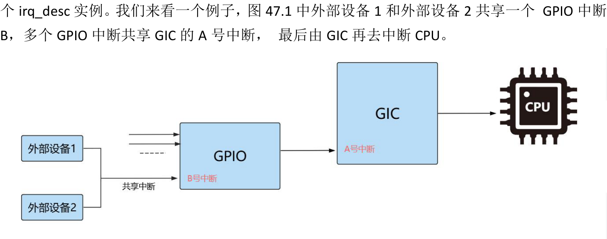
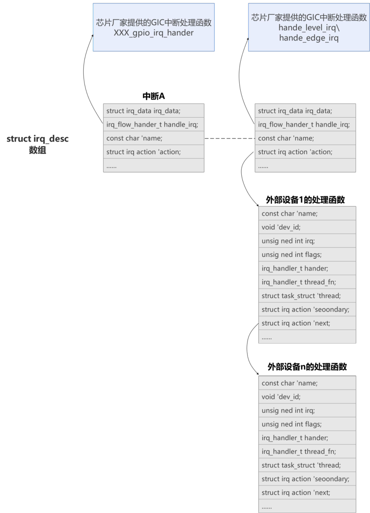

# 第047章 中断申请流程

本章分析中断申请流程。
## 47.1 中断申请流程分析
中断申请使用的是request_irq ()函数，它用于请求一个中断号（IRQ number）并将一个中断处理程序与该中断关联起来，它定义在内核源码的“/include/linux/interrupt.h”目录下，具体定义如代码清单47.1 所示：代码清单47.1
```c
request_irq(unsigned int irq, irq_handler_t handler, unsigned long flags,
        const char *name, void *dev)
{
    return request_threaded_irq(irq, handler, NULL, flags, name, dev);
}
```
从代码清单47.1 可以看出request_irq()函数实际上是调用了request_threaded_irq()函数来完成中断申请的过程。request_threaded_irq() 函数定义在内核源码kernel/irq/manage.c 文件中，具体内容如代码清单47.2 所示：代码清单47.2
```c
int request_threaded_irq(unsigned int irq, irq_handler_t handler, irq_handler_t thread_fn, unsigned long
irqflags, const char *devname, void *dev_id)
{
    struct irqaction *action;//定义一个指向irqaction 结构体的指针变量
    struct irq_desc *desc;//定义了一个指向irq_desc 结构体的指针变量
    int retval;// 返回值
    ...
    // 如果未指定中断处理函数，则使用中断线程处理。
    if (!handler) {
        if (!thread_fn)
             return -EINVAL;
        handler = irq_default_primary_handler;
    }
    ...
    if (!handler) {
        if (!thread_fn)
             return -EINVAL;
```

```c
handler = irq_default_primary_handler;
}
...
action->handler = handler;// 中断处理函数
action->thread_fn = thread_fn;// 线程处理函数
action->flags = irqflags;// 中断标志
action->name = devname;// 设备名称
action->dev_id = dev_id;// 设备ID
...
// 设置中断
retval = __setup_irq(irq, desc, action);
return retval;// 返回设置中断的结果
}
```
接下来我们分析代码清单47.2 中的代码，在第5 行代码定义了一个指向irq_desc 结构体的指针变量desc，struct irq_desc 的核心成员如代码清单47.3 所示：代码清单47.3
```c
struct irq_desc {
    struct irq_common_data irq_common_data;//通用中断数据
    struct irqaction*action;//指向该IRQ 的中断处理函数链表头
    unsigned intstatus_use_accessors;//中断状态
    irq_flow_handler_t handle_irq;
    ...
};
```
irq_desc 结构体是Linux 内核管理中断资源的核心数据结构，每个中断号（IRQ）都对应一

图47.1当发生中断时，irq_desc[A 号中断]中的handle_irq 函数会读取芯片的GPIO 控制器，irq_desc[A 号中断]中的handle_irq 函数一般由芯片厂家实现，在该函数中会区分是哪一个GPIO中断(假设是B 号中断)，然后再去调用irq_desc[B 号中断]中的handle_irq 函数，区分是哪个外设发生了中断。图47.5 是使用irq_desc 结构体描述了图47.2 中的中断关系。


图47.2代码清单47.3 中第3 行irqaction 结构体是描述单个中断处理函数的结构体，图47.5 中也出现了该结构体。该结构体定义在内核源码的“include/linux/interrupt.h”文件中，其核心成员如代码清单47.4所示。代码清单47.4
```c
struct irqaction {
    irq_handler_thandler;// 中断处理函数（顶半部）
    void*dev_id;// 设备ID
    void __percpu*percpu_dev_id;// 每个CPU 的设备ID
    struct irqaction*next;// 下一个中断动作结构体
    irq_handler_tthread_fn;// 线程处理函数
    struct task_struct*thread;// 线程结构体指针
    struct irqaction*secondary;// 次要中断动作结构体
    unsigned intirq;// 中断号
    unsigned intflags;// 中断标志
```

