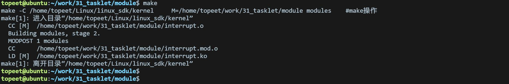
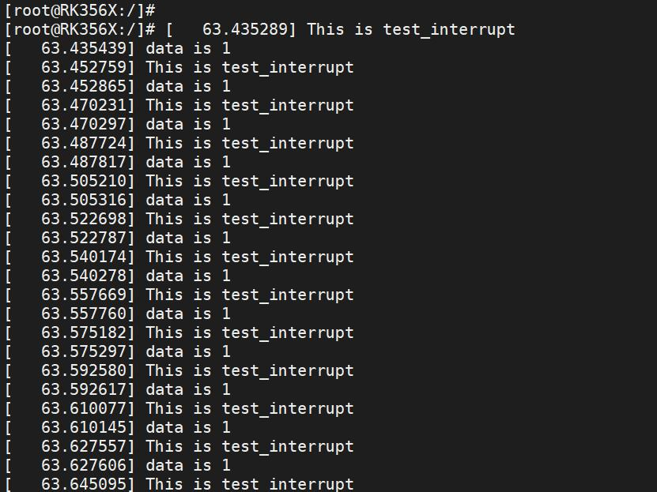
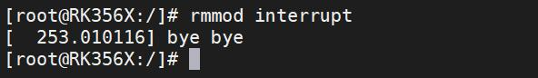
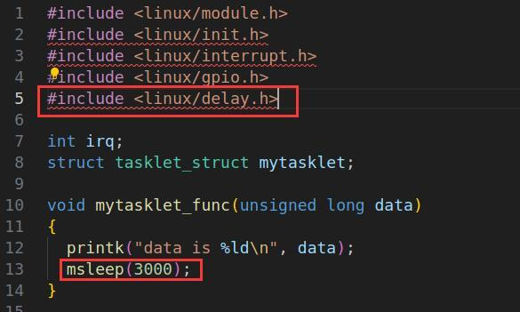
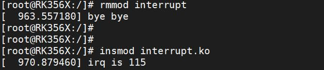

# 第048章 中断下文tasklet实验

```c
unsigned longthread_flags;// 线程标志
unsigned longthread_mask;// 线程掩码
const char*name;// 设备名称
struct proc_dir_entry*dir;// proc 文件系统目录项指针
} ____cacheline_internodealigned_in_smp;
```
当调用request_irq() 函数注册中断时，内核就会构造一个irqaction 结构体。在该结构体中保存了name、dev_id 、handler、thread_fn 和thread 等重要信息。handler 是中断处理的顶半部函数（即中断处理函数），thread_fn 对应一个内核线程thread，当handler 执行完毕，Linux 内核会唤醒对应的内核线程。在内核线程里，会调用thread_fn 函数。也就是中断线程化。如代码清单47.2 中的第4、21~25 行代码所示。申请中断实际上也是围绕该结构体展开的。我们看代码清单47.2 第9 到第22 行代码，在代码清单47.2 第9 到第22 行代码规定了中断的处理方式，处理方式如下：1.如果实现handler 而不实现thread_fn 函数，则使用request_irq 函数处理中断。2.如果不实现handler 只实现thread_fn 函数，则使用内核线程来处理中断。3.如果既实现handler 也实现thread_fn 函数，则使用中断低半部、顶半部处理中断。在代码清单47.2 中第22 行调用_setup_irq()函数申请中断。该函数也是申请中断的核心函数，核心操作是将新的irqaction（包含中断处理函数、线程函数、标志等）添加到中断描述符desc->action 链表中。图47.5 也展示了这个链表。此外该函数也会管理中断线程化，在_setup_irq()函数会调用setup_irq_thread()函数创建内核线程处理线程化中断。至此，中断申请流程分析完毕。
本章节学习中断下文的一种实现方式——tasklet。
## 48.1 什么是tasklet
在Linux 内核中，tasklet 是一种特殊的软中断机制，被广泛用于处理中断下文相关的任务。tasklet 绑定的函数在同一时间只能在一个CPU 上运行，因此不会出现并发冲突。tasklet 绑定的函数中不能调用可能导致休眠的函数，否则可能引起内核异常。在Linux 内核中，tasklet 结构体的定义位于include/linux/interrupt.h 头文件中。其原型如代码清单48.1 所示：

代码清单48.1
```c
struct tasklet_struct {
```
struct tasklet_struct *next; //指向下一个tasklet 的指针，用于形成链表结构
```c
unsigned long state;//表示tasklet 的当前状态
```
atomic_t count; //用于引用计数，用于确保tasklet 在多个地方调度或取消调度时的正确处理。void (*func)(unsigned long); //指向tasklet 绑定的函数的指针，该函数将在tasklet 执行时被调用。unsigned long data; //传递给tasklet 绑定函数的参数
```c
};
```
typedef struct tasklet_struct tasklet_t; //定义了tasklet_t 类型作为struct tasklet_struct 的别名
## 48.2 tasklet 相关接口函数
在Linux 内核中，使用DECLARE_TASKLET 宏来静态初始化tasklet，宏函数的原型如代码清单48.2 所示。代码清单48.2
```c
#define DECLARE_TASKLET(name,func,data) \
struct tasklet_struct name = { NULL,0,ATOMIC_INIT(0),func,data}
```
其中，name 是tasklet 的名称，func 是tasklet 的处理函数，即底半部，data 是传递给处理函数的参数。如果tasklet_struct 结构体中count 被赋值成0 则初始化状态为使能状态，被赋值为1 则初始化状态为非使能状态。宏DECLARE_TASKLET 默认初始化tasklet 为使能状态。初始化为非使能状态可以使用宏DECLARE_TASKLET_DISABLED(name,func,data),其参数与宏DECLARE_TASKLET 相同。在非使能状态下tasklet 不能被调度。从使能状态变为非使能状态和从非使能状态变为使能状态可以使用函数tasklet_disable()和tasklet_enable()。函数原型如代码清单48.3 所示：代码清单48.3void tasklet_disable(struct tasklet_struct *t);//函数参数*t 是指向tasklet 结构体的指针void tasklet_enable(struct tasklet_struct *t);在Linux 内核中，可以使用tasklet_init 函数对tasklet 进行动态初始化。该函数原型如代码清单48.4 所示。代码清单48.4
```c
void tasklet_init(struct tasklet_struct *t, void (*func)(unsigned long), unsigned long data);
```
其中，t 是指向tasklet 结构体的指针，func 是tasklet 的处理函数，即底半部，data 是传递给处理函数的参数。需要调度tasklet 时，可以使用tasklet_schedule()函数来调度一个已经初始化的tasklet。该函数的原型如代码清单48.5 所示。

代码清单48.5
```c
void tasklet_schedule(struct tasklet_struct *t);//函数参数*t 是指向tasklet 结构体的指针
```
代码清单48.6 是使用tasklet 实现中断处理函数的底半部。代码清单48.6
```c
int irq;
struct tasklet_struct mytasklet;
//定义tasklet 处理函数（底半部）
void mytasklet_func(unsigned long data)
{
     printk("data is %ld\n", data);//传入的参数是1，所以这里会打印data 的值是1
}
//中断处理程序（顶半部）
irqreturn_t test_interrupt(int irq, void *args)
{
     tasklet_schedule(&mytasklet); //在顶半部中调度tasklet 执行
     return IRQ_RETVAL(IRQ_HANDLED);
}
static int interrupt_irq_init(void)
{
     int ret;
     irq = gpio_to_irq(101); //将GPIO 转换为中断号
     //请求中断
     ret = request_irq(irq, test_interrupt, IRQF_TRIGGER_RISING, "test", NULL);
     //初始化tasklet，并传入参数1
     tasklet_init(&mytasklet, mytasklet_func, 1);
     return 0;
}
static void interrupt_irq_exit(void)
{
     free_irq(irq, NULL);
     tasklet_kill(&mytasklet);//销毁tasklet
}
```
在调用tasklet_kill()函数销毁tasklet 之前，应该先确保该tasklet 已经被停止（通过调用tasklet_disable()函数停止），以避免在调度过程中销毁导致内核异常。一旦销毁后，如需再次使用tasklet，必须重新进行初始化。

## 48.3 实验程序的编写
### 48.3.1 驱动程序编写
本实验代码存储在网盘iTOP-RK3568 开发板\07_学习教程配套资料\03_Linux 驱动配套资料\04_Linux 驱动例程\31_tasklet\module 路径下。本实验注册LVDS 触摸屏触摸中断，每当触摸LVDS 触摸屏时就会触发中断服务函数，在中断服务函数中调度中断下文tasklet 处理函数，打印“This id test_interrupt”和“data is1”。在驱动程序中的模块初始化函数中，将MIPI 屏幕触摸中断引脚对应的GPIO 的GPIO 编号转换为中断号，并使用request_irq 函数请求中断，然后对tasklet 进行初始化。在中断处理函数（即顶半部）中，调度tasklet 执行。在模块退出函数中，释放中断资源，并使能tasklet 销毁tasklet。实验代码interrupt.c 如代码清单48.7 所示。代码清单48.7
```c
#include <linux/module.h>
#include <linux/init.h>
#include <linux/interrupt.h>
#include <linux/gpio.h>
// #include <linux/delay.h>
int irq;
struct tasklet_struct mytasklet;
// 定义tasklet 处理函数(底半部)
void mytasklet_func(unsigned long data)
{
    printk("data is %ld\n", data); //传入的参数是1，所以这里会打印data 的值是1
    // msleep(3000);
}
// 中断处理程序（顶半部）
irqreturn_t test_interrupt(int irq, void *args)
{
     printk("This id test_interrupt\n");
     tasklet_schedule(&mytasklet); // 在顶半部中调度tasklet 执行
     return IRQ_RETVAL(IRQ_HANDLED);
}
// 模块初始化函数
static int interrupt_irq_init(void)
{
     int ret;
```

```c
irq = gpio_to_irq(101); // 将GPIO 转换为中断号
printk("irq is %d\n", irq);
// 请求中断
ret = request_irq(irq, test_interrupt, IRQF_TRIGGER_RISING, "test", NULL);
if (ret < 0)
{
   printk("request_irq is error\n");
   return -1;
}
// 初始化tasklet
tasklet_init(&mytasklet, mytasklet_func, 1);
return 0;
}
// 模块退出函数
static void interrupt_irq_exit(void)
{
free_irq(irq, NULL);
tasklet_enable(&mytasklet); // 使能tasklet（可选）
tasklet_kill(&mytasklet);// 销毁tasklet
printk("bye bye\n");
}
module_init(interrupt_irq_init); // 指定模块的初始化函数
module_exit(interrupt_irq_exit); // 指定模块的退出函数
MODULE_LICENSE("GPL");// 模块使用的许可证
MODULE_AUTHOR("topeet"); // 模块的作者
```
## 48.4 运行测试
### 48.4.1 编译驱动程序
在和interrupt.c 的同一目录下创建Makefile 文件，如图48.1 所示。

图48.1Makefile 文件内容如代码清单48.8 所示：代码清单48.8
```c
export ARCH=arm64#设置平台架构
export CROSS_COMPILE=aarch64-linux-gnu-#交叉编译器前缀
obj-m := interrupt.o
KDIR :=/home/topeet/Linux/linux_sdk/kernel#这里是你的内核目录
PWD ?= $(shell pwd)
all:
```

```c
make -C $(KDIR) M=$(PWD) modules#make 操作
clean:
make -C $(KDIR) M=$(PWD) clean#make clean 操作
```
使用命令make 编译驱动程序，编译成功后如图48.2 所示：

48.2编译完后会生成interrupt.ko 目标文件，如图48.3 所示：

图48.3至此驱动模块就编译成功了。
### 48.4.2 运行测试
将本章节编译好的interrupt.ko 驱动文件拷贝到开发板上。开发板启动之后，使用insmod interrupt.ko 命令进行驱动模块的加载，如下图48.4 所示：

图48.4通过图48.11 可以看出驱动模块加载后，申请的中断号（113）被打印了出来，然后用手触摸连接的LVDS 屏幕，触发中断服务程序，如果实现成功会打印如下图48.5 所示：


图48.5在图48.5 中，可以看到打印中断处理函数中添加的打印“This is test_interrupt”和tasklet处理函数中添加的打印“data is 1”，说明成功执行了中断下文tasklet 处理函数。实验成功后可以使用rmmod interrupt 命令进行驱动的卸载，如下图48.6 所示：

图48.6在什么是tasklet 小节中，讲解了tasklet 函数中不能调用休眠函数，在此我们在上述驱动实验的基础上添加休眠函数，如下图48.7 所示：


图48.7同理，编译驱动模块并卸载掉之前的驱动模块后，加载新编译的驱动模块，如下图48.8所示：

图48.8然后用手触摸连接的LVDS 屏幕，实验成功会打印如图48.16 所示的内核崩溃信息，由此说明在tasklet 函数中不能调用休眠函数。

