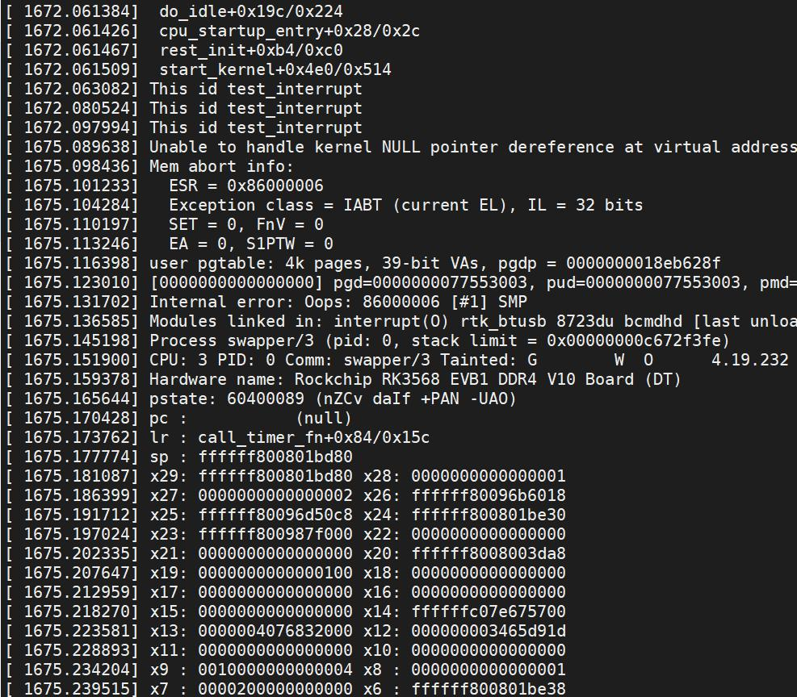
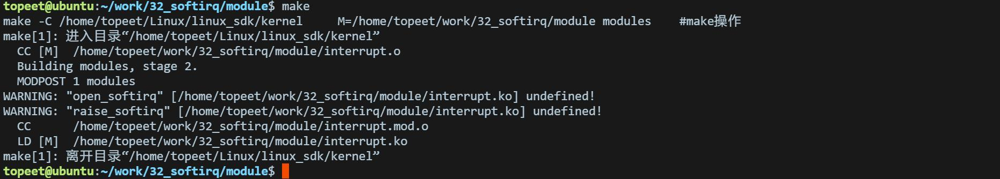
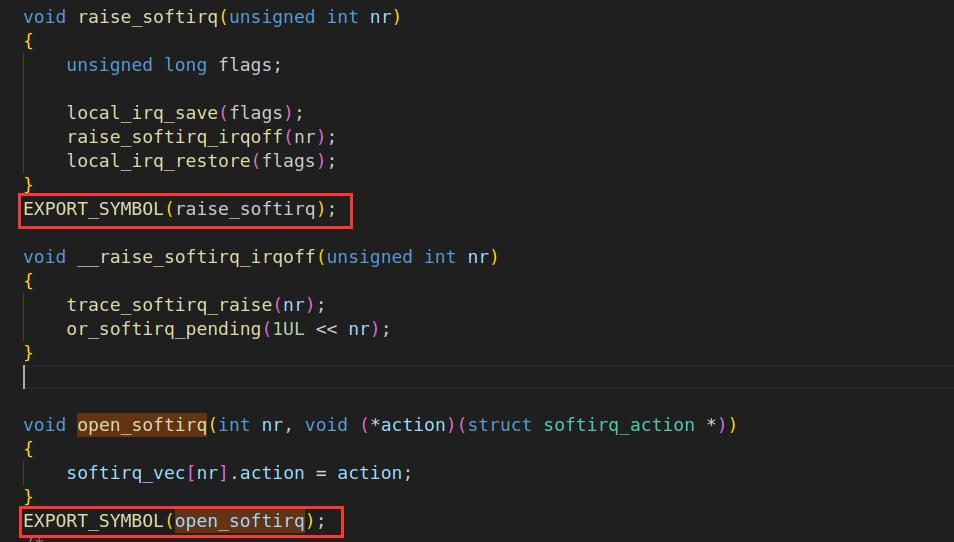
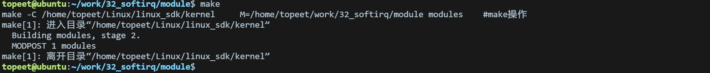
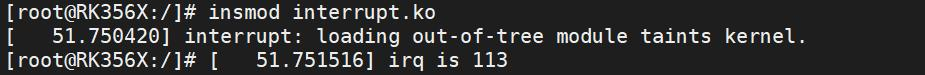

# 第049章 软中断实验


图48.9至此，中断下文tasklet 实验完毕。
本章节学习中断下文的另一种实现方式——软中断。
## 49.1 什么是软中断
软中断也可以实现中断处理函数的底半部，实际上，tasklet 也是基于软中断来实现的。在Linux 内核源码linux_sdk/kernel/include/linux/interrupt.h 中定义了软中断类型，如代码清单49.1所示。代码清单49.1
```c
enum
{
    HI_SOFTIRQ=0,//高优先级软中断
    TIMER_SOFTIRQ,//定时器软中断
    NET_TX_SOFTIRQ,//网络传输发送软中断
    NET_RX_SOFTIRQ,//网络传输接收软中断
    BLOCK_SOFTIRQ,//块设备软中断
    IRQ_POLL_SOFTIRQ,//中断轮询软中断
    TASKLET_SOFTIRQ,//任务软中断
```

```c
SCHED_SOFTIRQ,//调度软中断
HRTIMER_SOFTIRQ, /* Unused, but kept as tools rely on the numbering. Sigh! */
RCU_SOFTIRQ,/* Preferable RCU should always be the last softirq */
NR_SOFTIRQS//软中断类型的总数
};
```
软中断使用枚举类型来标识中断不同类型和优先级，软中断的序号越小，优先级越高。在驱动代码中，可以使用代码清单49.1 所述的软中断，也可以自己添加软中断。添加一个自定义的软中断，如下蓝色字体所示，TEST_SOFTIRQ 为自定义添加的软中断。enum{HI_SOFTIRQ=0,TIMER_SOFTIRQ,NET_TX_SOFTIRQ,NET_RX_SOFTIRQ,BLOCK_SOFTIRQ,IRQ_POLL_SOFTIRQ,TASKLET_SOFTIRQ,SCHED_SOFTIRQ,HRTIMER_SOFTIRQ, /* Unused, but kept as tools rely on thenumbering. Sigh! */RCU_SOFTIRQ,/* Preferable RCU should always be the last softirq */TEST_SOFTIRQ,//添加的自定义软中断NR_SOFTIRQS};尽管添加一个自定义的软中断非常简单，但是Linux 内核的开发者并不希望我们这样去做，如果要用软中断，建议使用tasklet。虽然Linux 内核开发者不建议自定义软中断，但是本章我们抱着学习的态度，添加自定义的TEST_SOFTIRQ 软中断，添加完成后重新编译内核源码并将编译好的内核镜像烧写到开发板。接下来基于TEST_SOFTIRQ 软中断学习软中断的使用方法。
## 49.2 软中断接口函数
软中断的接口函数非常简单，本节介绍最常用的几个函数。1 注册软中断，使用open_softirq()函数，函数原型如代码清单49.2 所示：代码清单49.2
```c
void open_softirq(int nr,void (*action)(struct softirq_action *));
```
该函数详细介绍如下：参数含义：

nr: 软中断序号action: 指向一个函数的指针，即底半部对应的函数。
2 触发软中断，使用raise_softirq()函数，调用时会主动关闭本地中断，函数原型如代码清单49.3 所示：代码清单49.3void raise_softirq(unsigned int nr);该函数详细介绍如下：参数含义：nr: 软中断序号3 触发软中断也可以使用raise_softirq_irqoff()函数，调用时不会主动关闭本地中断，函数原型如代码清单49.4 所示：代码清单49.4void raise_softirq_irqoff(unsigned int nr);该函数详细介绍如下：参数含义：nr: 软中断序号
在下一小节中将使用上述软中断API 进行相应的实验。
## 49.3 实验程序的编写
### 49.3.1 驱动程序编写
本实验代码存储在网盘iTOP-RK3568 开发板\07_学习教程配套资料\03_Linux 驱动配套资料\04_Linux 驱动例程\32_softirq\module 路径下。本实验实现注册LVDS 触摸屏的触摸中断，每按当触摸LVDS 触摸屏就会触发中断服务函数，在中断服务函数中触发软中断，打印“This id test_interrupt”和“This is testsoft_func”。实验代码interrupt.c 代码如代码清单49.5 所示：代码清单49.5
```c
#include <linux/module.h>
#include <linux/init.h>
#include <linux/interrupt.h>
#include <linux/gpio.h>
// #include <linux/delay.h>
int irq;
```

```c
// 软中断处理程序（底半部）
void testsoft_func(struct softirq_action *softirq_action)
{
     printk("This is testsoft_func\n");
}
// 软中断处理程序代码
irqreturn_t test_interrupt(int irq, void *args)
{
     printk("This is test_interrupt\n");
     raise_softirq(TEST_SOFTIRQ); // 触发软中断
     return IRQ_RETVAL(IRQ_HANDLED);
}
static int interrupt_irq_init(void)
{
     int ret;
     irq = gpio_to_irq(101); // 将GPIO 映射为中断号
     printk("irq is %d\n", irq);
     // 请求中断
     ret = request_irq(irq, test_interrupt, IRQF_TRIGGER_RISING, "test", NULL);
     if (ret < 0)
     {
        printk("request_irq is error\n");
        return -1;
     }
     // 注册软中断函数
     open_softirq(TEST_SOFTIRQ, testsoft_func);
     return 0;
}
static void interrupt_irq_exit(void)
{
     free_irq(irq, NULL); // 释放中断
     printk("bye bye\n");
}
module_init(interrupt_irq_init);
module_exit(interrupt_irq_exit);
MODULE_LICENSE("GPL");
MODULE_AUTHOR("topeet");
```
## 49.4 运行测试
### 49.4.1 编译驱动程序
在和interrupt.c 的同一目录下创建Makefile 文件，如图49.1 所示。


图49.1Makefile 文件内容如代码清单49.6 所示：代码清单49.6
```c
export ARCH=arm64#设置平台架构
export CROSS_COMPILE=aarch64-linux-gnu-#交叉编译器前缀
obj-m := interrupt.o
KDIR :=/home/topeet/Linux/linux_sdk/kernel#这里是你的内核目录
PWD ?= $(shell pwd)
all:
    make -C $(KDIR) M=$(PWD) modules#make 操作
clean:
    make -C $(KDIR) M=$(PWD) clean#make clean 操作
```
使用命令make 编译驱动程序，编译成功后如图49.2 所示：

49.2编译完后会生成interrupt.ko 目标文件，如图49.3 所示：

图49.3图49.1 提示open_softirq 和raise_softirq 没有被定义，出现这个错误的原因是Linux 内核开发者不希望驱动工程师擅自在枚举类型中添加软中断。我们将这俩个函数导出到符号表即可解决这个报错，修改linux_sdk/kernel/kernel/softirq.c，修改内容如图49.4 所示：


图49.4修改完成后，重新编译内核源码，编译源码通过后，再次编译驱动模块，如下图49.5 所示：

图49.5编译完生成interrupt.ko 目标文件，如下图49.6 所示：

图49.6
### 49.4.2 运行测试
将本章节编译好的interrupt.ko 驱动文件拷贝到开发板上。开发板启动之后，使用insmod interrupt.ko 命令进行驱动模块的加载，如下图49.7 所示：

图49.7驱动加载成功后，用手触摸连接的LVDS 屏幕，如果实验成功会触发中断服务程序，打印信息如下图49.8 所示：

