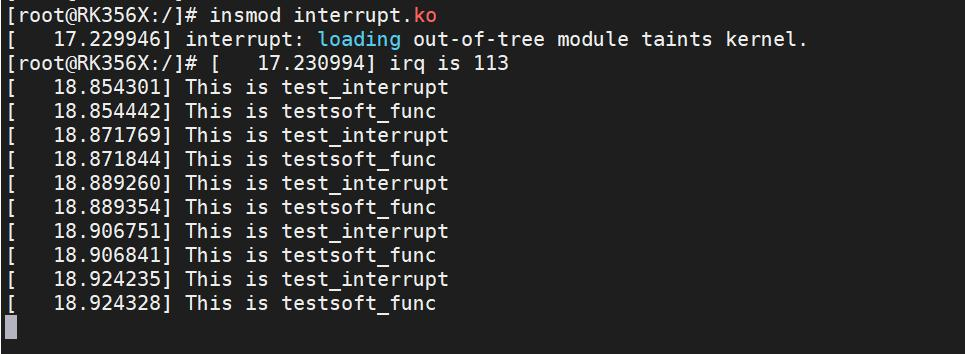
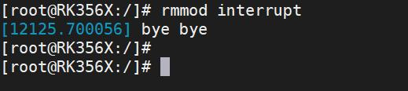

# 第050章 tasklet是特殊的软中断流程分析实验


图49.8在图49.8 中，可以看到打印中断处理函数中添加的打印“This is test_interrupt”和软中断处理函数中添加的打印“This is testsoft_func”。实验成功后使用rmmod interrupt 命令进行驱动的卸载，如下图49.9 所示：

图49.9至此，软中断实验就完成了。
tasklet 是Linux 内核中的一种软中断机制，它通过软中断实现，因此也被称为软中断。本

章节我们通过分析代码解释为什么说tasklet 是一个特殊的软中断。tasklet 是对软中断的一种封装，它简化了软中断的使用。在Linux 内核源码中，软中断处理函数的定义在kernel/kernel/softirq.c 文件中，如代码清单50.1代码清单50.1
```c
void __init softirq_init(void)
{
        int cpu;
        // 初始化每个CPU 的tasklet_vec 和tasklet_hi_vec
        // 将tail 指针设置为对应的head 指针的初始位置
        for_each_possible_cpu(cpu) {
            per_cpu(tasklet_vec, cpu).tail =
                &per_cpu(tasklet_vec, cpu).head;
            per_cpu(tasklet_hi_vec, cpu).tail =
                &per_cpu(tasklet_hi_vec, cpu).head;
    }
        // 注册TASKLET_SOFTIRQ 软中断，并指定对应的处理函数为tasklet_action
    open_softirq(TASKLET_SOFTIRQ, tasklet_action);
        // 注册HI_SOFTIRQ 软中断，并指定对应的处理函数为tasklet_hi_action
        open_softirq(HI_SOFTIRQ, tasklet_hi_action);
}
```
其中，代码第14 行在执行__init softirq_ini()t 函数时，会触发TASKLET_SOFTIRQ，然后会调用tasklet_action()处理函数，tasklet_action()函数如代码清单50.2 所示：代码清单50.2
```c
static __latent_entropy void tasklet_action(struct softirq_action *a)
{
    tasklet_action_common(a, this_cpu_ptr(&tasklet_vec), TASKLET_SOFTIRQ);
}
```
代码清单50.2 中调用了tasklet_action_common()函数，tasklet_action_common()函数如代码清单50.3 所示。代码清单50.3
```c
static void tasklet_action_common(struct softirq_action *a,struct tasklet_head *tl_head,unsigned int softirq_nr)
{
    struct tasklet_struct *list;
    // 禁用本地中断
    local_irq_disable();
    // 获取tasklet_head 中的任务链表
    list = tl_head->head;
    // 清空tasklet_head 中的任务链表
    tl_head->head = NULL;
```

```c
// 将tail 指针重新指向head 指针的位置
tl_head->tail = &tl_head->head;
// 启用本地中断
local_irq_enable();
// 遍历任务链表，处理每一个tasklet
while (list) {
    struct tasklet_struct *t = list;
    // 获取下一个tasklet，并更新链表
    list = list->next;
    if (tasklet_trylock(t)) {// 尝试获取tasklet 的锁
        if (!atomic_read(&t->count)) {// 检查count 计数器是否为0
             if (!test_and_clear_bit(TASKLET_STATE_SCHED,&t->state))
                 BUG();// 如果state 标志位不正确，则发生错误
             t->func(t->data);// 执行tasklet 的处理函数
             tasklet_unlock(t);// 解锁tasklet
             continue;
        }
        tasklet_unlock(t);// 解锁tasklet
    }
    // 禁用本地中断
    local_irq_disable();
    // 将当前tasklet 添加到tasklet_head 的尾部
    t->next = NULL;
    *tl_head->tail = t;
    // 更新tail 指针
    tl_head->tail = &t->next;
    // 触发软中断
    __raise_softirq_irqoff(softirq_nr);
    // 启用本地中断
    local_irq_enable();
}
}
```
在上述代码中，tasklet_action_common()函数对任务链表中的每个tasklet 进行处理。当需要执行tasklet 时，调用tasklet_schedule()函数将其加入到链表中，tasklet_schedule()函数如代码清单50.4 所示。代码清单50.4
```c
static inline void tasklet_schedule(struct tasklet_struct *t)
{
```

```c
if (!test_and_set_bit(TASKLET_STATE_SCHED, &t->state)) __tasklet_schedule(t);
}
```
代码清单50.4 实际调用了__tasklet_schedule()函数，函数实现如代码清单50.5 所示。代码清单50.5
```c
void __tasklet_schedule(struct tasklet_struct *t)
{
__tasklet_schedule_common(t, &tasklet_vec, TASKLET_SOFTIRQ);
 } EXPORT_SYMBOL(__tasklet_schedule);
```
由代码清单50.5 可知，tasklet 是通__tasklet_schedule_common()函数加入到链表中的。__tasklet_schedule_common()函数如代码清单50.6 所示。代码清单50.6
```c
static void __tasklet_schedule_common(struct tasklet_struct *t,struct tasklet_head __percpu *headp,
unsigned int softirq_nr)
{
    struct tasklet_head *head;
    unsigned long flags;
    // 保存当前中断状态，并禁用本地中断
    local_irq_save(flags);
    // 获取当前CPU 的tasklet_head 指针
    head = this_cpu_ptr(headp);
    // 将当前tasklet 添加到tasklet_head 的尾部
    t->next = NULL;
    *head->tail = t;
    // 更新tasklet_head 的尾指针
    head->tail = &(t->next);
    // 触发指定的软中断
    raise_softirq_irqoff(softirq_nr);
    // 恢复中断状态
    local_irq_restore(flags);
    }
```
代码清单50.6 中，__tasklet_schedule_common()函数将tasklet 添加到当前CPU 的tasklet链表的末尾，并触发对应软中断。当软中断被处理时（如tasklet_action 执行），系统会遍历链表中的每个tasklet，但是只有在满足代码清单50.3 第20-29 行的条件时才会执行其处理函数。经过上述代码分析，可知tasklet 是一个特殊的软中断。内核开发者不希望用户去添加软中断的软中断号，更希望用户使用tasklet。使用Tasklet与自定义软中断各有优劣：Tasklet 的优势在于接口简单、编程门槛低，运行于软中断上下文故延迟小，且内核会自动合并调度多个待执行的Tasklet 以提升效率；但它仅适合短时间任务（长时间运行会阻塞其他任务），灵活性较低（受限于软中断上下文），且数量受内核配置限制。

