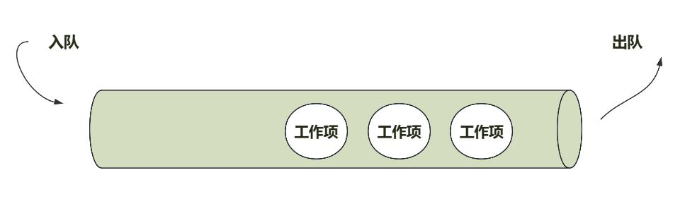
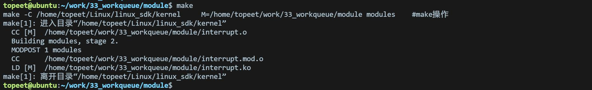
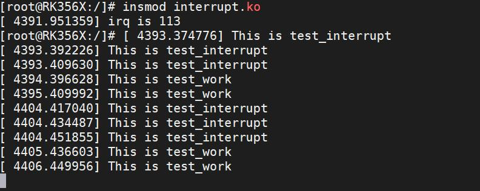
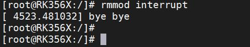

# 第051章 共享工作队列实验

而自定义软中断虽需手动处理更多细节，但在任务类型适配性和执行灵活性上更具优势，适合需要特殊调度或复杂处理的场景。
本章节学习中断下文的另一种实现方式——工作队列。
## 51.1 什么是工作队列
工作队列也是实现中断处理函数底半部的机制，在工作队列中是可以休眠的。一个工作队列就好像常用的消息队列一样，里面存着很多工作项等待着被处理，如下图51.1 所示。

图51.1在内核中，工作队列包括共享工作队列和自定义工作队列这俩种类型。这两种类型的工作队列具有不同的特点和用途。共享队列是由内核管理的全局工作队列，用于处理内核中一些系统级任务。共享工作队列是内核中一个默认工作队列，可以由多个驱动程序共享使用。2 自定义工作队列是由内核或驱动程序创建的特定工作队列，用于处理特定的任务。自定义工作队列通常与特定的内核模块或驱动程序相关联，用于执行该模块或驱动程序相关的任务。本章节我们先来学习共享工作队列相关的知识。在驱动开发中，使用工作队列需要先定义工作项，工作项在Linux 中使用work_struct 结构体表示，该结构体定义在include/linux/workqueue.h 文件中，如代码清单51.1 所示。代码清单51.1
```c
struct work_struct {
     atomic_long_t data;
     struct list_head entry;
     work_func_t func; /* 工作队列处理函数*/
};
typedef void (*work_func_t)(struct work_struct *work);//工作函数
```

## 51.2 工作队列相关接口函数
### 51.2.1 初始化函数
在实际的驱动开发中，我们只需要直接定义一个work_struct 结构体变量即可，然后使用INIT_WORK 宏来初始化工作，INIT_WORK 宏定义代码清单51.2 所示。代码清单51.2#define INIT_WORK(_work,_func)INIT_WORK 宏接受两个参数：_work 和_func，这俩个参数分别表示要初始化的工作项和工作项的处理函数。也可以使用DECLARE_WORK 宏一次性完成工作的创建和初始化，宏定义如代码清单51.3所示。代码清单51.3#define DECLARE_WORK(n, f)参数n 表示定义的工作(work_struct)，f 表示工作对应的处理函数。
### 51.2.2 调度/取消调度工作队列函数
和tasklet 一样，工作也是需要调度才可以运行，工作的调度函数为schedule_work()，此函数会将工作项提交到工作队列中，并请求调度器在合适的时机执行工作项。函数原型如代码清单51.4 所示。代码清单51.4static inline bool schedule_work(struct work_struct *work)//参数是指向工作项的指针。
如果想要取消该工作项的调度，使用cancel_work_sync()函数，函数原型如代码清单51.5所示。代码清单51.5bool cancel_work_sync(struct work_struct *work);
## 51.3 实验程序的编写
### 51.3.1 驱动程序编写
本实验代码存储在网盘iTOP-RK3568 开发板\07_学习教程配套资料\03_Linux 驱动配套资料\04_Linux 驱动例程\33_workqueue\module 路径下。

本实验实现注册LVDS触摸屏的触摸中断，每按触摸LVDS触摸屏就会触发中断服务函数，在中断服务函数中提交工作项到共享工作队列中，在工作项中打印“This id test_interrupt”和“This is test_work”。在驱动程序中的模块初始化函数中，我们将GPIO 转换为中断号，并使用request_irq 函数请求中断，然后初始化工作项。当中断被触发时，中断处理函数被调用，并将工作项提交到共享工作队列中，最终由工作项处理函数异步执行。实验代码interrupt.c 代码如代码清单51.6 所示。代码清单51.6
```c
#include <linux/module.h>
#include <linux/init.h>
#include <linux/interrupt.h>
#include <linux/gpio.h>
#include <linux/delay.h>
#include <linux/workqueue.h>
int irq;
struct work_struct test_workqueue;
// 工作项处理函数
void test_work(struct work_struct *work)
{
      msleep(1000);
      printk("This is test_work\n");
}
// 中断处理函数
irqreturn_t test_interrupt(int irq, void *args)
{
      printk("This is test_interrupt\n");
      // 提交工作项到工作队列
      schedule_work(&test_workqueue);
      return IRQ_RETVAL(IRQ_HANDLED);
}
static int interrupt_irq_init(void)
{
      int ret;
      irq = gpio_to_irq(101); // 将GPIO 映射为中断号
      printk("irq is %d\n", irq);
      // 请求中断
      ret = request_irq(irq, test_interrupt, IRQF_TRIGGER_RISING, "test", NULL);
      if (ret < 0)
      {
        printk("request_irq is error\n");
        return -1;
```

```c
}
// 初始化工作项
INIT_WORK(&test_workqueue, test_work);
return 0;
}
static void interrupt_irq_exit(void)
{
free_irq(irq, NULL); // 释放中断
printk("bye bye\n");
}
module_init(interrupt_irq_init);
module_exit(interrupt_irq_exit);
MODULE_LICENSE("GPL");
MODULE_AUTHOR("topeet");
```
## 51.4 运行测试
### 51.4.1 编译驱动程序
在和interrupt.c 的同一目录下创建Makefile 文件，如图51.2 所示。

图51.2Makefile 文件内容如代码清单51.7 所示：代码清单51.7
```c
export ARCH=arm64#设置平台架构
export CROSS_COMPILE=aarch64-linux-gnu-#交叉编译器前缀
obj-m := interrupt.o
KDIR :=/home/topeet/Linux/linux_sdk/kernel#这里是你的内核目录
PWD ?= $(shell pwd)
all:
    make -C $(KDIR) M=$(PWD) modules#make 操作
clean:
    make -C $(KDIR) M=$(PWD) clean#make clean 操作
```
使用命令make 编译驱动程序，编译成功后如图51.3 所示：


51.3编译完后会生成interrupt.ko 目标文件，如图51.4 所示：

图5.4
### 51.4.2 运行测试
将本章节编译好的interrupt.ko 驱动文件拷贝到开发板上。开发板启动之后，使用inmod interrupt.ko 命令进行驱动模块的加载，如下图51.5 所示：

图51.5然后用手触摸连接的LVDS 屏幕，如果实验成功会打印如下图51.6 所示的打印信息：

图51.6在图51.6 中，可以看到中断处理函数中添加的打印信息“This is test_interrupt”被多次打印，说明触发了好几次中断上文，中断上文会多次调度中断下文，所以也会打印工作项处理函数中添加的打印“This is test_work”。但是为什么只会打印俩次“This is test_work”呢？这是因为在中断上文调度工作项处理函数之后，内核没有来得及去执行工作项处理函数，没有执行相当于无效操作，有效的执行操作打印了俩次“This is test_work”。实验成功后可以使用rmmod interrupt 命令进行驱动的卸载，如下图51.7 所示：

图51.7至此，共享工作队列实验就完成了。

