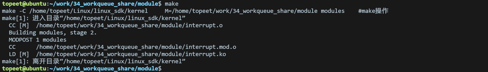
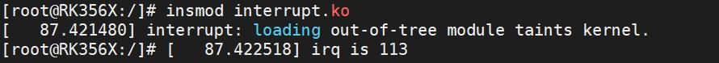

# 第052章 自定义工作队列实验

自定义工作队列故名思意需要自己创建工作队列，然后把工作项放在自己创建的工作队列上。而共享工作队列是所有人共用一个工作队列。如果用通俗的话解释共享工作队列就是工厂的通用流水线，而自定义工作队列就是工厂的定制流水线。本章学习自定义工作队列。
## 52.1 工作队列相关结构体
在Linux 内核中，struct work_struct 结构体描述的是要执行的工作项，该结构体定义在include/linux/workqueue.h 文件中，如代码清单52.1 所示。代码清单52.1
```c
struct work_struct {
    atomic_long_t data;// 工作项的数据字段
    struct list_head entry;// 工作项在工作队列中的链表节点
    work_func_t func;// 工作项的处理函数
    #ifdef CONFIG_LOCKDEP
        struct lockdep_map lockdep_map;// 锁依赖性映射
    #endif
};
```
内核使用struct workqueue_struct 结构体描述一个工作队列，定义在include/linux/workqueue.h 中，如代码清单52.2 所示：代码清单52.2
```c
struct workqueue_struct {
    struct list_head pwqs;// 工作队列上的挂起工作项列表
    struct list_head delayed_works;// 延迟执行的工作项列表
    struct delayed_work_timer dwork_timer;// 延迟工作项的定时器
    struct workqueue_attrs *unbound_attrs;// 无绑定工作队列的属性
    struct pool_workqueue *dfl_pwq;// 默认的池化工作队列
    ...
};
```
## 52.2 工作队列相关接口函数
create_workqueue()函数用于创建一个工作队列，函数原型如代码清单52.3 所示：代码清单52.3struct workqueue_struct *create_workqueue(const char *name);该函数详细介绍如下：

函数作用：使用这个函数可以给每个CPU 都创建一个CPU 相关的工作队列。函数参数：参数name 是创建的工作队列的名字。返回值：创建成功返回一个struct workqueue_struct 类型指针，创建失败返回NULL。如果只给一个CPU 创建一个CPU 相关的工作队列，使用代码清单52.4 所示的函数。代码清单52.4#define create_singlethread_workqueue(name) \ alloc_workqueue("%s",WQ_SINGLE_THREAD, 1, name)该函数详细介绍如下：函数作用：使用这个函数只会给一个CPU 创建一个CPU 相关的工作队列。函数参数：参数name 是创建的工作队列的名字。返回值：创建成功之后返回一个struct workqueue_struct 类型指针，创建失败返回NULL。当工作队列创建好之后，需要将要执行的工作项放在工作队列上，并调度工作队列，可以使用queue_work_on()函数，函数原型如代码清单52.5 所示：代码清单52.5bool queue_work_on(int cpu, struct workqueue_struct *wq, struct work_struct *work);该函数详细介绍如下：函数作用：queue_work_on()函数还有其他变种，比如queue_work()函数，其思路是一致的，都是用于将定义好的工作项立即添加到工作队列中，并在工作队列可用时立即执行。函数参数：第一个参数是一个整数cpu。第二个参数是一个指向struct workqueue_struct 的指针wq。第三个参数是一个指向struct work_struct 的指针work。返回值：该函数的返回类型是布尔值，表示是否成功调度工作队列。如果要取消一个已经调度的工作，使用函数bool cancel_work_sync()，函数原型如代码清单52.6 所示：代码清单52.6bool cancel_work_sync(struct work_struct *work);使用flush_workqueue()函数可以刷新工作队列中所有已提交但未执行的工作项。函数原型如代码清单52.7 所示：代码清单52.7void flush_workqueue(struct workqueue_struct *wq);该函数详细介绍如下：函数作用：刷新工作队列，告诉内核尽快处理工作队列上的工作。函数参数：一个指向struct workqueue_struct 类型的指针wq。

如果要删除自定义的工作队列，使用destroy_workqueue()函数，函数原型如代码清单52.8所示：代码清单52.8void destroy_workqueue(struct workqueue_struct *wq);
## 52.3 实验程序的编写
### 52.3.1 驱动程序编写
本实验代码存储在网盘iTOP-RK3568 开发板\07_学习教程配套资料\03_Linux 驱动配套资料\04_Linux 驱动例程\34_workqueue_share\module 路径下。本实验实现注册LVDS 触摸屏的触摸中断，每触摸LVDS 触摸屏就会触发中断服务函数，在中断服务函数中提交工作项到工作队列中，打印“This id test_interrupt”和“This istest_work”。在驱动程序中的模块初始化函数中，创建自定义工作队列，并初始化工作项。当中断被触发时，在中断处理函数（即顶半部）将工作项提交到自定义工作队列中。实验代码interrupt.c代码如代码清单52.9 所示。代码清单52.9
```c
#include <linux/module.h>
#include <linux/init.h>
#include <linux/interrupt.h>
#include <linux/gpio.h>
#include <linux/delay.h>
#include <linux/workqueue.h>
int irq;
struct workqueue_struct *test_workqueue;
struct work_struct test_workqueue_work;
// 工作项处理函数
void test_work(struct work_struct *work)
{
      msleep(1000);
      printk("This is test_work\n");
}
// 中断处理函数
irqreturn_t test_interrupt(int irq, void *args)
{
    printk("This is test_interrupt\n");
    // 提交工作项到自定义工作队列
```

```c
queue_work(test_workqueue, &test_workqueue_work);
return IRQ_RETVAL(IRQ_HANDLED);
}
static int interrupt_irq_init(void)
{
 int ret;
 irq = gpio_to_irq(101); // 将GPIO 映射为中断号
 printk("irq is %d\n", irq);
 // 请求中断
 ret = request_irq(irq, test_interrupt, IRQF_TRIGGER_RISING, "test", NULL);
 if (ret < 0)
 {
    printk("request_irq is error\n");
    return -1;
 }
 test_workqueue = create_workqueue("test_workqueue");// 创建工作队列
INIT_WORK(&test_workqueue_work, test_work);// 初始化工作项
  return 0;
}
static void interrupt_irq_exit(void)
{
 free_irq(irq, NULL);// 释放中断
 cancel_work_sync(&test_workqueue_work); // 取消工作项
 flush_workqueue(test_workqueue);// 刷新工作队列
 destroy_workqueue(test_workqueue);// 销毁工作队列
 printk("bye bye\n");
}
module_init(interrupt_irq_init);
module_exit(interrupt_irq_exit);
MODULE_LICENSE("GPL");
MODULE_AUTHOR("topeet");
```
## 52.4 运行测试
### 52.4.1 编译驱动程序
在和interrupt.c 的同一目录下创建Makefile 文件，如图52.1 所示。


图52.1Makefile 文件内容如代码清单52.10 所示：代码清单52.10
```c
export ARCH=arm64#设置平台架构
export CROSS_COMPILE=aarch64-linux-gnu-#交叉编译器前缀
obj-m := interrupt.o
KDIR :=/home/topeet/Linux/linux_sdk/kernel#这里是你的内核目录
PWD ?= $(shell pwd)
all:
    make -C $(KDIR) M=$(PWD) modules#make 操作
clean:
    make -C $(KDIR) M=$(PWD) clean#make clean 操作
```
使用命令make 编译驱动程序，编译成功后如图52.2 所示：

图52.2编译完后会生成interrupt.ko 目标文件，如图52.3 所示：

图52.3
### 52.4.2 运行测试
将本章节编译好的interrupt.ko 驱动文件拷贝到开发板上。开发板启动之后，使用insmod interrupt.ko 命令进行驱动模块的加载，如下图52.4 所示：

图52.4然后用手触摸连接的LVDS 屏幕，如果实现成功会打印如图52.5 所示内容。

