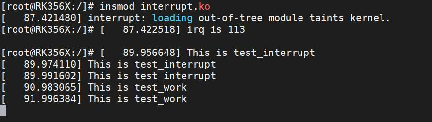
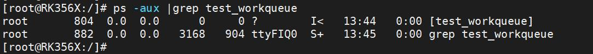
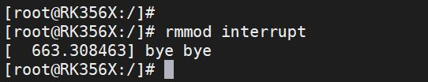
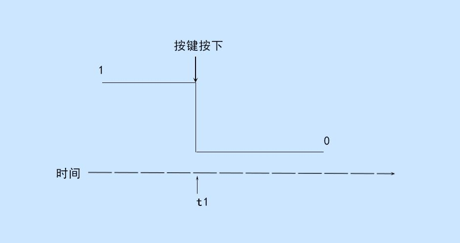
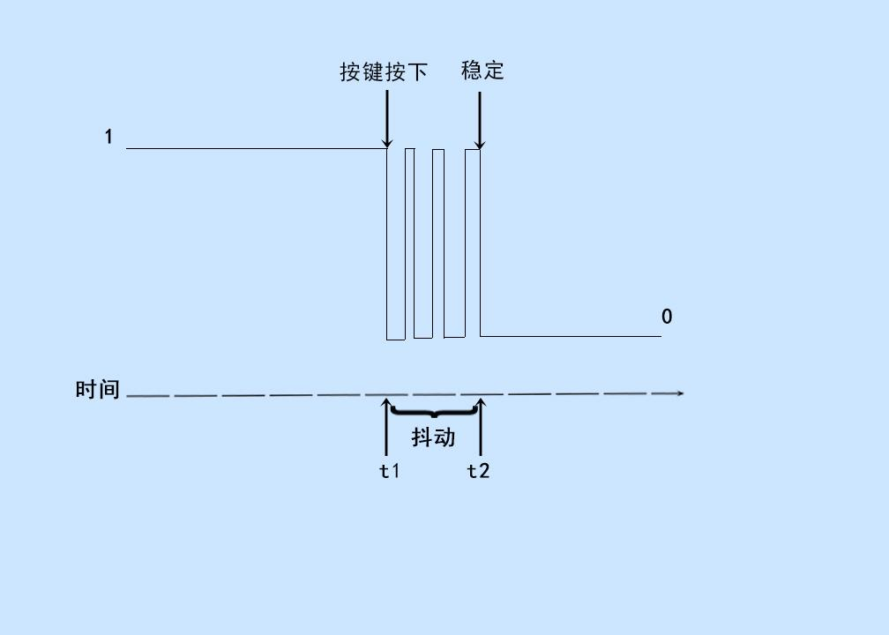
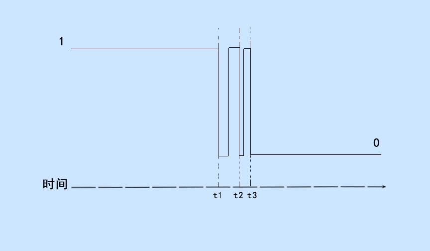
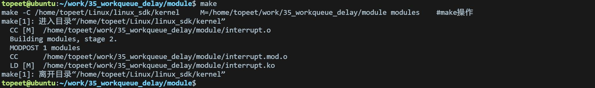
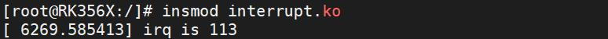

# 第053章 延迟工作实验


图52.5在52.5 中，可以看到打印中断处理函数中添加的打印“This is test_interrupt”.该打印被打印了俩次，说明触发了2 次中断上文，那么中断上文会调度2 次中断下文，所以也会打印2次工作项处理函数中添加的打印“This is test_work”。在按屏幕之后，立即输入ps -aux|grep test_workqueue 命令可以查看自己创建的工作队列，如图52.6 所示：

图52.6实验成功后可以使用rmmod interrupt 命令卸载驱动，如下图52.7 所示：

图52.7至此，自定义工作队列实验就完成了。
为了更形象地理解什么是延迟工作，可以将流水线比作工作队列，流水线上一个个等待处理的物料比作一个个工作。机器比作内核线程或进程。本章节学习的延迟工作，可以类比为将物料延迟一定时间，再放到流水线上加工。所以延迟工作不仅可以在自定义工作队列中实现也可以在共享工作队列上实现。
## 53.1 什么是延迟工作
延迟工作是指将工作执行延迟到稍后时间点进行处理。当某个任务需要花费较长时间，不

需要立即执行或需要按时执行时，延迟工作就会派上用场。为了方便大家理解，我们举个形象点的例子，比如，现在想通过驱动程序读取开发板上的按键的状态，那么只需要读取按键所连接的GPIO 的状态就可以了。理想型的按键电压变化过程如图53.1 所示：

图53.1在图53.1 中，按键没有按下的时候按键值为1，当按键在t1 时刻被按下以后按键值就变为0，这是最理想的状态。但是按键是机械结构的，所以按下去的一瞬间会有抖动，实际的按键电压变化过程如下图53.2 所示：

图53.2
在图53.2 中，t1 时刻按键被按下，但是由于抖动的原因，直到t2 时刻才稳定下来，t1 到t2 这段时间就是抖动。一般这段时间就是十几ms 左右，从图53.2 中可以看出在抖动期间会有

多次触发，所以就容易造成误判，本来按键就按下了一次，结果软件读取IO 值发现电平多次跳变以为按下了多次。所以我们需要跳过这段抖动时间再去读取按键的IO 值，也就是至少要在t2 时刻以后再去读IO 值。在讲解定时器时，我们使用定时器来实现消抖。按键采用中断驱动方式，当按键按下以后触发按键中断，在按键中断中开启一个定时器，定时周期为10ms，当定时时间到了以后就会触发定时器中断，最后在定时器中断处理函数中读取按键的值，如果按键值还是按下状态那就表示这是一次有效的按键。定时器按键消抖如下图53.3 所示：

图53.3在图53.3 中t1~t3 这一段时间就是按键抖动，是需要消除的。设置按键中断为下降沿触发，因此会在t1、t2 和t3 这三个时刻会触发按键中断，每次进入中断处理函数都会重新开启定时器中断，所以会在t1、t2 和t3 这三个时刻开启定时器中断。但是t1~t2 和t2~t3 这两个时间段是小于我们设置的定时器中断周期(也就是消抖时间，比如10ms)，所以虽然t1 开启了定时器，但是定时器定时时间还没到呢t2 时刻就重置了定时器，最终只有t3 时刻开启的定时器能完整的完成整个定时周期并触发中断，我们就可以在中断处理函数里面做按键处理了，这就是定时器实现按键防抖的原理。除了使用定时器方式进行消抖，也可以使用本章节讲述的延迟工作。将工作延迟3 秒之后，再去读GPIO 电平状态。在Linux 内核中，使用struct delayed_work 结构体来描述延迟工作，定义在include/linux/workqueue.h 当中，如代码清单53.1 所示：代码清单53.1
```c
struct delayed_work{
    struct work_struct work;// 延迟工作的基本工作结构
    struct timer_list timer;// 定时器，用于延迟执行工作
};
```
通过代码清单53.1 可以看出struct delayed_work 结构体将需要执行的工作封装成一个延迟

工作，并使用定时器来控制工作的延迟执行。通过设置定时器的延迟时间，可以指定工作在一定时间后执行。
## 53.2 延迟工作相关接口函数
### 53.2.1 初始化延迟工作函数
静态定义并初始化延迟工作使用宏DECLARE_DELAYED_WORK，函数原型如代码清单53.2所示：代码清单53.2
```c
#define DECLARE_DELAYED_WORK(n,f) struct delayed_work n = { .work = __WORK_INITIALIZER(n.work, (f)) }
```
n 代表延迟工作的变量名，f 是延迟工作的处理函数。动态定义并初始化延迟工作使用宏INIT_DELAYED_WORK，函数原型如代码清单53.3 所示：代码清单53.3
```c
#define INIT_DELAYED_WORK(_work, _func) \
       do { \
           INIT_WORK(&(_work)->work, (_func)); \
           (_work)->timer = TIMER_INITIALIZER((_work)->timer, 0, 0); \
} while (0)
```
n 代表延迟工作的变量名，f 是延迟工作的处理函数。
### 53.2.2 调度/取消调度延迟工作函数
如果是在共享工作队列上调度延迟工作，使用schedule_delayed_work()函数，函数原型如代码清单53.4 所示。代码清单53.4
```c
static inline bool schedule_delayed_work(struct delayed_work *dwork,unsigned long delay )
```
函数详细介绍如下：函数作用：用于在给定的延迟时间后调度延迟工作执行。函数参数：函数参数dwork:是指向延迟工作的指针，即要被调度的延迟工作。delay:表示延迟的时间长度，以内核时钟节拍数jiffies 为单位。如果是在自定义工作队列上调度延迟工作，使用queue_delayed_work()函数，函数原型如代码清单53.5 所示。代码清单53.5
```c
static inline bool queue_delayed_work(struct workqueue_struct *wq, struct delayed_work *dwork, unsigned
long delay)
```
函数详细介绍如下：函数作用：用于将延迟工作加入工作队列后在指定的延迟时间后执行。函数参数：函数参数wq 是指向工作队列结构的指针，即要将延迟工作加入的目标工作队列。

dwork:指向延迟工作的指针，也就是要被加入工作队列的延迟工作。delay: 表示延迟的时间长度，以内核时钟节拍数jiffies 为单位。如果要取消调度函数，使用cancel_delayed_work_sync()函数，函数原型如代码清单53.6所示：代码清单53.6
```c
extern bool cancel_delayed_work_sync(struct delayed_work *dwork);
```
函数详细介绍如下：函数作用：该函数是一个外部声明的函数，用于取消延迟工作并等待其完成。函数参数：dwork 参数是指向延迟工作的指针，也就是要被取消的延迟工作。返回值：函数如果返回true，说明成功取消延迟工作并等待其完成。函数如果返回false，说明无法取消延迟工作或等待其完成。
## 53.3 实验程序的编写
### 3.3.1 驱动程序编写
本实验代码存储在网盘iTOP-RK3568 开发板\07_学习教程配套资料\03_Linux 驱动配套资料\04_Linux 驱动例程\35_workqueue_delay\module 路径下。本实验实现注册LVDS 屏幕的触摸中断，每触摸LVDS 触摸屏就会触发中断服务函数，在中断服务函数中提交延迟工作项到自定义工作队列中，并打印“This id test_interrupt”，在延迟工作中打印“This is test_work”。在驱动程序中的模块初始化函数中，创建自定义工作队列，初始化延迟工作项。当中断被触发时，在中断处理函数（即中断顶半部）中将延迟工作项提交到自定义工作队列中。实验代码interrupt.c 如代码清单53.7 所示。代码清单53.7
```c
#include <linux/module.h>
#include <linux/init.h>
#include <linux/interrupt.h>
#include <linux/gpio.h>
#include <linux/delay.h>
#include <linux/workqueue.h>
int irq;
struct workqueue_struct *test_workqueue;
struct delayed_work test_workqueue_work;
// 工作项处理函数
void test_work(struct work_struct *work)
{
```

```c
msleep(1000);
printk("This is test_work\n");
}
// 中断处理函数
irqreturn_t test_interrupt(int irq, void *args)
{
printk("This is test_interrupt\n");
// 提交延迟工作项到自定义工作队列
queue_delayed_work(test_workqueue, &test_workqueue_work, 3 * HZ);
return IRQ_RETVAL(IRQ_HANDLED);
}
static int interrupt_irq_init(void)
{
int ret;
irq = gpio_to_irq(101); // 将GPIO 映射为中断号
printk("irq is %d\n", irq);
// 请求中断
ret = request_irq(irq, test_interrupt, IRQF_TRIGGER_RISING, "test", NULL);
if (ret < 0)
{
    printk("request_irq is error\n");
    return -1;
}
// 创建工作队列
 test_workqueue = create_workqueue("test_workqueue");
 // 初始化延迟工作项
 INIT_DELAYED_WORK(&test_workqueue_work, test_work);
  return 0;
}
static void interrupt_irq_exit(void)
{
free_irq(irq, NULL);// 释放中断
cancel_delayed_work_sync(&test_workqueue_work); // 取消延迟工作项
flush_workqueue(test_workqueue);// 刷新工作队列
destroy_workqueue(test_workqueue);// 销毁工作队列
printk("bye bye\n");
}
module_init(interrupt_irq_init);
module_exit(interrupt_irq_exit);
MODULE_LICENSE("GPL");
MODULE_AUTHOR("topeet");
```

## 53.4 运行测试
### 53.4.1 编译驱动程序
在和interrupt.c 的同一目录下创建Makefile 文件，如图53.4 所示。

图53.4Makefile 文件内容如代码清单53.8 所示：代码清单53.8
```c
export ARCH=arm64#设置平台架构
export CROSS_COMPILE=aarch64-linux-gnu-#交叉编译器前缀
obj-m := interrupt.o
KDIR :=/home/topeet/Linux/linux_sdk/kernel#这里是你的内核目录
PWD ?= $(shell pwd)
all:
    make -C $(KDIR) M=$(PWD) modules#make 操作
clean:
    make -C $(KDIR) M=$(PWD) clean#make clean 操作
```
使用命令make 编译驱动程序，编译成功后如图53.5 所示：

图53.5编译完后会生成interrupt.ko 目标文件，如图53.6 所示：

图53.6
### 53.4.2 运行测试
将本章节编译好的interrupt.ko 驱动文件拷贝到开发板上。开发板启动之后，使用insmod interrupt.ko 命令进行驱动模块的加载，如下图53.7 所示：

图53.7然后用手触摸连接的LVDS 屏幕，如果实验成功会打印如下图53.8 所示信息。

