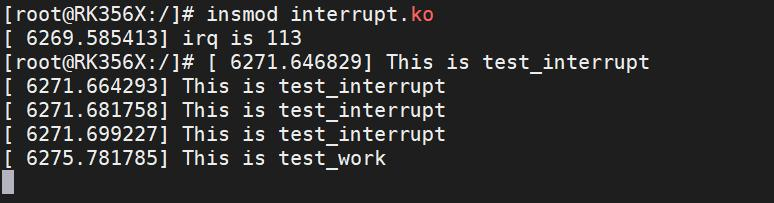
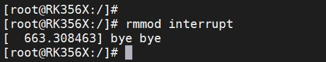
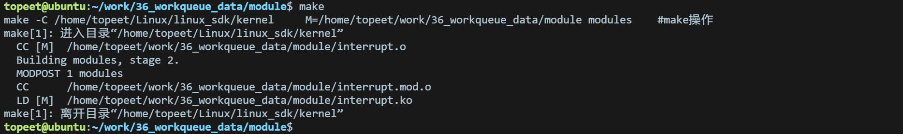
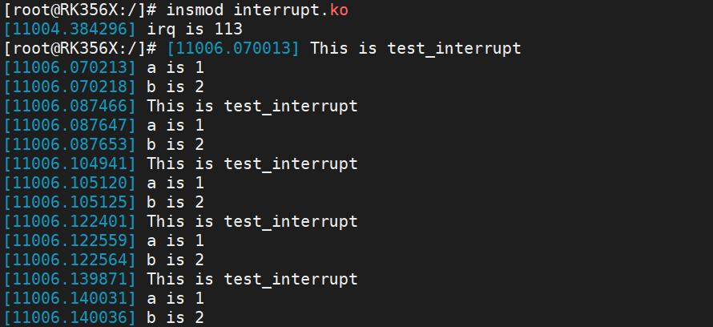

# 第054章 工作队列传参实验


图53.8在图53.8 中，可以看到打印中断处理函数中添加的打印“This is test_interrupt”，该打印被打印了多次，说明触发了多次中断上文，在4 秒之后，打印工作项处理函数中的“This istest_work”。4 秒之后打印“This is test_work”是因为调度延迟工作函数写了延迟3 秒，再加上工作项处理函数中延迟了一秒，所以一共是4 秒。实验成功后可以使用rmmod interrupt 命令进行驱动的卸载，如下图53.9 所示：

图53.9至此，延迟工作实验就完成了。

本章学习使用工作队列给中断低半部传参。
## 54.1 工作队列传参
首先定义工作项结构体，如代码清单54.1 所示，在结构体struct work_data 中定义了需要传递给工作项处理函数的参数a 和b，然后定义一个类型为struct work_data 的变量test_workqueue_work。代码清单54.1
```c
struct work_data
 {
    struct work_struct test_work;
  int a; int b;
};
struct work_data test_workqueue_work;
```
接下来在模块初始化函数interrupt_irq_init 中创建了一个工作队列test_workqueue 和一个工作项test_workqueue_work，如代码清单54.2 所示。代码清单54.2
```c
test_workqueue = create_workqueue("test_workqueue"); // 创建工作队列
INIT_WORK(&test_workqueue_work.test_work, test_work); // 初始化工作项
```
然后在模块初始化函数中，为工作项的参数a 和b 赋值，如代码清单54.3 所示。代码清单54.3
```c
test_workqueue_work.a = 1;
test_workqueue_work.b = 2;
```
当中断触发时，在test_interrupt()中断处理函数中，通过调用queue_work()函数将工作项test_workqueue_work.test_work 提交到工作队列test_workqueue 中，如代码清单54.4 所示。代码清单54.4
```c
queue_work(test_workqueue, &test_workqueue_work.test_work);
```
然后工作项处理函数test_work 定义了一个指针pdata，将工作项转换为struct work_data结构，并通过该结构访问参数a 和b。如下所示：代码清单54.5
```c
void test_work(struct work_struct *work)
{
  struct work_data *pdata;
```

```c
pdata = container_of(work, struct work_data, test_work);
printk("a is %d\n", pdata->a);
printk("b is %d\n", pdata->b);
}
```
这样，当工作队列被调度执行时，工作项处理函数test_work()将能够访问到传递给工作项的参数a 和b，并打印参数的值。注意，工作项处理函数中的container_of 宏用于从工作项结构的指针获取整个structwork_data 结构的指针。这样可以通过指针偏移来访问工作项结构中的其他字段，例如参数a和b。
## 54.2 实验程序的编写
### 54.2.1 驱动程序编写
本实验代码存储在网盘iTOP-RK3568 开发板\07_学习教程配套资料\03_Linux 驱动配套资料\04_Linux 驱动例程\36_workqueue_data\module 路径下。实验代码interrupt.c 如代码清单54.6 所示：代码清单54.6
```c
#include <linux/module.h>
#include <linux/init.h>
#include <linux/interrupt.h>
#include <linux/gpio.h>
#include <linux/delay.h>
#include <linux/workqueue.h>
int irq;
struct work_data
{
     struct work_struct test_work;
     int a;
     int b;
};
struct work_data test_workqueue_work;
struct workqueue_struct *test_workqueue;
//工作项处理函数
void test_work(struct work_struct *work)
{
```

```c
struct work_data *pdata;
pdata = container_of(work, struct work_data, test_work);
printk("a is %d", pdata->a);
printk("b is %d", pdata->b);
}
// 中断处理函数
irqreturn_t test_interrupt(int irq, void *args)
{
printk("This is test_interrupt\n");
// 提交工作项到工作队列
queue_work(test_workqueue, &test_workqueue_work.test_work);
return IRQ_RETVAL(IRQ_HANDLED);
}
static int interrupt_irq_init(void)
{
int ret;
irq = gpio_to_irq(101); // 将GPIO 映射为中断号
printk("irq is %d\n", irq);
// 请求中断
ret = request_irq(irq, test_interrupt, IRQF_TRIGGER_RISING, "test", NULL);
if (ret < 0)
{
  printk("request_irq is error\n");
  return -1;
}
// 创建工作队列
test_workqueue = create_workqueue("test_workqueue");
// 初始化工作项
INIT_WORK(&test_workqueue_work .test_work, test_work);
test_workqueue_work.a = 1;
test_workqueue_work.b = 2;
return 0;
}
static void interrupt_irq_exit(void)
{
free_irq(irq, NULL);// 释放中断
cancel_work_sync(&test_workqueue_work.test_work); // 取消工作项
flush_workqueue(test_workqueue);// 刷新工作队列
destroy_workqueue(test_workqueue);// 销毁工作队列
```

```c
printk("bye bye\n");
}
module_init(interrupt_irq_init);
module_exit(interrupt_irq_exit);
MODULE_LICENSE("GPL");
MODULE_AUTHOR("topeet");
```
## 54.3 运行测试
### 54.3.1 编译驱动程序
在和interrupt.c 的同一目录下创建Makefile 文件，如图54.1 所示。

图54.1Makefile 文件内容如代码清单54.7 所示：代码清单54.7
```c
export ARCH=arm64#设置平台架构
export CROSS_COMPILE=aarch64-linux-gnu-#交叉编译器前缀
obj-m := interrupt.o
KDIR :=/home/topeet/Linux/linux_sdk/kern el#这里是你的内核目录
PWD ?= $(shell pwd)
all:
    make -C $(KDIR) M=$(PWD) modules#make 操作
clean:
    make -C $(KDIR) M=$(PWD) clean#make clean 操作
```
使用命令make 编译驱动程序，编译成功后如图54.2 所示：

图54.2编译完后会生成interrupt.ko 目标文件，如图58.3 所示：

图54.3

### 54.3.2 运行测试
将本章节编译好的interrupt.ko 驱动文件拷贝到开发板上。开发板启动之后，使用insmod interrupt.ko 命令进行驱动模块的加载，如下图54.4 所示：

图54.4然后用手触摸连接的LVDS 7 屏幕，如果实验成功打印信息如下图54.5 所示。

图54.5在图54.5 中，可以看到打印中断处理函数中添加的打印“This is test_interrupt”和传递给工作项的参数a 和b 的值。实验成功后可以使用rmmod interrupt 命令卸载驱动程序，如图54.6 所示：

图54.6至此，工作队列传参实验就完成了。

