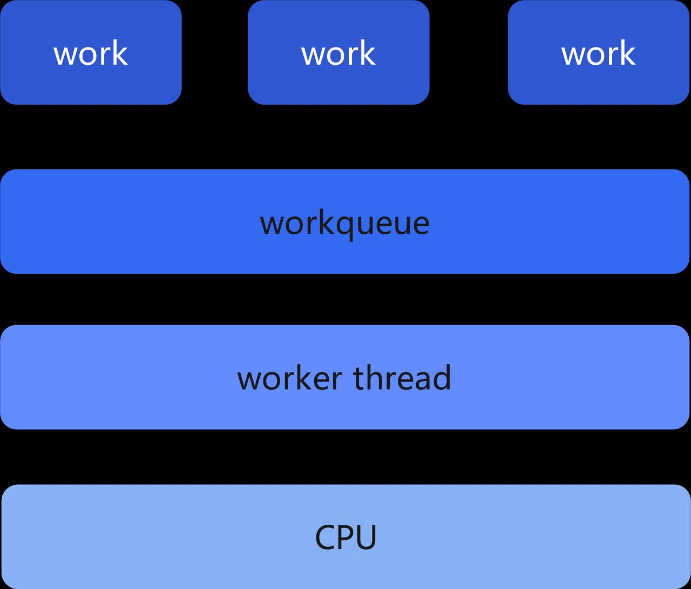
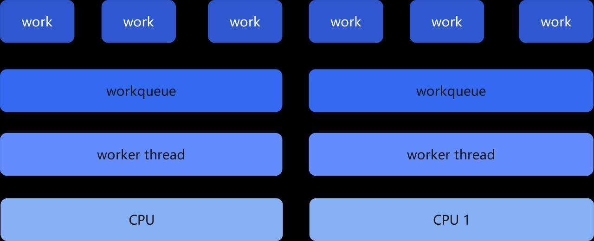
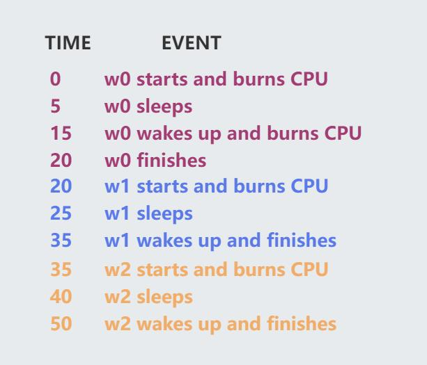
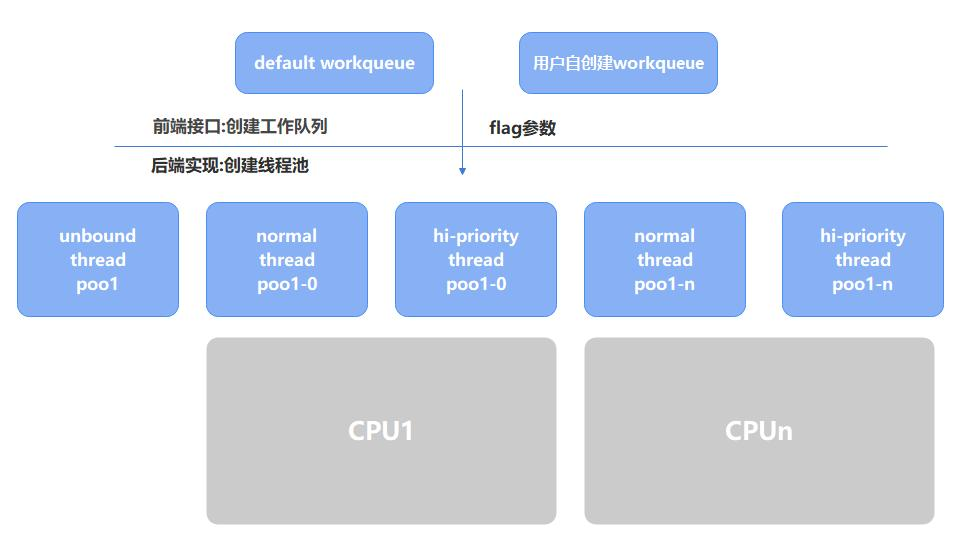
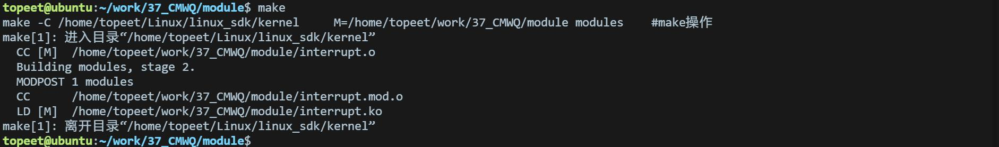
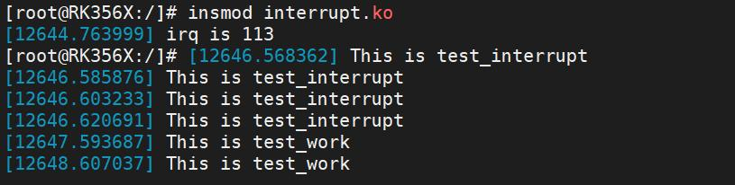
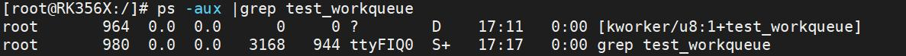
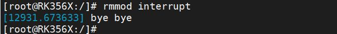

# 第055章 并发管理工作队列实验

本章节学习并发管理工作队列。
## 55.1 工作队列的实现
在使用工作队列时，首先定义一个work 结构体，然后将work（工作项）添加到workqueue(工作队列)中，最后worker thread（工作线程）执行workqueue。当工作队列中有新work 产生时，worker thread（工作线程）会执行工作队列中每个work。当执行完结束的时候，worker thread会睡眠，等到新的中断产生，work 再继续添加到工作队列，然后工作线程执行每个工作，周而复始。在单核线程的系统中，通常会为每个CPU（核心）初始化一个工作线程并关联一个工作队列。这种默认设置确保每个CPU 都有一个专门的线程来处理与其绑定的工作队列上的工作项。如下图55.1 所示：

图55.1在多核线程系统中，通常会存在多个工作队列，每个工作队列与一个工作线程（WorkerThread）绑定。这样可以充分利用多个核心的并行处理能力。如下图55.2 所示：


图55.2当有新的工作项产生时，系统需要决定将其分配给哪个工作队列。一种常见的策略是使用负载均衡算法，根据工作队列的负载情况来平衡分配工作项，以避免某个工作队列过载而导致性能下降。每个工作队列独立管理自己的工作项。当有新的工作项添加到工作队列时，工作线程会从其关联的工作队列中获取待执行的工作项，并执行相应的处理函数。在多核线程系统中，多个工作线程可以同时执行各自绑定的工作队列中的工作项。这样可以实现并行处理，提高系统的整体性能和响应速度。
## 55.2 workqueue 队列弊端
假如说有三个work 放到了同一个工作队列上，接下来CPU 会启动工作线程去执行这三个work，如下图（48-3）所示：

图55.3在上图中，工作项w0、w1、w2 被排队到同一个CPU 上的绑定工作队列上。w0 工作项执行的时候，先工作5 毫秒，然后睡眠10 毫秒，然后再工作CPU 5 毫秒，然后完成。工作项

w1 和w2 都是工作5ms，然后睡眠10 ms，然后完成。1 在工作项w0 工作甚至是睡眠时，工作项w1 w2 是排队等待的，在繁忙的系统中，工作队列可能会积累大量的待处理工作项，导致任务调度的延迟，这可能会影响系统的响应性能，并增加工作项的处理时间。2 在工作队列中，不同的工作项可能具有不同的处理时间和资源需求。如果工作项的处理时间差异很大，一些工作线程可能会一直忙于处理长时间的工作项，而其他工作线程则处于空闲状态，导致资源利用不均衡。3 在多线程环境下，多个工作线程同时访问和修改工作队列可能会导致竞争条件的发生。为了确保数据的一致性和正确性，需要采用适当的同步机制，如锁或原子操作，来保护共享数据，但这可能会引入额外的同步开销。4 工作队列通常按照先进先出（FIFO）的方式处理工作项，缺乏对工作项优先级的细粒度控制。在某些场景下，可能需要根据工作项的重要性或紧急程度进行优先级调度，而工作队列本身无法提供这种级别的优先级控制。5 当工作线程从工作队列中获取工作项并执行时，可能需要频繁地进行上下文切换，将处理器的执行上下文从一个线程切换到另一个线程。这种上下文切换可能会影响系统的性能和效率。
## 55.2 什么是并发管理工作队列
通过上一小节的学习，我们认识到传统的工作队列无论是单核系统还是多核系统都有缺陷。比如多核处理器的计算能力利用率低以及不同优先级的工作项调度不公平。为了解决这些问题，Con Kolivas 提出了CMWQ 调度算法。CMWQ 全称是concurrency Managed Workqueue，意为并发管理工作队列。并发管理工作队列是多线程或分布式系统中用于协调任务执行的一种机制，核心是在并发（同时处理多个任务）场景下，对“待处理任务队列”进行有序管理，确保任务被合理调度、资源高效利用。CMWQ 工作实现如下图55.4 所示：


图55.4并发管理工作队列可以类比这样一个场景：你是一家餐厅的服务员，饭点时很多顾客来到了餐厅。为了提高效率，你会把顾客的点菜需求按顺序排进一个“任务清单”里——这就是工作队列。这时，你和其他服务员可以同时从这份清单里“接单”，也就是每个人独立领取一个顾客的点菜需求，各自去为对应的顾客服务。不用等前一位顾客点完菜，就能同步处理多位顾客的需求——这就是通过并发管理工作队列的模式。
## 55.3 并发管理工作队列接口函数
alloc_workqueue()是Linux 内核中用于动态创建工作队列的函数。alloc_workqueue()函数原型如代码清单55.1 所示.代码清单55.1
```c
struct workqueue_struct *alloc_workqueue(const char *fmt, unsigned int flags, int max_active);
```
函数详细介绍如下：函数作用：创建一个工作队列函数参数：fmt：创建的工作队列的名称。flags：指定工作队列的标志，可以控制工作队列的行为和属性，如WQ_UNBOUND 表示无绑定的工作队列，WQ_HIGHPRI 表示高优先级的工作队列等。max_active：线程池里最大的线程数量。返回值：函数返回一个指向工作队列结构体（struct workqueue_struct）的指针，或者返回NULL表示创建失败。

## 55.4 实验程序的编写
### 55.4.1 驱动程序编写
本实验代码存储在网盘iTOP-RK3568 开发板\07_学习教程配套资料\03_Linux 驱动配套资料\04_Linux 驱动例程\37_CMWQ\module 路径下。本实验在自定义工作队列实验的基础上进行修改，使用alloc_workqueue 函数创建和分配一个工作队列。实验代码interrupt.c 如代码清单55.2 所示。代码清单55.2
```c
#include <linux/module.h>
#include <linux/init.h>
#include <linux/interrupt.h>
#include <linux/gpio.h>
#include <linux/delay.h>
#include <linux/workqueue.h>
int irq;
struct workqueue_struct *test_workqueue;
struct work_struct test_workqueue_work;
// 工作项处理函数
void test_work(struct work_struct *work)
{
     msleep(1000);
     printk("This is test_work\n");
}
// 中断处理函数
irqreturn_t test_interrupt(int irq, void *args)
{
     printk("This is test_interrupt\n");
     queue_work(test_workqueue, &test_workqueue_work); // 提交工作项到工作队列
     return IRQ_RETVAL(IRQ_HANDLED);
}
static int interrupt_irq_init(void)
{
     int ret;
     irq = gpio_to_irq(101); // 将GPIO 映射为中断号
     printk("irq is %d\n", irq);
```

```c
// 请求中断
ret = request_irq(irq, test_interrupt, IRQF_TRIGGER_RISING, "test", NULL);
if (ret < 0)
{
   printk("request_irq is error\n");
   return -1;
}
// 用于创建和分配一个工作队列
test_workqueue = alloc_workqueue("test_workqueue", WQ_UNBOUND, 0);
INIT_WORK(&test_workqueue_work, test_work); // 初始化工作项
return 0;
}
static void interrupt_irq_exit(void)
{
 free_irq(irq, NULL);// 释放中断
 cancel_work_sync(&test_workqueue_work); // 取消工作项
 flush_workqueue(test_workqueue);// 刷新工作队列
 destroy_workqueue(test_workqueue);// 销毁工作队列
 printk("bye bye\n");
}
module_init(interrupt_irq_init);
module_exit(interrupt_irq_exit);
MODULE_LICENSE("GPL");
MODULE_AUTHOR("topeet");
```
## 55.5 运行测试
### 55.5.1 编译驱动程序
在和interrupt.c 的同一目录下创建Makefile 文件，如图55.5 所示。

图55.5Makefile 文件内容如代码清单55.3 所示：代码清单55.3
```c
export ARCH=arm64#设置平台架构
export CROSS_COMPILE=aarch64-linux-gnu-#交叉编译器前缀
obj-m := interrupt.o
KDIR :=/home/topeet/Linux/linux_sdk/kern el#这里是你的内核目录
PWD ?= $(shell pwd)
all:
    make -C $(KDIR) M=$(PWD) modules#make 操作
```

```c
clean:
    make -C $(KDIR) M=$(PWD) clean#make clean 操作
```
使用命令make 编译驱动程序，编译成功后如图55.6 所示：

图55.6编译完后会生成interrupt.ko 目标文件，如图55.7 所示：

图55.7
### 55.5.2 运行测试
将本章节编译好的interrupt.ko 驱动文件拷贝到开发板上。开发板启动之后，使用insmod interrupt.ko 命令进行驱动模块的加载，如下图55.8 所示：

图55.8然后用手触摸连接的LVDS 屏幕，如果实现成功会打印如下图55.9 所示信息。

图55.9我们按一下屏幕，立即输入ps -aux | grep test_workqueue 命令,可以看到工作线程，如下图55.10 所示。

图55.10实验成功后可以使用rmmod interrupt 命令进行驱动的卸载，如下图55.11 所示：


