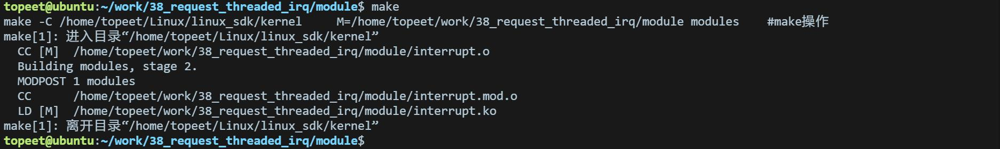
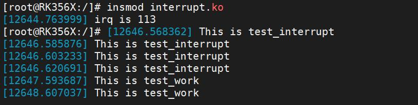

# 第056章 中断线程化实验

图55.11至此，并发管理工作队列实验就完成了。
本章学习中断线程化。
## 56.1 什么是中断线程化
中断线程化是Linux 内核中优化中断处理的一种机制。传统的中断处理分成了顶半部和底半部，顶半部用来处理比较紧急但是又不是很耗时的事情，如设置标志位，底半部用来处理耗时的事情。。在中断线程化机制中，中断处理程序不再执行具体任务，而是只负责唤醒一个内核线程来完成主要的中断处理逻辑。这样可以显著缩短中断响应时间，使被中断的实时进程能够更快地恢复运行。因此中断线程化也被认为是一种实现底半部的方式。
## 56.2 中断线程化接口函数
中断线程化的使用非常简单，只需要在申请中断时调用request_threaded_irq()函数，其函数原型如代码清单56.1 所示。代码清单56.1
```c
int request_threaded_irq(unsigned int irq, irq_handler_t handler,
                              irq_handler_t thread_fn, unsigned long irqflags,
                              const char *devname, void *dev_id);
```
该函数详细介绍如下;函数作用：注册中断处理程序并实现中断线程化。函数参数：irq：要请求的中断号。handler：中断上半部分函数。thread_fn：中断线程，如果此处设置为NULL，则表示没有使用中断线程化。irqflags：中断标志位。devname：中断的名称。dev_id：共享中断时使用。返回值：函数返回一个整数值，表示中断请求的结果。如果中断请求成功，返回值为0，否则返回

一个负数错误代码。
## 56.3 实验程序的编写
### 56.3.1 驱动程序编写
本实验代码存储在网盘iTOP-RK3568 开发板\07_学习教程配套资料\03_Linux 驱动配套资料\04_Linux 驱动例程\38_request_threaded_irq\module 路径下。实验代码interrupt.c 如代码清单56.2 所示。代码清单56.2
```c
#include <linux/module.h>
#include <linux/init.h>
#include <linux/interrupt.h>
#include <linux/gpio.h>
#include <linux/delay.h>
#include <linux/workqueue.h>
int irq;
// 中断处理函数的底半部（线程化中断处理函数）
irqreturn_t test_work(int irq, void *args)
{
      // 执行底半部的中断处理任务
      msleep(1000);
      printk("This is test_work\n");
      return IRQ_RETVAL(IRQ_HANDLED);
}
// 中断处理函数的顶半部
irqreturn_t test_interrupt(int irq, void *args)
{
      printk("This is test_interrupt\n");
      // 将中断处理工作推迟到底半部
      return IRQ_WAKE_THREAD;
}
static int interrupt_irq_init(void)
{
      int ret;
      irq = gpio_to_irq(101); // 将GPIO 映射为中断号
      printk("irq is %d\n", irq);
      // 用于请求并注册一个线程化的中断处理函数
```

```c
ret = request_threaded_irq(irq, test_interrupt, test_work, IRQF_TRIGGER_RISING, "test", NULL);
if (ret < 0)
{
  printk("request_irq is error\n");
  return -1;
}
return 0;
}
static void interrupt_irq_exit(void)
{
free_irq(irq, NULL); // 释放中断
printk("bye bye\n");
}
module_init(interrupt_irq_init);
module_exit(interrupt_irq_exit);
MODULE_LICENSE("GPL");
MODULE_AUTHOR("topeet");
```
## 56.4 运行测试
### 56.4.1 编译驱动程序
在和interrupt.c 的同一目录下创建Makefile 文件，如图56.1 所示。

图56.1Makefile 文件内容如代码清单56.3 所示：代码清单56 .3
```c
export ARCH=arm64#设置平台架构
export CROSS_COMPILE=aarch64-linux-gnu-#交叉编译器前缀
obj-m := interrupt.o
KDIR :=/home/topeet/Linux/linux_sdk/kern el#这里是你的内核目录
PWD ?= $(shell pwd)
all:
    make -C $(KDIR) M=$(PWD) modules#make 操作
clean:
    make -C $(KDIR) M=$(PWD) clean#make clean 操作
```
使用命令make 编译驱动程序，编译成功后如图56.2 所示：


图56.2编译完后会生成interrupt.ko 目标文件，如图56.3 所示：

图56.3
### 56.4.2 运行测试
将本章节编译好的interrupt.ko 驱动文件拷贝到开发板上。开发板启动之后，使用insmod interrupt.ko 命令进行驱动模块的加载，如下图56.4 所示：

图56.4然后用手触摸连接的LVDS 屏幕，如果实现成功会打印如下图56.5 所示信息。

图56.5通过图56.5 可以看出，使用中断线程化成功实现了中断底半部，即打印了This istest_work 打印信息。实验成功后可以使用rmmod interrupt 命令进行驱动的卸载，如下图56.6 所示：

图56.6至此，中断线程化实验就完成了。

