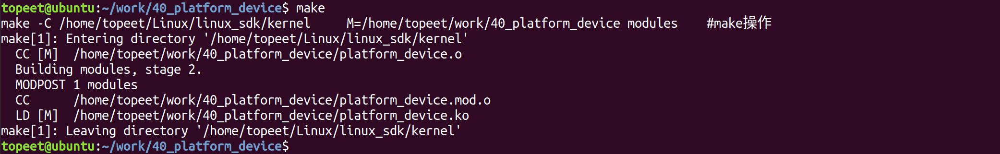
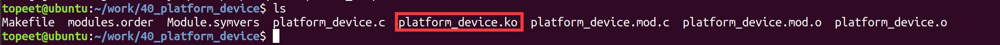
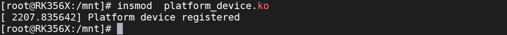
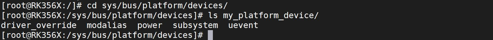
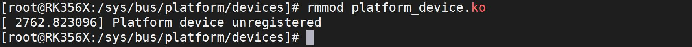

# 第058章 注册platform设备实验

## 第57 章平台总线模型介绍
本章节学习什么是平台总线模型。
## 57.1 平台总线模型介绍
Linux 系统可以支持不同架构处理器和不同的开发板，例如迅为的RK3568、2K1000 等开发板都可以运行Linux 系统。使用平台总线模型编写驱动程序可以让驱动程序有更好的重用性和跨平台的能力。比如在RK3568 开发板上编写的LED 驱动程序，只需要很小的改动就可以放在2K1000 开发板上运行。平台总线模型也叫platform 总线模型，平台总线是Linux 虚拟出来的一条总线，并没有实际的物理总线。平台总线模型把驱动分成了device 和driver 两部分，即platform 设备与platform 驱动两部分。device 部分是硬件相关代码，因为不同的开发板或处理器描述硬件资源的代码不通用，所以这部分代码被归类到device 部分。driver 部分是通用的驱动逻辑代码，如在驱动代码中操作LED 灯亮灭，不同的开发板操作逻辑是一样的，所以把驱动代码单独拿出来归类到driver部分可以避免重复造轮子的工作。这样在不同开发板上移植相同驱动的时候，只需要单独编写device 部分的硬件资源描述代码即可，driver 部分几乎无需改动，从而大幅提升驱动的兼容性和可移植性。
本章节学习注册platform 设备。
## 58.1 注册platform 设备
### 58.1.1 platform_device_register 函数
注册platform 设备使用platform_device_register()函数，下面是对platform_device_register()函数的详细介绍：函数原型：int platform_device_register(struct platform_device *pdev);头文件：#include <linux/platform_device.h>

函数作用：将platform_device 结构体描述的平台设备注册到内核中，使其能够参与设备的资源分配和驱动的匹配。参数含义：pdev：指向platform_device 结构体的指针，描述要注册的平台设备的信息。返回值：成功：返回0，表示设备注册成功。失败：返回负数，表示设备注册失败。
### 58.1.2 platform_device_unregister 函数
卸载platform设备使用platform_device_unregister() 函数，下下面是对platform_device_unregister()函数的详细介绍：函数原型：void platform_device_unregister(struct platform_device *pdev);头文件：#include <linux/platform_device.h>函数作用：用于取消注册已经注册的平台设备，从内核中移除设备。参数含义：pdev：指向要取消注册的平台设备的platform_device 结构体指针。返回值：无返回值。
### 58.1.3 platform_device 结构体
注册platform 设备用到了platform_device 结构体，platform_device 结构体用于表示platform 设备。该结构体定义在内核源码include/linux/platform_device.h 文件中，具体内容如代码清单58.1 所示。代码清单58.1
```c
struct platform_device {
    const char *name;//platform 设备的名称，用于唯一标识设备
    intid;//platform 设备的ID，可以用于区分同一种设备的不同实例
    bool id_auto;//表示platform 设备的ID 是否自动生成
    struct device dev;//表示platform 设备对应的struct device 结构体，用于设备的基本管理和操作
    u32 num_resources;//设备资源的数量
    struct resource *resource;//指向设备资源的指针
```

```c
const struct platform_device_id *id_entry;//指向设备的ID 表项的指针，用于匹配设备和驱动
char *driver_override;//强制设备与指定驱动匹配的驱动名称
/* MFD cell pointer */
struct mfd_cell *mfd_cell;//指向多功能设备（MFD）单元的指针，用于多功能设备的描述
/* arch specific additions */
struct pdev_archdataarchdata;//用于存储特定于架构的设备数据
};
```
下面对几个重要的参数和结构体进行讲解const char *name ：platform 设备的名称，如果platform_device 中的name 成员与platform_driver 结构体device_driver 成员中的name 名称相同则会与对应的platform 驱动匹配成功，从执行platform 驱动中的probe 函数。int id：platform 设备的ID，可以用于区分同一种platform 设备的不同实例。这个参数是可选的，如果不需要使用ID 进行区分，可以将其设置为-1，struct device dev：表示platform 设备对应的struct device 结构体。u32 num_resources：platform 设备需要使用的硬件资源数量。如寄存器地址、中断号等资源的总数。struct resource *resource：指向struct resource 结构体的指针，struct resource 结构体的用来描述平台设备的硬件资源。如描述地址寄存器地址，中断号等。
### 58.1.4 resource 结构体
struct resource 结构体用于描述platform 设备的硬件资源，该结构体定义在内核内核源码/include/linux/ioport.h 文件中，具体内容如代码清单58.2 所示。代码清单58.2
```c
struct resource {
    resource_size_t start;/* 资源的起始地址*/
    resource_size_t end;/* 资源的结束地址*/
    const char *name;/* 资源的名称*/
    unsigned long flags;/* 资源的标志位*/
    unsigned long desc;/* 资源的描述信息*/
    struct resource *parent;/* 指向父资源的指针*/
    struct resource *sibling;/* 指向同级兄弟资源的指针*/
    struct resource *child;/* 指向子资源的指针*/
```

```c
/* 以下宏定义用于保留未使用的字段*/
ANDROID_KABI_RESERVE(1);
ANDROID_KABI_RESERVE(2);
ANDROID_KABI_RESERVE(3);
ANDROID_KABI_RESERVE(4);
};
```
因为resource_size_t start、resource_size_t start、const char *name 和unsigned long flags 这四个结构体成员使用频率最高，所以我们重点关注这四个结构体成员。每个参数的具体介绍如下：resource_size_t start：资源的起始地址。如寄存器的起始地址。resource_size_t end：资源的结束地址。如寄存器的结束地址。const char *name：资源的名称。它是一个字符串，用于标识和描述资源。unsigned long flags：资源的标志位。有以下常见的几个标志位。IORESOURCE_IO：表示资源是I/O 端口资源。IORESOURCE_MEM：表示资源是内存资源。IORESOURCE_REG：表示资源是寄存器地址。IORESOURCE_IRQ：表示资源是中断资源。IORESOURCE_DMA：表示资源是DMA（直接内存访问）资源。
## 58.2 实验程序的编写
本实验代码存储在网盘iTOP-RK3568 开发板\07_学习教程配套资料\03_Linux 驱动配套资料\04_Linux 驱动例程\40_platform_device 路径下。本实验注册了一个名为my_platform_device 的platform 设备。my_platform_device 具有一个内存资源和一个中断资源。内存资源和中断资源使用struct resource 结构体描述并存放在struct resource 结构体类型的my_resources 的结构体数组中。内存资源和中断资源信息如下：内存资源：寄存器起始地址：MEM_START_ADDR（0xFDD60000）。寄存器结束地址：MEM_END_ADDR（0xFDD60004）。标志位：IORESOURCE_MEM中断资源：中断资源号：IRQ_NUMBER（101），中断号为101

标志位：IORESOURCE_IRQplatform_device.c 代码如代码清单58.3 所示。代码清单58.3
```c
#include <linux/module.h>
#include <linux/platform_device.h>
#include <linux/ioport.h>
#define MEM_START_ADDR 0xFDD60000
#define MEM_END_ADDR0xFDD60004
#define IRQ_NUMBER
static struct resource my_resources[] = {
    {
        .start = MEM_START_ADDR,// 内存资源起始地址
        .end = MEM_END_ADDR,// 内存资源结束地址
        .flags = IORESOURCE_MEM,// 标记为内存资源
    },
    {
        .start = IRQ_NUMBER,// 中断资源号
        .end = IRQ_NUMBER,// 中断资源号
        .flags = IORESOURCE_IRQ,// 标记为中断资源
    },
};
static void my_platform_device_release(struct device *dev)
{
    // 释放资源的回调函数
}
static struct platform_device my_platform_device = {
    .name = "my_platform_device",// 设备名称
    .id = -1,// 设备ID
    .num_resources = ARRAY_SIZE(my_resources),// 资源数量
    .resource = my_resources,// 资源数组
    .dev.release = my_platform_device_release,// 释放资源的回调函数
};
static int __init my_platform_device_init(void)
{
    int ret;
    ret = platform_device_register(&my_platform_device);// 注册平台设备
```

```c
if (ret) {
    printk(KERN_ERR "Failed to register platform device\n");
    return ret;
}
printk(KERN_INFO "Platform device registered\n");
return 0;
}
static void __exit my_platform_device_exit(void)
{
platform_device_unregister(&my_platform_device);// 注销平台设备
printk(KERN_INFO "Platform device unregistered\n");
}
module_init(my_platform_device_init);
module_exit(my_platform_device_exit);
MODULE_LICENSE("GPL");
MODULE_AUTHOR("topeet");
```
## 58.3 运行测试
### 58.3.1 编译驱动程序
在platform_device.c 代码同一目录下创建Makefile 文件，如图58.1 所示。

图58.1Makefile 文件内容如代码清单58.4 所示。代码清单58.4
```c
export ARCH=arm64#设置平台架构
export CROSS_COMPILE=aarch64-linux-gnu-#交叉编译器前缀
obj-m += platform_device.o#此处要和你的驱动源文件同名
KDIR :=/home/topeet/Linux/linux_sdk/kernel#这里是你的内核目录
PWD ?= $(shell pwd)
all:
    make -C $(KDIR) M=$(PWD) modules#make 操作
clean:
    make -C $(KDIR) M=$(PWD) clean#make clean 操作
```
在存放platform_device.c 和Makefile 文件目录下使用make 命令编译驱动程序，编译完成如图58.2 所示。


图58.2编译完生成platform_device.ko 目标文件，如图58.3 所示。

图58.3
### 58.3.2 运行测试
将本章节编译好的platform_device.ko 驱动文件拷贝到开发板上。开发板启动之后，使用insmod platform_device.ko 命令进行驱动模块的加载，如图58.4 所示。

图58.4然后来到/sys/bus/platform/devices 目录下，如果可以看到创建的my_platform_device 设备文件目录，则说明platform 设备注册成功，如图58.5 所示。

图58.5然后使用rmmod platform_device.ko 命令进行驱动模块的卸载，如图58.6 所示。

图58.6

