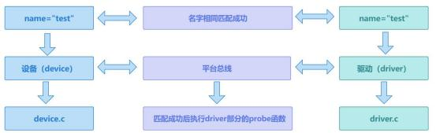
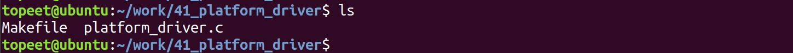
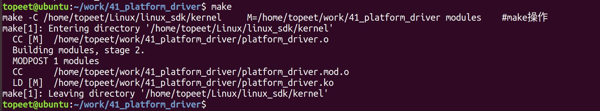
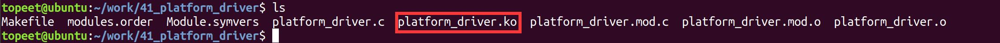
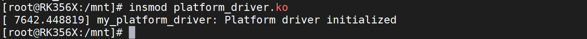
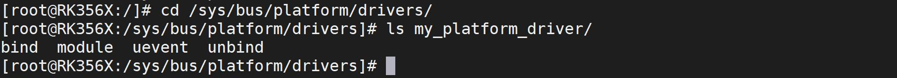
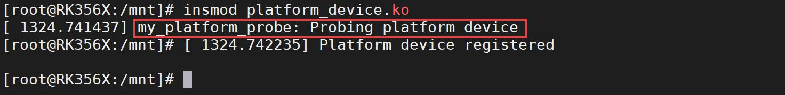

# 第059章 注册platform驱动实验

本章节学习注册platform 驱动。
## 59.1 注册platform 驱动
### 59.1.1 platform_driver_register 函数
注册platform 驱动使用platform_driver_register() 函数，platform_driver_register() 的详细介绍如下：函数原型：int platform_driver_register(struct platform_driver *drv);头文件：#include <linux/platform_device.h>函数作用：将一个平台驱动程序注册到内核中。通过注册平台驱动程序，内核可以识别并与特定的平台设备进行匹配，并在需要时调用相应的回调函数。参数含义：drv：指向struct platform_driver 结构体的指针，描述了要注册的平台驱动程序的属性和回调函数。返回值：如果注册成功，返回0；如果注册失败，返回一个负数错误码。
### 59.1.2 platform_driver_unregister 函数
卸载platform 驱动使用platform_driver_unregister() 函数，platform_driver_unregister() 函数的详细介绍：函数原型：void platform_driver_unregister(struct platform_driver *drv);头文件：#include <linux/platform_device.h>函数作用：用于从内核中注销平台设备。通过调用该函数，可以将指定的平台设备从系统中移除。参数含义：

pdev：指向要注销的平台设备的指针。返回值：无返回值。
### 59.1.3 platform_driver 结构体
在Linux 内核中platform_driver 结构体表是platform 驱动中的关键结构体。该结构体定义在内核源码include/linux/platform_device.h 文件中，部分代码如代码清单59.1 所示。代码清单59.1
```c
struct platform_driver {
    int (*probe)(struct platform_device *); /* 平台设备的探测函数指针*/
    int (*remove)(struct platform_device *); /* 平台设备的移除函数指针*/
    void (*shutdown)(struct platform_device *);/* 平台设备的关闭函数指针*/
    int (*suspend)(struct platform_device *, pm_message_t state);/* 平台设备的挂起函数指针*/
    int (*resume)(struct platform_device *);/* 平台设备的恢复函数指针*/
    struct device_driver driver;/* 设备驱动程序的通用数据*/
    const struct platform_device_id *id_table;/* 平台设备与驱动程序的关联关系表*/
    bool prevent_deferred_probe; /* 是否阻止延迟探测*/
};
```
关键成员介绍如下：probe：探测函数指针。当platform 驱动与platform 设备匹配成功后会执行probe 函数指针指向的函数。remove：移除函数指针。当平台设备从系统中移除时，该函数指针指向的函数将被调用以执行清理和释放资源的操作。shutdown：关闭函数指针。当系统关闭时，该函数指针指向的函数将被调用以执行与平台设备相关的关闭操作。suspend：挂起函数指针。当系统进入挂起状态时，该函数指针指向的函数将被调用以执行与平台设备相关的挂起操作。resume：恢复函数指针。当系统从挂起状态恢复时，该函数指针指向的函数将被调用以执行与平台设备相关的恢复操作。struct device_driver driver：表示platform 驱动对应的struct device_driver 结构体，structdevice_driver 结构体中包括驱动程序的名称、总线类型、模块拥有者、属性组数组指针等信息，该结构体的name 参数需要与platform_device 的.name 参数相同才能匹配成功，从而执行probe函数。id_table：指向struct platform_device_id 结构体数组的指针，当platform 设备与platform

驱动匹配时候，如果存在id_table 成员，则优先使用id_table 进行匹配，如果id_table 为NULL，则使用driver.name 成员与platform_device.name 进行匹配。prevent_deferred_probe：一个布尔值，用于确定是否阻止延迟探测。如果设置为true，则延迟探测将被禁用。
## 59.2 实验程序的编写
本实验代码存储在网盘iTOP-RK3568 开发板\07_学习教程配套资料\03_Linux 驱动配套资料\04_Linux 驱动例程\41 路径下。本实验注册一个platform 驱动并与对应的platform 设备进行匹配。当平台总线driver 部分中platform_driver.driver.name 成员的值与device 部分中platform_device.name 成员的值相同时，平台总线的device 和driver 两部会被平台总线匹配在一起。因此匹配规则的本质是字符串比较。匹配流程如图59.1 所示。

图59.1在注册platform 设备时候platform_device.name 值为my_platform_device。如代码清单59.2所示。代码清单59.2
```c
static struct platform_device my_platform_device = {
    .name = "my_platform_device",// 设备名称
    .id = -1,// 设备ID
    .num_resources = ARRAY_SIZE(my_resources),// 资源数量
    .resource = my_resources,// 资源数组
    .dev.release = my_platform_device_release,// 释放资源的回调函数
};
```
所以在注册platform_driver 时，platform_driver.driver.name 成员的值也应为my_platform_device 才可以与platform 设备与匹配成功。platform_driver.c 代码如代码清单59.3

所示。代码清单59.3
```c
#include <linux/module.h>
#include <linux/platform_device.h>
// 平台设备的探测函数
static int my_platform_probe(struct platform_device *pdev)
{
    printk(KERN_INFO "my_platform_probe: Probing platform device\n");
    // 添加设备特定的操作
    // ...
    return 0;
}
// 平台设备的移除函数
static int my_platform_remove(struct platform_device *pdev)
{
    printk(KERN_INFO "my_platform_remove: Removing platform device\n");
    // 清理设备特定的操作
    // ...
    return 0;
}
// 定义平台驱动结构体
static struct platform_driver my_platform_driver = {
    .probe = my_platform_probe,
    .remove = my_platform_remove,
    .driver = {
        .name = "my_platform_device",
        .owner = THIS_MODULE,
    },
};
// 模块初始化函数
static int __init my_platform_driver_init(void)
{
    int ret;
    // 注册平台驱动
```

```c
ret = platform_driver_register(&my_platform_driver);
if (ret) {
    printk(KERN_ERR "Failed to register platform driver\n");
    return ret;
}
printk(KERN_INFO "my_platform_driver: Platform driver initialized\n");
return 0;
}
// 模块退出函数
static void __exit my_platform_driver_exit(void)
{
// 注销平台驱动
platform_driver_unregister(&my_platform_driver);
printk(KERN_INFO "my_platform_driver: Platform driver exited\n");
}
module_init(my_platform_driver_init);
module_exit(my_platform_driver_exit);
MODULE_LICENSE("GPL");
MODULE_AUTHOR("topeet");
```
## 59.3 运行测试
### 59.3.1 编译驱动程序
在platform_driver.c 代码同一目录下创建Makefile 文件，如图59.2 所示。

图59.2Makefile 文件内容如代码清单59.4 所示。代码清单59.4
```c
export ARCH=arm64#设置平台架构
export CROSS_COMPILE=aarch64-linux-gnu-#交叉编译器前缀
obj-m += platform_driver.o#此处要和你的驱动源文件同名
KDIR :=/home/topeet/Linux/linux_sdk/kernel#这里是你的内核目录
PWD ?= $(shell pwd)
```

```c
all:
    make -C $(KDIR) M=$(PWD) modules#make 操作
clean:
    make -C $(KDIR) M=$(PWD) clean#make clean 操作
```
在存放platform_driver.c 和Makefile 文件目录下使用make 命令编译驱动程序，编译完成如图59.3 所示。

图59.3编译完生成platform_driver.ko 目标文件，如图59.4 所示。

图59.4
### 59.3.2 运行测试
本小节的测试需要用到两个驱动ko 文件，即上一章节的注册platform 设备ko 文件和本章节的注册platform 驱动ko 文件。开发板启动之后，使用insmod platform_driver.ko 命令进行驱动模块的加载，如图59.5 所示。

图59.5然后来到/sys/bus/platform/drivers 目录下，如果注册成功可以看到my_platform_driver 文件夹，如图59.6 所示。

图59.6然后使用insmod platform_device.ko 命令加载注册platform 设备ko 文件，（加载上述两个ko 文件不分先后顺序）加载成功之后如图59.7 所示。

图59.7

