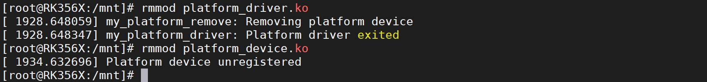
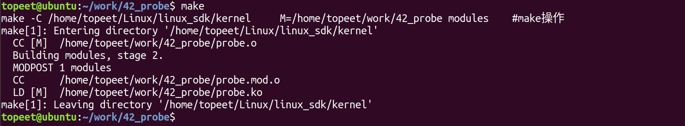
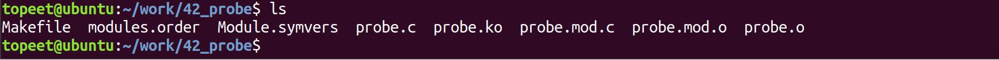
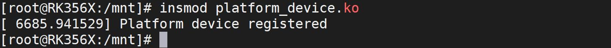
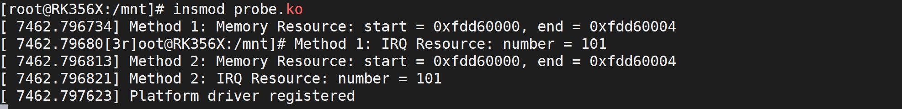
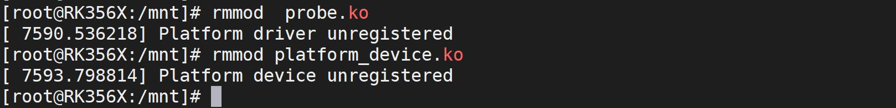

# 第060章 probe函数编写实验

通过图59.6 打印信息可以看出platform 设备与platform 驱动匹配成功之后就会执行platform 驱动中的probe 函数。然后使用rmmod platform_driver.ko 和rmmod platform_device.ko命令进行驱动模块的卸载，如图59.8 所示。

图59.8至此，注册platform 驱动实验就完成了。

在platform 设备和platform 驱动匹配成功之后，如果需要使用在platform 设备中描述的硬件资源，可以通过API 函数在platform_driver 驱动的probe 函数中获取在platform 设备中描述的硬件资源。
## 60.1 获取device 中描述的硬件资源
方法1：直接访问platform_device 结构体的资源数组在probe 函数中直接访问platform_device 结构体中的资源数组来获取硬件资源。其中pdev->resource 是一个资源数组，存储了设备的硬件资源信息。在代码清单60.1 中，pdev->resource 资源数组的第一个元素对应的是内存资源，第二个元素对应的是中断资源。所以将第一个元素的指针赋值给res_mem，第二个元素的指针赋值给res_irq。代码清单60.1
```c
if (pdev->num_resources >= 2) {
    struct resource *res_mem = &pdev->resource[0];
    struct resource *res_irq = &pdev->resource[1];
    // 使用获取到的硬件资源进行处理
    printk("Method 1: Memory Resource: start = 0x%lld, end = 0x%lld\n",res_mem->start, res_mem->end);
    printk("Method 1: IRQ Resource: number = %lld\n", res_irq->start);
}
```
方法2：使用platform_get_resource() 获取硬件资源platform_get_resource()函数用于获取设备的资源信息。它的声明位于<linux/platform_device.h>头文件中。platform_get_resource()函数详细介绍如下：函数原型：struct resource *platform_get_resource(struct platform_device *pdev,unsigned int type, unsigned int num);参数说明：pdev：指向要获取资源的平台设备（platform_device）结构体的指针。type：指定资源的类型，可以是以下值之一：IORESOURCE_MEM：表示内存资源。IORESOURCE_IO：表示I/O 资源。

IORESOURCE_IRQ：表示中断资源。其他资源类型的宏定义可在<linux/ioport.h>和<linux/irq.h>头文件中找到。num：指定要获取的资源的索引。在一个设备中可能存在多个相同类型的资源，通过索引可以选择获取特定的资源。返回值：如果成功获取资源，则返回指向资源（struct resource）的指针。如果获取资源失败，或者指定的资源不存在，则返回NULL。platform_get_resource()函数用于从平台设备的资源数组中获取指定类型和索引的资源。在平台设备的资源数组中，每个元素都是一个struct resource 结构体，每个struct resource 结构体描述了一个资源的信息，如起始地址、结束地址、中断号等。在probe 函数中示例用法如代码清单60.2 所示。代码清单60.2
```c
struct resource *res;
res = platform_get_resource(pdev, IORESOURCE_MEM, 0);
if (!res) {
    // 处理获取内存资源失败的情况
}
// 获取寄存器的起始地址和结束地址。
unsigned long start = res->start;
unsigned long end = res->end;
```
在代码清单60.2中，首先通过platform_get_resource()函数获取在platform设备中使用structresource 结构体描述的第一个内存资源（索引值为0）。如果获取资源失败（返回NULL），则可以根据实际情况进行错误处理。如果获取资源成功，则可以使用在platform 设备中通过structresource 结构体描述的硬件资源。
## 60.2 实验程序的编写
本实验代码存储在网盘iTOP-RK3568 开发板\07_学习教程配套资料\03_Linux 驱动配套资料\04_Linux 驱动例程\42_probe 路径下。本实验在probe 函数中使用方法1 和方法2 分别获取在platform 设备中通过struct resource结构体描述的硬件资源。实验代码probe.c 如代码清单60.3 所示。

代码清单60.3
```c
#include <linux/module.h>
#include <linux/platform_device.h>
#include <linux/ioport.h>
static int my_platform_driver_probe(struct platform_device *pdev)
{
    struct resource *res_mem, *res_irq;
    // 方法1：直接访问platform_device 结构体的资源数组
    if (pdev->num_resources >= 2) {
        struct resource *res_mem = &pdev->resource[0];
        struct resource *res_irq = &pdev->resource[1];
        // 使用获取到的硬件资源进行处理
        printk("Method 1: Memory Resource: start = 0x%llx, end = 0x%llx\n",
                res_mem->start, res_mem->end);
        printk("Method 1: IRQ Resource: number = %lld\n", res_irq->start);
    }
    // 方法2：使用platform_get_resource() 获取硬件资源
    res_mem = platform_get_resource(pdev, IORESOURCE_MEM, 0);
    if (!res_mem) {
        dev_err(&pdev->dev, "Failed to get memory resource\n");
        return -ENODEV;
    }
    res_irq = platform_get_resource(pdev, IORESOURCE_IRQ, 0);
    if (!res_irq) {
        dev_err(&pdev->dev, "Failed to get IRQ resource\n");
        return -ENODEV;
    }
    // 使用获取到的硬件资源进行处理
    printk("Method 2: Memory Resource: start = 0x%llx, end = 0x%llx\n",
            res_mem->start, res_mem->end);
    printk("Method 2: IRQ Resource: number = %lld\n", res_irq->start);
    return 0;
}
static int my_platform_driver_remove(struct platform_device *pdev)
{
```

```c
// 设备移除操作
return 0;
}
static struct platform_driver my_platform_driver = {
.driver = {
    .name = "my_platform_device", // 与platform_device.c 中的设备名称匹配
    .owner = THIS_MODULE,
},
.probe = my_platform_driver_probe,
.remove = my_platform_driver_remove,
};
static int __init my_platform_driver_init(void)
{
int ret;
ret = platform_driver_register(&my_platform_driver); // 注册平台驱动
if (ret) {
    printk("Failed to register platform driver\n");
    return ret;
}
printk("Platform driver registered\n");
return 0;
}
static void __exit my_platform_driver_exit(void)
{
platform_driver_unregister(&my_platform_driver); // 注销平台驱动
printk("Platform driver unregistered\n");
}
module_init(my_platform_driver_init);
module_exit(my_platform_driver_exit);
MODULE_LICENSE("GPL");
MODULE_AUTHOR("topeet");
```
## 60.3 运行测试
### 60.3.1 编译驱动程序
在上一小节中的probe.c 代码同一目录下创建Makefile 文件，如图60.1 所示。


图60.1Makefile 文件内容如代码清单60.4 所示。代码清单60.4
```c
export ARCH=arm64#设置平台架构
export CROSS_COMPILE=aarch64-linux-gnu-#交叉编译器前缀
obj-m += probe.o#此处要和你的驱动源文件同名
KDIR :=/home/topeet/Linux/linux_sdk/kernel#这里是你的内核目录
PWD ?= $(shell pwd)
all:
    make -C $(KDIR) M=$(PWD) modules#make 操作
clean:
    make -C $(KDIR) M=$(PWD) clean#make clean 操作
```
在存放probe.c 和Makefile 文件目录下使用make 命令编译驱动程序，编译完成如图60.2所示。

图60.2编译完生成probe.ko 目标文件，如图60.3 所示。

图60.3
### 60.3.2 运行测试
本小节的测试要使用两个ko 文件，第一个ko 文件为注册platform 设备对应的platform_device.ko 驱动，第二个ko 文件为在上一小节编译出的probe.ko 驱动文件。开发板启动之后，首先使用insmod platform_device.ko 命令进行platform 设备的注册，如图60.4 所示。

图60.4然后继续使用insmod probe.ko 命令加载probe.ko 驱动，打印如图60.5 所示。


图60.5在图60.5 中，分别打印了通过方法1 和方法2 两种方式获取到的内存信息和中断信息，说明在platfrom 驱动的probe 函数中成功获取到了在platform 设备中通过struct resource 结构体描述的硬件资源。最后可以使用rmmodprobe.ko 和rmmod platform_device.ko 命令进行驱动的卸载，如图60.6 所示。

图60.6

