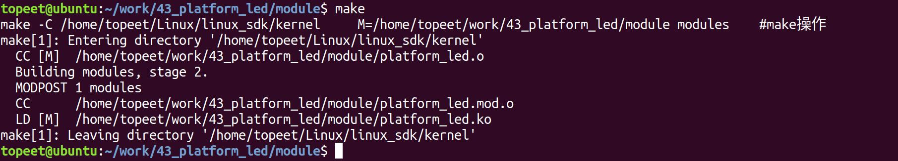
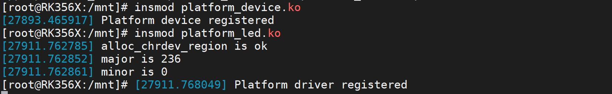
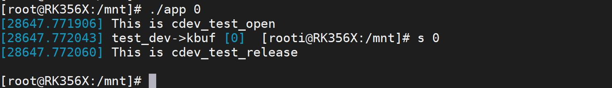
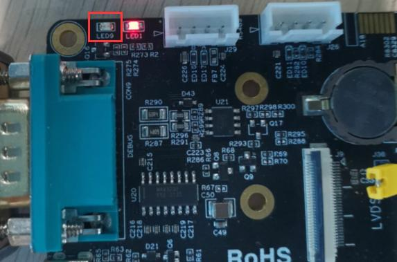
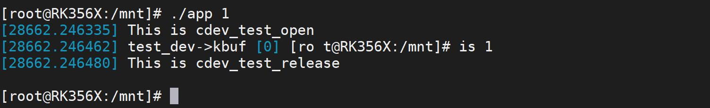
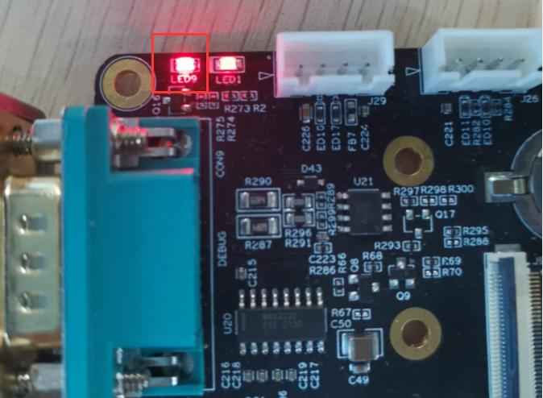
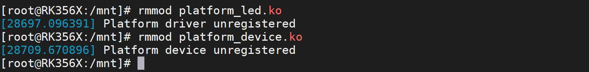

# 第061章 点亮LED灯实验（平台总线）

本章实验目标：学习platform 总线的使用并将字符设备驱动，文件私有数据与platform 总线相结合。在本章使用平台总线编写LED 驱动程序。平台总线将驱动分成了platform 驱动和platform设备俩部分。因此使用平台总线编写LED 驱动程序需要分别编写platform 驱动和platform 设备俩部分驱动程序，在platform 设备驱动程序中描述LED 灯所使用的硬件资源，在platform 驱动的probe()里面获取platform 设备中描述的LED 灯的硬件资源并注册字符设备实现LED 灯控制逻辑代码。
## 61.1 实验程序的编写
### 61.1.1 驱动程序编写
本实验代码存储在网盘iTOP-RK3568 开发板\07_学习教程配套资料\03_Linux 驱动配套资料\04_Linux 驱动例程\43_platform_led\module 路径下。实验代码platform_led.c（platform 驱动）如代码清单61.1 所示。代码清单61.1
```c
#include <linux/module.h>
#include <linux/platform_device.h>
#include <linux/ioport.h>
#include <linux/kdev_t.h>
#include <linux/fs.h>
#include <linux/cdev.h>
#include <linux/uaccess.h>
#include <linux/io.h>
struct device_test{
    dev_t dev_num;//设备号
     int major ;//主设备号
    int minor ;//次设备号
    struct cdev cdev_test; // cdev
    struct class *class;//类
    struct device *device; //设备
```

```c
char kbuf[32];
unsigned int *vir_gpio_dr;
};
structdevice_test dev1;
/*打开设备函数*/
static int cdev_test_open(struct inode *inode, struct file *file)
{
file->private_data=&dev1;//设置私有数据
printk("This is cdev_test_open\r\n");
return 0;
}
/*向设备写入数据函数*/
static ssize_t cdev_test_write(struct file *file, const char __user *buf, size_t size, loff_t *off)
{
 struct device_test *test_dev=(struct device_test *)file->private_data;
if (copy_from_user(test_dev->kbuf, buf, size) != 0) // copy_from_user:用户空间向内核空间传数据
{
    printk("copy_from_user error\r\n");
    return -1;
}
if(test_dev->kbuf[0]==1){//如果应用层传入的数据是1，则打开灯
        *(test_dev->vir_gpio_dr) = 0x8000c040;//设置数据寄存器的地址
          printk("test_dev->kbuf [0]is %d\n",test_dev->kbuf[0]);//打印传入的数据
}
else if(test_dev->kbuf[0]==0)//如果应用层传入的数据是0，则关闭灯
{
        *(test_dev->vir_gpio_dr) = 0x80004040; //设置数据寄存器的地址
        printk("test_dev->kbuf [0]is %d\n",test_dev->kbuf[0]); //打印传入的数据
}
return 0;
}
/*从设备读取数据*/
static ssize_t cdev_test_read(struct file *file, char __user *buf, size_t size, loff_t *off)
{
struct device_test *test_dev=(struct device_test *)file->private_data;
if (copy_to_user(buf, test_dev->kbuf, strlen( test_dev->kbuf)) != 0) // copy_to_user:内核空间向用户空间
传数据
{
    printk("copy_to_user error\r\n");
```

```c
return -1;
}
printk("This is cdev_test_read\r\n");
return 0;
}
static int cdev_test_release(struct inode *inode, struct file *file)
{
printk("This is cdev_test_release\r\n");
return 0;
}
/*设备操作函数*/
struct file_operations cdev_test_fops = {
.owner = THIS_MODULE, //将owner 字段指向本模块，可以避免在模块的操作正在被使用时卸载该模块
.open = cdev_test_open, //将open 字段指向cdev_test_open(...)函数
.read = cdev_test_read, //将read 字段指向cdev_test_read(...)函数
.write = cdev_test_write, //将write 字段指向cdev_test_write(...)函数
.release = cdev_test_release, //将release 字段指向cdev_test_release(...)函数
};
static int my_platform_driver_probe(struct platform_device *pdev)
{
struct resource *res_mem;
int ret;
res_mem = platform_get_resource(pdev, IORESOURCE_MEM, 0);
if (!res_mem) {
dev_err(&pdev->dev, "Failed to get memory resource\n");
return -ENODEV;
}
/*注册字符设备驱动*/
/*1 创建设备号*/
ret = alloc_chrdev_region(&dev1.dev_num, 0, 1, "alloc_name"); //动态分配设备号
if (ret < 0)
{
goto err_chrdev;
}
printk("alloc_chrdev_region is ok\n");
dev1.major = MAJOR(dev1.dev_num); //获取主设备号
dev1.minor = MINOR(dev1.dev_num); //获取次设备号
```

```c
printk("major is %d \r\n", dev1.major); //打印主设备号
printk("minor is %d \r\n", dev1.minor); //打印次设备号
 /*2 初始化cdev*/
dev1.cdev_test.owner = THIS_MODULE;
cdev_init(&dev1.cdev_test, &cdev_test_fops);
/*3 添加一个cdev,完成字符设备注册到内核*/
ret =cdev_add(&dev1.cdev_test, dev1.dev_num, 1);
if(ret<0)
{
    gotoerr_chr_add;
}
/*4 创建类*/
dev1. class = class_create(THIS_MODULE, "test");
if(IS_ERR(dev1.class))
{
    ret=PTR_ERR(dev1.class);
    goto err_class_create;
}
/*5创建设备*/
dev1.device = device_create(dev1.class, NULL, dev1.dev_num, NULL, "test");
if(IS_ERR(dev1.device))
{
    ret=PTR_ERR(dev1.device);
    goto err_device_create;
}
dev1.vir_gpio_dr=ioremap(res_mem->start,4);//将物理地址转化为虚拟地址
if(IS_ERR(dev1.vir_gpio_dr))
{
    ret=PTR_ERR(dev1.vir_gpio_dr);//PTR_ERR()来返回错误代码
    goto err_ioremap;
}
return 0;
err_ioremap:
    iounmap(dev1.vir_gpio_dr);
err_device_create:
    class_destroy(dev1.class);//删除类
err_class_create:
   cdev_del(&dev1.cdev_test);//删除cdev
err_chr_add:
```

```c
unregister_chrdev_region(dev1.dev_num, 1); //注销设备号
err_chrdev:
return ret;
}
static int my_platform_driver_remove(struct platform_device *pdev)
{
// 设备移除操作
return 0;
}
static struct platform_driver my_platform_driver = {
.driver = {
.name = "my_platform_device", // 与platform_device.c 中的设备名称匹配
.owner = THIS_MODULE,
},
.probe = my_platform_driver_probe,
.remove = my_platform_driver_remove,
};
static int __init my_platform_driver_init(void)
{
int ret;
ret = platform_driver_register(&my_platform_driver); // 注册平台驱动
if (ret) {
printk("Failed to register platform driver\n");
return ret;
}
printk("Platform driver registered\n");
return 0;
}
static void __exit my_platform_driver_exit(void)
{
/*注销字符设备*/
unregister_chrdev_region(dev1.dev_num, 1); //注销设备号
cdev_del(&dev1.cdev_test);//删除cdev
device_destroy(dev1.class, dev1.dev_num);//删除设备
class_destroy(dev1.class);//删除类
platform_driver_unregister(&my_platform_driver); // 注销平台驱动
printk("Platform driver unregistered\n");
```

```c
}
module_init(my_platform_driver_init);
module_exit(my_platform_driver_exit);
MODULE_LICENSE("GPL");
MODULE_AUTHOR("topeet");
```
platform_device 部分代码与注册platform_device 设备章节中实验代码相同。即控制亮LED 灯实验中查询寄存器地址章节，本节不在赘述。
### 61.1.2 编写测试APP
本实验代码存储在网盘iTOP-RK3568 开发板\07_学习教程配套资料\03_Linux 驱动配套资料\04_Linux 驱动例程\43_platform_led\app 路径下。LED 驱动加载成功之后会生成/dev/test 设备节点，应用程序通过操作/dev/test 设备节点完成对LED 设备的控制。本实验规定向/dev/test 文件写入0 表示关闭LED 灯，写入1 表示打开LED 灯。实验代码app.c 应用程序如代码清单61.2 所示。代码清单61.2
```c
#include <stdio.h>
#include <sys/types.h>
#include <sys/stat.h>
#include <fcntl.h>
#include <unistd.h>
#include <stdlib.h>
int main(int argc, char *argv[])
{
    int fd;
    char buf[32] = {0};
    fd = open("/dev/test", O_RDWR);//打开led 驱动
    if (fd < 0)
    {
        perror("open error \n");
        return fd;
    }
    // atoi()将字符串转为整型，这里将第一个参数转化为整型后，存放在buf[0]中
    buf[0] =atoi(argv[1]);
    write(fd,buf,sizeof(buf));//向/dev/test 文件写入数据
    close(fd);//关闭文件
```

```c
return 0;
}
```
## 61.2 运行测试
### 61.2.1 编译驱动程序
在platform_led.c 代码同一目录下创建Makefile 文件，如图61.1 所示。

图61.1Makefile 文件内容如代码清单61.3 所示。代码清单61.3
```c
export ARCH=arm64#设置平台架构
export CROSS_COMPILE=aarch64-linux-gnu-#交叉编译器前缀
obj-m += platform_led.o#此处要和你的驱动源文件同名
KDIR :=/home/topeet/Linux/linux_sdk/kernel#这里是你的内核目录
PWD ?= $(shell pwd)
all:
    make -C $(KDIR) M=$(PWD) modules#make 操作
clean:
    make -C $(KDIR) M=$(PWD) clean#make clean 操作
```
在存放platform_led.c 和Makefile 文件目录下使用make 命令编译驱动程序，编译完成如图61.2 所示。

图61.2编译完生成platform_led.ko 目标文件，如图61.3 所示。

图61.3
### 61.2.2 编译应用程序
来到存放应用程序app.c 的文件夹下，使用aarch64-linux-gnu-gcc app.c -o app 命令对app.c进行交叉编译，编译完成如图61.4 所示。


图61.4
### 61.2.3 运行测试
本小节的测试要使用两个ko 文件和一个测试应用程序，第一个ko 文件为注册platform 设备章节中编译的platform_device.ko 驱动，第二个ko 文件为在上一小节编译出的platform_device.ko 驱动文件，应用程序为上一小节编译出来的app。开发板启动之后，首先使用insmod platform_device.ko 命令进行platform 设备的注册，如图61.5 所示。

图61.5然后继续使用insmod platform_led.ko 命令加载platform_led.ko 驱动，打印如图61.6 所示。

图61.6如果驱动加载成功使用命令ls /dev/test 可以LED 灯对应的设备节点，如图61.7 所示。

图61.7默认情况下iTOP-RK3568 开发板led 灯的状态为常亮，输入./app 0 命令熄灭LED 灯，如果实验成功LED 灯熄灭，打印信息如图61.8、实验现象如图61.9 所示。

图61.8


图61.9输入./app 0 命令使LED 灯点亮，如果实验成功LED 灯点亮，打印信息如图61.10、实验现象如61.11 所示。

图61.10

图61.11最后可以使用rmmod platform_led.ko 和rmmod platform_device.ko 命令进行驱动的卸载，如图61.12 所示。


图61.12至此，使用平台总线的点亮LCD 灯实验就完成了。

