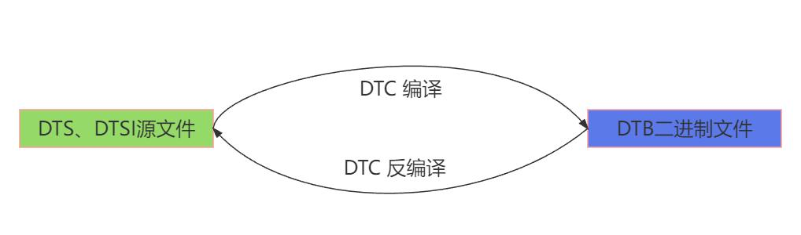
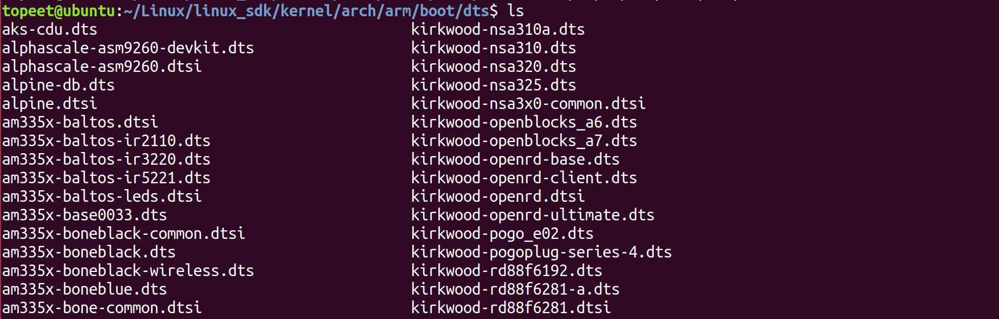
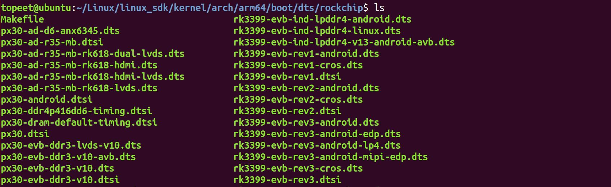
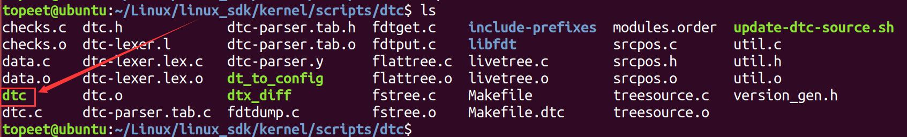
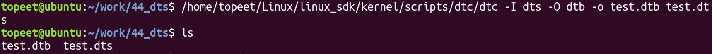
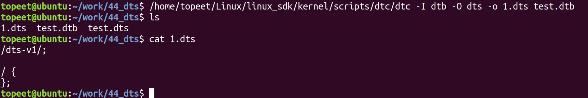

# 第062章 初识设备树

## 62.1 设备树的由来
尽管平台总线模型已经将硬件相关代码归类到了平台总线的device 部分，但是随着时间的推移，Linux 内核中与硬件相关的代码越来越多，不过硬件相关的代码对Linux 内核来说没有实际意义，所以ARM 社区的开发者们逐渐使用设备树来描述硬件资源。由于设备树文件不会被直接编译进内核，而是以外部文件形式提供，因此可以有效地把对内核毫无意义的硬件相关代码从内核中剥离出来。
## 62.2 设备树基础知识
学习设备树（Device Tree）时，通常会涉及到DTS、DTSI、DTB 和DTC 等术语：。下面对每个术语进行介绍。DTS（Device Tree Source）：DTS 是设备树的源文件，采用一种类似于文本的语法来描述硬件设备的结构、属性和连接关系。DTS 文件以.dts 为扩展名，通常由开发人员编写。DTSI（Device Tree Source Include）：DTSI 文件是设备树源文件的包含文件。它扩展了DTS文件的功能，用于定义可重用的设备树片段。DTSI 文件以.dtsi 为扩展名，可以在多个DTS 文件中包含和共享。DTB（Device Tree Blob）：DTB 是设备树的二进制表示形式。DTB 文件是通过将DTS 或DTSI文件编译而成的二进制文件，以.dtb 为扩展名。DTC（Device Tree Compiler）：DTC 是设备树的编译器。它是一个命令行工具，用于将DTS和DTSI 文件编译成DTB 文件。DTS、DTSI、DTB 和DTC 之间的关系：设备树文件需要通过DTC 工具进行编译或反编译。DTC 会将文本格式的设备树文件编译为以.dtb 为后缀的二进制格式文件，以便操作系统能够加载和解析。如图62.1 所示。


图62.1设备树文件存放路径：ARM 体系结构：ARM 体系结构下的设备树源文件通常存放在内核源码arch/arm/boot/dts/目录中。该目录是设备树源文件的根目录，如图62.2 所示。

图62.2ARM64 体系结构：ARM64 体系结构下的设备树源文件通常存放在内核源码arch/arm64/boot/dts/目录及其子目录中。该目录也是设备树源文件的根目录，并包含了针对不同ARM64 平台和设备的子目录，如图62.3 所示。

图62.3在ARM64 的子目录中，按照硬件平台、设备类型或制造商进行组织和分类。这些子目录的命名特定芯片厂商（如Qualcomm、NVIDIA、Samsung）有关，本手册使用的soc 是瑞芯微的rk3568，所以对应的设备树目录为arch/arm64/boot/dts/rockchip。每个子目录中包含多个设备树文件，用于描述不同的硬件配置和设备类型，这里以rockchip 子目录为例，其内容如图62.4

所示。

图62.4
## 62.3 设备树的编译
设备树的编译是将设备树源文件（如上述的.dts 文件）转换为二进制的设备树表示形式（.dtb文件）的过程。编译器被称为DTC（Device Tree Compiler）。DTC（Device Tree Compiler）的源代码和相关工具存放在内核源码scripts/dtc/目录中，如图62.5 所示。

图62.5编译内核源码时dtc 编译器会默认编译，如果没有生成dtc 编译器，需检查内核配置文件（.config）中CONFIG_DTC 配置项是否使能。
设备树的编译：在Linux 环境中，可以使用以下命令将设备树源文件编译为二进制设备树文件：dtc -I dts -O dtb -o output.dtb input.dts其中，input.dts 是输入的设备树源文件，output.dtb 是编译后的二进制设备树文件。参数-I dts 表示输入文件是.dts 文件，参数-O dtb 表示输出文件是.dtb 文件。设备树的反编译：设备树的反编译指的是将二进制设备树文件转换回设备树源文件。以便进行查看、编辑或修改。反编译使用的编译器也是DTC。

在Linux 环境中，可以使用以下命令将二进制设备树文件反编译为设备树源文件：dtc -I dtb -O dts -o output.dts input.dtb其中，input.dtb 是输入的二进制设备树文件，output.dts 是反编译后的设备树源文件。参数-I dts 表示输入文件是.dts 文件，参数-O dtb 表示输出文件是.dtb 文件。下面演示设备树编译和反编译，首先创建一个名为test.dts 的设备树文件，文件内容如代码清单62.1 所示。代码清单62.1
```c
/dts-v1/;
/ {
};
```
创建完成如图62.6 所示。

图62.6然后使用以下命令进行设备树的编译（这里使用的dtc 的绝对路径，可根据自己实际路径进行修改）。/home/topeet/Linux/linux_sdk/kernel/scripts/dtc/dtc -I dts -O dtb -o test.dtb test.dts编译完成如图62.7 所示。

图62.7通过图612.7 可以看到编译好的test.dtb 文件，说明已经编译成功，然后使用以下命令对test.dtb 进行反编译。/home/topeet/Linux/linux_sdk/kernel/scripts/dtc/dtc -I dtb -O dts -o 1.dts test.dtb反编译完成如图62.8 所示。


图62.8反编译成功后会得到1.dts 文件，查看反编译出的1.dts 跟之前的test.dts 内容相同，则说明反编译成功。

