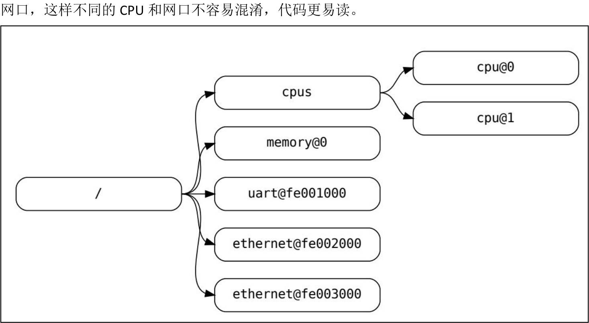

# 第063章 设备树基本语法

本章学习设备树基本语法。
## 63.1 根节点
设备树根节点是整个设备树的起始点和顶层节点。根节点以/标识符作为开头，以{}表示根节点所包含的内容，以分号表示结尾，一个最简单的根节点如代码清单63.1 所示。代码清单63.1
```c
/dts-v1/;//设备树版本信息，版本信息可选
/ {
    //根节点开始
        /*
        在这里可以添加注释，描述根节点的属性和配置
    */
};
```
## 63.2 子节点
子节点是根节点的子项，用于描述具体的硬件设备或设备集合。子节点采用特定的格式来表示，如代码清单63.2 所示。代码清单63.2
```c
[label:] node-name@[unit-address] {
    [properties definitions]
    [child nodes]
};
```
以下是对这些部分的详细介绍：（1）label 节点别名（小名）：是可选项。（2）node-name 节点名称（大名）：在设备树中是唯一且必不可少的。（3）unit-address 单元地址：单元地址用于标识设备的实例。它可以是一个整数、一个十六进制值或一个字符串，具体取决于设备的要求。此部分没有实际意义，只是为了让代码更易读，所以也是可选项。例如在图56.1 中名为cpu 的节点通过它们的单元地址值0 和1 来区分

CPU1 和CPU1，名称为ethernet 的节点通过其单元地址值fe002000 和fe003000 来区分不同的

图63.1（4）properties definitions 属性定义：属性定义是一组键值对，用于描述设备的配置和特性。属性可以根据设备的需求进行定义，例如寄存器地址、中断号、时钟频率等。（5）child node 子节点：子节点是当前节点的子项，用于进一步描述硬件设备的子组件或配置。子节点可以包含自己的属性定义和更深层次的子节点，形成设备树的层次结构。
## 63.3 reg 属性
reg 属性在设备树中用以指定地址，常与#address-cells 和#size-cells 属性搭配使用。#address-cells 表示子节点reg 属性用几个32 位的数表示地址，#size-cells 表示子节点reg 属性用几个32 位的数表示地址长度，使用方法如代码清单63.3、63.4 和63.5 所示。代码清单63.3
```c
/ {
    #address-cells = <0x1>; //在根节点下使用1 个u32 来代表address。
    #size-cells = <0x0>; //在根节点下使用0 个u32 来代表size。
    node1 {
            reg = <0x32>; //表示地址是0x32。
    };
}
```

代码清单63.4
```c
/ {
    #address-cells = <0x1>; //在根节点下使用1 个u32 来代表address。
    #size-cells = <0x1>; //在根节点下使用1 个u32 来代表size。
    node1{
            reg = <0x1000 0x04>;//0x1000 是地址，0x04 是地址的长度
    };
}
```
代码清单63.5
```c
/ {
    #address-cells = <0x2>; //在根节点下使用2 个u32 来代表address。
    #size-cells = <0x1>; //在根节点下使用1 个u32 来代表size。
    node1{
        reg = <0x1000 0000 0x04>;//0x1000 0000 是地址，0x04 是地址的长度
    };
}
```
## 63.4 model 属性
model 是可选属性，用于描述设备的名称或型号，其值为字符串，便于识别和区分设备，如代码清单63.6 展示了如何在设备树中使用model 属性。代码清单63.6
```c
my_device {
    compatible = "vendor,device";
    model = "My Device XYZ";
    // 其他属性和子节点的定义
};
```
model 值为My Device XYZ，表示该设备的型号或名称为My Device XYZ。该属性仅用于标识，不参与驱动匹配。
## 63.5 status 属性
status 属性用于描述设备或节点的状态，属性值是字符串。属性值有以下几种：okay 表示设备或节点是可用状态；disabled 表示设备或节点是不可用状态；reserved 表示设备或节点已被保留，暂时不可用；fail 表示设备或节点是不可用状态并且检测到了错误。

如代码清单63.7 展示了如何在设备树中使用status 属性。代码清单63.7
```c
my_device {
    compatible = "vendor,device";
    status = "okay";
    // 其他属性和子节点的定义
};
```
my_device 节点status 属性值为okay。这表示设备处于正常工作状态，可用。
## 63.6 compatible 属性
设备树中的设备节点使用compatible 属性的值与driver 进行匹配，如使用平台总线就要与平台总线driver 部分中的platform_driver.driver.of_match_table 成员的值进行匹配，如果匹配成功，即字符串值相等，则会执行平台总线driver 部分的probe()函数，如代码清单63.8 所示。代码清单63.8
```c
//设备树
/{
    topeet{
        #address-cells = <1>;
        #size-cells = <1>;
        compatible = "simple-bus";
        myLed{
            compatible = "my devicetree";
        };
    };
};
//平台总线模型的driver 部分
#include <linux/platform_device.h>
#include <linux/mod_devicetable.h>
//匹配成功后执行probe 函数
static int my_platform_probe(struct platform_device *pdev)
{
    printk(KERN_INFO "my_platform_probe: Probing platform device\n");
    return 0;
}
const struct of_device_id of_match_table_id[]= {
    {.compatible="my devicetree"},
};
//定义平台驱动结构体
```

```c
static struct platform_driver my_platform_driver = {
    .probe = my_platform_probe,
    .driver = {
        .name = "my_platform_device",
        .of_match_table = of_match_table_id,
    },
};
```
## 63.7 aliases 节点
aliases 是设备树根节点下的特殊节点，用于为设备节点定义别名，方便引用和管理。每个别名是一个属性，值是要被定义别名的目标节点的路径或引用。aliases 节点使用示例如代码清单63.9 所示。代码清单63.9
```c
aliases {
    mmc0 = &sdmmc0;
    mmc1 = &sdmmc1;
    mmc2 = &sdhci;
    serial0 = "/simple@fe000000/seria1@11c500";
};
```
在代码清单63.9 中，mmc0~mmc2 和serial0 为别名。通过别名，可以更便捷地访问目标节点，避免使用复杂路径。其中& 表示节点引用，字符串则是被起别名的节点所在的路径。
## 63.8 chosen 节点
chosen 节点要位于设备树根节点下，它用于传递系统引导和配置相关信息。其中bootargs属性用于存储引导内核时传递的命令行参数。在引导过程中，操作系统或引导加载程序可以读取该属性来获取启动参数。chosen 节点示例如代码清单63.10 所示。代码清单63.10
```c
chosen {
        bootargs = "root=/dev/nfs rw nfsroot=192.168.1.1 console=ttyS0,115200";
};
```

在代码清单63.10 中，属性bootargs 值为root=/dev/nfs rw nfsroot=192.168.1.1console=ttyS0,115200，指定使用NFS 根文件系统，并将控制台输出重定向到串口ttyS0。
## 63.9 中断相关属性
interrupt-parent 属性用于指定中断控制器，interrupts 属性用于指定中断参数，如代码清单56.11 所示。代码清单63.11interrupt-parent = <&gpio3>;//中断控制器为gpio3interrupts = <RK_PA5 IRQ_TYPE_LEVEL_LOW>;//中断引脚为RK_PA5，宏IRQ_TYPE_LEVEL_LOW 表示触发方式为低电平触发。其中宏IRQ_TYPE_EDGE_RISING 表示上升沿触发，宏IRQ_TYPE_EDGE_FALLING 表示下降沿触发，宏IRQ_TYPE_EDGE_BOTH 表示双边沿触发，宏IRQ_TYPE_LEVEL_HIGH 表示高电平触发。
## 63.10 自定义属性
除固定属性以外，设备树中的属性也可以自定义。自定义属性的具体作用是什么需要根据工程师自己写的驱动程序决定。所以使用设备树描述硬件资源非常灵活。代码清单63.12 展示了在设备树中自定义一个名为pinnum 的管脚标号属性，其属性值为1。代码清单63.12
```c
my_device {
        pinnum = <0 1 2 3 4>;
};
```
## 63.11 修改/追加节点内容
代码清单63.13 中，&pinctrl 并不是一个新建的节点，而是表示对已存在的pinctrl 节点进行追加或修改。其语法格式为：&节点名，用于引用设备树中已有的节点。代码清单63.13 表示向pinctrl 节点追加一个名为uart0 的子节点，并将pinctrl 节点中的status 属性值修改为“okay”，以启用该节点。代码清单63.13
```c
pinctrl: pinctrl {
compatible = "rockchip,rk3568-pinctrl";
    status = "disabled";
```

```c
......
};
&pinctrl {
status = "okay";//把pinctrl 节点中的属性值修改为okay
uart0 {//追加uart0 节点
    /omit-if-no-ref/
    uart0_xfer: uart0-xfer {
        rockchip,pins =<0 RK_PC0 3 &pcfg_pull_up>,
                     <0 RK_PC1 3 &pcfg_pull_up>;
    };
};
```
## 63.12 包含文件
在设备树文件中，可以通过#include 指令包含.h、.dtsi 和.dts 文件，如代码清单63.14 所示。其语法与C 语言一样，<>和“”表示文件查找路径区别。代码清单63.14
```c
#include <dt-bindings/pinctrl/rockchip.h>
#include "rockchip-pinconf.dtsi"
#include "rockchip-evk.dts"
```

