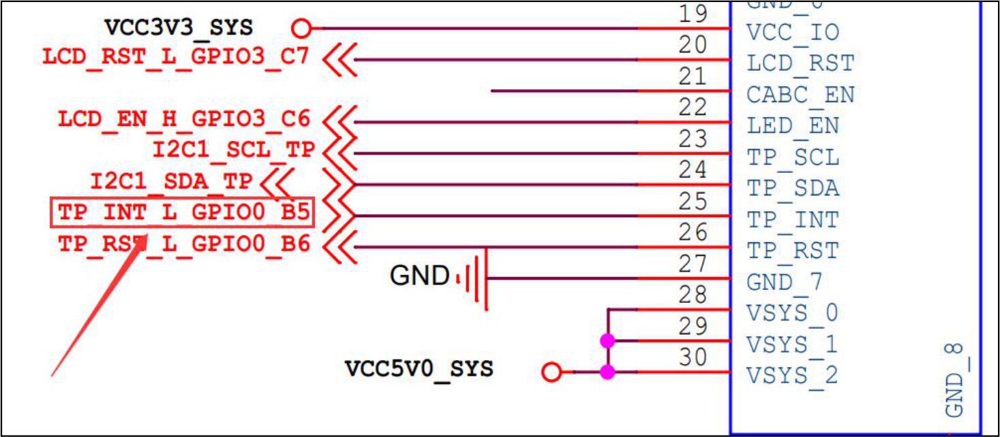
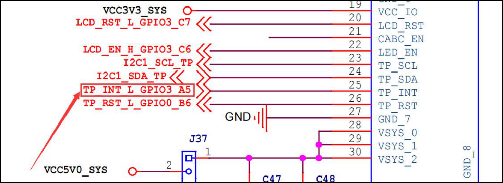
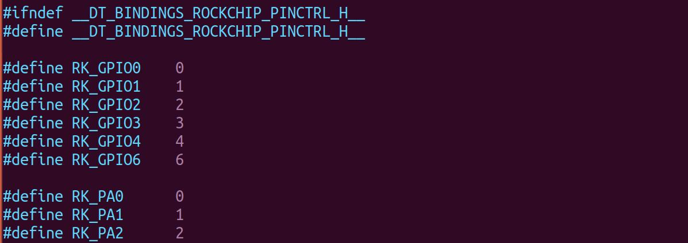
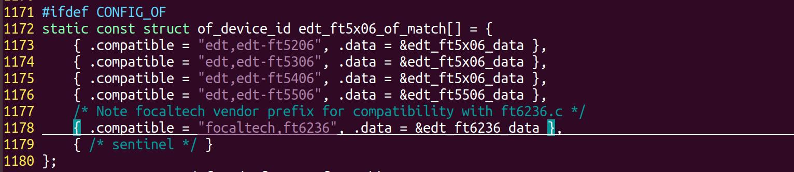

# 第064章 实例分析：中断

## 64.1 中断相关属性
代码清单64.1 展示的是iTOP-RK3568 开发板SDK 源码设备树中的ft5x06 节点，其中蓝色字体部分就是关于中断相关的描述，包括了interrupts、interrupt-controller、#interrupt-cells、interrupt-parent 四种常见属性。代码清单64.1
```c
gpio0: gpio@fdd60000 {
    compatible = "rockchip,gpio-bank";
    reg = <0x0 0xfdd60000 0x0 0x100>;
    interrupts = <GIC_SPI 33 IRQ_TYPE_LEVEL_HIGH>;
    clocks = <&pmucru PCLK_GPI00>, <&pmucru DBCLK_GPI00>;
    gpio-controller;
    #gpio-cells = <2>;
    gpio-ranges = <&pinctrl 0 0 32>;
    interrupt-controller;
    #interrupt-cells = <2>;
  };
ft5x06: ft5x06@38 {
    status = "disabled";
    compatible = "edt,edt-ft5306";
    reg = <0x38>;
    touch-gpio = <&gpio0 RK_PB5 IRQ_TYPE_EDGE_RISING>;
    interrupt-parent = <&gpio0>;
    interrupts = <RK_PB5 IRQ_TYPE_LEVEL_LOW>;
    reset-gpios = <&gpio0 RK_PB6 GPIO_ACTIVE_LOW>;
    touchscreen-size-x = <800>;
    touchscreen-size-y = <1280>;
    touch_type = <1>;
};
```
interrupts 属性interrupts 属性用于描述设备所使用的中断号及触发方式，例如gpio0 节点中的interrupts属性具有三个参数，分别表示中断控制器类型、中断号和中断触发类型。其中中断控制器的常见类型包括GIC (Generic Interrupt Controller)、IRQ (Basic Interrupt Handling)等，触发类型的宏

定义在内核源码include/dt-bindings/interrupt-controller/irq.h 目录下，常见取值如代码清单64.2所示。代码清单64.2
```c
#define IRQ_TYPE_NONE// 无中断触发类型
#define IRQ_TYPE_EDGE_RISING// 上升沿触发
#define IRQ_TYPE_EDGE_FALLING// 下降沿触发
#define IRQ_TYPE_EDGE_BOTH(IRQ_TYPE_EDGE_FALLING | IRQ_TYPE_EDGE_RISING)// 双边沿触发
#define IRQ_TYPE_LEVEL_HIGH// 高电平触发
#define IRQ_TYPE_LEVEL_LOW// 低电平触发
```
而在ft5x06 节点中interrupts 只有中断号和中断触发类型两个参数，这是为什么呢，带着疑问我们继续学习下面的几个属性。interrupt-controller 属性interrupt-controller 属性用于标识当前节点所描述的设备是一个中断控制器。其本身没有特定的属性值，只需出现在节点的属性列表中即可。interrupt-parent 属性interrupt-parent 属性用于指定当前节点的中断由哪个控制器处理。在代码清单64.1 中ft5x06 的interrupt-parent = <&gpio0>;就是表示ft5x06 的中断由gpio0 控制器负责。该属性用于建立中断源与中断控制器的关联。#interrupt-cells 属性#interrupt-cells 属性的值是一个整数，表示中断控制器下的设备描述一个中断所需的单元数。例如，GIC 控制器使用#interrupt-cells = <2>表示使用这个中断控制器的设备中的interrupts属性需2 个参数。
## 64.2 中断实例编写
本节编写一个在iTOP-RK3568 开发板上的ft5x06 触摸中断设备树。1.确定ft5x06 的中断引脚号由于iTOP-RK3568 有1.2 和1.7 两个版本，所以这里展示了两个版本的原理图，如图64.1和64.2 所示。


图64.1

图64.2图64.1 为V1.2 版本的原理图，触摸引脚网络标号为TP_INT_L_GPIO0_B5，对应的SOC 管脚为GPIO0_B5，图64.2 为V1.7 版本的原理图，触摸引脚网络标号为TP_INT_L_GPIO3_A5，对应的SOC 管脚为GPIO3_A5。在内核源码目录下的include/dt-bindings/pinctrl/rockchip.h 头文件中，定义了RK 引脚名和gpio 编号的宏定义，如图64.3 所示。可以直接通过宏定义表示对应的引脚。


图64.32.确定compatible 属性值在内核源码drivers/input/touchscreen/edt-ft5x06.c 文件中可以找到ft5x06 驱动匹配所支持的compatible 属性值，如图64.4 所示。

图64.4这里作者选择的是edt,edt-ft5206。即ft5x06 设备树中compatible 属性值为edt,edt-ft5206。3.编写ft5x06 设备树V1.2 版本底板编写完成的设备树如代码清单64.3 所示。代码清单64.3
```c
/dts-v1/;
#include "dt-bindings/pinctrl/rockchip.h"
#include "dt-bindings/interrupt-controller/irq.h"
/{
    model = "This is my devicetree!";
    ft5x06@38 {
        compatible = "edt,edt-ft5206";
        interrupt-parent = <&gpio0>;
        interrupts = <RK_PB5 IRQ_TYPE_EDGE_RISING>;
    };
```

```c
};
```
V1.7 版本底板编写完成的设备树如代码清单64.4 所示。代码清单64.4
```c
/dts-v1/;
#include "dt-bindings/pinctrl/rockchip.h"
#include "dt-bindings/interrupt-controller/irq.h"
/{
    model = "This is my devicetree!";
    ft5x06@38 {
        compatible = "edt,edt-ft5206";
        interrupt-parent = <&gpio3>;
        interrupts = <RK_PA5 IRQ_TYPE_EDGE_RISING>;
    };
};
```
代码清单64.3 和64.4 中。第1 行: 设备树文件的头部，指定了使用的设备树语法版本。第3-4 行：引入引脚与中断宏定义头文件。第5 行：表示设备树的根节点开始。第6 行：通过model 属性指定设备树名称为"This is my devicetree!"。第9 行：驱动匹配字符串。第10 行：指定中断所属控制器是gpio3。第11 行：配置中断引脚和触发方式。RK_PB5 表示中断信号的引脚编号，IRQ_TYPE_EDGE_RISING 表示中断类型为上升沿触发。至此，关于ft5x06 的设备树就讲解完成了。
## 64.3 其他SOC 设备树对比
无论使用的是瑞芯微SOC 还是恩智浦、三星的SOC 或者其他厂家的SOC，在设备树中关于中断相关的描述都离不开上面提到的四个属性。在恩智浦源码中的ft5x06 设备树如代码清单64.5 所示。代码清单64.5
```c
gpio1: gpio@0209c000 {
    compatible = "fsl,inx6ul-gpio", "fsl,imx35-gpio";
    reg = <0x0209c000 0x4000>;
    interrupts = <GIC_SPI 66 IRQ_TYPE_LEVEL_HIGH>, <GIC_SPI 67 IRQ_TYPE_LEVEL_HIGH>;
    gpio-controller;
    #gpio-cells = <2>;
    interrupt-controller;
```

```c
#interrupt-cells = <2>;
edt-ft5x06@38 {
    compatible = "edt,edt-ft5306", "edt,edt-ft5x06", "edt,edt-ft5406";
    pinctrl-names = "default";
    pinctrl-0 = <&ts_int_pin &ts_reset_pin>;
    reg = <0x38>;
    interrupt-parent = <&gpio1>;
    interrupts = <9 0>;
    reset-gpios = <&gpio5 9 GPIO_ACTIVE_LOW>;
    irq-gpios = <&gpio1 9 GPIO_ACTIVE_LOW>;
    status = "disabled";
};
};
```
在三星源码中的ft5x06 设备树如代码清单64.6 所示。代码清单64.6
```c
gpio_c: gpioc {
    compatible = "gpio-controller";
    #gpio-cells = <2>;
    interrupt-controller;
    #interrupt-cells = <2>;
};
ft5x06: ft5x06038 {
    compatible = "edt,edt-ft5406";
    reg = <0x38>;
    pinctrl-names = "default";
    #if defined(RGB_1024x600) || defined(RGB_800x480)
    pinctrl-0 = <&tsc2007_irq>;
    interrupt-parent = <&gpio_c>;
    interrupts = <26 IRQ_TYPE_EDGE_FALLING>;
    #endif
    #if defined(LvDs_800×1280) || defined(LvDS_1024x768)
    pinctrl-0 = <&gt911_irq>;
    interrupt-parent = <&gpio_b>;
    interrupts = <29 IRQ_TYPE_EDGE_FALLING>;
    #endif
        reset-gpios = <&gpio_e 30 0>;
};
```
对代码清单64.5 和64.6 对比之后会发现，不同厂商对于中断属性的配置都是类似的，只

是里面的参数有些许区别，如果大家在之后遇到了其他平台，只需要稍加区分即可。

