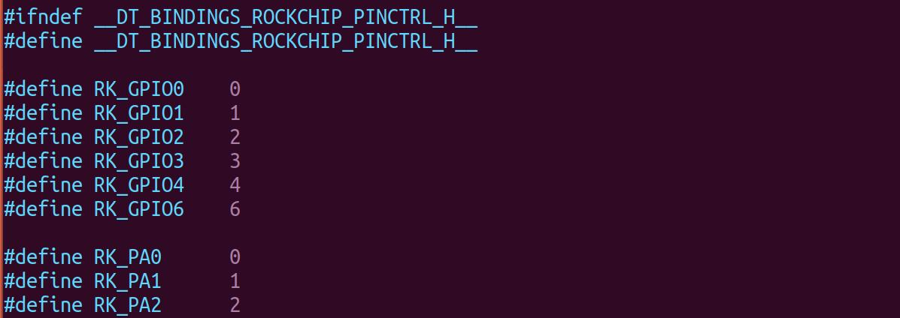
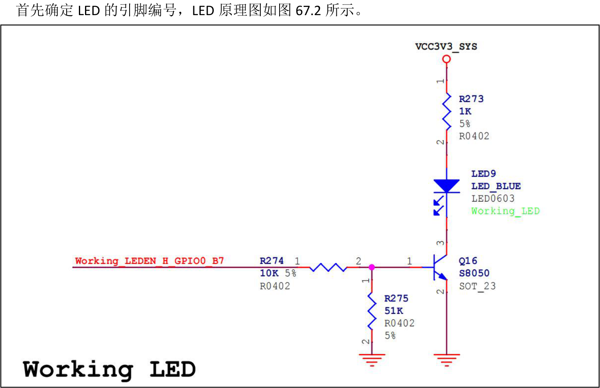
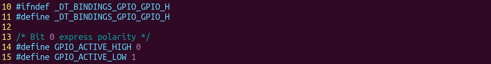
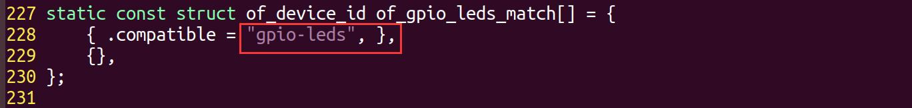

# 第067章 实例分析：GPIO

## 67.1 GPIO 相关属性
代码清单67.1 展示的是iTOP-RK3568 开发板SDK 源码中的ft5x06 设备树，其中蓝色字体部分就是关于gpio 相关的描述。代码清单67.1
```c
gpio0: gpio@fdd60000 {
    compatible = "rockchip,gpio-bank";
    reg = <0x0 0xfdd60000 0x0 0x100>;
    interrupts = <GIC_SPI 33 IRQ_TYPE_LEVEL_HIGH>;
    clocks = <&pmucru PCLK_GPI00>, <&pmucru DBCLK_GPI00>;
    gpio-controller;
    #gpio-cells = <2>;
    gpio-ranges = <&pinctrl 0 0 32>;
    interrupt-controller;
    #interrupt-cells = <2>;
  };
ft5x06: ft5x06@38 {
    status = "disabled";
    compatible = "edt,edt-ft5306";
    reg = <0x38>;
    touch-gpio = <&gpio0 RK_PB5 IRQ_TYPE_EDGE_RISING>;
    interrupt-parent = <&gpio0>;
    interrupts = <RK_PB5 IRQ_TYPE_LEVEL_LOW>;
    reset-gpios = <&gpio0 RK_PB6 GPIO_ACTIVE_LOW>;
    touchscreen-size-x = <800>;
    touchscreen-size-y = <1280>;
    touch_type = <1>;
};
```
gpio-controller 属性gpio-controller 属性用于标识当前节点所描述的设备是一个GPIO 控制器。其本身没有特定的属性值，只需出现在节点中即可。#gpio-cells 属性#gpio-cells 属性值是一个整数，表示用于GPIO 引脚描述符的单元数，通常值为2。例如在

代码清单67.1 中reset-gpios 引用了gpio0 控制器，而gpio0 控制器中#gpio-cells 属性被设置为了2，所以reset-gpios 使用RK_PB6 和GPIO_ACTIVE_LOW 两个值进行描述。其中RK_PB6 定义在内核源码include/dt-bindings/pinctrl/rockchip.h 头文件中，该文件中定义了RK 引脚名和gpio 编号的宏定义，如图67.1 所示。

图67.1GPIO_ACTIVE_LOW 定义在内核源码include/dt-bindings/gpio/gpio.h 头文件中，表示引脚设置为低电平，同理GPIO_ACTIVE_HIGH 就表示将这个GPIO 设置为高电平，不过这里只是描述并不是说这里设置成低电平就一定是低电平，具体是否按照描述进行设置需要根据驱动决定。其他属性设备树节点示例如代码清单67.2 所示。代码清单67.2
```c
gpio-controller@00000000 {
    compatible = "foo";
    reg = <0x00000000 0x1000>;
    gpio-controller;
    #gpio-cells = <2>;
    ngpios = <18>;
    gpio-reserved-ranges = <0 4>, <12 2>;
    gpio-line-names = "MMC-CD", "MMC-WP",
                      "voD eth", "RST eth", "LED R",
                      "LED G", "LED B", "col A",
                      "col B", "col C", "col D",
                      "NMI button", "Row A", "Row B",
                      "Row C", "Row D", "poweroff",
                      "reset";
};
```
ngpios 属性：指定了GPIO 控制器所支持的GPIO 引脚数量。此处为18，意味着该GPIO 控制器支持18 个GPIO 引脚。

gpio-reserved-ranges 属性：定义了保留的GPIO 范围。每个范围由两个整数值表示。例如<0 4>表示从第0 个引脚开始的连续4 个引脚被保留，即第一个参数为起始引脚，第二个参数为引脚数量。gpio-line-names 属性：定义了GPIO 引脚的名称，以逗号分隔。这里描述的就是ngpios 属性所指的18 个GPIO 引脚对应的名称。
## 67.2 GPIO 实例编写
编写一个在RK3568 上LED 灯的GPIO 设备树。1.确定LED 引脚编号

图67.2从图67.2 可以得到LED 灯的引脚网络标号为Working_LEDEN_H_GPIO0_B7，对应的GPIO引脚为GPIO0_B7。在内核源码include/dt-bindings/pinctrl/rockchip.h 头文件中，定义了RK 引脚名和gpio 编号的宏定义，如图67.3 所示。


图67.3在源码include/dt-bindings/gpio/gpio.h 文件中定义了引脚极性设置宏定义，如图67.4 所示。

图67.4其中GPIO_ACTIVE_HIGH 表示将该引脚设置为高电平，GPIO_ACTIVE_LOW 表示将该引脚设置为低电平。2.确定compatible 属性值查看内核源码中led 的驱动文件drivers/drivers/leds/leds-gpio.c，找到compatible 匹配值相关的部分，如图67.5 所示。

图67.5可以看到compatible 匹配值为gpio-leds。即compatible 属性值需要设置成gpio-leds。3.编写设备树编写完成的设备树如代码清单67.3 所示。代码清单67.3
```c
/dts-v1/;
#include "dt-bindings/pinctrl/rockchip.h"
#include "dt-bindings/gpio/gpio.h"
/{
```

```c
model = "This is my devicetree!";
led led@1 {
    compatible = "gpio-leds";
    gpios = <&gpio0 RK_PB7 GPIO_ACTIVE_HIGH>
};
};
```
代码清单67.3 中：第1 行: 设备树文件的头部，指定了使用的设备树语法版本。第3-4 行：引入了gpio 编号与极性设置宏定义。第5 行：表示设备树的根节点开始。第6 行：指定设备树的名称为"This is my devicetree!"。第9 行：驱动匹配字符串。第10 行：指定了该LED 设备所使用的GPIO 引脚。
## 67.3 其他SOC 设备树对比
无论使用的是瑞芯微SOC 还是恩智浦、三星的SOC 或者其他厂家的SOC，在设备树关于gpio 相关的描述都是类似的。在恩智浦源码中的ft5x06 设备树如代码清单67.4 所示（关于gpio 相关的属性已经标记为了蓝色）。代码清单67.4
```c
gpio1: gpio@0209c000 {
    compatible = "fsl,inx6ul-gpio", "fsl,imx35-gpio";
    reg = <0x0209c000 0x4000>;
    interrupts = <GIC_SPI 66 IRQ_TYPE_LEVEL_HIGH>, <GIC_SPI 67 IRQ_TYPE_LEVEL_HIGH>;
    gpio-controller;
    #gpio-cells = <2>;
    interrupt-controller;
    #interrupt-cells = <2>;
    edt-ft5x06@38 {
        compatible = "edt,edt-ft5306", "edt,edt-ft5x06", "edt,edt-ft5406";
        pinctrl-names = "default";
        pinctrl-0 = <&ts_int_pin &ts_reset_pin>;
        reg = <0x38>;
        interrupt-parent = <&gpio1>;
        interrupts = <9 0>;
```

```c
reset-gpios = <&gpio5 9 GPIO_ACTIVE_LOW>;
irq-gpios = <&gpio1 9 GPIO_ACTIVE_LOW>;
status = "disabled";
};
};
```
在三星源码中的ft5x06 设备树如代码清单67.5 所示。代码清单67.5
```c
gpio_c: gpioc {
    compatible = "gpio-controller";
    #gpio-cells = <2>;
    interrupt-controller;
    #interrupt-cells = <2>;
};
ft5x06: ft5x06038 {
    compatible = "edt,edt-ft5406";
    reg = <0x38>;
    pinctrl-names = "default";
    #if defined(RGB_1024x600) || defined(RGB_800x480)
    pinctrl-0 = <&tsc2007_irq>;
    interrupt-parent = <&gpio_c>;
    interrupts = <26 IRQ_TYPE_EDGE_FALLING>;
    #endif
    #if defined(LvDs_800×1280) || defined(LvDS_1024x768)
    pinctrl-0 = <&gt911_irq>;
    interrupt-parent = <&gpio_b>;
    interrupts = <29 IRQ_TYPE_EDGE_FALLING>;
    #endif
     reset-gpios = <&gpio_e 30 0>;
};
```
对比之后会发现，不同厂商对于gpio 的配置都是类似的，只是里面的参数有些许区别，如果大家在之后遇到了其他平台，只需要稍加区分即可。

