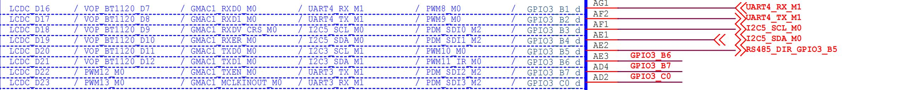
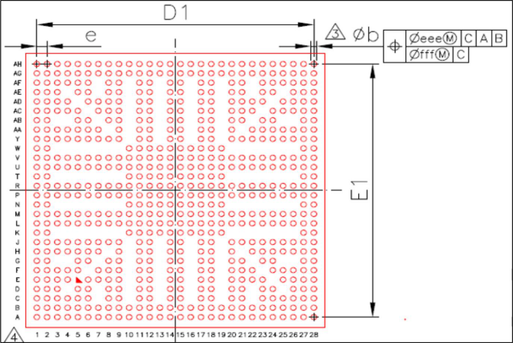
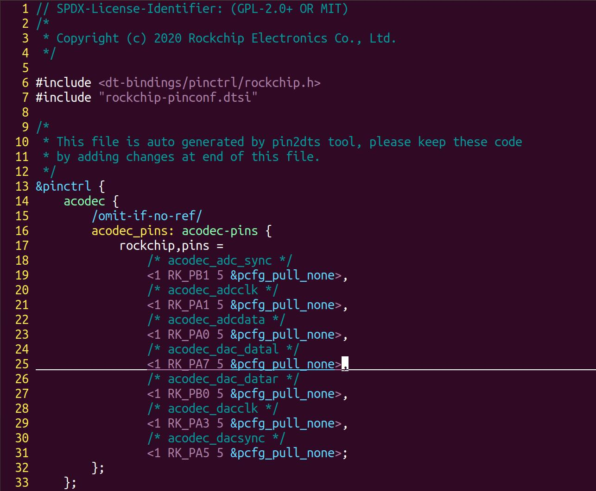
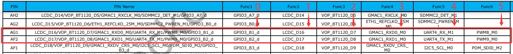
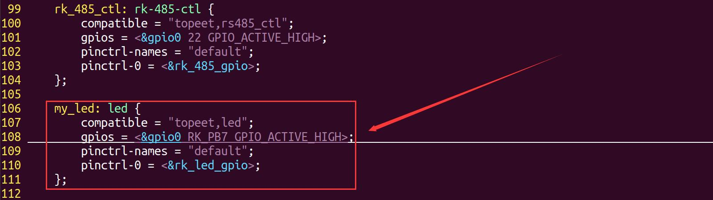
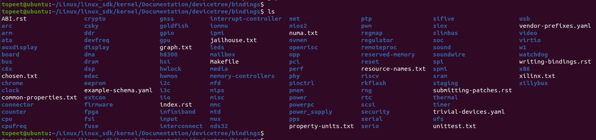

# 第068章 实例分析：pinctrl

## 68.1 pinmux 介绍
pinmux 即引脚复用。现代处理器中单个引脚可以具有多个功能，例如一个引脚可配置为GPIO、UART、SPI 或I2C 等。那我们要怎样知晓每一个管脚都可以复用成什么功能呢？如iTOP-RK3568 开发板在核心板原理图中标注出了每个管脚的复用功能，如图68.1 所示。

图68.1从图68.1 可以看到UART4_RX_M1 对应的引脚可以复用为以下6 个功能：LCDC_D16、VOP_BT1120_D7、GMAC1_RXD0_M0、UART4_RX_M1、PWM8_M0、GPIO3_B1_d。其对应的BGA 引脚标号为AG1，那这里的BGA，AG1 又是什么呢？BGA 是一种封装，RK3568 处理器使用的封装为BGA 封装，在BGA（Ball Grid Array，球栅阵列）封装中，引脚标号是用于唯一标识每个引脚的标识符。这些标号通常由芯片制造商定义，并在芯片的规格文档或数据手册中提供。BGA 芯片的引脚标号通常由字母和数字的组合构成。它们用于在芯片的封装底部的焊盘上进行标记。每个引脚标号都与芯片内部的功能或信号相对应，以便正确连接到印刷电路板（PCB）上的目标位置。RK3568 处理器的引脚标号图如图68.2 所示。


图68.2可以看到纵向为A-AH 的28 个字母类型标号，横向为1-28 的28 个字母类型标号，通过横向和纵向坐标即可确定一个引脚，如AG1 代表纵坐标是AG，横坐标是1。这样通过横纵坐标就可确定一个引脚位置。瑞芯微公司也在RK3568 数据手册中加入了根据BGA 位置制作的复用功能图，部分内容如图68.3 所示。


图68.3其中黑色框代表被保留的引脚，其他有颜色的框一般为电源和地，白色的框代表有具体复用功能的引脚。
## 68.2 使用pinctrl 设置复用关系
通过pinctrl 在设备树中可以设置引脚复用关系，pinctrl 的语法由客户端和服务端两个部分构成。
### 68.2.1 客户端（Client）
客户端代码格式是固定的，通过pinctrl-names 和pinctrl-<N>属性完成。接下来将使用三个例子对客户端要用到的属性进行讲解。例1 如代码清单68.1 所示。代码清单68.1
```c
node {
    pinctrl-names = "default";
    pinctrl-0 = <&pinctrl_hog_1>;
}
```
在代码清单68.1 中，pinctrl-names 属性定义了一个状态default，对应的引脚配置通过pinctrl-0 属性指定为pinctrl_hog_1 节点对应的引脚配置。即在default 状态下使用pinctrl_hog_1节点中的引脚配置。

例2 如代码清单68.2 所示。代码清单68.2
```c
node {
    pinctrl-names = "default", "wake up";
    pinctrl-0 = <&pinctrl_hog_1>;
    pinctrl-1 = <&pinctrl_hog_2>;
}
```
在代码清单68.2 中，pinctrl-names 属性定义了两个状态名称default 和wake up，其中pinctrl-0 属性指定default 对应的引脚配置为pinctrl_hog_1 节点对应的引脚配置。pinctrl-1 属性指定wake up 对应的引脚配置为pinctrl_hog_2 节点对应的引脚配置。在驱动程序中，俩个状态可以互相切换。例3 如代码清单68.3 所示。代码清单68..3
```c
node {
    pinctrl-names = "default";
    pinctrl-0 = <&pinctrl_hog_1 &pinctrl_hog_2>;
}
```
在代码清单68.3 中，pinctrl-names 属性定义了一个状态名称default。但与之前的例子不同的是，在pinctrl-0属性中引用了两个引脚配置节点pinctrl_hog_1 和pinctrl_hog_2，说明default状态需使用多个引脚配置。
### 68.2.2 服务端（Server）
服务端是设备树中定义引脚配置的部分。如前面提到的pinctrl_hog_1 和pinctrl_hog_2 节点都属于服务端。不同处理器其服务端代码格式是不同的。这里以iTOP-rk3568 的SDK 为例进行pinctrl 服务端的讲解，瑞芯微原厂BSP 工程师将服务器代码写在了arch/arm64/boot/dts/rockchip/rk3568-pinctrl.dtsi 设备树中，部分代码如图68.4所示。


图68.4以uart4 的引脚复用为例进行讲解，uart4 的pinctrl 服务端内容如图68.5 所示。

图68.5其中<3 RK_PB1 4 &pcfg_pull_up>和<3 RK_PB2 4 &pcfg_pull_up>分别表示将GPIO3 的PB1 引脚设置为功能4，将GPIO3 的PB2 也设置为功能4，且电器属性都设置为上拉。通过查找原理图可以得到两个引脚在BGA 封装位置分别为AG1 和AF2，如图68.6 所示。

图68.6

然后在rk3568 的数据手册中找到引脚复用表对应的位置，具体内容如图68.7 所示。

图68.7可以看到功能4 对应串口4 的发送端和接收端，pinctrl 服务端的配置和数据手册中的引脚复用功能是一一对应，那如果要将RK_PB1 和RK_PB2 设置为GPIO 功能要如何设置呢，从上图可以看到GPIO 对应功能0，所以可以通过代码清单68.4 内容将设置RK_PB1 和RK_PB2 设置为GPIO 功能（事实上如果不对该管脚进行功能复用该引脚默认就会设置为GPIO 功能）：代码清单68.4
```c
<3 RK_PB1 0 &pcfg_pull_up>,
<3 RK_PB2 0 &pcfg_pull_up>;
```
然后在客户端对uart4 服务端的引用即可通过pinctrl 设置引脚复用，如图68.8 所示。

图68.8
## 68.3 pinctrl 实例编写
本节将iTOP-RK3568 开发板上的led 的控制引脚复用为GPIO 模式。1.梳理设备树结构设备树之间包含关系如表68.1 所。表68.1顶层设备树rk3568-evb1-ddr4-v10-linux.dts第二级设备树rk3568-evb1-ddr4-v10.dtsirk3568-linux.dtsi第三级设备树rk3568.dtsirk3568-evb.dtsitopeet_screen_choose.dtsitopeet_rk3568_lcds.dtsi
led 节点位于rk3568-evb.dtsi 设备树中，如图68.9 所示。


图68.92.使用pinctrl 设置引脚复用由图68.9 可以看到这里并没有配置gpio 的复用，因为当一个引脚没有被复用为任何功能时，默认就是GPIO 功能，所以这里没有pinctrl 配置led 功能也可以正常使用。为熟练pinctrl 的配置，这里我们仍旧使用pinctrl 对led 进行配置，首先注释掉默认的leds节点，注释完成如图68.10 所示。

图68.10然后进入到rk3568-evb1-ddr4-v10.dtsi 设备树中，找到rk_485_ctl 节点，可以看到rk_485_ctl节点如图68.11 所示。

图68.11rk_485_ctl 节点也是用来控制一个GPIO 的，我们可以仿照该节点编写led 节点。在该节点下方编写led 控制节点，编写的led 节点内容如代码清单68.5 所示。代码清单68.5
```c
my_led: led {
   compatible = "topeet,led";
   gpios = <&gpio0 RK_PB7 GPIO_ACTIVE_HIGH>;
   pinctrl-names = "default";
   pinctrl-0 = <&rk_led_gpio>;
};
```
添加完成如图68.12 所示。


图68.12然后继续找到在同一设备树文件的485 pinctrl 服务端节点，具体内容如图68.13 所示。

图68.13然后在该节点下方仿写led 控制引脚pinctrl 服务端节点，led 引脚的pinctrl 节点内容如代码清单68.6 所示。代码清单68.6
```c
rk_led{
    rk_led_gpio:rk-led-gpio {
        rockchip,pins = <0 RK_PB7 RK_FUNC_GPIO &pcfg_pull_none>;
    };
};
```
添加完成后如图68.14 所示。

图68.14至此，led 的控制引脚就通过pinctrl 被复用为了GPIO 功能，重新编译内核，如果没有报错就证明我们的实验完成了。编写led 节点我们参考了设备树中默认有的节点，那如果遇到没有可参考的节点怎么办呢？可以看内核Documentation/devicetree/bindings 目录下的文档，其提供了有关设备树的各种设备和驱动程序的详细说明和用法示例。bindings 目录如图68.15 所示。


图68.15

