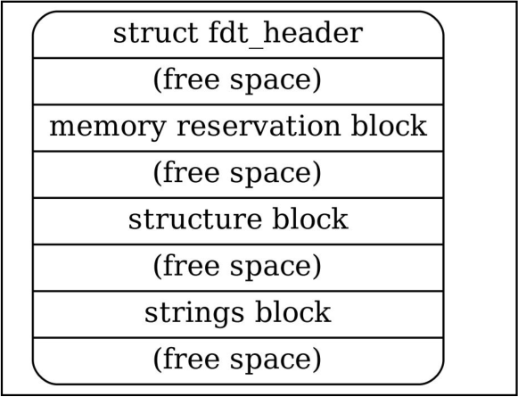
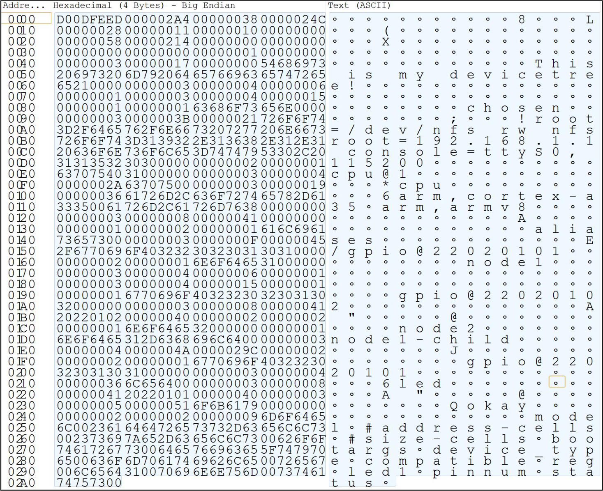
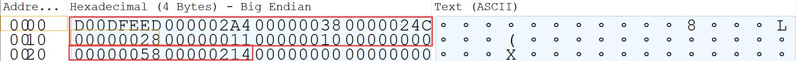
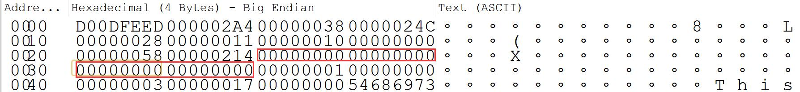
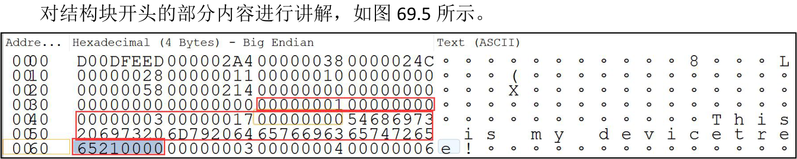
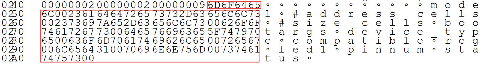

# 第069章 DTB文件格式

DTB 文件格式主要分small header（头部）、memory reservation block（内存预留块）、structureblock（结构块）和strings block（字符串块）等四个部分。还有一个不一定存在的free space（自由空间），free space 主要功能是为了对其。如图69.1 所示。

图69.1以代码清单69.1 所示的设备树源码为例对DTB 文件的四个部分式进行讲解。代码清单69.1
```c
/dts-v1/;
/ {
    model = "This is my devicetree!";
    #address-cells = <1>;
    #size-cells = <1>;
    chosen {
        bootargs = "root=/dev/nfs rw nfsroot=192.168.1.1 console=ttyS0, 115200";
    };
    cpu1: cpu@1 {
        device_type = "cpu";
        compatible = "arm,cortex-a35", "arm,armv8";
        reg = <0x0 0x1>;
    };
    aliases {
        led1 = "/gpio@22020101";
    };
```

```c
node1 {
    #address-cells = <1>;
    #size-cells = <1>;
    gpio@22020102 {
        reg = <0x20220102 0x40>;
    };
};
node2 {
    node1-child {
        pinnum = <01234>;
    };
};
gpio@22020101 {
    compatible = "led";
    reg = <0x20220101 0x40>;
    status = "okay";
};
};
```
对应设备树dts 文件、dtb 文件以及pxBinaryViewerSetup 二进制分析软件存储在网盘
\49_dt_format 路径下。将代码清单69.1 所示设备树使用dtc 工具编译成dtb 文件后，使用二进制分析软件打开dtb文件并设置为大端模式，打开后如图69.2 所示。


图69.2
## 69.1 头部
dtb 的头部由fdt_header 结构定义，如代码清单69.2 所示。代码清单69.2
```c
struct fdt_header {
    uint32_t magic;
    uint32_t totalsize;
    uint32_t off_dt_struct;
    uint32_t off_dt_strings;
    uint32_t off_mem_rsvmap;
    uint32_t version;
    uint32_t last_comp_version;
    uint32_t boot_cpuid_phys;
    uint32_t size_dt_strings;
    uint32_t size_dt_struct;
};
```

每个字段的描述如表69.1 所示。表69.1字段描述magic为固定值0xd00dfeed，用于标识设备树二进制文件（DTB）totalsize表示dtb 文件的总大小（以字节为单位）off_dt_struct表示结构块在dtb 文件中的偏移地址off_dt_strings表示字符串块在dtb 文件中的偏移地址off_mem_rsvmap表示内存预留块在dtb 文件中的偏移地址version表示设备树数据结构的版本last_comp_version表示向后兼容的设备树数据结构的最低版本boot_cpuid_phys表示cpu 的ID 值，与设备树中cpu 节点的reg 属性对应size_dt_strings表示字符串块的大小size_dt_struct表示结构块的大小然后查看二进制文件，其中4 个字节表示一个单位，前十个单位分别代表上述的十个字段如图69.3 所示。

图69.3图69.3 中数据整理成下表69.2。表69.2字段十六进制数值代表含义magicD00DFEED固定值totalsize000002A4转换为十进制之后为676，表示该文件大小为676 字节表示结构块从00000038 这个地址开始，和后面的off_dt_struct00000038size_dt_struct 结构块大小参数一起可以确定结构块的存储范围表示字符串块从0000024C 这个地址开始，和后面的off_dt_strings0000024Csize_dt_strings 字符串块大小参数一起可以确定字符串块的存储范围表示内存预留块的偏移为00000028，header 之后结构块off_mem_rsvmap00000028之前都是属于内存预留块。11 转换为十进制之后为17，表示当前设备树结构版本为version0000001110 转换为十进制之后为16，表示向前兼容的设备树结构last_comp_version00000010版本为16boot_cpuid_phys00000000表示设备树中cpu 节点的reg 属性为0表示字符串块的大小为00000058 ，和前面的size_dt_strings00000058off_dt_strings 字符串块偏移值一起可以确定字符串块的范围size_dt_struct00000214表示结构块的大小为00000214，和前面的off_dt_struct

结构块偏移值一起可以确定结构块的范围
## 69.2 内存预留块
内存预留块是使用memreserve 描述的保留内存的大小。由于在示例设备树（代码清单69.1）中没有设置内存保留块，所以相应的区域都为0，如图69.4 所示。

图69.4该区域包括了若干的保留内存描述符。每个保留内存描述符是由address 和size 组成，由fdt_reserve_entry 结构体表示，如代码清单69.3 所示。代码清单69.3
```c
struct fdt_reserve_entry {
    uint64_t address;
    uint64_t size;
};
```
其中address 类型为64 位整数，表示保留区域的起始地址。即在系统启动时，这部分内存将被标记为“保留”状态，不能被操作系统或其他程序使用。这通常是一些引导程序、硬件资源、或者用于特殊目的的内存区域。size 类型也是64 位整数，该字段表示保留区域的大小（以字节为单位）。它指定了从address开始的连续内存区域的大小，这部分内存将被标记为“保留”并不能被其他应用程序占用。
## 69.3 结构块
结构块描述的是设备树的结构，也就是设备树的节点。那如何表示一个节点的开始和结束呢。FDT_BEGIN_NODE (0x00000001):FDT_BEGIN_NODE 标记表示一个节点的开始。它后面跟着节点名称（根节点名字用0 表示）作为额外数据。节点名称以空字符结尾的字符串形式存储，并且可以包括单元地址。节点名称后可能需要填充零字节以对齐，然后是下一个标记，可以是除了FDT_END_NODE 之外的任何标记。FDT_END_NODE (0x00000002):

FDT_END_NODE 标记表示一个节点的结束。该标记没有额外的数据，紧随其后的是下一个标记，可以是除了FDT_PROP 之外的任何标记。FDT_PROP (0x00000003):FDT_PROP 标记表示设备树中属性的开始。它后面跟着描述属性的额外数据，该数据由属性的长度和名称组成，用代码清单69.4 所示结构表示。代码清单69.4
```c
struct {
    uint32_t len;
    uint32_t nameoff;
}
```
len 表示属性值的字节长度，nameoff 表示属性名字在字符串块中的偏移。在这个结构之后，属性的值作为字节字符串输出。属性值后可能需要填充零字节以对齐，然后是下一个标记，可以是除了FDT_END_NODE 之外的任何标记。FDT_NOP (0x00000004):FDT_NOP 标记可以被解析设备树的程序忽略。该标记没有额外的数据，紧随其后的是下一个标记，可以是任何有效的标记。FDT_END (0x00000009):FDT_END 标记表示根节点的结束，也就是整个结构块的结束。

图69.5上图629.5 中的数据整理成下表69.3。表69.3十六进制数值代表含义00000001根节点的开始00000000根节点名字为000000003设备树中属性的开始代表该属性的大小，换算成十进制为23，也就是"This is my devicetree!"这一00000017字符串的长度00000000代表该属性在字符串块的偏移量，这里为0，表示无偏移54686973-model 的具体值65210000

## 69.4 字符串块
字符串块用于存储设备树中使用的所有属性名称。它由一系列以空字符结尾的字符串组成，这些字符串在字符串块中简单地连接在一起，具体如图69.6 所示。

图69.6字符串块中的字符串以空字符00 作为终止符来连接。这意味着每个字符串都以空字符结尾，并且下一个字符串紧跟在上一个字符串的末尾。图69.6 中可以看出model 属性名称对应的字符串为6D6F64656C，后面00 表示结束。后面属性以此类推即可。（2）偏移量引用在结构块中，属性的名称是通过偏移量来引用字符串块中的相应字符串的。偏移量是一个无符号整数值，它表示字符串在字符串块中的位置。通过使用偏移量引用，设备树可以节省空间，并且在属性名称发生变化时也更加灵活，因为只需要更新偏移量，而不需要修改结构块中的属性引用。（3）对齐约束：字符串块没有对齐约束，这意味着它可以出现在设备树blob 的任何偏移处。这使得字符串块的位置在设备树blob 中是灵活的，并且可以根据需要进行调整，而不会对设备树的解析和处理造成影响。字符串块是设备树中用于存储属性名称的部分。它由字符串连接而成，并通过偏移量在结构块中进行引用。字符串块的灵活位置使得设备树的表示更加紧凑和可扩展。

