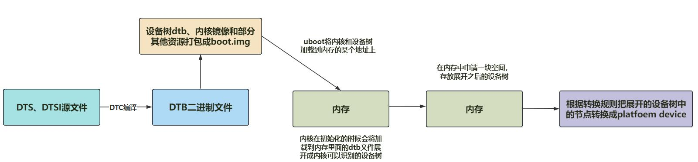
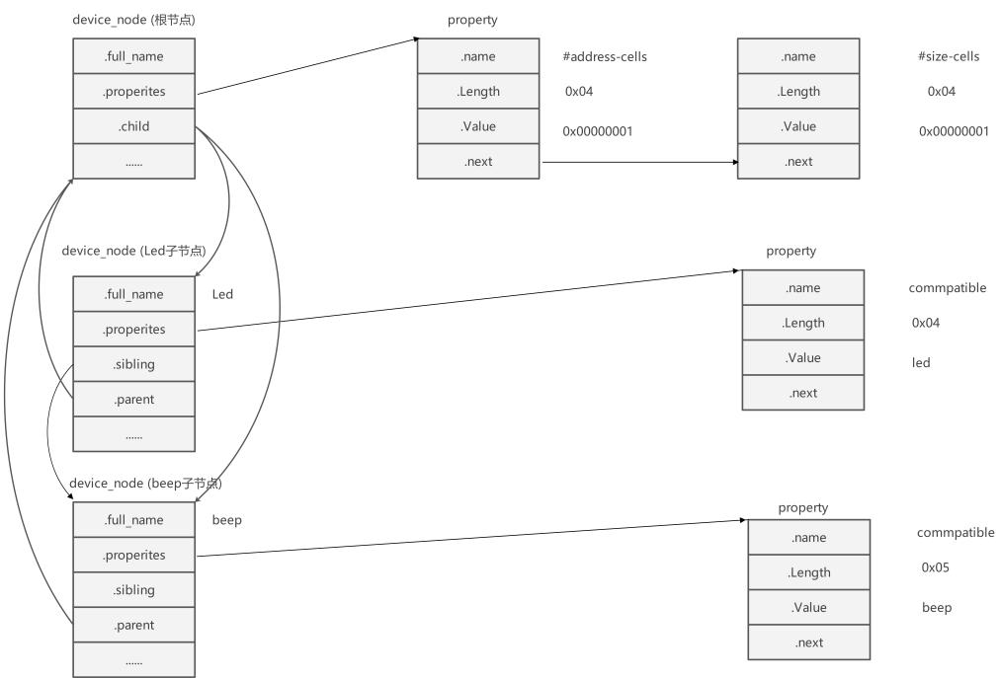
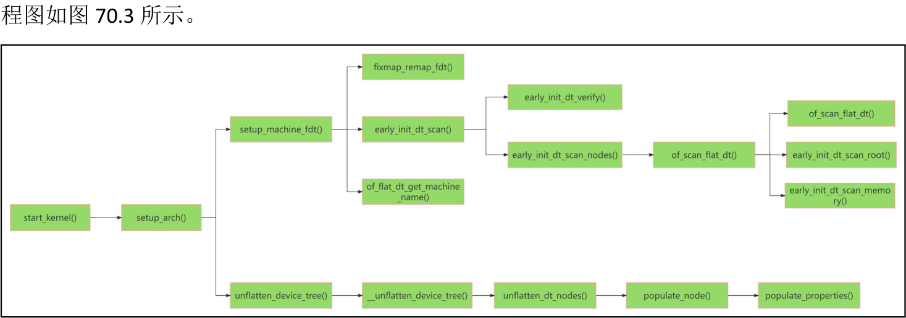

# 第070章 设备树展开流程

设备树会被编译成DTB 文件并不会被编译进内核。但是因为设备树描述的是硬件资源，内核又要使用设备树中描述的硬件资源。所以Linux 会把设备树转换成内核可以识别的格式。如图70.1 是设备树的转换流程。

图70.1
## 70.1 dtb 展开成device_node
在图63.1 中提到内核在初始化的时候会将加载到内存里面的dtb 文件展开成内核可以识别的设备树，这里的可识别格式就是指将dtb 解析成内核中的设备节点，在Linux 中用device_node结构体表示设备节点。device_node 结构体定义在内核源码的include/linux/of.h 文件中，具体内容如代码清单70.1 所示。代码清单70.1
```c
struct device_node {
const char *name;//设备节点的名称
const char *type;//设备节点的类型
phandle phandle;//设备节点的句柄
const char *full_name;//设备节点的完整名称
struct fwnode_handle fwnode;//设备节点的固件节点句柄
struct property *properties;//设备节点的属性列表
struct property *deadprops;//已删除的属性列表
struct device_node *parent;//设备节点的父节点
struct device_node *child;//设备节点的子节点
struct device_node *sibling;//设备节点的同级节点
#if defined(CONFIG_OF_KOBJ)
```

```c
struct kobject kobj;//内核对象（用于sysfs）
#endif
unsigned long _flags;//设备节点的标志位
void *data;//与设备节点相关的数据指针
#if defined(CONFIG_SPARC)
const char *path_component_name; //设备节点的路径组件名称
unsigned int unique_id;//设备节点的唯一标识
struct of_irq_controller *irq_trans; //设备节点的中断控制器
#endif
};
```
可以通过device_node 结构体中节点的名字、父节点、子节点和同级节点，以代码方式构建出与dts 文件中一致的设备节点关系。其中properties 字段是指向设备节点属性的指针。设备节点的属性包含了与设备节点相关联的配置和参数信息。property 字段同样定义在内核源码的include/linux/of.h 文件中，具体内容如代码清单70.2 所示。代码清单70.2
```c
struct property {
    char *name;//属性的名称
    int length;//属性值的长度（字节数）
    void *value;//属性值
    struct property *next;//指向节点的下一个属性
    #if defined(CONFIG_OF_DYNAMIC) || defined(CONFIG_SPARC)
    unsigned long _flags;//属性的标志位
    #endif
    #if defined(CONFIG_OF_PROMTREE)
    unsigned int unique_id;//属性的唯一标识
    #endif
    #if defined(CONFIG_OF_KOBJ)
    struct bin_attribute attr;//内核对象二进制属性
    #endif
};
```
例如代码清单70.3 展示了在根节点下有led 和beep 两个子节点，每个子节点都有一个compatible 属性。同时根节点还定义了#address-cells 和#size-cells 属性。代码清单70.3
```c
/ {
    #address-cells = <1>;
    #size-cells = <1>;
    led{
```

```c
compatible = "led";
};
beep{
compatible = "beep";
};
};
```
代码清单70.3 中的节点在代码中用device_node 结构体表示，其扁平化结构如图70.2 所示。

图70.2
## 70.2 dtb 展开过程源码分析
dtb 文件最终会展开成device_node 这一可以让内核识别的格式，那更具体的实现流程是怎样的呢，我们继续解析源码。首先来到内核源码目录下的init/main.c 文件，找到其中的start_kernel ()函数，该函数是Linux 内核启动的入口点，它是Linux 内核的核心函数之一，负责完成内核的初始化和启动过程，具体内容如代码清单70.4 所示。

代码清单70.4
```c
asmlinkage __visible void __init start_kernel(void)
{
    char *command_line;
    char *after_dashes;
    set_task_stack_end_magic(&init_task);//设置任务栈的魔数
    smp_setup_processor_id();//设置处理器ID
    debug_objects_early_init();//初始化调试对象
    cgroup_init_early();//初始化cgroup（控制组）
    local_irq_disable();//禁用本地中断
    early_boot_irqs_disabled = true;//标记早期引导期间中断已禁用
    /*
     * 中断仍然被禁用。进行必要的设置，然后启用它们。
     */
    boot_cpu_init();//初始化引导CPU
    page_address_init();//设置页地址
    pr_notice("%s", linux_banner);//打印Linux 内核版本信息
    setup_arch(&command_line);//架构相关的初始化
    mm_init_cpumask(&init_mm);//初始化内存管理的cpumask（CPU 掩码）
    setup_command_line(command_line);//设置命令行参数
    setup_nr_cpu_ids();//设置CPU 个数
    setup_per_cpu_areas();//设置每个CPU 的区域
    smp_prepare_boot_cpu();//准备启动CPU（架构特定的启动CPU 钩子）
    boot_cpu_hotplug_init();//初始化热插拔的引导CPU
    build_all_zonelists(NULL);//构建所有内存区域列表
    page_alloc_init();//初始化页面分配器
    ........
}
```
代码清单70.3 中跟设备树相关的函数为第20 行的setup_arch(&command_line)，该函数定义在内核源码的arch/arm64/kernel/setup.c 文件中，具体内容如代码清单70.5 所示。代码清单70.5
```c
void __init setup_arch(char **cmdline_p)
{
    init_mm.start_code = (unsigned long) _text;
    init_mm.end_code= (unsigned long) _etext;
    init_mm.end_data= (unsigned long) _edata;
```

```c
init_mm.brk= (unsigned long) _end;
*cmdline_p = boot_command_line; //记录了uboot 传递给内核的command_line，大小为4096。
early_fixmap_init();//初始化early fixmap
early_ioremap_init();//初始化early ioremap
setup_machine_fdt(__fdt_pointer);//设置机器的FDT（平台设备树）
//初始化静态密钥，早期可能会被cpufeature 代码和早期参数启用
jump_label_init();
parse_early_param();
//在启动可能的早期控制台后，解除屏蔽异步中断和FIQ（一旦我们可以报告发生的系统错误）
local_daif_restore(DAIF_PROCCTX_NOIRQ);
//在这个阶段，TTBR0 仅用于身份映射。将其指向零页面，以避免做出猜测性的新条目获取。
cpu_uninstall_idmap();
xen_early_init();// Xen 平台的早期初始化
efi_init();// EFI 平台的初始化
arm64_memblock_init();// ARM64 内存块的初始化
paging_init();//分页初始化
acpi_table_upgrade();// ACPI 表的升级
//解析ACPI 表以进行可能的引导时配置
acpi_boot_table_init();
if (acpi_disabled)
    unflatten_device_tree();//展开设备树
bootmem_init();//引导内存的初始化
............
}
```
在setup_arch()函数中与设备树相关的函数分别为第13 行的setup_machine_fdt(__fdt_pointer)和第37 行的unflatten_device_tree()，接下来将对上述两个函数进行详细的介绍。
### 70.2.1 setup_machine_fdt(__fdt_pointer)函数
setup_machine_fdt(__fdt_pointer)中的__fdt_pointer 参数是uboot 传递给内核的dtb 文件加载到内存的地址。以ARM64 为例，在内核源码目录下的arch/arm64/kernel/head.S 文件中把dtb 加载地址保存到了__fdt_pointer 中，关键内容如代码清单70.6 所示。

代码清单70.6
```c
preserve_boot_args:
    mov x21, x0// x21=FDT
__primary_switched:
    str_l x21, __fdt_pointer, x5// Save FDT pointer
```
x0 寄存器值由uboot 设置，保存的是dtb 在内存中的物理地址。代码清单63.5 中第2 行将寄存器x0 的值复制到寄存器x21 中，第5 行又将寄存器x21 的值存储到__fdt_pointer 中。这样uboot 就把dtb 地址传递给了内核。。然后来看setup_machine_fdt()函数，该函数定义在内核源码的arch/arm64/kernel/setup.c文件中，具体内容如代码清单70.7 所示。代码清单70.7
```c
//初始化设置机器的设备树
static void __init setup_machine_fdt(phys_addr_t dt_phys)
{
    int size;
    //将设备树物理地址映射到内核虚拟地址空间
    void *dt_virt = fixmap_remap_fdt(dt_phys, &size, PAGE_KERNEL);
    const char *name;
    //如果映射成功
    if (dt_virt) {
        //保留设备树占用的内存区域
        memblock_reserve(dt_phys, size);
    }
    // 如果设备树映射失败或者设备树解析失败
    if (!dt_virt || !early_init_dt_scan(dt_virt)) {
        //输出错误信息
        pr_crit("\n"
        "Error: invalid device tree blob at physical address %pa (virtual address 0x%p)\n"
        "The dtb must be 8-byte aligned and must not exceed 2 MB in size\n"//dtb 文件大小不能超过2M
        "\nPlease check your bootloader.",
        &dt_phys, dt_virt);
        //无限循环，等待系统崩溃
        while (true)
            cpu_relax();
    }
```

```c
//将设备树所在的内存地址设置为只读模式
fixmap_remap_fdt(dt_phys, &size, PAGE_KERNEL_RO);
//获取设备树根节点下的model 和compatible 的属性值
name = of_flat_dt_get_machine_name();
//如果设备树没有机器名，则返回
if (!name)
    return;
    pr_info("Machine model: %s\n", name); //输出model 属性值
    dump_stack_set_arch_desc("%s (DT)", name); //设置堆栈描述信息
}
```
在代码清单70.7 第6 行中该函数将dtb 位于内存的物理地址映射成虚拟地址。然后使用memblock_reserve(dt_phys, size)将dtb 位于内存的物理地址保留，防止该地址被覆盖。然后通过调用early_init_dt_scan()进行扫描，检查设备树的有效性和完整性。检查完成后调用fixmap_remap_fdt()将设备树所在的内存地址设置为只读模式。early_init_dt_scan()函数定义在内核源码的drivers/of/fdt.c 目录下，具体内容如代码清单70.8 所示。代码清单70.8
```c
bool __init early_init_dt_scan(void *params)
{
    bool status;
    // 验证设备树的兼容性和完整性
    status = early_init_dt_verify(params);
    if (!status)
        return false;
    // 扫描设备树节点
    early_init_dt_scan_nodes();
    return true;
}
```
在代码清单70.8 第6 行中调用了early_init_dt_verify() 函数校验检查设备树，该函数的具体内容如代码清单70.9 所示。代码清单70.9
```c
bool __init early_init_dt_verify(void *params)
{
    // 验证传入的参数是否为空
    if (!params)
```

```c
return false;
// 检查设备树头部的有效性
// 如果设备树头部无效，返回false
if (fdt_check_header(params))
return false;
//将dtb 的虚拟地址保存到了initial_boot_params 中
initial_boot_params = params;
//计算设备树的CRC32 校验值
//并将结果保存在全局变量of_fdt_crc32 中
of_fdt_crc32 = crc32_be(~0, initial_boot_params, fdt_totalsize(initial_boot_params));
//返回true，表示设备树验证和初始化成功
return true;
}
```
early_init_dt_verify() 函数主要进行校验检查的工作。除此之外在代码清单63.9 第13 行该函数将dtb 的虚拟地址保存到了initial_boot_params 中。然后继续回到early_init_dt_scan() 函数中，如果设备树验证成功（即status 为真），则调用early_init_dt_scan_nodes() 函数，这个函数的作用是扫描设备树的节点并进行相应的处理，该函数的具体内容如代码清单70.10 所示。代码清单70.10
```c
void __init early_init_dt_scan_nodes(void)
    {
    /* 从/chosen 节点中检索各种信息*/
    of_scan_flat_dt(early_init_dt_scan_chosen, boot_command_line);
    /* 初始化{size,address}-cells 信息*/
    of_scan_flat_dt(early_init_dt_scan_root, NULL);
    /* 设置内存信息，调用early_init_dt_add_memory_arch 函数*/
    of_scan_flat_dt(early_init_dt_scan_memory, NULL);
}
```
该函数会遍历设备树的节点，解析出重要的信息用于内核启动。至此，关于setup_machine_fdt(__fdt_pointer)代码的分析就完成了。
### 70.2.2 unflatten_device_tree 函数
unflatten_device_tree()函数为dtb 展开成device_node 树状结构的核心函数。该函数定义在

内核源码的drivers/of/fdt.c 文件中，具体内容如代码清单70.11 所示。
代码清单70.11
```c
void __init unflatten_device_tree(void)
{
    /* 解析设备树*/
    __unflatten_device_tree(initial_boot_params, NULL, &of_root,
                             early_init_dt_alloc_memory_arch, false);
    /* 获取指向"/chosen" 和"/aliases" 节点的指针，以供全局使用*/
    of_alias_scan(early_init_dt_alloc_memory_arch);
    /* 运行设备树的单元测试*/
    unittest_unflatten_overlay_base();
}
```
代码清单70.11 第4 行封装了__unflatten_device_tree 函数，该函数中的initial_boot_params 参数就是代码清单63.9 中保存的dtb 的虚拟地址，of_root 参数为设备树的device_node 的根节点的指针，early_init_dt_alloc_memory_arch 参数是为device_node 和property 这两个结构体分配地址。该函数的具体内容如代码清单70.12 所示。代码清单70.12
```c
void *__unflatten_device_tree(const void *blob,
               struct device_node *dad,
                   struct device_node **mynodes,
                   void *(*dt_alloc)(u64 size, u64 align),
                   bool detached)
{
    int size;
    void *mem;
    pr_debug(" -> unflatten_device_tree()\n");
    if (!blob) {
        pr_debug("No device tree pointer\n");
        return NULL;
    }
    pr_debug("Unflattening device tree:\n");
    pr_debug("magic: %08x\n", fdt_magic(blob));
```

```c
pr_debug("size: %08x\n", fdt_totalsize(blob));
pr_debug("version: %08x\n", fdt_version(blob));
if (fdt_check_header(blob)) {
    pr_err("Invalid device tree blob header\n");
    return NULL;
}
/* 第一遍扫描，计算大小*/
size = unflatten_dt_nodes(blob, NULL, dad, NULL);
if (size < 0)
    return NULL;
size = ALIGN(size, 4);
pr_debug("大小为%d，正在分配内存...\n", size);
/* 为展开的设备树分配内存*/
mem = dt_alloc(size + 4, alignof(struct device_node));
if (!mem)
    return NULL;
memset(mem, 0, size);
*(__be32 *)(mem + size) = cpu_to_be32(0xdeadbeef);
pr_debug("正在展开%p...\n", mem);
/* 第二遍扫描，实际展开设备树*/
unflatten_dt_nodes(blob, mem, dad, mynodes);
if (be32_to_cpup(mem + size) != 0xdeadbeef)
    pr_warning("End of tree marker overwritten: %08x\n",
           be32_to_cpup(mem + size));
if (detached && mynodes) {
    of_node_set_flag(*mynodes, OF_DETACHED);
    pr_debug("unflattened tree is detached\n");
}
pr_debug(" <- unflatten_device_tree()\n");
return mem;
}
```
该函数的重点在两次设备树的扫描上。第一遍扫描的目的是计算展开设备树所需的内存大小。代码清单70.12 第29 行中

unflatten_dt_nodes()函数的作用就是递归地遍历设备树数据块，并计算展开设备树所需的内存大小。它的第二个参数为NULL 表示只统计大小不做其他操作。计算完成后，unflatten_dt_nodes()函数会返回展开设备树所需的内存大小，然后在对大小进行对齐操作，并为展开的设备树分配内存。第二遍扫描的目的是实际展开设备树，并填充设备节点的名称、类型和属性等信息。代码清单70.12 第48 行中再次调用了unflatten_dt_nodes 函数进行第二遍扫描，第二个参数不再是NULL，第二遍扫描会将设备树数据块中的节点展开为真正的设备节点，并填充节点的名称、类型和属性等信息。这样就完成了设备树的展开过程。其中unflatten_dt_nodes()函数具体定义如代码清单70.13 所示。代码清单70.13
```c
static int unflatten_dt_nodes(const void *blob,
                   void *mem,
                   struct device_node *dad,
                   struct device_node **nodepp)
{
    struct device_node *root;// 根节点
    int offset = 0, depth = 0, initial_depth = 0;// 偏移量、深度和初始深度
    #define FDT_MAX_DEPTH64// 最大深度
    struct device_node *nps[FDT_MAX_DEPTH];// 设备节点数组
    void *base = mem;// 基地址，用于计算偏移量
    bool dryrun = !base;// 是否只是模拟运行，不实际处理
    if (nodepp)
        *nodepp = NULL;// 如果指针不为空，将其置为空指针
    /*
     * 如果@dad 有效，则表示正在展开设备子树。
     * 在第一层深度可能有多个节点。
     * 将@depth 设置为1，以使fdt_next_node() 正常工作。
     * 当发现负的@depth 时，该函数会立即退出。
     * 否则，除第一个节点外的设备节点将无法成功展开。
     */
    if (dad)
        depth = initial_depth = 1;
    root = dad;// 根节点为@dad
    nps[depth] = dad;// 将根节点放入设备节点数组
```

```c
for (offset = 0;
     offset >= 0 && depth >= initial_depth;
     offset = fdt_next_node(blob, offset, &depth)) {
    if (WARN_ON_ONCE(depth >= FDT_MAX_DEPTH))
        continue;
    // 如果未启用CONFIG_OF_KOBJ 并且节点不可用，则跳过该节点
    if (!IS_ENABLED(CONFIG_OF_KOBJ) &&
        !of_fdt_device_is_available(blob, offset))
        continue;
    // 填充节点信息，并将子节点添加到设备节点数组
    if (!populate_node(blob, offset, &mem, nps[depth],
                &nps[depth+1], dryrun))
        return mem - base;
    if (!dryrun && nodepp && !*nodepp)
        *nodepp = nps[depth+1];// 将子节点指针赋值给@nodepp
    if (!dryrun && !root)
        root = nps[depth+1];// 如果根节点为空，则将子节点设置为根节点
}
if (offset < 0 && offset != -FDT_ERR_NOTFOUND) {
    pr_err("Error %d processing FDT\n", offset);
    return -EINVAL;
}
// 反转子节点列表。一些驱动程序假设节点顺序与.dts 文件中的节点顺序一致
if (!dryrun)
    reverse_nodes(root);
return mem - base;// 返回处理的字节数
}
```
在代码清单70.13 中29-49 行为一个for 循环，其中首先会调用fdt_next_node() 函数用来遍历获取设备树的每一个节点。找到节点后，调用populate_node() 函数填充节点信息，构造每一个device_node 以及其下对应的property。其中populate_node() 函数定义如代码清单70.14所示。代码清单70.14
```c
static bool populate_node(const void *blob,
               int offset,
               void **mem,
```

```c
struct device_node *dad,
struct device_node **pnp,
bool dryrun)
{
struct device_node *np;// 设备节点指针
const char *pathp;// 节点路径字符串指针
unsigned int l, allocl;// 路径字符串长度和分配的内存大小
pathp = fdt_get_name(blob, offset, &l);// 获取节点路径和长度
if (!pathp) {
*pnp = NULL;
return false;
}
allocl = ++l;// 分配内存大小为路径长度加一，用于存储节点路径字符串
np = unflatten_dt_alloc(mem, sizeof(struct device_node) + allocl,
  __alignof__(struct device_node));// 分配设备节点内存
if (!dryrun) {
char *fn;
of_node_init(np);// 初始化设备节点
np->full_name = fn = ((char *)np) + sizeof(*np);// 设置设备节点的完整路径名
memcpy(fn, pathp, l);// 将节点路径字符串复制到设备节点的完整路径名中
if (dad != NULL) {
np->parent = dad;// 设置设备节点的父节点
np->sibling = dad->child;// 设置设备节点的兄弟节点
dad->child = np;// 将设备节点添加为父节点的子节点
}
}
populate_properties(blob, offset, mem, np, pathp, dryrun);// 填充设备节点的属性信息
if (!dryrun) {
np->name = of_get_property(np, "name", NULL);// 获取设备节点的名称属性
np->type = of_get_property(np, "device_type", NULL);// 获取设备节点的设备类型属性
if (!np->name)
np->name = "<NULL>";// 如果设备节点没有名称属性，则设置为"<NULL>"
if (!np->type)
np->type = "<NULL>";// 如果设备节点没有设备类型属性，则设置为"<NULL>"
}
*pnp = np;// 将设备节点指针赋值给*pnp
```

```c
return true;
}
```
在populate_node ()函数中首先会调用unflatten_dt_alloc ()函数分配设备节点内存。分配的内存大小为sizeof(struct device_node) + allocl 字节，并使用__alignof__(struct device_node) 对齐。然后调用populate_properties ()函数填充设备节点的属性信息。至此，关于dtb 二进制文件展开成device_node 的过程就讲解完成了，完整的源码分析流

图70.3

