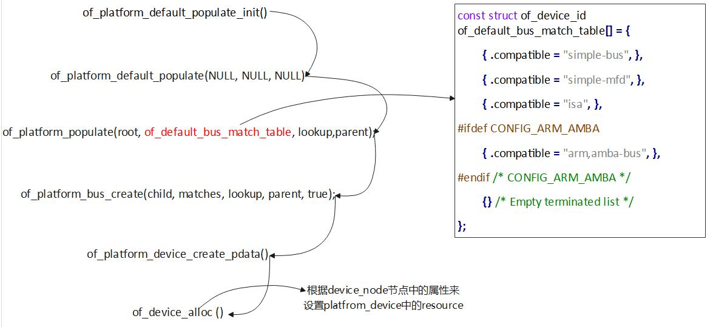
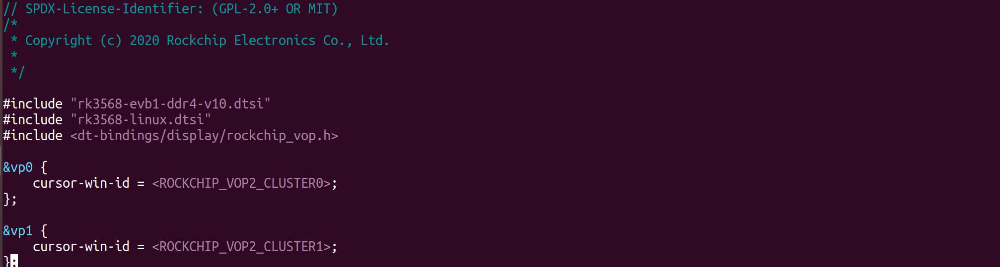
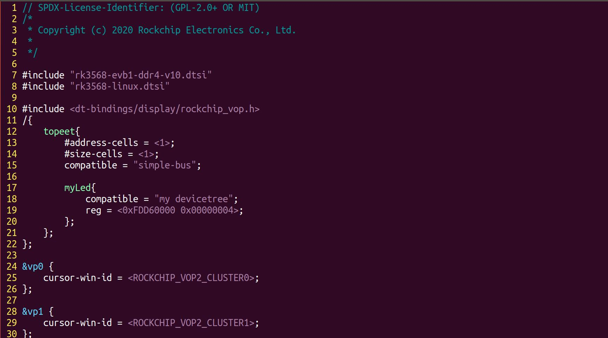
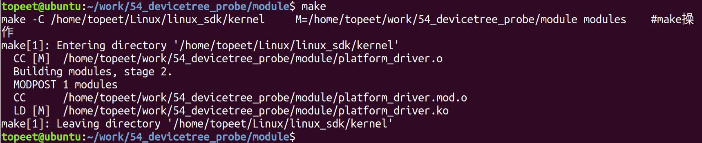
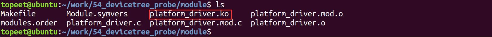
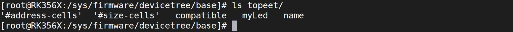
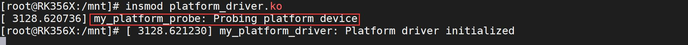
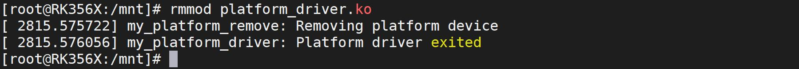

# 第072章 设备树下platform_device和platform_driver匹配实验

```c
platform_device_put(dev);
goto err_clear_flag;
}
return dev;
err_clear_flag:
/* 清除设备节点的已填充标志*/
of_node_clear_flag(np, OF_POPULATED);
return NULL;
```
of_platform_device_create_pdata() 函数作用根据设备树节点分配并初始化一个platform_device，并将其注册到设备模型中。代码清单71.10 第10 行函数会检查设备节点的可用性，即检查设备树对应节点的status属性。如果设备节点不可用或已经被填充，则直接返回NULL。代码清单71.10 第15 行函数调用of_device_alloc ()分配一个platform_device 型结构体，并将设备节点指针、设备标识符和父设备指针传递给它。如果分配失败，则跳转到err_clear_flag 标签处进行错误处理。代码清单71.10 第29 行调用of_device_add() 将平台设备添加到设备模型中。至此，关于device_node 转换成platform_device 的具体流程就分析完成了，函数调用流程图如图71.1 所示。

图71.1

在本章将将会对设备树下platform_device 和platform_driver 的匹配进行实验。
## 72.1 of_match_table
在平台总线驱动模型中，platform_driver 与platform_device 之间的匹配通常依赖于platform_device 结构体中的name 字段与platform_driver 中嵌套的driver.name 或id_table 进行比对。然而，在使用设备树描述硬件资源的场景中，驱动程序需通过of_match_table 实现与设备树节点的匹配。of_match_table 是driver 结构体中的一个成员，其指向一个const structof_device_id 类型的数组，用于描述兼容设备信息of_device_id 结构体定义在内核源码include/linux/mod_devicetable.h 文件中，具体内容如代码清单72.1 所示。代码清单72.1
```c
struct of_device_id {
    char name[32];
    char type[32];
    char compatible[128];
    const void *data;
};
```
struct of_device_id 结构体通常作为一个数组在驱动程序中定义，每个元素用于指定一个兼容字符串，数组的最后一个元素必须是一个空的结构体，以标记数组的结束。如代码清单72.2 展示了如何在驱动程序中使用of_device_id 进行设备树匹配。代码清单72.2
```c
static const struct of_device_id my_driver_match[] = {
    { .compatible = "vendor,device-1" },
    { .compatible = "vendor,device-2" },
    { },
};
```
在代码清单72.2 中my_driver_match 定义了两个匹配项，分别对应设备树节点中的compatible 属性。驱动程序将根据这些兼容性字符串与设备树中的节点进行匹配。

## 72.2 实验程序编写
本次实验的要求使用设备树描述下面的内存资源：内存资源：起始寄存器地址：0xFDD60000结束寄存器地址：0xFDD60004然后编写对应的platform_driver 驱动程序，要求跟上述内存资源所创建的节点进行匹配，从而验证上一小节讲解的of_match_table 属性。
### 72.2.1 设备树的编写
改完成的dts 文件和编译完成的boot.img 镜像存储在网盘iTOP-RK3568 开发板\07_学习教程配套资料\03_Linux 驱动配套资料\04_Linux 驱动例程\54_devicetree_probe\dts 目录下。1.梳理设备树结构设备树之间的包含关系如表72.1 所示。表72.1顶层设备树rk3568-evb1-ddr4-v10-linux.dts第二级设备树rk3568-evb1-ddr4-v10.dtsirk3568-linux.dtsi第三级设备树rk3568.dtsirk3568-evb.dtsitopeet_screen_choose.dtsitopeet_rk3568_lcds.dtsi
rk3568-evb1-ddr4-v10-linux.dts 是顶层设备树，为了便于理解我们之后在该设备树下进行节点的添加（当然这里也可以修改其他设备树），进入该设备树文件之后如图72.1 所示。

图72.1然后将根据需求编写的设备树节点添加到rk3568-evb1-ddr4-v10-linux.dts 中，要添加的内容如代码清单72.3 所示。代码清单72.3

```c
/{
    topeet{
        #address-cells = <1>;
        #size-cells = <1>;
        compatible = "simple-bus";
        myLed{
            compatible = "my devicetree";
            reg = <0xFDD60000 0x00000004>;
        };
    };
};
```
为了避免#address-cells = <1>和#size-cells = <1>这两个属性改变根节点其他的节点的属性，所以在这里创建了一个topeet 节点。在这个示例中，#address-cells 设置为1 表示地址使用一个32 位的单元，#size-cells 也设置为1 表示地址大小使用一个32 位的单元。将topeet 节点的compatible 属性设置为simple-bus，在转换platform_device 的过程中，会继续查找该节点的子节点。子节点myLed 的compatible 属性为my devicetree，表明该节点将会被转换为platform_device。reg 属性用于描述myLed 节点的寄存器信息。reg 属性的值<0xFDD60000 0x00000004> 表示myLed 设备的寄存器起始地址为0xFDD60000，大小为0x00000004。添加完成如图72.2 所示。


图72.2保存退出之后，重新编译内核源码，编译完成之后将生成的boot.img 烧写到开发板即可。
### 72.2.2 驱动程序的编写
本实验代码存储在网盘iTOP-RK3568 开发板\07_学习教程配套资料\03_Linux 驱动配套资料\04_Linux 驱动例程\54_devicetree_probe\module 目录下。本小节驱动程序是由“注册platform 驱动实验”程序修改而来，相较于源程序只是添加了of_match_table 相关代码，用来与设备树节点进行匹配。实验代码platform_driver.c 如代码清单72.4 所示。代码清单72.4
```c
#include <linux/module.h>
#include <linux/platform_device.h>
#include <linux/mod_devicetable.h>
// 平台设备的初始化函数
static int my_platform_probe(struct platform_device *pdev)
{
    printk(KERN_INFO "my_platform_probe: Probing platform device\n");
        // 添加设备特定的操作
        // ...
    return 0;
}
// 平台设备的移除函数
static int my_platform_remove(struct platform_device *pdev)
{
    printk(KERN_INFO "my_platform_remove: Removing platform device\n");
    // 清理设备特定的操作
    // ...
    return 0;
}
const struct of_device_id of_match_table_id[]= {
    {.compatible="my devicetree"},
};
```

```c
// 定义平台驱动结构体
static struct platform_driver my_platform_driver = {
    .probe = my_platform_probe,
    .remove = my_platform_remove,
    .driver = {
        .name = "my_platform_device",
        .owner = THIS_MODULE,
        .of_match_table =of_match_table_id,
    },
};
// 模块初始化函数
static int __init my_platform_driver_init(void)
{
    int ret;
    // 注册平台驱动
    ret = platform_driver_register(&my_platform_driver);
    if (ret) {
        printk(KERN_ERR "Failed to register platform driver\n");
        return ret;
    }
    printk(KERN_INFO "my_platform_driver: Platform driver initialized\n");
    return 0;
}
// 模块退出函数
static void __exit my_platform_driver_exit(void)
{
    // 注销平台驱动
    platform_driver_unregister(&my_platform_driver);
    printk(KERN_INFO "my_platform_driver: Platform driver exited\n");
}
module_init(my_platform_driver_init);
module_exit(my_platform_driver_exit);
MODULE_LICENSE("GPL");
MODULE_AUTHOR("topeet");
```

## 72.3 运行测试
### 72.3.1 编译驱动程序
在platform_driver.c 代码同一目录下创建Makefile 文件，如图72.3 所示。

图72.3Makefile 文件内容如代码清单72.5 所示。代码清单72.5
```c
export ARCH=arm64#设置平台架构
export CROSS_COMPILE=aarch64-linux-gnu-#交叉编译器前缀
obj-m += platform_driver.o#此处要和你的驱动源文件同名
KDIR :=/home/topeet/Linux/linux_sdk/kernel#这里是你的内核目录
PWD ?= $(shell pwd)
all:
    make -C $(KDIR) M=$(PWD) modules#make 操作
clean:
    make -C $(KDIR) M=$(PWD) clean#make clean 操作
```
在存放platform_driver.c 和Makefile 文件目录下使用make 命令编译驱动程序，编译完成如图72.4 所示。

图72.4编译完生成platform_driver.ko 目标文件，如图72.5 所示。

图72.5
### 72.3.2 运行测试
在进行实验之前，首先要确保开发板烧写的是我们在65.2.1 小节中编译出来的boot.img。开发板启动之后，首先进入到/proc/device-tree 目录下，查看是否已经存在topeet 目录，如下图72.6 所示。


图72.6只有在设备树节点编写正确的前提下，这里才会生成topeet 目录，如果没有出现topeet目录就要回头检查看看了。然后使用insmod platform_driver.ko 命令进行驱动模块的加载，如图72.7 所示。

图72.7在图72.7 中可以看到成功打印了在probe 函数中的打印，证明我们添加的设备树节点和platform_driver 驱动匹配成功了。实验成功后使用rmmod platform_driver.ko 命令进行驱动模块的卸载，如图72.8 所示。

图72.8至此，设备树下platform_device 和platform_driver 匹配实验就完成了。

