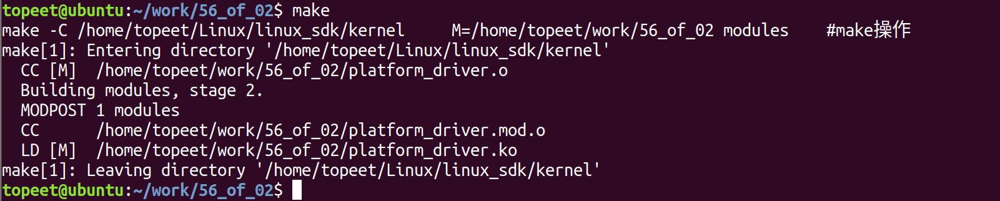
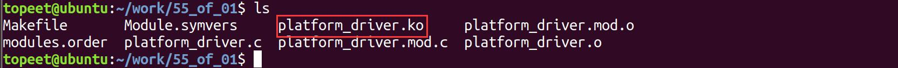
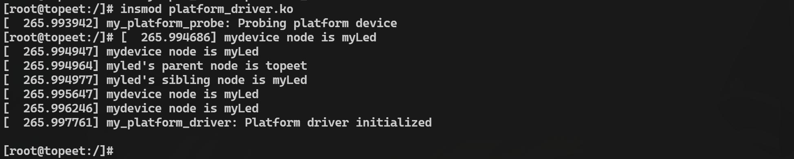
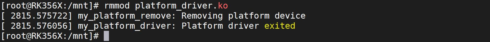
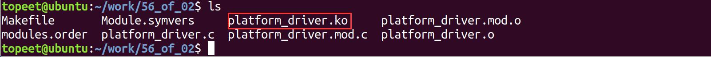
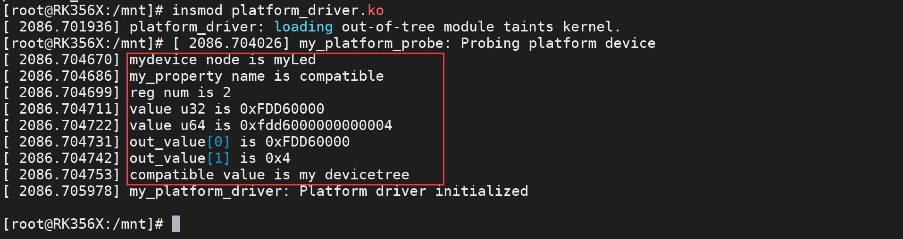
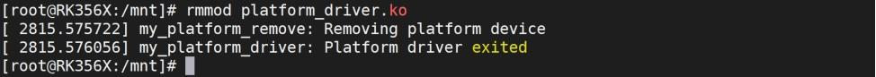

# 第074章 of操作函数实验：获取属性


图73.2编译完生成platform_driver.ko 目标文件，如图73.3 所示。

图73.3
### 73.3.2 运行测试
在进行实验之前，首先要确保开发板烧写的是我们在设备树下platform_device 和platform_driver 匹配实验中编译出来的boot.img ，开发板启动之后，使用insmodplatform_driver.ko 命令进行驱动模块的加载，如图73.4 所示。

图73.4在图73.4 中可以看到总共有4 个打印，前两个打印都是查找的myLed 节点，第三个打印是查找的myLed 的父节点，也就是topeet 节点，第四个打印是查找的topeet 的子节点，也就又回到了myLed 节点。第5 个打印是通过compatible 属性查找到的myLed 节点，第6 个打印是通过of_device_id 匹配表查找到的myLed 节点。实验完成后使用rmmod platform_driver.ko 命令进行驱动模块的卸载，如图73.5 所示。

图73.5至此，使用of 操作函数获取设备树节点实验就完成了。

## 774.1 of 操作：获取属性
### 74.1.1 of_find_property 函数
下面是对of_find_property()函数的详细介绍：函数原型:struct property *of_find_property(const struct device_node *np, const char *name, int *lenp)头文件：#include <linux/of.h>函数作用:该函数用于在节点np 下查找指定名称name 的属性。函数参数:np: 要查找的节点。name: 要查找的属性的属性名。lenp: 一个指向整数的指针，用于接收属性值的字节数。返回值:如果成功找到了指定名称的属性，则返回对应的属性结构体指针struct property *；如果未找到，则返回NULL。
### 74.1.2 of_property_count_elems_of_size 函数
下面是对of_property_count_elems_of_size()函数的详细介绍：函数原型:int of_property_count_elems_of_size(const struct device_node *np, const char *propname, int elem_size)头文件：#include <linux/of.h>函数作用:该函数用于在设备树中的设备节点下查找指定名称的属性，并获取属性中指定元素的数量。函数参数和返回值:

np: 设备节点。propname: 需要获取元素数量的属性名。elem_size: 单个元素的尺寸。返回值:如果成功获取了指定属性中元素的数量，则返回该数量；如果未找到属性或属性中没有元素，则返回0。
### 74.1.3 of_property_read_u32_index 函数
下面是对of_property_read_u32_index()函数的详细介绍：函数原型:int of_property_read_u32_index(const struct device_node *np, const char *propname, u32 index, u32 *out_value)头文件：#include <linux/of.h>函数作用:该函数用于从指定属性中获取指定索引位置的u32 类型的数据值。函数参数:np: 设备节点。propname: 要读取的属性名。index: 要读取的属性值在属性中的索引，索引从0 开始。out_value: 用于存储读取到的值的指针。返回值:如果成功读取到了指定属性指定索引位置的u32 类型的数据值，则返回0；如果未找到属性或读取失败，则返回相应的错误码。
### 74.1.4 of_property_read_u64_index 函数
下面是对of_property_read_u64_index()函数的详细介绍：函数原型:static inline int of_property_read_u64_index(const struct device_node *np, const char *propname, u32 index, u64 *out_value)头文件：#include <linux/of.h>函数作用:该函数用于从指定属性中获取指定索引位置的u64 类型的数据值。

函数参数和返回值:np: 设备节点。propname: 要读取的属性名。index: 要读取的属性值在属性中的索引，索引从0 开始。out_value: 用于存储读取到的值的指针。返回值:如果成功读取到了指定属性指定索引位置的u64 类型的数据值，则返回0；如果未找到属性或读取失败，则返回相应的错误码。
### 74.1.5 of_property_read_variable_u32_array 函数
下面是对of_property_read_variable_u32_array()函数的详细介绍：函数原型：int of_property_read_variable_u32_array(const struct device_node *np, const char *propname, u32 *out_values, size_t SZ_min, size_t SZ_max)函数作用:从指定属性中读取u32 类型数组。函数参数和返回值:np: 设备节点。propname: 要读取的属性名。out_values: 用于存储读取到的u8 数组的指针。SZ_min: 数组的最小大小。SZ_max: 数组的最大大小。返回值：如果成功读取到了指定属性的u8 数组，则返回数组的大小。如果未找到属性或读取失败，则返回相应的错误码。上面介绍的函数用于从指定属性中读取u32 类型数组，下面是另外三个读取其他数组大小的函数：从指定属性中读取u8 类型数组，如代码清单74.1 所示。代码清单74.1
```c
int of_property_read_variable_u8_array(const struct device_node *np, const char *propname, u8 *out_values,
size_t SZ_min, size_t SZ_max)
```
从指定属性中读取u16 类型数组，如代码清单74.2 所示。代码清单74.2
```c
int of_property_read_variable_u16_array(const struct device_node *np, const char *propname, u16
```

```c
*out_values, size_t SZ_min, size_t SZ_max)
```
从指定属性中读取u64 类型数组，如代码清单74.3 所示。代码清单74.3
```c
int of_property_read_variable_u64_array(const struct device_node *np, const char *propname, u64
*out_values, size_t SZ_min, size_t SZ_max)
```
### 74.1.6 of_property_read_string 函数
下面是对of_property_read_string()函数的详细介绍：函数原型:static inline int of_property_read_string(const struct device_node *np, const char *propname, const char **out_string)头文件：#include <linux/of.h>函数作用:该函数用于从指定属性中读取字符串。函数参数:np: 设备节点。propname: 要读取的属性名。out_string: 用于存储读取到的字符串的指针。返回值:如果成功读取到了指定属性的字符串，则返回0；如果未找到属性或读取失败，则返回相应的错误码。
## 74.2 实验程序编写
本实验代码存储在网盘iTOP-RK3568开发板\07_学习教程配套资料\03_Linux驱动配套资料\04_Linux 驱动例程\56_of_02 目录下。本小节驱动程序是由设备树下platform_device和platform_driver匹配实验驱动程序修改而来，由于本章节获取设备树属性的函数需要在查找到设备树节点的前提下使用，所以在下面的程序中，先在probe()函数中添加获取设备树节点的相关内容，然后添加了本章节学习的of 操作相关代码，用来获取设备树节点相关属性。实验代码platform_driver.c 如代码清单74.4 所示。代码清单74.4
```c
#include <linux/module.h>
```

```c
#include <linux/platform_device.h>
#include <linux/mod_devicetable.h>
#include <linux/of.h>
struct device_node *mydevice_node;
int num;
u32 value_u32;
u64 value_u64;
u32 out_value[2];
const char *value_compatible;
struct property *my_property;
// 平台设备的探测函数
static int my_platform_probe(struct platform_device *pdev)
{
    printk(KERN_INFO "my_platform_probe: Probing platform device\n");
    // 通过节点名称查找设备树节点
    mydevice_node = of_find_node_by_name(NULL, "myLed");
    printk("mydevice node is %s\n", mydevice_node->name);
    // 查找compatible 属性
    my_property = of_find_property(mydevice_node, "compatible", NULL);
    printk("my_property name is %s\n", my_property->name);
    // 获取reg 属性的元素数量
    num = of_property_count_elems_of_size(mydevice_node, "reg", 4);
    printk("reg num is %d\n", num);
    // 读取reg 属性的值
    of_property_read_u32_index(mydevice_node, "reg", 0, &value_u32);
    of_property_read_u64_index(mydevice_node, "reg", 0, &value_u64);
    printk("value u32 is 0x%X\n", value_u32);
    printk("value u64 is 0x%llx\n", value_u64);
    // 读取reg 属性的变长数组
    of_property_read_variable_u32_array(mydevice_node, "reg", out_value, 1, 2);
    printk("out_value[0] is 0x%X\n", out_value[0]);
    printk("out_value[1] is 0x%X\n", out_value[1]);
    // 读取compatible 属性的字符串值
    of_property_read_string(mydevice_node, "compatible", &value_compatible);
    printk("compatible value is %s\n", value_compatible);
```

```c
return 0;
}
// 平台设备的移除函数
static int my_platform_remove(struct platform_device *pdev)
{
printk(KERN_INFO "my_platform_remove: Removing platform device\n");
// 清理设备特定的操作
// ...
return 0;
}
const struct of_device_id of_match_table_id[]= {
{.compatible="my devicetree"},
};
// 定义平台驱动结构体
static struct platform_driver my_platform_driver = {
.probe = my_platform_probe,
.remove = my_platform_remove,
.driver = {
    .name = "my_platform_device",
    .owner = THIS_MODULE,
    .of_match_table =of_match_table_id,
},
};
// 模块初始化函数
static int __init my_platform_driver_init(void)
{
int ret;
// 注册平台驱动
ret = platform_driver_register(&my_platform_driver);
if (ret) {
    printk(KERN_ERR "Failed to register platform driver\n");
    return ret;
}
printk(KERN_INFO "my_platform_driver: Platform driver initialized\n");
```

```c
return 0;
}
// 模块退出函数
static void __exit my_platform_driver_exit(void)
{
// 注销平台驱动
platform_driver_unregister(&my_platform_driver);
printk(KERN_INFO "my_platform_driver: Platform driver exited\n");
}
module_init(my_platform_driver_init);
module_exit(my_platform_driver_exit);
MODULE_LICENSE("GPL");
MODULE_AUTHOR("topeet");
```
## 74.3 运行测试
### 74.3.1 编译驱动程序
在platform_driver.c 代码同一目录下创建Makefile 文件，如图74.1 所示。

图74.1Makefile 文件内容如代码清单74.5 所示。代码清单74.5
```c
export ARCH=arm64#设置平台架构
export CROSS_COMPILE=aarch64-linux-gnu-#交叉编译器前缀
obj-m += platform_driver.o#此处要和你的驱动源文件同名
KDIR :=/home/topeet/Linux/linux_sdk/kernel#这里是你的内核目录
PWD ?= $(shell pwd)
all:
    make -C $(KDIR) M=$(PWD) modules#make 操作
clean:
    make -C $(KDIR) M=$(PWD) clean#make clean 操作
```
在存放platform_driver.c 和Makefile 文件目录下使用make 命令编译驱动程序，编译完成如图74.2 所示。


图74.2编译完生成platform_driver.ko 目标文件，如图74.3 所示。

图74.3
### 74.3.2 运行测试
在进行实验之前，首先要确保开发板烧写的是我们在设备树下platform_device 和platform_driver 匹配实验中编译出来的boot.img ，开发板启动之后，使用insmodplatform_driver.ko 命令进行驱动模块的加载，如图74.4 所示。

图74.4在图74.4 中可以看到总共有8 个打印，第一个打印表示查找到的节点为myLed，接下来的打印都是使用该节点进行的属性查找。第二个打印表示查找的属性名为compatible，第三个打印表示查找的reg 属性数量为2，第四个和第五个分别表示读取到的32 位和64 位的reg 属性值，第6 个和第7 个打印表示reg 的第一个属性值和第二个属性值，第8 个打印表示compatite属性值为my devicetree。实验完成后使用rmmod platform_driver.ko 命令进行驱动模块的卸载，如图74.5 所示。

图74.5至此，使用of 操作函数获取设备树节点实验就完成了。

