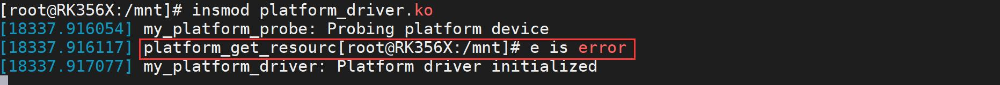
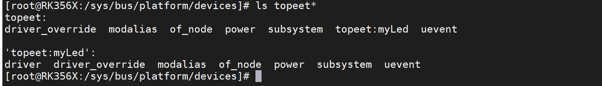
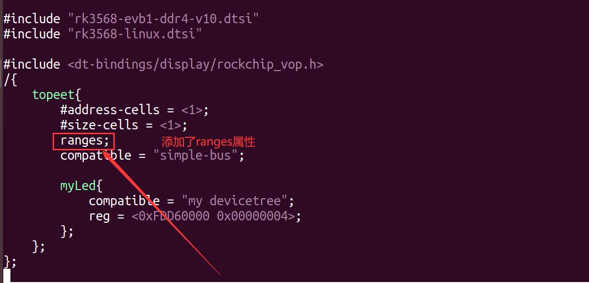
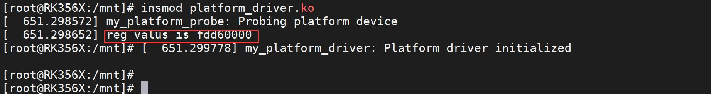

# 第075章 ranges属性实验

## 75.1 platform_get_resource 获取设备树资源
由于设备树在系统启动的时候都会转化为platform 设备，那我们能不能直接在驱动中使用platform_get_resource()函数直接获取platform_device 资源呢？
### 75.1.1 驱动程序编写
带着疑惑我们这里仍旧以72 章的驱动程序为原型，在probe() 函数中加入使用platform_get_resource()函数获取reg 资源，添加完成的驱动程序内容如代码清单75.1 所示。代码清单75.1
```c
#include <linux/module.h>
#include <linux/platform_device.h>
#include <linux/mod_devicetable.h>
// 平台设备的初始化函数
struct resource *myresources;
static int my_platform_probe(struct platform_device *pdev)
{
    printk(KERN_INFO "my_platform_probe: Probing platform device\n");
    // 获取平台设备的资源
    myresources = platform_get_resource(pdev, IORESOURCE_MEM, 0);
    if (myresources == NULL) {
        // 如果获取资源失败，打印value_compatible 的值
        printk("platform_get_resource is error\n");
    }
    printk("reg valus is %llx\n" , myresources->start);
    return 0;
}
// 平台设备的移除函数
static int my_platform_remove(struct platform_device *pdev)
{
    printk(KERN_INFO "my_platform_remove: Removing platform device\n");
    // 清理设备特定的操作
    // ...
```

```c
return 0;
}
const struct of_device_id of_match_table_id[]= {
{.compatible="my devicetree"},
};
// 定义平台驱动结构体
static struct platform_driver my_platform_driver = {
.probe = my_platform_probe,
.remove = my_platform_remove,
.driver = {
    .name = "my_platform_device",
    .owner = THIS_MODULE,
    .of_match_table =of_match_table_id,
},
};
// 模块初始化函数
static int __init my_platform_driver_init(void)
{
int ret;
// 注册平台驱动
ret = platform_driver_register(&my_platform_driver);
if (ret) {
    printk(KERN_ERR "Failed to register platform driver\n");
    return ret;
}
printk(KERN_INFO "my_platform_driver: Platform driver initialized\n");
return 0;
}
// 模块退出函数
static void __exit my_platform_driver_exit(void)
{
// 注销平台驱动
platform_driver_unregister(&my_platform_driver);
printk(KERN_INFO "my_platform_driver: Platform driver exited\n");
}
```

```c
module_init(my_platform_driver_init);
module_exit(my_platform_driver_exit);
MODULE_LICENSE("GPL");
MODULE_AUTHOR("topeet");
```
编译成模块之后，放到开发板上进行加载，打印信息如图75.1 所示。

图75.1可以看到使用platform_get_resource()函数获取reg 资源实验失败了，在下一个小节中将分析获取资源失败的原因。
### 75.1.2 获取资源失败源码分析
platform_get_resource()函数定义在内核源码目录下的drivers/base/platform.c 目录下，具体内容如代码清单75.2 所示。代码清单75.2
```c
struct resource *platform_get_resource(struct platform_device *dev,
                        unsigned int type, unsigned int num)
{
    u32 i;
    for (i = 0; i < dev->num_resources; i++) {
        struct resource *r = &dev->resource[i];
        if (type == resource_type(r) && num-- == 0)
             return r;
    }
    return NULL;
}
```
该函数返回NULL 的情况有两种可能性，一种是没进入上面的for 循环直接返回了NULL，另外一种是进入了for 循环，但是类型匹配不正确，跳出for 循环之后再返回NULL。这里的类型一定是匹配的，所以我们就来寻找为什么没有进入for 循环，这里只有一种可能，也就是dev->num_resources 为0。所以现在的目标来到了寻找dev->num_resources 是在哪里进行的赋值，前面已经讲解过了由设备树转换为platform 的过程，而且在系统启动后，在对应目录下也有了相应的节点：


图75.-2证明转换是没问题的，所以继续寻找中间转换过程中有关资源数量的相关函数，定位到了of_platform_device_create_pdata()函数，该函数定义在内核源码目录下的drivers/of/platform.c文件中，具体内容如代码清单75.3 所示。代码清单75.3
```c
static struct platform_device *of_platform_device_create_pdata(
                     struct device_node *np,
                     const char *bus_id,
                     void *platform_data,
                     struct device *parent)
{
    struct platform_device *dev;
    /* 检查设备节点是否可用或已填充*/
    if (!of_device_is_available(np) ||
        of_node_test_and_set_flag(np, OF_POPULATED))
        return NULL;
    /* 分配平台设备结构体*/
    dev = of_device_alloc(np, bus_id, parent);
    if (!dev)
        goto err_clear_flag;
    /* 设置平台设备的一些属性*/
    dev->dev.coherent_dma_mask = DMA_BIT_MASK(32);
    if (!dev->dev.dma_mask)
        dev->dev.dma_mask = &dev->dev.coherent_dma_mask;
    dev->dev.bus = &platform_bus_type;
    dev->dev.platform_data = platform_data;
    of_msi_configure(&dev->dev, dev->dev.of_node);
    of_reserved_mem_device_init_by_idx(&dev->dev, dev->dev.of_node, 0);
    /* 将平台设备添加到设备模型中*/
    if (of_device_add(dev) != 0) {
        platform_device_put(dev);
        goto err_clear_flag;
    }
```

```c
return dev;
err_clear_flag:
/* 清除设备节点的已填充标志*/
of_node_clear_flag(np, OF_POPULATED);return NULL;
}
```
代码清单75.3 第15 行中函数调用of_device_alloc 分配一个平台设备结构体，并将设备节点指针、设备标识符和父设备指针传递给它，正是该函数决定的dev->num_resources，然后找到该函数的定义，如代码清单75.4 所示。代码清单75.4
```c
struct platform_device *of_device_alloc(struct device_node *np,
               const char *bus_id,
               struct device *parent)
{
struct platform_device *dev;
int rc, i, num_reg = 0, num_irq;
struct resource *res, temp_res;
dev = platform_device_alloc("", PLATFORM_DEVID_NONE);
if (!dev)
    return NULL;
/* count the io and irq resources */
while (of_address_to_resource(np, num_reg, &temp_res) == 0)
    num_reg++;
num_irq = of_irq_count(np);
/* Populate the resource table */
if (num_irq || num_reg) {
    res = kcalloc(num_irq + num_reg, sizeof(*res), GFP_KERNEL);
    if (!res) {
        platform_device_put(dev);
        return NULL;
    }
    dev->num_resources = num_reg + num_irq;
    dev->resource = res;
    for (i = 0; i < num_reg; i++, res++) {
        rc = of_address_to_resource(np, i, res);
        WARN_ON(rc);
    }
```

```c
if (of_irq_to_resource_table(np, res, num_irq) != num_irq)
    pr_debug("not all legacy IRQ resources mapped for %pOFn\n",
         np);
}
dev->dev.of_node = of_node_get(np);
dev->dev.fwnode = &np->fwnode;
dev->dev.parent = parent ? : &platform_bus;
if (bus_id)
dev_set_name(&dev->dev, "%s", bus_id);
else
of_device_make_bus_id(&dev->dev);
return dev;
}
```
代码清单75.4 第26 行中出现了for 循环的dev->num_resources 其中num_reg 表示reg 的number，num_irq 表示irq 的number，由于在设备树中并没有添加中断相关的属性num_irq 为0，那这里的num_reg 是哪里确定的呢。代码清单68.5 的第14、15 行，具体内容如代码清单75.5 所示。代码清单75.5
```c
/* count the io and irq resources */
while (of_address_to_resource(np, num_reg, &temp_res) == 0)
    num_reg++;
```
然后跳转到while 循环中的of_address_to_resource()函数里，该函数定义在内核源码目录的drivers/of/address.c 文件中，具体内容如代码清单75.6 所示。代码清单75.6
```c
int of_address_to_resource(struct device_node *dev, int index,
                struct resource *r)
{
    const __be32*addrp;
    u64size;
    unsigned intflags;
    const char*name = NULL;
    addrp = of_get_address(dev, index, &size, &flags);
    if (addrp == NULL)
        return -EINVAL;
    /* Get optional "reg-names" property to add a name to a resource */
```

```c
of_property_read_string_index(dev, "reg-names", index, &name);
return __of_address_to_resource(dev, addrp, size, flags, name, r);
}
```
代码清单75.6 第9 行，获取reg 属性的地址、大小和类型，在设备树中reg 属性已经存在了，所以这里会正确返回。第14 行，读取reg-names 属性，由于设备树中没有定义这个属性，所以该函数不会有影响。最后具有决定性作用的函数就是第16 行返回的__of_address_to_resource()函数了，跳转到该函数的定义如代码清单75.7 所示。代码清单75.7
```c
static int __of_address_to_resource(struct device_node *dev,
        const __be32 *addrp, u64 size, unsigned int flags,
        const char *name, struct resource *r)
{
    u64 taddr;
    if (flags & IORESOURCE_MEM)
        taddr = of_translate_address(dev, addrp);
    else if (flags & IORESOURCE_IO)
        taddr = of_translate_ioport(dev, addrp, size);
    else
        return -EINVAL;
    if (taddr == OF_BAD_ADDR)
        return -EINVAL;
    memset(r, 0, sizeof(struct resource));
    r->start = taddr;
    r->end = taddr + size - 1;
    r->flags = flags;
    r->name = name ? name : dev->full_name;
    return 0;
}
```
reg 属性的flags 为IORESOURCE_MEM ，所以又会执行代码清单75.7 第9 行的of_translate_address()函数，跳转到该函数，该函数的定义如代码清单75.8 所示。代码清单75.8
```c
u64 of_translate_address(struct device_node *dev, const __be32 *in_addr)
{
    struct device_node *host;
    u64 ret;
    ret = __of_translate_address(dev, in_addr, "ranges", &host);
```

```c
if (host) {
    of_node_put(host);
    return OF_BAD_ADDR;
}
return ret;
}
```
代码清单75.8 中函数的重点在第6 行，上述函数实际上是__of_translate_address 函数的封装，其中传入的第三个参数ranges 是我们要关注的重点，继续跳转到该函数的定义，具体内容如代码清单75.9 所示。代码清单75.9
```c
static u64 __of_translate_address(struct device_node *dev,
                   const __be32 *in_addr, const char *rprop,
                   struct device_node **host)
{
    struct device_node *parent = NULL;
    struct of_bus *bus, *pbus;
    __be32 addr[OF_MAX_ADDR_CELLS];
    int na, ns, pna, pns;
    u64 result = OF_BAD_ADDR;
    pr_debug("** translation for device %pOF **\n", dev);
    /* Increase refcount at current level */
    of_node_get(dev);
    *host = NULL;
    /* Get parent & match bus type */
    parent = of_get_parent(dev);
    if (parent == NULL)
        goto bail;
    bus = of_match_bus(parent);
    /* Count address cells & copy address locally */
    bus->count_cells(dev, &na, &ns);
    if (!OF_CHECK_COUNTS(na, ns)) {
        pr_debug("Bad cell count for %pOF\n", dev);
        goto bail;
    }
    memcpy(addr, in_addr, na * 4);
    pr_debug("bus is %s (na=%d, ns=%d) on %pOF\n",
```

```c
bus->name, na, ns, parent);
of_dump_addr("translating address:", addr, na);
/* Translate */
for (;;) {
struct logic_pio_hwaddr *iorange;
/* Switch to parent bus */
of_node_put(dev);
dev = parent;
parent = of_get_parent(dev);
/* If root, we have finished */
if (parent == NULL) {
    pr_debug("reached root node\n");
    result = of_read_number(addr, na);
    break;
}
/*
 * For indirectIO device which has no ranges property, get
 * the address from reg directly.
 */
iorange = find_io_range_by_fwnode(&dev->fwnode);
if (iorange && (iorange->flags != LOGIC_PIO_CPU_MMIO)) {
    result = of_read_number(addr + 1, na - 1);
    pr_debug("indirectIO matched(%pOF) 0x%llx\n",
          dev, result);
    *host = of_node_get(dev);
    break;
}
/* Get new parent bus and counts */
pbus = of_match_bus(parent);
pbus->count_cells(dev, &pna, &pns);
if (!OF_CHECK_COUNTS(pna, pns)) {
    pr_err("Bad cell count for %pOF\n", dev);
    break;
}
pr_debug("parent bus is %s (na=%d, ns=%d) on %pOF\n",
    pbus->name, pna, pns, parent);
/* Apply bus translation */
```

```c
if (of_translate_one(dev, bus, pbus, addr, na, ns, pna, rprop))
    break;
/* Complete the move up one level */
na = pna;
ns = pns;
bus = pbus;
of_dump_addr("one level translation:", addr, na);
}
bail:
of_node_put(parent);
of_node_put(dev);
return result;
}
```
该函数获取父节点和匹配的总线类型，然后获取address-cell 和size-cells，再然后是一个for循环，在代码清单75.9 第76 行使用of_translate_one()函数进行转换，其中rprop 参数表示要转换的资源属性，该参数的值为传入的ranges，然后我们继续跳转到该函数，该函数的具体内容如代码清单75.10 所示。代码清单75.10
```c
static int of_translate_one(struct device_node *parent, struct of_bus *bus,
             struct of_bus *pbus, __be32 *addr,
             int na, int ns, int pna, const char *rprop)
{
const __be32 *ranges;
unsigned int rlen;
int rone;
u64 offset = OF_BAD_ADDR;
/*
 * Normally, an absence of a "ranges" property means we are
 * crossing a non-translatable boundary, and thus the addresses
 * below the current cannot be converted to CPU physical ones.
 * Unfortunately, while this is very clear in the spec, it's not
 * what Apple understood, and they do have things like /uni-n or
 * /ht nodes with no "ranges" property and a lot of perfectly
 * useable mapped devices below them. Thus we treat the absence of
 * "ranges" as equivalent to an empty "ranges" property which means
 * a 1:1 translation at that level. It's up to the caller not to try
 * to translate addresses that aren't supposed to be translated in
```

```c
* the first place. --BenH.
*
* As far as we know, this damage only exists on Apple machines, so
* This code is only enabled on powerpc. --gcl
*/
ranges = of_get_property(parent, rprop, &rlen);
if (ranges == NULL && !of_empty_ranges_quirk(parent)) {
   pr_debug("no ranges; cannot translate\n");
   return 1;
}
if (ranges == NULL || rlen == 0) {
   offset = of_read_number(addr, na);
   memset(addr, 0, pna * 4);
   pr_debug("empty ranges; 1:1 translation\n");
   goto finish;
}
pr_debug("walking ranges...\n");
/* Now walk through the ranges */
rlen /= 4;
rone = na + pna + ns;
for (; rlen >= rone; rlen -= rone, ranges += rone) {
   offset = bus->map(addr, ranges, na, ns, pna);
   if (offset != OF_BAD_ADDR)
       break;
}
if (offset == OF_BAD_ADDR) {
   pr_debug("not found !\n");
   return 1;
}
memcpy(addr, ranges + na, 4 * pna);
finish:
of_dump_addr("parent translation for:", addr, pna);
pr_debug("with offset: %llx\n", (unsigned long long)offset);
/* Translate it into parent bus space */
return pbus->translate(addr, offset, pna);
}
```
代码清单75.10 第26 行使用of_get_property()函数获取ranges 属性，但由于在我们添加的设备树节点中并没有该属性，所以这里的ranges 值就为NULL，第27 行的条件判断成立，也就会返回1。

接下来再根据这个返回值继续分析上级函数:of_translate_one()函数返回1 之后，上一级的_of_translate_address()的返回值就为OF_BAD_ADDR，再上一级的of_translate_address 返回值也是OF_BAD_ADDR，继续向上查找_of_address_to_resource()函数会返回EINVAL，of_address_to_resource 返回EINVAL，所以num_reg 为0,所以dev->num_resources 就为0。到这里关于为什么platform_get_resource 函数获取资源失败的问题就找到了，只是因为在设备树中并没有这个名为ranges 这个属性，所以只需要对设备树进行ranges 属性的添加即可，要修改的设备树为arch/arm64/boot/dts/rockchip/rk3568-evb1-ddr4-v10-linux.dts，修改完成如图75.3 所示。

图75.3然后重新编译内核，将编译生成的boot.img 烧写进开发板之后重新加载上面编写的驱动程序，可以看到之前获取失败的打印就消失了，而且成功打印出了reg 属性的第一个值，如图75.4 所示。

图75.4虽然这里的问题解决了，但引起的思考并没有结束，那我们在这里添加的ranges 属性的作用是啥呢，带着疑问，开始下一小节的学习吧。

## 75.2 ranges 属性
### 75.2.1 ranges 属性介绍
ranges 属性用于描述子设备地址空间如何映射到父设备地址空间。设备树中的每个设备节点都可以具有ranges 属性，其中包含了地址映射的信息。下面是ranges 属性的两种格式：
```c
ranges = <child-bus-address parent-bus-address length>;
ranges;
```
然后对上述格式的每个部分进行解释：child-bus-address ：子设备地址空间的起始地址。具体的字长由ranges 所在节点的#address-cells 属性决定。parent-bus-address：父设备地址空间的起始地址。具体的字长由ranges 所在节点的父节点的#address-cells 属性决定。length：映射的大小。它指定了子设备地址空间在父设备地址空间中的长度。具体的字长由ranges 所在节点的父节点的#size-cells 属性决定。当ranges 属性的值为空时，表示子设备地址空间和父设备地址空间具有完全相同的映射，即1:1 映射。当没有ranges 属性时，代表这个设备只能被父节点访问。以代码清单75.11 所示设备树为例进行ranges 属性的讲解。代码清单75.11
```c
/dts-v1/;
/ {
  compatible = "acme,coyotes-revenge";
  #address-cells = <1>;
  #size-cells = <1>;
  ....
  external-bus {
    #address-cells = <2>;
    #size-cells = <1>;
    ranges = <0 0 0x10100000 0x10000
               0 0x10160000 0x10000
               0 0x30000000 0x30000000>;
    // Chipselect 1, Ethernet
    // Chipselect 2, i2c controller
    // Chipselect 3, NOR Flash
```

```c
.......
```
这里以ranges 的第一组属性值为例进行具体解释如下：在external-bus 节点中#address-cells 属性值为2，表示child-bus-address 由两个值表示，即<0 0>，表示子设备地址从0x00000000 开始。父节点的#address-cells 属性值和#size-cells 属性值都为1，所以parent-bus-address 和length 都由一个表示，也就是0x10100000 表示映射到父设备地址空间的起始地址，0x10000 为映射大小。
### 75.2.2 设备分类
设备可以分为内存映射型设备和非内存映射型设备两大类。（1）内存映射型设备：内存映射型设备是指CPU 可以直接访问的设备。在设备树中，内存映射型设备的设备树举例如代码清单75.12 所示。代码清单75.12
```c
/dts-v1/;
/ {
        #address-cells = <1>;
        #size-cells = <1>;
        ranges;
        serial@101f0000 {
            compatible = "arm,pl011";
            reg = <0x101f0000 0x1000>;
        };
        gpio@101f3000 {
            compatible = "arm,pl061";
            reg = <0x101f3000 0x1000
                    0x101f4000 0x10>;
        };
        spi@10115000 {
            compatible = "arm,pl022";
            reg = <0x10115000 0x1000>;
        };
};
```
代码清单75.13 中的serial、gpio 和spi 这三个子节点所代表的设备都是内存映射型设备，CPU 可以直接访问的设备。

（2）非内存映射型设备：非内存映射型设备是指CPU 不可以直接访问的设备，需要地址映射才可以访问的设备。在设备树中，非内存映射型设备的设备树举例如代码清单75.13 所示。代码清单75.13
```c
/dts-v1/;
/ {
  compatible = "acme,coyotes-revenge";
  #address-cells = <1>;
  #size-cells = <1>;
  ....
  external-bus {
    #address-cells = <2>;
    #size-cells = <1>;
    ranges = <0 0 0x10100000 0x10000
               0 0x10160000 0x10000
               0 0x30000000 0x30000000>;
    // Chipselect 1, Ethernet
    // Chipselect 2, i2c controller
    // Chipselect 3, NOR Flash
    ethernet@0,0 {
      compatible = "smc,smc91c111";
      reg = <0 0 0x1000>;
    };
    i2c@1,0 {
      compatible = "acme,a1234-i2c-bus";
      #address-cells = <1>;
      #size-cells = <0>;
      reg = <1 0 0x1000>;
      rtc@58 {
        compatible = "maxim,ds1338";
        reg = <0x58>;
      };
    };
  } ;
};
```
代码清单75.14 中的ethernet 和i2c 节点所代表的设备是非内存映射型设备，CPU 想访问ethernet 或i2c 控制器就需要进行地址映射。其中i2c 控制器节点没有ranges 属性，所以rtc 设

备只能被它的父节点i2c 控制器访问。
### 75.2.3 映射地址计算
以代码清单75.14 中的ethernet@0 节点为例，计算该网卡设备的映射地址。首先，找到ethernet@0 所在的节点，并查看其reg 属性为<0 0 0x1000>，其父节点中，#address-cells 的值为2，则地址由两个32 位的数组成，即<0 0>，#size-cells 的值为1，则长度由一个32 位的数组成，即<0x1000>。接下来，根据ranges 属性进行地址映射计算:在external-bus 节点的ranges 属性中，第一个映射条目为<0 0 0x10100000 0x10000>，表示外部总线的地址范围为0x10100000 到0x1010FFFF。该映射条目的第一个值为0，表示与external-bus节点的第一个子节点（ethernet@0,0）相关联。我们可以进行以下计算：ethernet@0 的物理起始地址=外部总线地址起始值=0x10100000ethernet@0 的物理结束地址=外部总线地址起始值+（ethernet@0 的reg属性的第二个值-1）= 0x10100000 + 0xFFF= 0x10100FFF因此，ethernet@0 的物理地址范围为0x10100000 - 0x10100FFF，至此，关于映射地址的计算就讲解完成了，大家可以根据同样的方法计算i2c@1 的物理地址。

