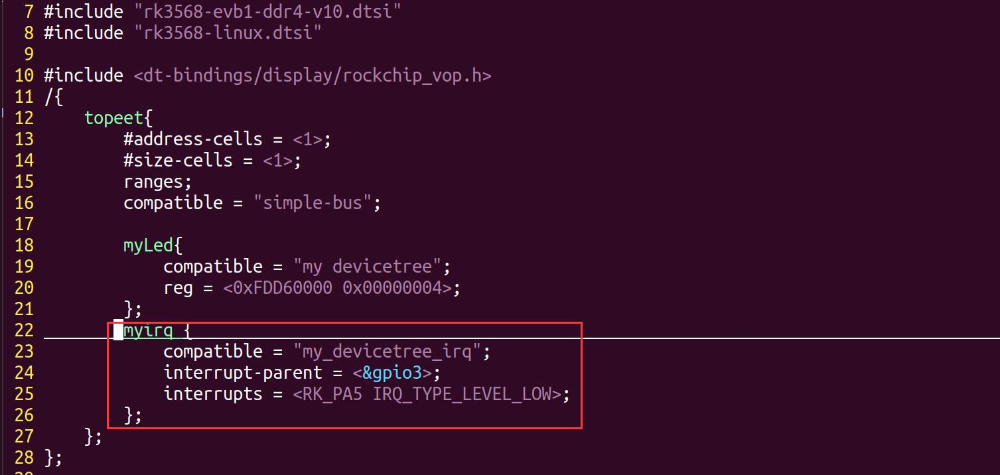
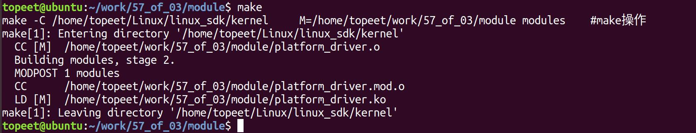
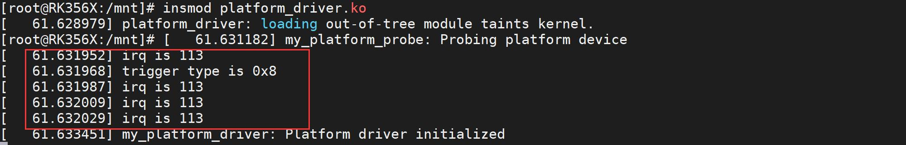

# 第076章 of操作函数实验：获取中断资源

## 76.1 of 操作：获取中断资源
### 76.1.1 irq_of_parse_and_map 函数
下面是对irq_of_parse_and_map()函数的详细介绍：函数原型：unsigned int irq_of_parse_and_map(struct device_node *dev, int index);头文件：#include <linux/of_irq.h>函数作用：从设备节点的interrupts 属性中解析和映射对应的中断号参数说明：dev：设备节点，表示要解析的设备节点。index：索引号，表示从interrupts 属性中获取第几个中断号返回值：是一个无符号整数，表示成功解析和映射的中断号
### 76.1.2 irq_get_trigger_type 函数
下面是对irq_get_trigger_type()函数的详细介绍：函数原型：u32 irqd_get_trigger_type(struct irq_data *d);头文件：#include <linux/irq.h>函数作用：从中断数据结构（irq_data）中获取对应的中断触发类型参数说明：d：中断数据结构（irq_data），表示要获取中断触发类型的中断返回值：

是一个无符号32 位整数，表示成功获取的中断触发类型
### 76.1.3 irq_get_irq_data 函数
下面是对irq_get_irq_data()函数的详细介绍：函数原型：struct irq_data *irq_get_irq_data(unsigned int irq);头文件：#include <linux/irq.h>函数作用：根据中断号获取对应的中断数据结构参数说明：irq：中断号，表示要获取中断数据结构的中断号返回值：指向irq_data 结构体的指针，表示成功获取的中断数据结构
### 76.1.4 gpio_to_irq 函数
下面是对gpio_to_irq()函数的详细介绍：函数原型：int gpio_to_irq(unsigned int gpio);头文件：#include <linux/gpio.h>函数作用：根据GPIO 编号获取对应的中断号参数说明：gpio：GPIO 编号，表示要获取中断号的GPIO返回值：是一个整数，表示成功获取的中断号。
### 76.1.5 of_irq_get 函数
下面是对of_irq_get()函数的详细介绍：函数原型：int of_irq_get(struct device_node *dev, int index);头文件：#include <linux/of_irq.h>

函数作用：是从设备节点的interrupts 属性中获取对应的中断号参数说明：dev：设备节点，表示要获取中断号的设备节点index：索引号，表示从interrupts 属性中获取第几个中断号返回值：是一个整数，表示成功获取的中断号
### 76.1.6 platform_get_irq 函数
下面是对platform_get_irq()函数的详细介绍：函数原型：int platform_get_irq(struct platform_device *dev, unsigned int num);函数作用：根据平台设备和索引号获取对应的中断号。头文件：linux/platform_device.h参数说明：dev：平台设备，表示要获取中断号的平台设备。num：索引号，表示从中获取第几个中断号。返回值：是一个整数，表示成功获取的中断号。
## 76.2 实验程序编写
### 76.2.1 设备树的修改
本实验修改完成的设备树和编译完成的boot.img 存储在网盘iTOP-RK3568 开发板\07_学习教程配套资料\03_Linux 驱动配套资料\04_Linux 驱动例程\57_of_03\dts 目录下。由于本章节要获取的是中断相关的资源，所以需要在设备树中添加有关中断的设备节点，在第57 章节的学习中，我们已经对中断实例进行了讲解，所以这里直接对rk3568-evb1-ddr4-v10-linux.dts 设备树进行中断节点的添加，添加的内容如代码清单76.1 所示。代码清单76.1
```c
myirq {
    compatible = "my_devicetree_irq";
    interrupt-parent = <&gpio3>;
```

```c
interrupts = <RK_PA5 IRQ_TYPE_LEVEL_LOW>;
};
```
添加完成如图76.1 所示。

图76.1保存退出之后，重新编译内核源码，得到boot.img 内核镜像之后烧写到开发板即可。
### 76.2.2 实验程序的编写
本实验代码存储在网盘iTOP-RK3568开发板\07_学习教程配套资料\03_Linux驱动配套资料\04_Linux 驱动例程\57_of_03 目录下。本小节驱动程序是由65 章驱动程序修改而来，由于本章节获取中断属性的函数需要在查找到设备树节点的前提下使用，所以在下面的程序中，先在probe()函数中查找设备树节点，然后添加了本章节学习的of 操作相关代码和其他一些相关的函数，用来获取设备树节点中断资源。实验代码platform_driver.c 如代码清单76.2 所示。代码清单76.2
```c
#include <linux/module.h>
#include <linux/platform_device.h>
#include <linux/mod_devicetable.h>
#include <linux/of.h>
#include <linux/of_irq.h>
#include <linux/gpio.h>
int num;
int irq;
struct irq_data *my_irq_data;
```

```c
struct device_node *mydevice_node;
u32 trigger_type;
// 平台设备的初始化函数
static int my_platform_probe(struct platform_device *pdev)
{
    printk(KERN_INFO "my_platform_probe: Probing platform device\n");
    // 查找设备节点
    mydevice_node = of_find_node_by_name(NULL, "myirq");
    // 解析和映射中断
    irq = irq_of_parse_and_map(mydevice_node, 0);
    printk("irq is %d\n", irq);
    // 获取中断数据结构
    my_irq_data = irq_get_irq_data(irq);
    // 获取中断触发类型
    trigger_type = irqd_get_trigger_type(my_irq_data);
    printk("trigger type is 0x%x\n", trigger_type);
    // 将GPIO 转换为中断号
    irq = gpio_to_irq(101);
    printk("irq is %d\n", irq);
    // 从设备节点获取中断号
    irq = of_irq_get(mydevice_node, 0);
    printk("irq is %d\n", irq);
    // 获取平台设备的中断号
    irq = platform_get_irq(pdev, 0);
    printk("irq is %d\n", irq);
    return 0;
}
// 平台设备的移除函数
static int my_platform_remove(struct platform_device *pdev)
{
    printk(KERN_INFO "my_platform_remove: Removing platform device\n");
    // 清理设备特定的操作
    // ...
    return 0;
```

```c
}
const struct of_device_id of_match_table_id[]= {
    {.compatible="my_devicetree_irq"},
};
// 定义平台驱动结构体
static struct platform_driver my_platform_driver = {
    .probe = my_platform_probe,
    .remove = my_platform_remove,
    .driver = {
        .name = "my_platform_device",
        .owner = THIS_MODULE,
        .of_match_table =of_match_table_id,
    },
};
// 模块初始化函数
static int __init my_platform_driver_init(void)
{
    int ret;
    // 注册平台驱动
    ret = platform_driver_register(&my_platform_driver);
    if (ret) {
        printk(KERN_ERR "Failed to register platform driver\n");
        return ret;
    }
    printk(KERN_INFO "my_platform_driver: Platform driver initialized\n");
    return 0;
}
// 模块退出函数
static void __exit my_platform_driver_exit(void)
{
    // 注销平台驱动
    platform_driver_unregister(&my_platform_driver);
    printk(KERN_INFO "my_platform_driver: Platform driver exited\n");
}
```

```c
module_init(my_platform_driver_init);
module_exit(my_platform_driver_exit);
MODULE_LICENSE("GPL");
MODULE_AUTHOR("topeet");
```
## 76.3 运行测试
### 76.3.1 编译驱动程序
在platform_driver.c 代码同一目录下创建Makefile 文件，如图76.2 所示。

图76.2Makefile 文件内容如代码清单76.3 所示。代码清单76.3
```c
export ARCH=arm64#设置平台架构
export CROSS_COMPILE=aarch64-linux-gnu-#交叉编译器前缀
obj-m += platform_driver.o#此处要和你的驱动源文件同名
KDIR :=/home/topeet/Linux/linux_sdk/kernel#这里是你的内核目录
PWD ?= $(shell pwd)
all:
    make -C $(KDIR) M=$(PWD) modules#make 操作
clean:
    make -C $(KDIR) M=$(PWD) clean#make clean 操作
```
在存放platform_driver.c 和Makefile 文件目录下使用make 命令编译驱动程序，编译完成如图76.3 所示。

图76.3编译完生成platform_driver.ko 目标文件，如图76.4 所示。

图76.4

### 76.3.2 运行测试
在进行实验之前，首先要确保开发板烧写的是我们在76.2.1 小节中编译出来的boot.img，开发板启动之后，使用insmod platform_driver.ko 命令进行驱动模块的加载，如图76.5 所示。

图76.5在图76.5 中可以看到总共有5 个打印，第1、3、4、5 个打印都是获取的中断号为113，第2 个打印的是中断的类型，即IRQ_TYPE_LEVEL_LOW，该触发类型的宏定义在内核源码include/dt-bindings/interrupt-controller/irq.h 目录下，具体内容如代码清单76.4 所示。代码清单76.4
```c
#define IRQ_TYPE_NONE// 无中断触发类型
#define IRQ_TYPE_EDGE_RISING// 上升沿触发
#define IRQ_TYPE_EDGE_FALLING// 下降沿触发
#define IRQ_TYPE_EDGE_BOTH(IRQ_TYPE_EDGE_FALLING | IRQ_TYPE_EDGE_RISING)// 双边沿触发
#define IRQ_TYPE_LEVEL_HIGH// 高电平触发
#define IRQ_TYPE_LEVEL_LOW// 低电平触发
```
可以看到IRQ_TYPE_LEVEL_LOW 的宏定义为8，证明上面的打印正确。然后使用rmmod platform_driver.ko 命令进行驱动模块的卸载，如图76.6 所示。

图76.6至此，使用of 操作函数获取中断资源实验就完成了。

