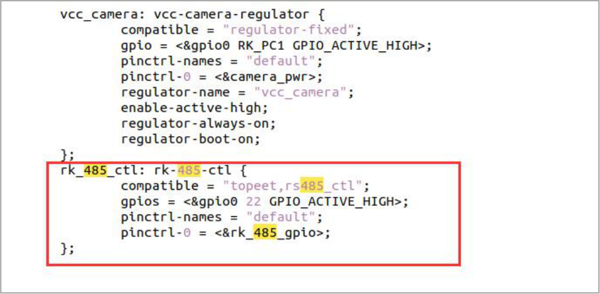

# 第077章 设备树插件介绍

本章节讲解设备树插件的基本知识。
## 77.1 什么是设备树插件
Linux4.4 以后引入了动态设备树（Dynamic DeviceTree），动态设备树也叫做设备树插件。设备树插件是原有设备树（Device Tree）技术的扩展机制。设备树插件允许在系统运行时动态修改设备树中的内容，从而无需重新编译整个设备树。通过使用设备树插件，开发人员可以在不重新启动系统的情况下对设备树进行更改。因此设备树插件功能在嵌入式开发调试阶段非常有用。设备树插件（Dynamic DeviceTree）使用文本格式定义，并以.dts 为后缀名。在设备树插件代码中要描述需要动态修改的设备树节点或属性等内容。
## 77.2 设备树插件语法
设备树插件的语法与设备树语法基本相同，但是在设备树插件中有一些特定的语法和指令用于描述设备树插件的行为。新建一个overlay.dts 文件用于讲解设备树插件语法，如图77.1 所示。

图77.1接下来编写overlay.dts 文件内容。首先添加设备树插件头部声明，头部声明指定了设备树插件的名称和版本等信息。如代码清单77.1 所示。代码清单77.1/dts-v1/;/plugin/;设备树插件中的节点用于定义要动态添加，修改或删除的设备树节点及其属性。设备树插件中节点和属性语法与设备树语法相同，但在在设备树插件中，节点名称前需指定要动态修改

的设备节点。比如动态修改设备树根节点下的rs485 节点，rk485 节点如图77.2 所示。

图77.2编写设备树插件代码动态修改设备树根节点下的rs485 节点有4 中方法。方法1：如代码清单77.2 所示。代码清单77.2
```c
/dts-v1/;
/plugin/;
/{
    &{/rk-485-ctl}{
        overlay_node{
             status = "okay";
        };
    };
};
```
在方法1 中通过绝对路径指定要修改的节点，如代码&{/rk-485-ctl}表示要动态修改根节点下的rk485 节点。修改内容为在rs485 节点下添加overlay_node 节点，并在overlay_node 节点中添加status 属性，属性值为okay。方法2：如代码清单77.3 所示。代码清单77.3
```c
/dts-v1/;
/plugin/;
/{
    &rk_485_ctl{
        overlay_node{
             status = "okay";
        };
    };
```

```c
};
```
在方法2 中直接通过代码&rk_485_ctl 表示要动态修改的节点为rs485 节点。方法3：如代码清单77.4 所示。代码清单77.4在方法3 中通过fragment@0 节点中的target_path 属性指定动态修改的节点是根节点下的
```c
/dts-v1/;
/plugin/;
/{
    fragment@0{
        target_path="/rk-485-ctl";
             __overlay__ {
                 overlay_node {
                 status = "okay";
               };
           };
       };
};
```
rs485 节点。并通过__overlay__节点添加overlay_node 节点和属性。方法4：如代码清单77.5 所示。代码清单77.5
```c
/dts-v1/;
/plugin/;
/{
    fragment@0{
        target=<&rk_485_ctl>;
             __overlay__ {
                 overlay_node {
                 status = "okay";
               };
           };
       };
};
```
与方法3 不同的是方法4 在fragment@0 节点中的target_path 属性直接引用rs485 节点，表示动态修改rs485 节点。因为方法1 和方法2 比较简介，因此大多数情况下使用方法1 和方法2 居多。
## 77.3 设备树插件编译

