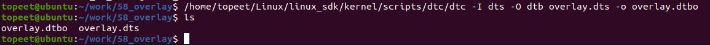
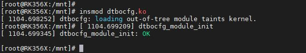
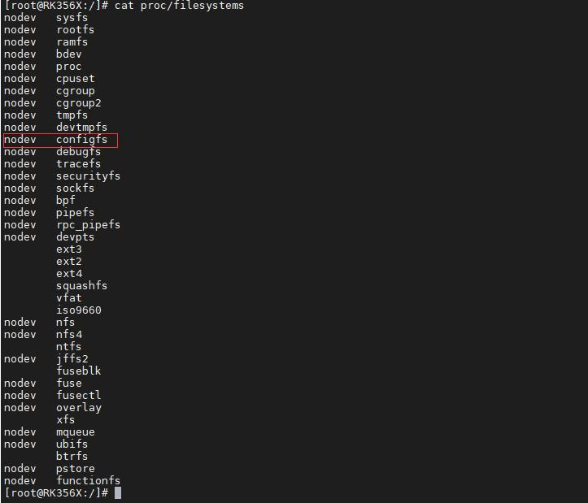
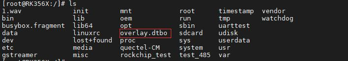
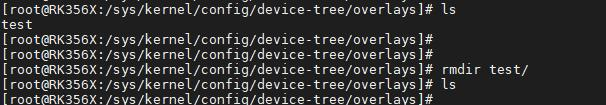

# 第078章 设备树插件使用实验

使用方法1 修改rs485 节点，编写好设备树插件代码后编译设备树插件源码overlay.dts，编译设备树插件方式与编译设备树相同，同样使用dtc 编译器。如使用代码清单77.6 中使用dtc 编译器编译设备树插件源码。代码清单77.6/home/topeet/Linux/linux_sdk/kernel/scripts/dtc/dtc -I dts -O dtb overlay.dts -o overlay.dtbo代码清单77.5 中使用的dtc 编译器是iTOP-RK3568 开发板Linux SDK 中kernel/scripts/dtc/路径下的dtc 编译器。编译成功如图77.3 所示。

```c
77.3
```
反编译设备树插件方法与反编译设备树方法一样，如代码清单77.7 所示。代码清单77.7/home/topeet/Linux/linux_sdk/kernel/scripts/dtc/dtc -I dtb -O dts overlay.dtbo -o 1.dts反编译成功如图77.4 所示。

图77.4

本章学习设备树插件使用。
## 78.1 准备实验环境
首先烧写网盘iTOP-RK3568 开发板\07_学习教程配套资料\03_Linux 驱动配套资料\04_Linux驱动例程\65_dtbocfg目录下的Linux系统镜像，然后将设备树插件驱动程序dtbocfg.ko拷贝到系统中并使用insmod dtbocfg.ko 命令加载驱动程序，如图78.1 所示

图78.1接着输入命令cat proc/filesystems 检查configfs 是否挂载成功。挂载成功如图78.2 所示：

图78.2

## 78.2 设备树插件的使用
在上一个小节中烧写了支持设备树插件的内核镜像，并且加载了dtbocfg.ko 驱动程序。在此基础上，本小节继续讲解如何使用设备树插件。创建一个名为overlay.dts 设备树插件源文件，在overlay.dts 对iTOP-RK3568 开发板对应的设备树根节点下的rs485 节点进行动态修改，overlay.dts 文件中代码如图78.3 所示。

图78.3图78.3 中代码在rs485 点下添加overlay_node 节点以及属性status，status 属性值为okay。使用dtc 编译器编译得到dtbo 文件，并将dtbo 拷贝到开发板上。编译命令如代码清单78.1所示。代码清单78.1/home/topeet/Linux/linux_sdk/kernel/scripts/dtc/dtc -I dts -O dtb overlay.dts -o overlay.dtbo编译成功如图78.4 所示。

图78.4将编译好的dtbo 文件拷贝到开发板上，如图78.5 所示。

图78.45接着进到系统/sys/kernel/config/device-tree/overlays/目录下，如图78.6 所示。

图78.6在这个目录下使用mkdir test 命令创建一个内核对象，如图78.7 所示。


图78.7使用命令cd test 进到test 文件夹，如图78.8 所示。

图78.8使用cat /overlay.dtbo > dtbo 命令将编译好的设备树插件文件写入到dtbo 中，如图78.9 所示。

图78.9使用echo 1 > status 命令使能dtbo，如图78.10 所示

图78.10使用ls /proc/device-tree/rk-485-ctl/overlay_node/命令查看在rs485 节点下是否动态添加了overlay_node 节点。如添加成功如图78.11 所示。

图78.11实验成功后如果想删掉动态添加的节点，在/sys/kernel/config/device-tree/overlays 目录下使用命令rmdir test 删除test 目录即可。如图78.12 所示。

图78.12此时使用命令ls /proc/device-tree/rk-485-ctl/已经看不到添加的overlay_node 节点了。如图78.13 所示。

图78.13
## 78.3 加载多个dtbo
加载多个dtbo 指的是加载多个设备树插件文件，把上一小节的设备树插件重新加载成功

后不要卸，本小节在写第一个名为overlay2.dts 的设备树插件文件，其代码如代码清单78.2 所示。代码清单78.2
```c
/dts-v1/;
/plugin/;
    /{
    &[/rk-485-ctl] {
        overlay_node{
             status="disable";
    };
};
```
代码清单78.2 中将overlay_node 节点中的status 属性值修改成了disable。编译完成overlay2.dts 后进到系统/sys/kernel/config/device-tree/overlays/目录下并在这个目录下使用命令mkdir test1 创建一个内核对象。如图78.14 所示。作者编译好的overlay2.dts 名为/overlay2.dtbo。

图78.14使用命令cd test 进到test1 文件夹，如图78.15 所示。

图78.15使用命令cat /overlay2.dtbo > dtbo 将编译好的设备树插件文件写进dtbo 中，如图78.16 所示。

图78.16使用命令echo 1 > status 使能dtbo，如图78.17

图78.17如果使用命令cat /proc/device-tree/rk-485-ctl/overlay_node/status 可以看到status 属性值已经被修改成了disable。说明加载第二个设备树插件成功。如图78.18 所示

图78.18

