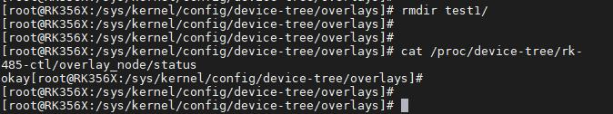

# 第079章 虚拟文件系统configfS介绍

实验成功后删除test1 文件夹，如图78.19 所示。

图78.19可以看到status 的属性值又变成了okay，如图78.20 所示。

图78.20至此，加载多个dtbo 实验完成。

设备树插件基于虚拟文件系统configfs 实现。虚拟文件系统configfS 是一个特殊的文件系统，旨在提供一种动态配置Linux 内核和设备的机制。本章学习虚拟文件系统configfS 的基础知识。
## 79.1 常用的虚拟文件系统
在Linux 内核中，常见的虚拟文件系统有procfs、sysyfs 和configfs 虚拟文件系统。1.procfs 虚拟文件系统procfs 虚拟文件系统提供了系统运行时状态的访问接口。它以文件和目录的形式表示内核中的进程，设备，驱动程序和其他系统信息。因此通过读取和写入procfs 虚拟文件系统中的文件，可以获取和修改系统状态的信息。2.sysfs 虚拟文件系统sysfs 虚拟文件系统会在/sys 目录下生成一个包含整个系统硬件层次结构的视图。sysfs 虚拟文件系统的作用是在用户空间中展示内核中设备、驱动和总线的信息。并且基于sysfs 虚拟文件系统用户可以查看并操作系统中的设备和驱动。3.configfs 虚拟文件系统configfs 虚拟文件系统用于动态配置和管理内核对象。它提供了一种以文件和目录的形式的内核对象访问接口，允许用户在运行时添加，修改和删除内核对象，无需重新编译内核或重新启动系统。procfs、sysyfs 和configfs 虚拟文件系统的区别：procfs 虚拟文件系统主要用于访问和管理进程信息，提供有关进程，内核参数和系统状态的信息。sysfs 虚拟文件系统主要用于表示和配置系统中的设备，驱动和其他内核对象，并且提供统一的接口来访问和控制这些对象的属性和状态。configfs 虚拟文件系统主要用于动态配置和管理内核对象，允许在运行时添加，修改和删除内核对象。

