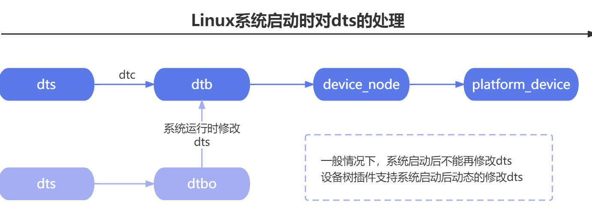

# 第080章configfs的核心数据结构

## 79.2 设备树插件选择ConfigFS 原因
图79.1 是Linux 系统启动时对设备树文件的处理以及设备树插件工作流程

图79.1
在系统运行时，如果要修改设备树，用户空间肯定需要和内核空间要进行交互。configfs 虚拟机文件系统作用的英文解释为Userspace-driven kernel object configuration，翻译过来就是用户空间配置内核对象。configfs 虚拟文件系统可以从用户空间去配置内核对象，并且不需要重新编译内核或者修改内核代码。所以configfs 虚拟文件系统更适合设备树插件这个技术。
本章学习configfS 的核心数据结构。
## 80.1 关键数据结构介绍
configfS 的核心数据结构主要包括configfs_subsystem 结构体、config_group 和config_item结构体三部分。1.configfs_subsystem 结构体configfs_subsystem 结构体是一个顶层的数据结构。如代码清单80.1 所示。代码清单80.1struct configfs_subsystem {

struct config_group su_group;struct mutexsu_mutex;};如通过代码清单80.2 可在/sys/kernel/config/ 目录下生成device-tree 目录。生成的device-tree 目录就是顶层目录。代码清单80.2
```c
static struct configfs_subsystem dtbocfg_root_subsys = {
        .su_group = {
            .cg_item = {
                .ci_namebuf = "device-tree",
            },
        },
      .su_mutex = __MUTEX_INITIALIZER(dtbocfg_root_subsys.su_mutex),
};
static int __init dtbocfg_module_init(void)
{
    config_group_init(&dtbocfg_root_subsys.su_group);
    retval = configfs_register_subsystem(&dtbocfg_root_subsys);
    ...
}
```
如图80.1 所示。

图80.12.config_group 结构体config_group 是configs 的目录和属性的容器。config_group 结构体如代码清单80.3 所示。代码清单80.3struct config_group {struct config_itemcg_item;struct list_headcg_children;struct configfs_subsystem*cg_subsys;struct list_headdefault_groups;struct list_headgroup_entry;

};如图80.2 中overlays 就是一个config_group。因此overlays 就是test1 和test 的容器，即在overlays 目录下有test1 和test 俩个属性。如图80.2 所示。

图80.2configfs_subsystem 结构体中也包含config_group 结构体，所以configfs_subsystem 也会在/sys/kernel/config 路径下有对应的目录。如图80.2 中的device-tree 目录。3.config_item 结构体config_item 用于表示一个配置项。每个配置项都是一个内核对象。config_item 结构包含了配置项的类型、名称、属性、状态等信息。如代码清单80.4 所示。代码清单80.4struct config_item {char*ci_name;charci_namebuf[CONFIGFS_ITEM_NAME_LEN];//目录的名字struct krefci_kref;struct list_head ci_entry;struct config_item*ci_parent;struct config_group*ci_group;const struct config_item_type*ci_type;//目录下属性文件和属性操作struct dentry*ci_dentry;};
如图80.3 使用mkdir 命令创建的test 就是一个config_item。

图80.3对config_item 可以进行创建，删除，读写等操作，这些操作会有对应的操作方法。所以接下来继续看config_item 结构体。config_item 结构体中包含了config_item_type 结构体，在

config_item_type 结构体中定义了容器，目录和属性的操作方法，如代码清单80.5 所示。代码清单80.5struct config_item_type {struct module*ct_owner;struct configfs_item_operations*ct_item_ops;//item（目录）的操作方法struct configfs_group_operations *ct_group_ops;//group（容器）的操作方法struct configfs_attribute**ct_attrs;//属性文件的操作方法struct configfs_bin_attribute**ct_bin_attrs; //bin 属性文件的操作方法};在config_item_type 结构体中的struct configfs_item_operations 结构体对应的删除操作方法。如代码清单80.6 所示。代码清单80.6struct configfs_item_operations {//删除item 方法，在group 下面使用rmdir 命令会调用这个方法void (*release)(struct config_item *);int (*allow_link)(struct config_item *src, struct config_item *target);void (*drop_link)(struct config_item *src, struct config_item *target);};config_item_type 结构体中的truct configfs_group_operations 结构体有对应创建的方法，如代码清单80.7 所示。代码清单80.7struct configfs_group_operations {//创建item 的方法，在group 下面使用mkdir 命令会调用这个方法struct config_item *(*make_item)(struct config_group *group, const char *name);//创建group 的方法struct config_group *(*make_group)(struct config_group *group, const char *name);int (*commit_item)(struct config_item *item);void (*disconnect_notify)(struct config_group *group, struct config_item *item);void (*drop_item)(struct config_group *group, struct config_item *item);

};config_item_type 结构体中的struct configfs_attribute 结构体用来表示属性相关信息。如代码清单80.8 所示。代码清单80.8struct configfs_attribute {const char*ca_name;属性文件的名字struct module*ca_owner;属性文件文件的所属模块umode_tca_mode;属性文件访问权限读写方法的函数指针，具体功能需要自行实现。ssize_t (*show)(struct config_item *, char *);ssize_t (*store)(struct config_item *, const char *, size_t);};
## 80.2 关键数据结构体对应图
图80.4 是关键数据结构体与/sys/kernel/config 路径下文件与目录对应图。

