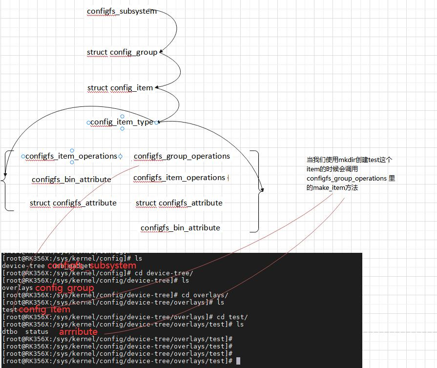
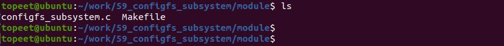

# 第081章 注册configfs子系统实验


图80.4
本章节学习注册一个configfs 子系统。即使用configfs_subsystem 结构体在/sys/kernel/config路径下生成对应的目录。
## 81.1 API 函数介绍
注册configs 子系统需要时使用config_group_init()和configfs_register_subsystem()函数。1. config_group_init()函数函数原型：void config_group_init(struct config_group *group)函数作用：初始化group

函数参数：struct config_group *group：要初始化的group。2.configfs_register_subsystem()函数函数原型：int configfs_register_subsystem(struct configfs_subsystem *subsys)函数作用：注册一个configfs 子系统。函数参数：struct configfs_subsystem *subsys：要注册的configfs 子系统。函数返回值：注册成功返回0，失败返回负数。
## 81.2 实验程序的编写
### 81.2.1 驱动程序编写
本实验存放在网盘iTOP-RK3568 开发板\07_学习教程配套资料\03_Linux 驱动配套资料\04_Linux 驱动例程\59_configfs_subsystem\module 路径下。本实验代码在/sys/kernel/config 路径下创建一个名为“myconfigfs”的configfs 子系统，实验代码configfs_subsystem.c 如代码清单81.1 所示。代码清单81.1
```c
#include <linux/module.h>
#include <linux/init.h>
#include <linux/slab.h>
#include <linux/configfs.h>
//定义名为"myconfig_item_type"的配置项类型结构体
static const struct config_item_type myconfig_item_type ={
      .ct_owner = THIS_MODULE,
      .ct_item_ops = NULL,
      .ct_group_ops = NULL,
      .ct_attrs = NULL,
};
//定义一个configfs_subsystem 结构体实例"myconfigfs_subsystem"
static struct configfs_subsystem myconfigfs_subsystem ={
      .su_group = {
        .cg_item = {
          .ci_namebuf = "myconfigfs",
          .ci_type = &myconfig_item_type,
        },
      },
};
//模块的初始化函数
```

```c
static int myconfigfs_init(void)
{
      //初始化配置组
      config_group_init(&myconfigfs_subsystem.su_group);
      //注册子系统
      configfs_register_subsystem(&myconfigfs_subsystem);
      return 0;
}
// 模块退出函数
static void myconfigfs_exit(void)
{
      configfs_unregister_subsystem(&myconfigfs_subsystem);
}
module_init(myconfigfs_init); // 指定模块的初始化函数
module_exit(myconfigfs_exit); // 指定模块的退出函数
MODULE_LICENSE("GPL");// 模块使用的许可证
MODULE_AUTHOR("topeet"); // 模块的作者
```
## 81.3 运行测试
### 81.3.1 编译驱动程序
在configfs_subsystem.c 代码同一目录下创建Makefile 文件，如图81.1 所示

Makefile 文件内容如代码清单81.2 所示。代码清单81.2
```c
export ARCH=arm64#设置平台架构
export CROSS_COMPILE=aarch64-linux-gnu-#交叉编译器前缀
obj-m +=configfs_subsystem.o#此处要和你的驱动源文件同名
KDIR :=/home/topeet/Linux/linux_sdk/kernel#这里是你的内核目录
PWD ?= $(shell pwd)
all:
    make -C $(KDIR) M=$(PWD) modules#make 操作
clean:
    make -C $(KDIR) M=$(PWD) clean#make clean 操作
```
回到存放configfs_subsystem.c 和Makefile 文件目录下使用命令make 编译驱动程序，编译完成如图81.2 所示。

