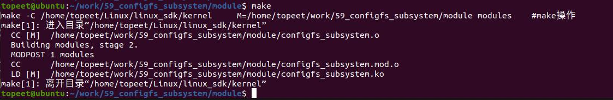
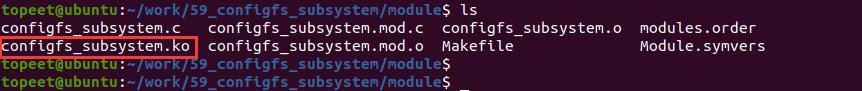
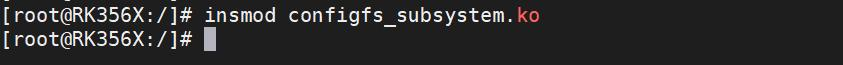
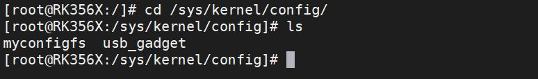
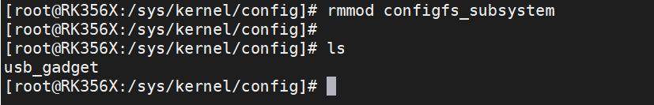
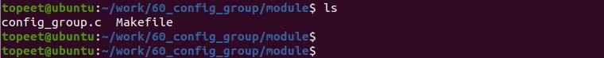
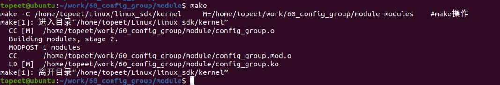
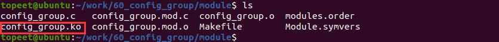
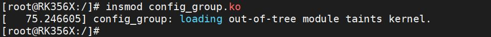

# 第082章 注册group容器实验


图81.2编译成功会生成configfs_subsystem.ko 目标文件，如图81.3 所示。

图81.3至此驱动模块就编译成功了，接下来进行测试。
### 81.3.2 运行测试
开发板启动之后，使用insmod configfs_subsystem.ko 命令加载驱动程序，如图81.4 所示。

图81.4驱动加载之后进入/sys/kernel/config 目录下，如果实验成功可以看到注册生成的myconfigfs子系统，如图81.5 所示。

图81.5使用rmmod configfs_subsystem 命令卸载驱动程序，如图81.6 所示。

图81.6至此，注册configfs 子系统实验就完成了。

本章节学习注册group 容器。
## 82.1 API 函数介绍
在学习设备树插件使用时，系统/sys/kernel/config/device-tree/目录下的overlays/目录即group 容器，如图82.1 所示。因此大家也可以把group 容器理解成一个目录，在目录(容器)下可以包含属性或者目录(容器)。

图82.1在/sys/kernel/config/目录下注册容器需要使用config_group_init_type_name()和configfs_register_group()俩个API 函数。1. config_group_init_type_name()函数函数原型：void config_group_init_type_name(struct config_group *group, const char*name,const struct config_item_type *type)函数作用：初始化group。函数参数：struct config_group *group：要初始的group。const char *name：group 的名字。const struct config_item_type *type：config_item_type 结构体中定义可以对目录下的属性或者配置项进行哪些操作。2.configfs_register_group()函数函数原型：int configfs_register_group(struct config_group *parent_group,struct config_group *group);函数作用：注册一个group。函数参数：struct config_group *parent_group：要注册的group 的父group。如图8.7 中overlays 的父group 就是device-tree。struct config_group *group：要注册的group。函数返回值：成功返回0，失败返回负数。
## 82.2 实验程序的编写
### 82.2.1 驱动程序编写
本实验代码存放在网盘iTOP-RK3568 开发板\07_学习教程配套资料\03_Linux 驱动配套资料\04_Linux 驱动例程\60_config_group\module 路径下。本实验代码在myconfigfs 目录下注册group 容器。实验代码config_group.c 如代码清单82.1

所示。代码清单82.1
```c
#include <linux/module.h>
#include <linux/init.h>
#include <linux/slab.h>
#include <linux/configfs.h>
// 定义一个名为"mygroup"的config_group 结构体
static struct config_group mygroup;
// 定义一个名为"mygroup_config_item_type"的config_item_type 结构体，用于描述配置项类型。
static const struct config_item_type mygroup_config_item_type = {
        .ct_owner = THIS_MODULE,
        .ct_item_ops = NULL,
        .ct_group_ops = NULL,
        .ct_attrs = NULL,
};
// 定义名为"myconfig_item_type"的配置项类型结构体
static const struct config_item_type myconfig_item_type = {
        .ct_owner = THIS_MODULE,
        .ct_group_ops = NULL,
};
// 定义一个configfs_subsystem 结构体实例"myconfigfs_subsystem"
static struct configfs_subsystem myconfigfs_subsystem = {
        .su_group = {
            .cg_item = {
                .ci_namebuf = "myconfigfs",
                .ci_type = &myconfig_item_type,
            },
        },
};
// 模块的初始化函数
static int myconfig_group_init(void)
{
      // 初始化配置组
      config_group_init(&myconfigfs_subsystem.su_group);
      // 注册子系统
      configfs_register_subsystem(&myconfigfs_subsystem);
      // 初始化配置组"mygroup"
      config_group_init_type_name(&mygroup, "mygroup", &mygroup_config_item_type);
```

```c
// 在子系统中注册配置组"mygroup"
configfs_register_group(&myconfigfs_subsystem.su_group, &mygroup);
return 0;
}
// 模块退出函数
static void myconfig_group_exit(void)
{
// 注销子系统
configfs_unregister_subsystem(&myconfigfs_subsystem);
}
module_init(myconfig_group_init); // 指定模块的初始化函数
module_exit(myconfig_group_exit); // 指定模块的退出函数
MODULE_LICENSE("GPL");// 模块使用的许可证
MODULE_AUTHOR("topeet"); // 模块的作者
```
## 82.3 运行测试
### 82.3.1 编译驱动程序
在config_group.c 代码同一目录下创建Makefile 文件，如图82.2 所示

图82.2Makefile 文件内容如代码清单82.2 所示。代码清单82.2
```c
export ARCH=arm64#设置平台架构
export CROSS_COMPILE=aarch64-linux-gnu-#交叉编译器前缀
obj-m +=config_group.o#此处要和你的驱动源文件同名
KDIR :=/home/topeet/Linux/linux_sdk/kernel#这里是你的内核目录
PWD ?= $(shell pwd)
all:
    make -C $(KDIR) M=$(PWD) modules#make 操作
clean:
    make -C $(KDIR) M=$(PWD) clean#make clean 操作
```
回到存放config_group.c 和Makefile 文件目录下使用命令make 编译驱动程序，编译完成如图82.3 所示。


图82.3编译成功回成config_group.ko 目标文件，如图82.4 所示。

图82.4至此驱动模块就编译成功了，接下来进行测试。
### 82.3.2 运行测试
开发板启动之后，使用insmod config_group.ko 命令加载驱动程序，如图82.5 所示。

图82.5驱动加载之后进入/sys/kernel/config 目录下，如果注册成功可以看到注册生成的myconfigfs子系统，如图82.6 所示：

图82.6然后进入注册生成的myconfigfs 子系统中，如果注册成功可以看到注册生成的mygroup 容器。如图82.7 所示。

图82.7实验成功后使用rmmod config_group 命令卸载驱动程序，如图82.8 所示。

