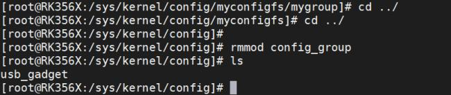
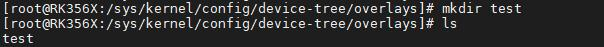
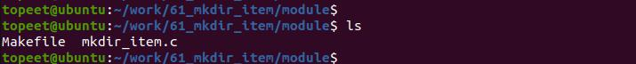
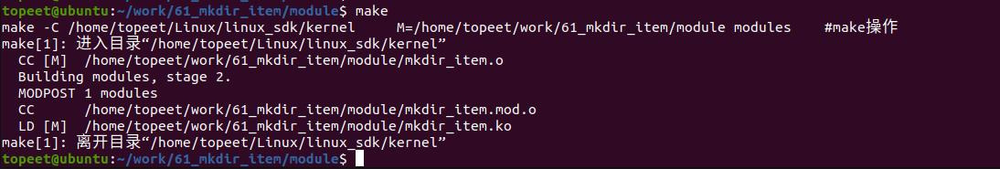
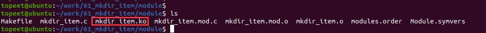
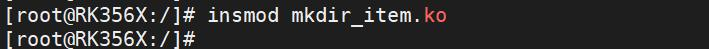
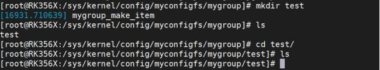
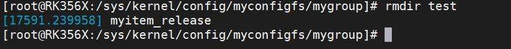
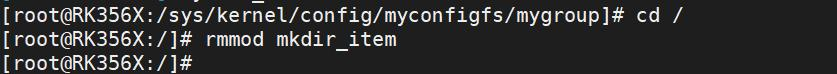

# 第083章 用户空间创建item实验


图82.8至此，注册group 容器实验就完成了。

本章节学习实现可以用mkdir 命令创建item 的功能。83.1 API 函数介绍在学习设备树插件使用时使用mkdir test 命令可以创建一个内核对象，如图83.1 所示。

图83.1在图8.9 中创建的test 即内核对象，也可以称之为item 或者配置项。创建item 主要工作是是对config_item_type 结构体中的ct_group_ops 成员下的make_item 函数进行实现。
## 83.1 实验程序的编写
### 83.1.1 驱动程序编写
本实验代码存放在iTOP-RK3568 开发板\07_学习教程配套资料\03_Linux 驱动配套资料\04_Linux 驱动例程\61_mkdir_item\module 路径下。本实验代码实现可以用mkdir 命令创建item 功能。实验代码mkdir_item.c 如代码清单83.1所示。代码清单83.1
```c
#include <linux/module.h>
#include <linux/init.h>
#include <linux/slab.h>
#include <linux/configfs.h>
// 定义一个名为"mygroup"的config_group 结构体
static struct config_group mygroup;
// 自定义的配置项结构体
struct myitem
{
        struct config_item item;
};
// 配置项释放函数
```

```c
void myitem_release(struct config_item *item)
{
        struct myitem *myitem = container_of(item, struct myitem, item);
        kfree(myitem);
        printk("%s\n", __func__);
}
// 配置项操作结构体
struct configfs_item_operations myitem_ops = {
        .release = myitem_release,
};
// 配置项类型结构体
static struct config_item_type mygroup_item_type = {
        .ct_owner = THIS_MODULE,
        .ct_item_ops = &myitem_ops,
};
// 创建配置项函数
struct config_item *mygroup_make_item(struct config_group *group, const char *name)
{
        struct myitem *myconfig_item;
        printk("%s\n", __func__);
        myconfig_item = kzalloc(sizeof(*myconfig_item), GFP_KERNEL);
        config_item_init_type_name(&myconfig_item->item, name, &mygroup_item_type);
        return &myconfig_item->item;
}
// 配置组操作结构体
struct configfs_group_operations mygroup_ops = {
        .make_item = mygroup_make_item,
};
// 定义名为"mygroup_config_item_type"的config_item_type 结构体，用于描述配置项类型。
static const struct config_item_type mygroup_config_item_type = {
        .ct_owner = THIS_MODULE,
        .ct_group_ops = &mygroup_ops,
};
// 定义名为"myconfig_item_type"的配置项类型结构体
static const struct config_item_type myconfig_item_type = {
        .ct_owner = THIS_MODULE,
        .ct_group_ops = NULL,
};
```

```c
// 定义一个configfs_subsystem 结构体实例"myconfigfs_subsystem"
static struct configfs_subsystem myconfigfs_subsystem = {
        .su_group = {
            .cg_item = {
                .ci_namebuf = "myconfigfs",
                .ci_type = &myconfig_item_type,
            },
    },
};
// 模块的初始化函数
static int myconfig_group_init(void)
{
        // 初始化配置组
        config_group_init(&myconfigfs_subsystem.su_group);
        // 注册子系统
        configfs_register_subsystem(&myconfigfs_subsystem);
        // 初始化配置组"mygroup"
        config_group_init_type_name(&mygroup, "mygroup", &mygroup_config_item_type);
        // 在子系统中注册配置组"mygroup"
        configfs_register_group(&myconfigfs_subsystem.su_group, &mygroup);
        return 0;
}
// 模块退出函数
static void myconfig_group_exit(void)
{
        // 注销子系统
        configfs_unregister_subsystem(&myconfigfs_subsystem);
}
module_init(myconfig_group_init); // 指定模块的初始化函数
module_exit(myconfig_group_exit); // 指定模块的退出函数
MODULE_LICENSE("GPL");// 模块使用的许可证
MODULE_AUTHOR("topeet"); // 模块的作者
```

## 83.2 运行测试
### 83.2.1 编译驱动程序
在mkdir_item.c 代码同一目录下创建Makefile 文件，如图83.2 所示。

图83.2Makefile 文件内容如代码清单83.2 所示。代码清单83.2
```c
export ARCH=arm64#设置平台架构
export CROSS_COMPILE=aarch64-linux-gnu-#交叉编译器前缀
obj-m += mkdir_item.o#此处要和你的驱动源文件同名
KDIR :=/home/topeet/Linux/linux_sdk/kernel#这里是你的内核目录
PWD ?= $(shell pwd)
all:
    make -C $(KDIR) M=$(PWD) modules#make 操作
clean:
    make -C $(KDIR) M=$(PWD) clean#make clean 操作
```
回到存放mkdir_item.c 和Makefile 文件目录下，使用命令make 编译驱动程序，编译完成如图83.3 所示。

图83.3编译完生成mkdir_item.ko 目标文件，如图83.4 所示。

图83.4至此驱动模块就编译成功了，接下来进行测试。
### 83.2.2 运行测试
开发板启动之后，使用insmod mkdir_item.ko 命令加载驱动程序，如图83.5 所示。


图83.5驱动加载之后进入/sys/kernel/config 目录下，可以看到注册生成的myconfigfs 子系统，如图83.6 所示。

图83.6然后进入注册生成的myconfigfs 子系统，可以看到注册生成的mygroup 容器。如图83.7所示。

图83.7接着输入mkdir test 命令创建config_item，，如果创建成功会打印“mygroup_make_item”，说明驱动程序中mygroup_make_item 函数成功被执行，则创建item 实验成功。如图83.8 所示。

图83.8实验成功后可以输入rmdir test 命令删除item，如图83.9 所示。

图83.9最后可以可以使用rmmod mkdir_item 命令卸载驱动程序，如图83.10 所示。

图83.10至此，用户空间创建item 实验就完成了。

