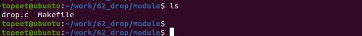
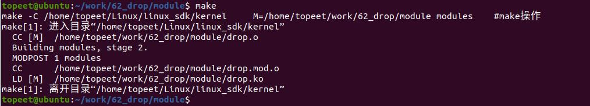
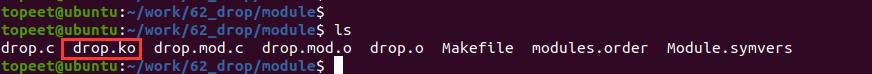
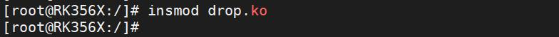
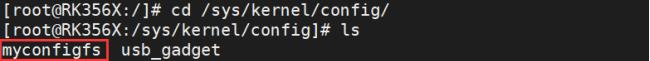
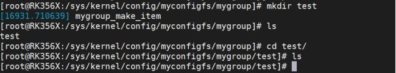
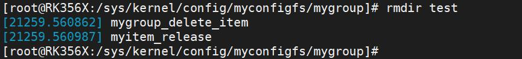

# 第084章 完善drop和release函数实验

本章完善驱动中drop 函数和release 函数。
## 84.1 release 和drop 函数的区别
.drop_item 是struct configfs_group_operations 结构体中定义的一个回调函数指针。当configfs 中的配置被删除时，内核会调用该函数来处理与配置组删除的相关操作。.release 是struct config_item_type 结构体中定义的一个回调函数指针。当configfs 中的配置项被释放时，内核会调用该函数来执行相应的资源释放操作。如果驱动中存在drop 函数时，不管是不是同时存在release 函数，当使用rmdir 命令删除配置项时会去执行drop 函数而不会去执行release 函数。如需要在删除配置项时候既执行drop函数又执行relase 函数，则需要在drop 函数中调用config_item_put()函数去执行release 函数从而配合处理配置组删除的相关操作。
## 84.2 实验程序的编写
### 84.2.1 驱动程序编写
本实验代码存放在iTOP-RK3568 开发板\07_学习教程配套资料\03_Linux 驱动配套资料\04_Linux 驱动例程\62_drop\module 路径下。本实验代码实现了删除配置项的函数，实验代码drop.c 如代码清单84.1 所示。
```c
#include <linux/module.h>
#include <linux/init.h>
#include <linux/slab.h>
#include <linux/configfs.h>
// 定义一个名为"mygroup"的config_group 结构体
static struct config_group mygroup;
// 自定义的配置项结构体
struct myitem
{
        struct config_item item;
};
```

```c
// 配置项释放函数
void myitem_release(struct config_item *item)
{
        struct myitem *myitem = container_of(item, struct myitem, item);
        kfree(myitem);
        printk("%s\n", __func__);
}
// 配置项操作结构体
struct configfs_item_operations myitem_ops = {
        .release = myitem_release,
};
// 配置项类型结构体
static struct config_item_type mygroup_item_type = {
        .ct_owner = THIS_MODULE,
        .ct_item_ops = &myitem_ops,
};
// 创建配置项函数
struct config_item *mygroup_make_item(struct config_group *group, const char *name)
{
        struct myitem *myconfig_item;
        printk("%s\n", __func__);
        myconfig_item = kzalloc(sizeof(*myconfig_item), GFP_KERNEL);
        config_item_init_type_name(&myconfig_item->item, name, &mygroup_item_type);
        return &myconfig_item->item;
}
// 删除配置项函数
void mygroup_delete_item(struct config_group *group, struct config_item *item)
{
        struct myitem *myitem = container_of(item, struct myitem, item);
        config_item_put(&myitem->item);
        printk("%s\n", __func__);
}
// 配置组操作结构体
struct configfs_group_operations mygroup_ops = {
        .make_item = mygroup_make_item,
        .drop_item = mygroup_delete_item,
};
// 定义名为"mygroup_config_item_type"的config_item_type 结构体，用于描述配置项类型。
```

```c
static const struct config_item_type mygroup_config_item_type = {
        .ct_owner = THIS_MODULE,
        .ct_group_ops = &mygroup_ops,
};
// 定义名为"myconfig_item_type"的配置项类型结构体
static const struct config_item_type myconfig_item_type = {
        .ct_owner = THIS_MODULE,
        .ct_group_ops = NULL,
};
// 定义一个configfs_subsystem 结构体实例"myconfigfs_subsystem"
static struct configfs_subsystem myconfigfs_subsystem = {
        .su_group = {
            .cg_item = {
                .ci_namebuf = "myconfigfs",
                .ci_type = &myconfig_item_type,
            },
        },
};
// 模块的初始化函数
static int myconfig_group_init(void)
{
        // 初始化配置组
        config_group_init(&myconfigfs_subsystem.su_group);
        // 注册子系统
        configfs_register_subsystem(&myconfigfs_subsystem);
        // 初始化配置组"mygroup"
        config_group_init_type_name(&mygroup, "mygroup", &mygroup_config_item_type);
        // 在子系统中注册配置组"mygroup"
        configfs_register_group(&myconfigfs_subsystem.su_group, &mygroup);
        return 0;
}
// 模块退出函数
static void myconfig_group_exit(void)
{
        // 注销子系统
        configfs_unregister_subsystem(&myconfigfs_subsystem);
}
module_init(myconfig_group_init); // 指定模块的初始化函数
```

```c
module_exit(myconfig_group_exit); // 指定模块的退出函数
MODULE_LICENSE("GPL");// 模块使用的许可证
MODULE_AUTHOR("topeet"); // 模块的作者
```
## 84.3 运行测试
### 84.3.1 编译驱动程序
在drop.c 代码同一目录下创建Makefile 文件，如图84.1 所示。

图84.1Makefile 文件内容如代码清单84.2 所示。代码清单84.2
```c
export ARCH=arm64#设置平台架构
export CROSS_COMPILE=aarch64-linux-gnu-#交叉编译器前缀
obj-m += drop.o#此处要和你的驱动源文件同名
KDIR :=/home/topeet/Linux/linux_sdk/kernel#这里是你的内核目录
PWD ?= $(shell pwd)
all:
    make -C $(KDIR) M=$(PWD) modules#make 操作
clean:
    make -C $(KDIR) M=$(PWD) clean#make clean 操作
```
回到存放drop.c 和Makefile 文件目录下，命令make 编译驱动程序，编译完成如图84.2 所示。

图84.2编译完生成drop.ko 目标文件，如图84.3 所示。

图84.3至此驱动模块就编译成功了，接下来进行测试。

### 84.3.2 运行测试
开发板启动之后，使用insmod drop.ko 命令加载驱动程序，如图84.4 所示。

图84.4驱动加载之后进入/sys/kernel/config 目录下，可以看到注册生成的myconfigfs 子系统，如图84.5 所示。

图84.5然后进入注册生成的myconfigfs 子系统，可以看到注册生成的mygroup 容器。如图84.6所示。

图84.6然后输入mkdir test 命令创建config_item，创建成功之后会打印“mygroup_make_item”。如图84.7 所示。

图84.7输入rmdir test 命令删除item,如下图所示，执行rmdir 命令之后，如果实验成功会依次执行了mygroup_delete_item 函数和myitem_release 函数。如图84.8 所示。

图84.8

