# 第085章 注册attribute实验

实验成功后使用rmmod mkdir_item 命令卸载驱动程序，如图84.9 所示。
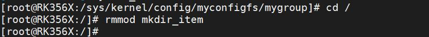
图84.9至此，完善drop 和release 函数实验就完成了。

本章学习在item 下创建属性。
## 85.1 API 函数介绍
在学习设备树插件使用时候使用echo 1 > status 命令可以使能设备树插件，如图85.1 所示。
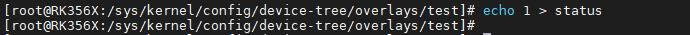
图85.1图85.1 中的status 即属性文件。在Linux 中提供了以下6 个宏定义用于定义属性文件。CONFIGFS_ATTR(_pfx, _name)、CONFIGFS_ATTR_RO(_pfx, _name)、CONFIGFS_ATTR_WO(_pfx, _name)、CONFIGFS_BIN_ATTR(_pfx, _name, _priv, _maxsz)、CONFIGFS_BIN_ATTR_RO(_pfx, _name, _priv, _maxsz)CONFIGFS_BIN_ATTR_WO(_pfx, _name, _priv, _maxsz)宏CONFIGFS_ATTR(_pfx, _name)、CONFIGFS_ATTR_RO(_pfx, _name)和CONFIGFS_ATTR_WO(_pfx, _name)原型如代码清单85.1 所示。代码清单85.1
```c
#define CONFIGFS_ATTR(_pfx, _name)\
    static struct configfs_attribute _pfx##attr_##_name = {\
    .ca_name = __stringify(_name),\
    .ca_mode = S_IRUGO | S_IWUSR,\
    .ca_owner= THIS_MODULE,\
    .show= _pfx##_name##_show,\
    .store= _pfx##_name##_store,\
    }
#define CONFIGFS_ATTR_RO(_pfx, _name)\
    static struct configfs_attribute _pfx##attr_##_name = {\
    .ca_name = __stringify(_name),\
    .ca_mode = S_IRUGO,\
    .ca_owner= THIS_MODULE,\
    .show= _pfx##_name##_show,\
    }
```

```c
#define CONFIGFS_ATTR_WO(_pfx, _name)\
    static struct configfs_attribute _pfx##attr_##_name = {\
    .ca_name = __stringify(_name),\
    .ca_mode = S_IWUSR,\
    .ca_owner= THIS_MODULE,\
    .store= _pfx##_name##_store,\
}
```
通过代码清单85.1 可以看出这3 个宏定义本质是给struct configfs_attribute 结构体中成员进行赋值。如代码CONFIGFS_ATTR_RO(my, read)表示struct configfs_attribute 结构体的名字是myattr_read，show 函数名称是myread_show。宏定义中的##表示连接。宏CONFIGFS_BIN_ATTR(_pfx, _name, _priv, _maxsz)、CONFIGFS_BIN_ATTR_RO(_pfx, _name,_priv, _maxsz)和CONFIGFS_BIN_ATTR_WO(_pfx, _name, _priv, _maxsz)原型如代码清单85.2 所示。代码清单85.2
```c
#define CONFIGFS_BIN_ATTR(_pfx, _name, _priv, _maxsz)\
    static struct configfs_bin_attribute _pfx##attr_##_name = {\
    .cb_attr = {\
        .ca_name = __stringify(_name),\
        .ca_mode = S_IRUGO | S_IWUSR,\
        .ca_owner= THIS_MODULE,\
    },\
    .cb_private= _priv,\
    .cb_max_size= _maxsz,\
    .read= _pfx##_name##_read,\
    .write= _pfx##_name##_write,\
    }
#define CONFIGFS_BIN_ATTR_RO(_pfx, _name, _priv, _maxsz)\
    static struct configfs_bin_attribute _pfx##attr_##_name = {\
    .cb_attr = {\
        .ca_name = __stringify(_name),\
        .ca_mode = S_IRUGO,\
        .ca_owner= THIS_MODULE,\
    },\
    .cb_private= _priv,\
    .cb_max_size= _maxsz,\
    .read= _pfx##_name##_read,\
    }
#define CONFIGFS_BIN_ATTR_WO(_pfx, _name, _priv, _maxsz)\
    static struct configfs_bin_attribute _pfx##attr_##_name = {\
    .cb_attr = {\
        .ca_name = __stringify(_name),\
        .ca_mode = S_IWUSR,\
```

```c
.ca_owner= THIS_MODULE,\
},\
.cb_private= _priv,\
.cb_max_size= _maxsz,\
.write= _pfx##_name##_write,\
}
```
通过代码清单85.2 可以看出这3 个宏定义本质是给struct configfs_bin_attribute 结构体中成员进行赋值。使用宏定义的方式比直接使用结构体在代码上更简洁。因此在Linux 中定义了这些宏定义供开发者使用。
## 85.2 实验程序的编写
### 85.2.1 驱动程序编写
本实验代码存放在iTOP-RK3568 开发板\07_学习教程配套资料\03_Linux 驱动配套资料\04_Linux 驱动例程\63_attr\module 路径下。本实验实现在item 目录下生成属性read 和write，并实现read 属性的读取操作和write 属性的写入操作。实验代码attr.c 如代码清单85.3 所示。代码清单85.3
```c
#include <linux/module.h>
#include <linux/init.h>
#include <linux/slab.h>
#include <linux/configfs.h>
// 定义一个名为"mygroup"的config_group 结构体
static struct config_group mygroup;
// 自定义的配置项结构体
struct myitem
{
        struct config_item item;
        int size;
        void *addr;
};
// 配置项释放函数
void myitem_release(struct config_item *item)
{
```

```c
struct myitem *myitem = container_of(item, struct myitem, item);
kfree(myitem);
printk("%s\n", __func__);
};
// 读取配置项内容的回调函数
ssize_t myread_show(struct config_item *item, char *page)
{
struct myitem *myitem = container_of(item, struct myitem, item);
memcpy(page, myitem->addr, myitem->size);
printk("%s\n", __func__);
return myitem->size;
};
// 写入配置项内容的回调函数
ssize_t mywrite_store(struct config_item *item, const char *page, size_t size)
{
struct myitem *myitem = container_of(item, struct myitem, item);
myitem->addr = kmemdup(page, size, GFP_KERNEL);
myitem->size = size;
printk("%s\n", __func__);
return myitem->size;
};
// 创建只读配置项
CONFIGFS_ATTR_RO(my, read);
// 创建只写配置项
CONFIGFS_ATTR_WO(my, write);
// 配置项属性数组
struct configfs_attribute *my_attrs[] = {
&myattr_read,
&myattr_write,
NULL,
};
// 配置项操作结构体
struct configfs_item_operations myitem_ops = {
.release = myitem_release,
};
// 配置项类型结构体
static struct config_item_type mygroup_item_type = {
.ct_owner = THIS_MODULE,
```

```c
.ct_item_ops = &myitem_ops,
.ct_attrs = my_attrs,
};
// 创建配置项函数
struct config_item *mygroup_make_item(struct config_group *group, const char *name)
{
struct myitem *myconfig_item;
printk("%s\n", __func__);
myconfig_item = kzalloc(sizeof(*myconfig_item), GFP_KERNEL);
config_item_init_type_name(&myconfig_item->item, name, &mygroup_item_type);
return &myconfig_item->item;
}
// 删除配置项函数
void mygroup_delete_item(struct config_group *group, struct config_item *item)
{
struct myitem *myitem = container_of(item, struct myitem, item);
config_item_put(&myitem->item);
printk("%s\n", __func__);
}
// 配置组操作结构体
struct configfs_group_operations mygroup_ops = {
.make_item = mygroup_make_item,
.drop_item = mygroup_delete_item,
};
// 配置项类型结构体
static const struct config_item_type mygroup_config_item_type = {
.ct_owner = THIS_MODULE,
.ct_group_ops = &mygroup_ops,
};
// 配置项类型结构体
static const struct config_item_type myconfig_item_type = {
.ct_owner = THIS_MODULE,
.ct_group_ops = NULL,
};
// 定义一个configfs_subsystem 结构体实例"myconfigfs_subsystem"
static struct configfs_subsystem myconfigfs_subsystem = {
.su_group = {
```

```c
.cg_item = {
    .ci_namebuf = "myconfigfs",
    .ci_type = &myconfig_item_type,
},
},
};
// 模块的初始化函数
static int myconfig_group_init(void)
{
// 初始化配置组
config_group_init(&myconfigfs_subsystem.su_group);
// 注册子系统
configfs_register_subsystem(&myconfigfs_subsystem);
// 初始化配置组"mygroup"
config_group_init_type_name(&mygroup, "mygroup", &mygroup_config_item_type);
// 在子系统中注册配置组"mygroup"
configfs_register_group(&myconfigfs_subsystem.su_group, &mygroup);
return 0;
}
// 模块退出函数
static void myconfig_group_exit(void)
{
// 注销子系统
configfs_unregister_subsystem(&myconfigfs_subsystem);
}
module_init(myconfig_group_init); // 指定模块的初始化函数
module_exit(myconfig_group_exit); // 指定模块的退出函数
MODULE_LICENSE("GPL");// 模块使用的许可证
MODULE_AUTHOR("topeet"); // 模块的作者
```
## 85.3 运行测试
### 85.3.1 编译驱动程序
在attr.c 代码同一目录下创建Makefile 文件，如图85.2 所示。
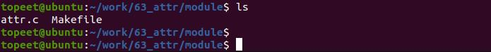

图85.2Makefile 文件内容如代码清单85.4 所示。代码清单85.4
```c
export ARCH=arm64#设置平台架构
export CROSS_COMPILE=aarch64-linux-gnu-#交叉编译器前缀
obj-m += attr.o#此处要和你的驱动源文件同名
KDIR :=/home/topeet/Linux/linux_sdk/kernel#这里是你的内核目录
PWD ?= $(shell pwd)
all:
    make -C $(KDIR) M=$(PWD) modules#make 操作
clean:
    make -C $(KDIR) M=$(PWD) clean#make clean 操作
```
回到存放attr.c 和Makefile 文件目录下使用命令make 编译驱动程序，编译完成如图85.3所示。
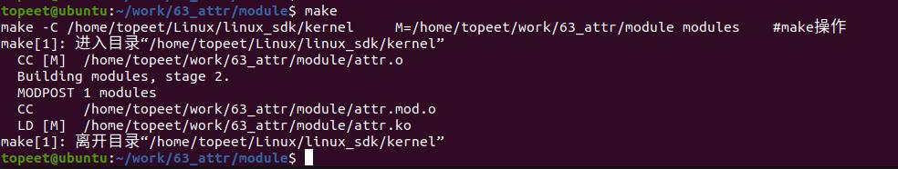
图85.3编译完生成attr.ko 目标文件，如图85.4 所示
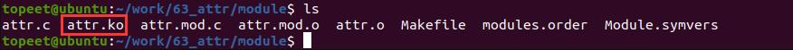
图85.4至此驱动模块就编译成功了，接下来进行测试。
### 85.3.2 运行测试
开发板启动之后，使用insmod attr.ko 命令加载驱动程序，如图85.5 所示。
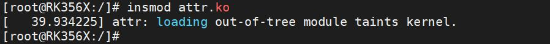
图85.5驱动加载之后进入/sys/kernel/config 目录下，可以看到注册生成的myconfigfs 子系统，如图85.6 所示。

图85.6然后进入注册生成的myconfigfs 子系统，可以看到注册生成的mygroup 容器，如图85.7所示。

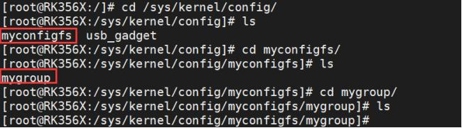
图85.7然后输入mkdir test 命令创建config_item，创建成功之后会打印“mygroup_make_item”。如图85.8 所示。
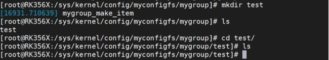
图85.8然后进入到test 目录下，如果实现成功可以看到生成的属性read 和write。如图85.9 所示。
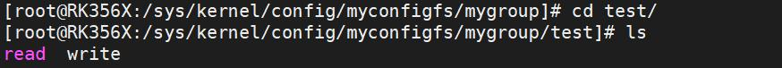
图85.9输入以下命令对属性进行读写操作，如代码清单85.5 所示。代码清单85.5cat readecho 1 > write实验成功如图85.10 所示
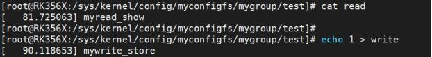
图85.10在图85.10 中分别对属性read 和write 进行读写操作，如果读写操作成功会分别打印“myread_show”和“mywrite_store”。实验成功后输入rmdir test 命令删除item，如图85.11 所示。
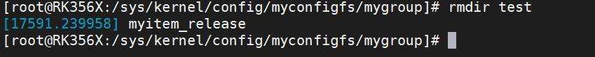

图85.11最后使用rmmod attr 命令卸载驱动程序，如图85.12。
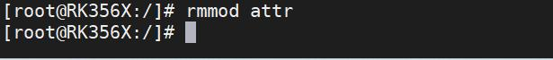
图85.12至此，注册attribute 实验就完成了。

