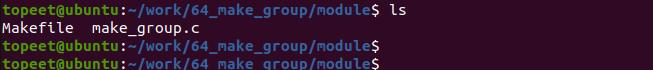
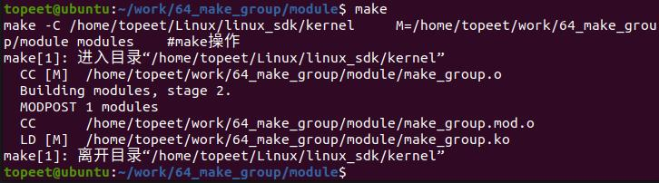
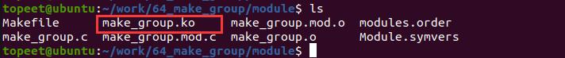
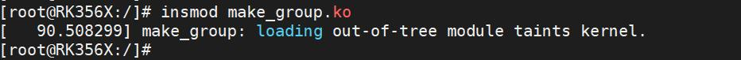
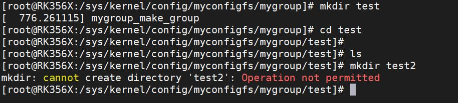
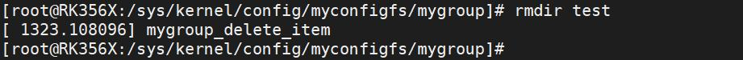

# 第086章 实现多级目录实验

本章节在configfs 下实现多级目录。
## 86.1 实验程序的编写
### 86.1.1 驱动程序编写
本实验代码存放在网盘iTOP-RK3568 开发板\07_学习教程配套资料\03_Linux 驱动配套资料\04_Linux 驱动例程\64_make_group\module 路径下。实验代码make_group.c 如代码清单86.1 所示。代码清单86.1
```c
#include <linux/module.h>
#include <linux/init.h>
#include <linux/slab.h>
#include <linux/configfs.h>
// 定义一个名为"mygroup"的config_group 结构体
static struct config_group mygroup;
// 自定义的配置项结构体
struct myitem
{
        struct config_item item;
        int size;
        void *addr;
};
// 自定义的配置组结构体
struct mygroup
{
        struct config_group group;
};
// 配置项释放函数
void myitem_release(struct config_item *item)
{
        struct myitem *myitem = container_of(item, struct myitem, item);
        kfree(myitem);
        printk("%s\n", __func__);
};
```

```c
// 读取配置项内容的回调函数
ssize_t myread_show(struct config_item *item, char *page)
{
        struct myitem *myitem = container_of(item, struct myitem, item);
        memcpy(page, myitem->addr, myitem->size);
        printk("%s\n", __func__);
        return myitem->size;
};
// 写入配置项内容的回调函数
ssize_t mywrite_store(struct config_item *item, const char *page, size_t size)
{
        struct myitem *myitem = container_of(item, struct myitem, item);
        myitem->addr = kmemdup(page, size, GFP_KERNEL);
        myitem->size = size;
        printk("%s\n", __func__);
        return myitem->size;
};
// 创建只读配置项
CONFIGFS_ATTR_RO(my, read);
// 创建只写配置项
CONFIGFS_ATTR_WO(my, write);
// 配置项属性数组
struct configfs_attribute *my_attrs[] = {
        &myattr_read,
        &myattr_write,
        NULL,
};
// 配置项操作结构体
struct configfs_item_operations myitem_ops = {
        .release = myitem_release,
};
// 配置项类型结构体
static struct config_item_type mygroup_item_type = {
        .ct_owner = THIS_MODULE,
        .ct_item_ops = &myitem_ops,
        .ct_attrs = my_attrs,
};
```

```c
// 配置组类型结构体
static struct config_item_type mygroup_type = {
        .ct_owner = THIS_MODULE,
};
// 创建配置项函数
struct config_item *mygroup_make_item(struct config_group *group, const char *name)
{
        struct myitem *myconfig_item;
        printk("%s\n", __func__);
        myconfig_item = kzalloc(sizeof(*myconfig_item), GFP_KERNEL);
        config_item_init_type_name(&myconfig_item->item, name, &mygroup_item_type);
        return &myconfig_item->item;
}
// 删除配置项函数
void mygroup_delete_item(struct config_group *group, struct config_item *item)
{
        struct myitem *myitem = container_of(item, struct myitem, item);
        config_item_put(&myitem->item);
        printk("%s\n", __func__);
}
// 创建配置组函数
struct config_group *mygroup_make_group(struct config_group *group, const char *name)
{
        struct mygroup *mygroup;
        printk("%s\n", __func__);
        mygroup = kzalloc(sizeof(*mygroup), GFP_KERNEL);
        config_group_init_type_name(&mygroup->group, name, &mygroup_type);
        return &mygroup->group;
};
// 配置组操作结构体
struct configfs_group_operations mygroup_ops = {
        .make_item = mygroup_make_item,
        .drop_item = mygroup_delete_item,
        .make_group = mygroup_make_group,
};
// 配置项类型结构体
static const struct config_item_type mygroup_config_item_type = {
        .ct_owner = THIS_MODULE,
```

```c
.ct_group_ops = &mygroup_ops,
};
// 配置项类型结构体
static const struct config_item_type myconfig_item_type = {
.ct_owner = THIS_MODULE,
.ct_group_ops = NULL,
};
// 定义一个configfs_subsystem 结构体实例"myconfigfs_subsystem"
static struct configfs_subsystem myconfigfs_subsystem = {
.su_group = {
    .cg_item = {
        .ci_namebuf = "myconfigfs",
        .ci_type = &myconfig_item_type,
    },
},
};
// 模块的初始化函数
static int myconfig_group_init(void)
{
// 初始化配置组
config_group_init(&myconfigfs_subsystem.su_group);
// 注册子系统
configfs_register_subsystem(&myconfigfs_subsystem);
// 初始化配置组"mygroup"
config_group_init_type_name(&mygroup, "mygroup", &mygroup_config_item_type);
// 在子系统中注册配置组"mygroup"
configfs_register_group(&myconfigfs_subsystem.su_group, &mygroup);
return 0;
}
// 模块退出函数
static void myconfig_group_exit(void)
{
// 注销子系统
configfs_unregister_subsystem(&myconfigfs_subsystem);
}
module_init(myconfig_group_init); // 指定模块的初始化函数
module_exit(myconfig_group_exit); // 指定模块的退出函数
```

```c
MODULE_LICENSE("GPL");// 模块使用的许可证
MODULE_AUTHOR("topeet"); // 模块的作者
```
## 86.2 运行测试
### 86.2.1 编译驱动程序
在make_group.c 代码同一目录下创建Makefile 文件，如图86.1 所示。

图86.1Makefile 文件内容如代码清单86.2 所示。代码清单86.2
```c
export ARCH=arm64#设置平台架构
export CROSS_COMPILE=aarch64-linux-gnu-#交叉编译器前缀
obj-m += make_group.o#此处要和你的驱动源文件同名
KDIR :=/home/topeet/Linux/linux_sdk/kernel#这里是你的内核目录
PWD ?= $(shell pwd)
all:
    make -C $(KDIR) M=$(PWD) modules#make 操作
clean:
    make -C $(KDIR) M=$(PWD) clean#make clean 操作
```
回到存放make_group.c 和Makefile 文件目录下，使用命令make 编译驱动程序，编译完成如图86.2 所示。

图86.2编译完生成make_group.ko 目标文件，如图86.3 所示。

图86.3至此驱动模块就编译成功了，接下来进行测试。

### 86.2.2 运行测试
开发板启动之后，使用insmod make_group.ko 命令加载驱动程序，如图86.4 所示。

图86.4驱动加载之后进入/sys/kernel/config 目录下，可以看到注册生成的myconfigfs 子系统，如图86.5 所示。

图86.5然后进入注册生成的myconfigfs 子系统，可以看到注册生成的mygroup 容器。如图86.6所示。

图86.6然后输入mkdir test 命令创建config_item，如果实验成功会打印“mygroup_make_group”并创建test 目录，然后进入创建的test 目录下，在test 目录下创建item，如test2。但由于在驱动中我们并没有实现在group 下创建item 功能，所以会提示创建test2 没有权限。如图86.7 所示。

图86.7实验成功后输入rmdir test 命令删除group，如图86.8 所示。


