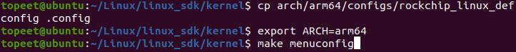
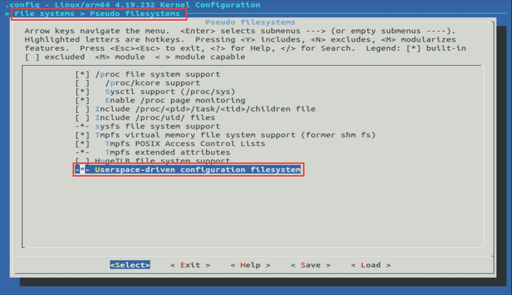
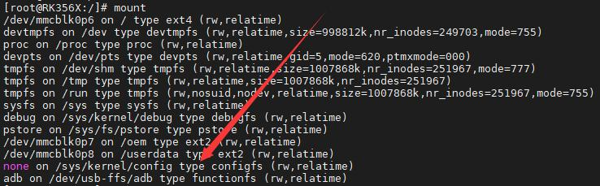
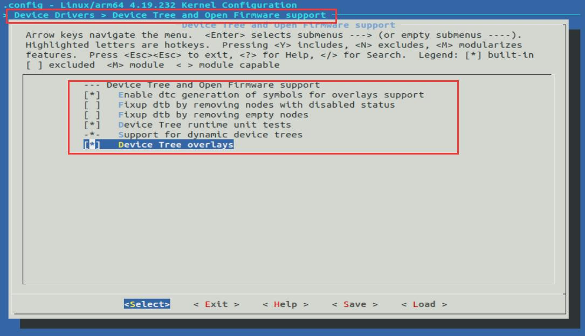
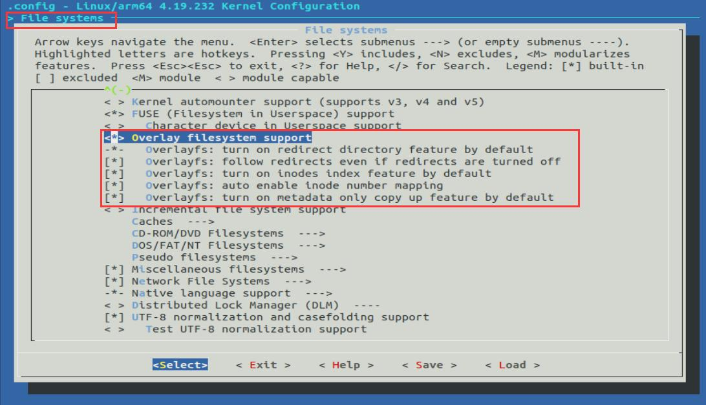

# 第087章 移植设备树插件驱动实验

图86.8使用rmmod make_group 命令卸载驱动程序，如图86.9 所示。

图86.9至此，实现多级目录实验就完成了。

本章学习如何移植设备树插件功能到iTOP-RK3568 开发板上。移植设备树插件功能包括以下3 个步骤：1 配置内核支持configfs 虚拟文件系统。2 配置内核支持设备树插件3 移植设备树插件驱动
## 87.1 配置内核支持configfs 虚拟文件系统
首先在Linux 内核源码下输入代码清单87.1 中的命令打开menuconfig 配置界面。代码清单87.1cp arch/arm64/configs/rockchip_linux_defconfig .configexport ARCH=arm64make menuconfig输入完成后如图87.1 所示。

图87.1打开menuconfig 图形化界面之后，将图87.2 中的选项选中。

图87.2勾选之后保存退出，然后输入代码清单87.2 中命令编译内核。代码清单87.2cp .config arch/arm64/configs/rockchip_linux_defconfigcd .././build.sh kernel将编译之后的内核镜像烧写到开发板上，接着使用mount 命令检查configfs 虚拟文件系统是否配置成功。配置成功如图87.3 所示。

图87.3如果系统没有如图87.3 一样自动挂载configfs 虚拟文件系统，可以尝试使用mount -tconfigfs none /sys/kernel/config 命令手动挂载。
## 87.2 配置内核支持设备树插件
在Linux 内核源码下输入代码清单87.3 中的命令打开menuconfig 配置界面。代码清单87.3cp arch/arm64/configs/rockchip_linux_defconfig .configexport ARCH=arm64make menuconfig输入完成后如图87.4 所示。

图87.4打开menuconfig 图形化界面之后，将图87.5、87.6 中的选项选中。

图87.5

图87.6
勾选之后保存退出，然后输入代码清单87.4 中命令编译内核源码。代码清单87.4cp .config arch/arm64/configs/rockchip_linux_defconfigcd .././build.sh kernel
## 87.3 移植设备树插件驱动
将网盘iTOP-RK3568 开发板\07_学习教程配套资料\03_Linux 驱动配套资料\04_Linux 驱动例程\65_dtbocfg 路径下的驱动程序和Makefile 文件拷贝到虚拟机ubuntu 中，如图87.7 所示。

