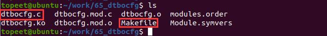
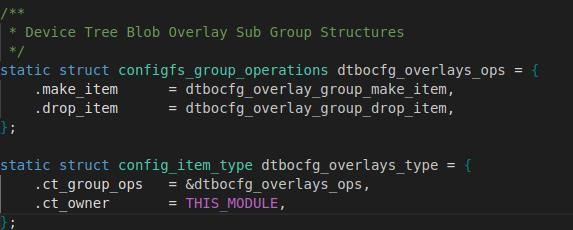
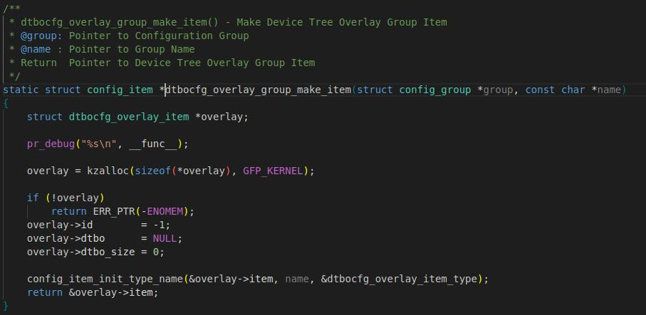
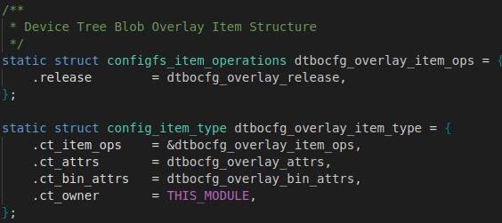
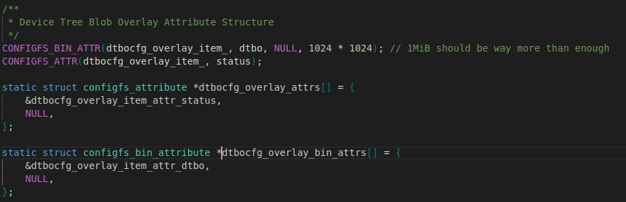
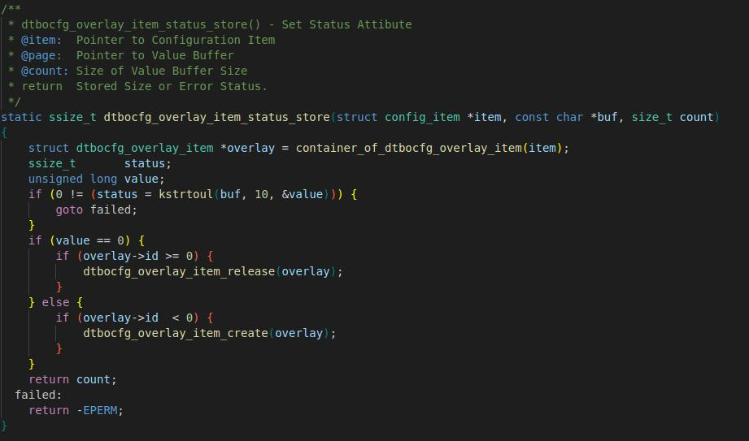
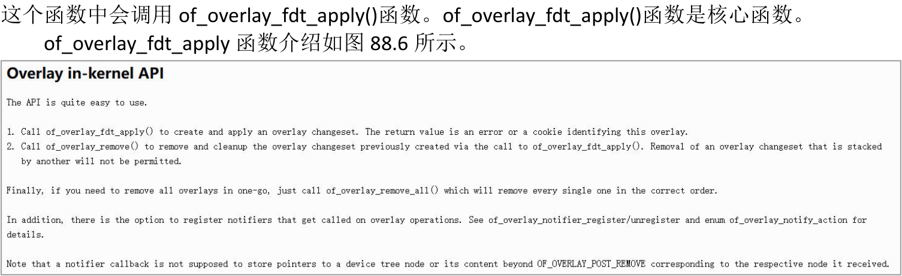

# 第088章 设备树插件驱动分析实验


图87.7图87.7 中dtbocfg.c 是设备树插件驱动源码，只要将此驱动编译成驱动模块或者编译进内核即可。编译过程不在赘述，在网盘中也提供了编译好的dtbocfg.ko 文件。将编译好的驱动程序加载到系统中即可使用设备树插件功能。

设备树插件驱动基于configfs 虚拟文件系统实现，这也是为什么在设备树插件中讲解configfs 虚拟文件系统知识的原因。本章分析设备树插件驱动程序。网盘资料iTOP-RK3568 开发板\07_学习教程配套资料\03_Linux 驱动配套资料\04_Linux 驱动例程\65_dtbocfg 中的dtbocfg.c 为设备树插件驱动。1. __init dtbocfg_module_init()函数。__init dtbocfg_module_init() 函数主要作用是在/sys/kernel/config 路径下在生成device-tree/overlays 目录结构。如代码清单88.1 所示。代码清单88.1
```c
static int __init dtbocfg_module_init(void)
{
        int retval = 0;
        pr_info("%s\n", __func__);
        config_group_init(&dtbocfg_root_subsys.su_group);
        config_group_init_type_name(&dtbocfg_overlay_group, "overlays",&dtbocfg_overlays_type);
        retval = configfs_register_subsystem(&dtbocfg_root_subsys);
        if (retval != 0) {
            pr_err( "%s: couldn't register subsys\n", __func__);
            goto register_subsystem_failed;
        }
        retval = configfs_register_group(&dtbocfg_root_subsys.su_group, &dtbocfg_overlay_group);
        if (retval != 0) {
            pr_err( "%s: couldn't register group\n", __func__);
            goto register_group_failed;
        }
        pr_info("%s: OK\n", __func__);
        return 0;
      register_group_failed:
        configfs_unregister_subsystem(&dtbocfg_root_subsys);
      register_subsystem_failed:
```

```c
return retval;
}
```
2.dtbocfg_overlays_type 结构体在dtbocfg_overlays_type 结构体中实现了创建和删除配置项的make_item 和drop_item 函数，如图88.1 所示。

图88.1如当在命令行输入mkdir 命令创建配置项时则执行dtbocfg_overlay_group_make_item()函数，如图88.2 所示。

图88.2在dtbocfg_overlay_group_make_item()函数中会调用config_item_init_type_name()函数初

始化item。2. dtbocfg_overlay_item_type 结构体在dtbocfg_overlay_item_type 中通过成员ct_attrs 和ct_bin_attrs 创建对应的属性并通过ct_item_ops 成员实现属性操作函数，如图88.3 所示。

图88.3ct_attrs 成员创建了属性status 和ct_bin_attrs 成员创建了属性dtbo，对应图88.4 中代码。

图88.4图88.4 中代码使用宏CONFIGFS_BIN_ATTR 创建属性dtbo，使用宏CONFIGFS_ATTR 创建属性status。同时在使用宏CONFIGFS_BIN_ATTR 创建属性时也会实现dtbocfg_overlay_item_dtbo_read()和dtbocfg_overlay_item_dtbo_write()属性读写操作函数。当使用命令cat /overlay.dtbo > dtbo 将编译好的设备树插件文件写入到dtbo 时会执行dtbocfg_overlay_item_dtbo_write()函数。dtbocfg_overlay_item_dtbo_write()函数如代码清单88.2所示。代码清单88.2
```c
static ssize_t dtbocfg_overlay_item_dtbo_write(struct config_item *item, const void *buf, size_t count)
{
    struct dtbocfg_overlay_item *overlay = container_of_dtbocfg_overlay_item(item);
```

```c
if (overlay->dtbo_size > 0) {
    if (overlay->id >= 0) {
        return -EPERM;
    }
    kfree(overlay->dtbo);
    overlay->dtbo= NULL;
    overlay->dtbo_size = 0;
}
overlay->dtbo = kmemdup(buf, count, GFP_KERNEL);
if (overlay->dtbo == NULL) {
    overlay->dtbo_size = 0;
    return -ENOMEM;
} else {
    overlay->dtbo_size = count;
    return count;
}
}
```
代码清单88.2 中通过通过dtbo 属性将设备树插件写入到内核中。并将地址保存到overlay->dtbo 中。在使用宏CONFIGFS_BIN_ATTR 创建属性时会实现dtbocfg_overlay_item_status_store() 和dtbocfg_overlay_item_status_show()属性读写操作函数当使用命令cat /overlay.dtbo > dtbo 将编译好的设备树插件文件写入到dtbo 后，使用命令echo 1 > status 命令使能dtbo 时会调用dtbocfg_overlay_item_status_store() 函数。dtbocfg_overlay_item_status_store()函数如图88.5 所示。


图88.5在dtbocfg_overlay_item_status_store()函数中会调用dtbocfg_overlay_item_create 函数。在

图88.6
of_overlay_fdt_apply()函数会先创建一个改变集。创建改变集的目的是为了方便对设备树进行修改和复原，因为在改变集中记录了要修改的地方，动态修改设备树时会根据这个改变集去进行修改从而实现动态修改设备树。

