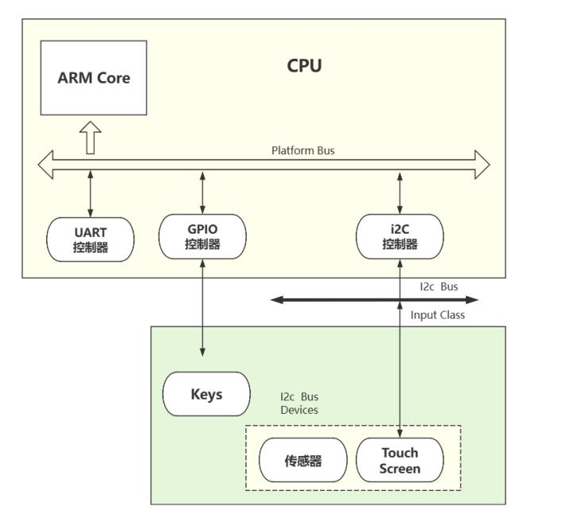
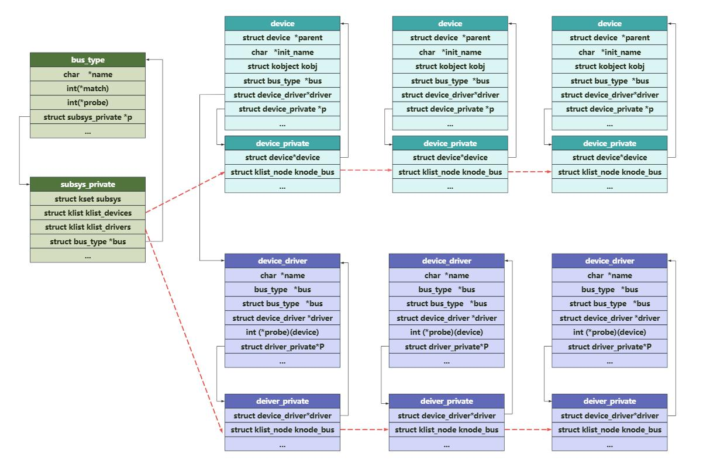
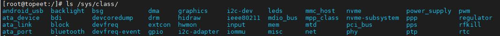
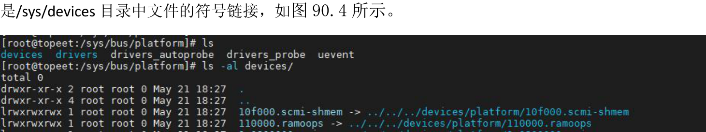
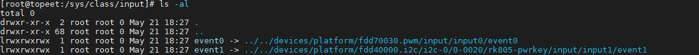
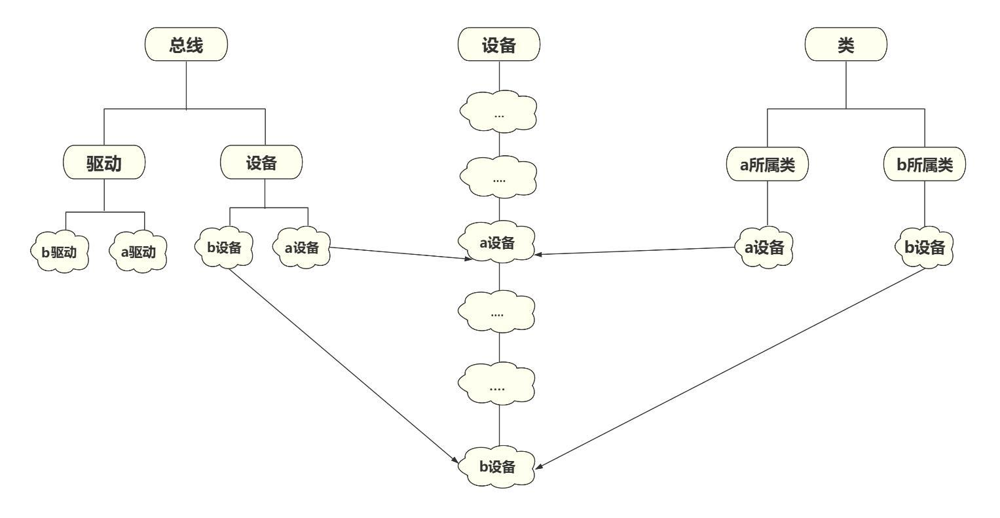
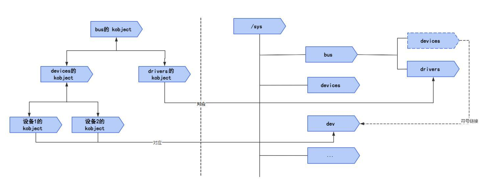
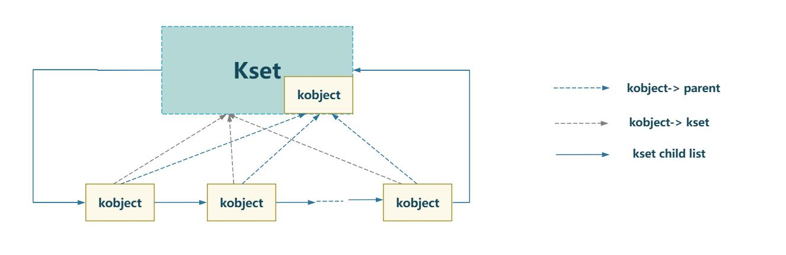

# 第090章设备模型基本框架-kobject和kset

## 90.1 设备模型概述
如图90.1 所示是嵌入式系统中常见的硬件拓扑。

图90.1在硬件拓扑结构中体现了设备模型中的四个重要概念，分别是总线（bus）、类（class）、设备（device）和设备驱动（device driver）。
```c
.设备
```
设备是硬件设备的抽象表示，在Linux 中使用device 结构体表示设备，在这个结构体中包含了设备的名称、设备号、设备类型、从属总线和从属类等基本信息。device 结构体定义在include/linux/device.h 文件中，关键部分如代码清单90.1 所示。代码清单90.1
```c
struct device {
    struct device*parent;
    struct device_private*p;
    struct kobject kobj;
    const char*init_name; /* initial name of the device */
    const struct device_type *type;
```

```c
struct bus_type*bus;/* type of bus device is on */
struct device_driver *driver;
struct device_node *of_node; /* associated device tree node */
dev_tdevt;/* dev_t, creates the sysfs "dev" */
struct klist_nodeknode_class;
struct class*class;
const struct attribute_group **groups;/* optional groups */
};
2.设备驱动
```
设备驱动是硬件设备驱动的抽象表示，在Linux 中使用device_driver 结构体表示设备驱动，结构体关键部分如代码清单90.2 所示。代码清单90.2
```c
struct device_driver {
    const char*name;
    struct bus_type*bus;
    const struct of_device_id*of_match_table;
    int (*probe) (struct device *dev);
    void (*sync_state)(struct device *dev);
    int (*remove) (struct device *dev);
    void (*shutdown) (struct device *dev);
    int (*suspend) (struct device *dev, pm_message_t state);
    int (*resume) (struct device *dev);
};
3.总线
```
Linux 中所有设备都要挂载在总线上，总线负责管理挂载在总线上的设备和驱动。在Linux中使用bus_type 结构体表示总线，结构体关键部分如代码清单90.3 所示。代码清单90.3
```c
struct bus_type {
    const char*name;
    const char*dev_name;
    struct device*dev_root;
    int (*match)(struct device *dev, struct device_driver *drv);
    int (*probe)(struct device *dev);
    int (*remove)(struct device *dev);
     struct subsys_private *p;
};
```
总线管理着设备链表和设备驱动链表两个链表，当注册一个驱动时会插入到总线的设备驱动链表，当注册一个设备时会插入到总线的设备链表。在插入设备或驱动时，总线会执行bus_type 结构体中的match 函数对新插入的设备或驱动进行匹配，如以名字的方式进行匹配。匹配成功后会调用驱动中的probe()函数，即device_driver 结构体中的probe()函数。

设备、设备驱动和总线关系如图90.2 所示。

图90.2设备模型的意义在于提供一种组织和管理硬件设备的统一框架，使设备、驱动和总线能够被抽象化、统一化地表示。这种抽象和统一能够提高内核的可维护性和可移植性，并简化设备驱动程序的开发。以平台总线为例，在Linux 内核drivers/base/platform.c 文件里定义并注册了平台总线，代码清单90.4 所示：代码清单90.4
```c
struct bus_type platform_bus_type = {
    .name= "platform",
    .dev_groups= platform_dev_groups,
    .match= platform_match,
    .uevent= platform_uevent,
    .dma_configure= platform_dma_configure,
    .pm= &platform_dev_pm_ops,
};
    ......
    bus_register(&platform_bus_type);//调用bus_register()函数注册平台总线
```
平台总线中使用platform_device 结构体来表示平台设备。在platform_device 结构体中包含了一个device 结构体成员，用于描述该平台设备对应的通用设备信息，如代码清单90.5 所示。

代码清单90.5
```c
struct platform_device {
    struct device dev;//表示平台设备对应的struct device 结构体
};
```
平台总线中使用platform_driver 结构体来表示平台驱动。在platform_driver 结构体中包含了一个device_driver 结构体，用于描述驱动程序的通用属性，如代码清单90.6 所示。代码清单90.6
```c
struct platform_driver {
    struct device_driver driver;
};
```
platform_device 结构体中包含一个device 结构体成员，platform_driver 结构体中包含一个device_driver 成员。可以认为device 和device_driver 结构体是platform_device 和platform_driver的父类。基于这个思想，所有总线都可以基于设备模型框架开发。4.类在Linux 系统中，类表示一组具有相似功能的设备集合。每个设备都属于某个类，一个类也可以管理多个设备。类的作用是对不同类型的设备进行统一的分类管理。例如在硬件拓扑结构中，无论触摸屏、传感器和按键等设备挂载在哪种总线上，它们都被归类为输入类设备。在Linux 中使用class 结构体表示类，定义在include/linux/device.h 文件中，如代码清单90.7所示。代码清单90.7
```c
struct class {
    const char*name;
    struct module*owner;
    const struct attribute_group**class_groups;
    const struct attribute_group**dev_groups;
    struct kobject*dev_kobj;
    int (*dev_uevent)(struct device *dev, struct kobj_uevent_env *env);
    char *(*devnode)(struct device *dev, umode_t *mode);
    void (*class_release)(struct class *class);
    void (*dev_release)(struct device *dev);
    int (*shutdown_pre)(struct device *dev);
    const struct kobj_ns_type_operations *ns_type;
    const void *(*namespace)(struct device *dev);
    void (*get_ownership)(struct device *dev, kuid_t *uid, kgid_t *gid);
    const struct dev_pm_ops *pm;
    struct subsys_private *p;
};
```
几乎所有的类都可以在/sys/class 目录下看到，如图90.3 所示。


图90.3在/sys/bus/platform 等子目录下可以看到drivers 和devices 目录，其中devices 目录下的文件实际上

图90.4在/sys/class/目录下的各类子目录中，也包含指向/sys/devices 目录下相应设备文件的符号链接，如图90.5 所示。

图90.5图90.3、图90.4 和图90.5 所展示的关系如图90.6 所示。

图90.6
## 90.2 kobject 和kset 基本概念
/sys 目录下挂载的是sysfs 虚拟文件系统，它会在该目录下生成一个包含整个系统硬件层次

结构的视图。sysfs 虚拟文件系统的作用是在用户空间中展示内核中设备、驱动和总线的信息。基于sysfs 用户可以查看并操作设备和驱动等。在设备模型中，设备、驱动和总线都会在/sys 下有对应的目录，这些目录都是通过kobject结构体来表示的。内核中的device、device_driver 和bus_type 结构体都会绑定kobject 结构体，如图90.7 所示。

图90.7kobject 结构体在内核源码kernel/include/linux/kobject.h 文件中，如代码清单90.8 所示：代码清单90.8
```c
struct kobject {
    const char*name; //表示kobject 的名称，通常用于在/sys 目录下创建对应的目录
    struct list_headentry;//用于将kobject 链接到父kobject 的子对象列表中，以建立层次关系。
    struct kobject*parent; //指向父kobject，表示kobject 的层次关系。
    struct kset*kset;//指向包含该kobject 的kset，用于进一步组织和管理kobject。
    struct kobj_type*ktype; //指向定义kobject 类型的kobj_type 结构体，描述kobject 的属性和操作。
    struct kernfs_node *sd;//指向sysfs 目录中对应的kernfs_node
    struct krefkref;//用于对kobject 进行引用计数，确保在不再使用时能够正确释放资源。...
};
```
在kobject 结构体中使用kobj_type 结构体成员提供对应功能，kobj_type 结构体如代码清单90.9 所示。代码清单90.9
```c
struct kobj_type {
    const struct sysfs_ops *sysfs_ops;
    struct attribute **default_attrs;
        ...
```

```c
};
```
其中sysfs_ops 结构体提供了目录下属性的操作方法，如代码清单90.10 所示。代码清单90.10
```c
struct sysfs_ops {
    ssize_t(*show)(struct kobject *, struct attribute *, char *);
    ssize_t(*store)(struct kobject *, struct attribute *, const char *, size_t);
};
```
show()函数用于读取一个属性值到用户空间。store()函数将属性值写入到内核中。kobj_type结构体中的attribute 结构体成员是/sys 目录下以文件形式存在的属性，如代码清单90.11 所示。代码清单90.11
```c
struct attribute {
    const char*name;
    umode_tmode;
};
```
为了让设备驱动模型中的多个对象以层次分明、逻辑清晰的方式组织在一起，Linux 使用kset 结构体作为kobject 的容器。每个kset 也会在/sys 目录下对应一个子目录，这样就可以实现在一个目录（kset）下包含多个目录（kobject），kset 与kobject 的关系如图90.8 所示。

图90.8kset 在内核里面用struct kset 结构体来表示，定义在include/linux/kobject.h 头文件中，如代码清单90.12 所示。代码清单90.12
```c
struct kset {
    struct list_head list;
    spinlock_t list_lock;
    struct kobject kobj;//包含kobject,说明kset 也会在sys 目录下对应一个目录
    const struct kset_uevent_ops *uevent_ops;
}
```

