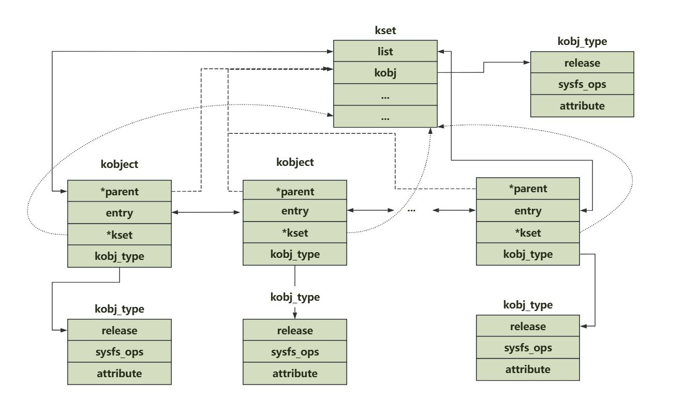
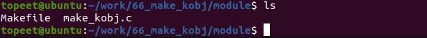
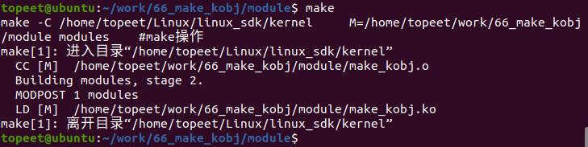
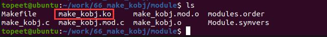
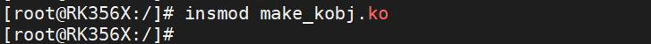

# 第091章 创建kobject实验

在Linux 内核中，kset 和kobjec 是相关联的两个概念，它们之间存在一种层次化的关系，如下图90.9 所示：

图90.9

本章进行创建kobject 实验，通过调用kobject 相关API 函数，在/sys 目录下实现目录创建。
## 91.1 实验程序的编写
### 91.1.1 驱动程序编写
本实验代码存储在网盘路径为iTOP-RK3568 开发板\07_学习教程配套资料\03_Linux 驱动配套资料\04_Linux 驱动例程\66_make_kobj\module 路径下。本实验分别是使用kobject_create_and_add()和kobject_init_and_add()函数两种方法创建kobject 对象。实验代码make_kobj.c 如代码清单91.1 所示：代码清单91.1
```c
#include <linux/module.h>
#include <linux/init.h>
#include <linux/slab.h>
#include <linux/configfs.h>
#include <linux/kernel.h>
#include <linux/kobject.h>
// 定义了三个kobject 指针变量：mykobject01、mykobject02、mykobject03
struct kobject *mykobject01;
struct kobject *mykobject02;
struct kobject *mykobject03;
// 定义了一个kobj_type 结构体变量mytype，用于描述kobject 的类型。
struct kobj_type mytype;
// 模块的初始化函数
static int mykobj_init(void)
{
        int ret;
        // 创建kobject 的第一种方法
        // 创建并添加了名为"mykobject01"的kobject 对象，父kobject 为NULL
        mykobject01 = kobject_create_and_add("mykobject01", NULL);
```

```c
// 创建并添加了名为"mykobject02"的kobject 对象，父kobject 为mykobject01。
mykobject02 = kobject_create_and_add("mykobject02", mykobject01);
// 创建kobject 的第二种方法
// 1 使用kzalloc 函数分配了一个kobject 对象的内存
mykobject03 = kzalloc(sizeof(struct kobject), GFP_KERNEL);
// 2 初始化并添加到内核中，名为"mykobject03"。
ret = kobject_init_and_add(mykobject03, &mytype, NULL, "%s", "mykobject03");
return 0;
}
// 模块退出函数
static void mykobj_exit(void)
{
// 释放了之前创建的kobject 对象
kobject_put(mykobject01);
kobject_put(mykobject02);
kobject_put(mykobject03);
}
module_init(mykobj_init); // 指定模块的初始化函数
module_exit(mykobj_exit); // 指定模块的退出函数
MODULE_LICENSE("GPL");// 模块使用的许可证
MODULE_AUTHOR("topeet"); // 模块的作者
```
## 91.2 运行测试
### 91.2.1 编译驱动程序
在和make_kobj.c 的同一目录下创建Makefile 文件，如图91.1 所示。

图91.1Makefile 文件内容如代码清单91.2 所示：代码清单91.2
```c
export ARCH=arm64#设置平台架构
export CROSS_COMPILE=aarch64-linux-gnu-#交叉编译器前缀
obj-m := make_kobj.o
```

```c
KDIR :=/home/topeet/Linux/linux_sdk/kernel#这里是你的内核目录
PWD ?= $(shell pwd)
all:
    make -C $(KDIR) M=$(PWD) modules#make 操作
clean:
    make -C $(KDIR) M=$(PWD) clean#make clean 操作
```
回到存放make_kobj.c 和Makefile 文件目录下，使用命令make 编译驱动程序，编译成功后如图91.2 所示。

图91.2编译完后会生成make_kobj.ko 目标文件，如图91.3 所示：

图91.3至此，我们的驱动模块就编译成功了，下面进行运行测试。
### 91.2.2 运行测试
将本章节编译好的make_kobj.ko 驱动文件拷贝到开发板上。开发板启动之后，使用insmod make_kobj.ko 命令进行驱动模块的加载，如下图91.4 所示：

图91.4驱动加载之后，我们进入/sys/目录下，如下图91.5 所示：

