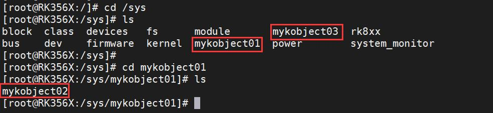
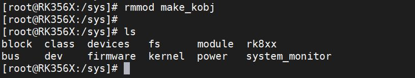
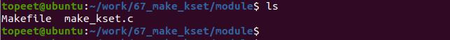
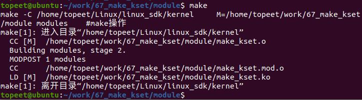
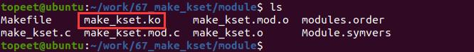

# 第092章 创建kset实验


图91.5通过图91.5 可以看出mykobject01，mykobject03 创建在系统根目录/sys 目录下，mykobject02的父节点是mykobject01，所以mykobject02 被创建在mykobject01 目录下。实验成功后可以使用rmmod make_kobj 命令进行驱动的卸载，如下图91.6 所示：

图91.6至此，创建kobject 实验就完成了。

kset 是kobject 的集合，kset 结构体中也包含kobject 结构体，所以在创建kset 时也会在/sys下创建对应的目录。本章进行创建kset 的实验。
## 92.1 实验程序的编写
### 92.1.1 驱动程序编写
本实验代码存储在网盘iTOP-RK3568 开发板\07_学习教程配套资料\03_Linux 驱动配套资料\04_Linux 驱动例程\67_make_kset\module 路径下。本实验定义并初始化两个自定义内核对象mykobject01 和mykobject02，并将它们添加到一个自定义内核对象集合mykset 中。实验代码make_kset.c 如代码清单92.1 所示。代码清单92.1
```c
#include <linux/module.h>
#include <linux/init.h>
#include <linux/slab.h>
#include <linux/configfs.h>
#include <linux/kernel.h>
#include <linux/kobject.h>
// 定义kobject 结构体指针，用于表示第一个自定义内核对象
struct kobject *mykobject01;
// 定义kobject 结构体指针，用于表示第二个自定义内核对象
struct kobject *mykobject02;
// 定义kset 结构体指针，用于表示自定义内核对象的集合
struct kset *mykset;
// 定义kobj_type 结构体，用于定义自定义内核对象的类型
struct kobj_type mytype;
// 模块的初始化函数
static int mykobj_init(void)
{
        int ret;
```

```c
// 创建并添加kset，kset 名称为"mykset"，父kobject 为NULL，属性为NULL
mykset = kset_create_and_add("mykset", NULL, NULL);
// 为mykobject01 分配内存空间，大小为struct kobject 的大小，标志为GFP_KERNEL
mykobject01 = kzalloc(sizeof(struct kobject), GFP_KERNEL);
// 将mykset 设置为mykobject01 的kset 属性
mykobject01->kset = mykset;
// 初始化并添加mykobject01，类型为mytype，父kobject 为NULL，格式化字符串为"mykobject01"
ret = kobject_init_and_add(mykobject01, &mytype, NULL, "%s", "mykobject01");
// 为mykobject02 分配内存空间，大小为struct kobject 的大小，标志为GFP_KERNEL
mykobject02 = kzalloc(sizeof(struct kobject), GFP_KERNEL);
// 将mykset 设置为mykobject02 的kset 属性
mykobject02->kset = mykset;
// 初始化并添加mykobject02，类型为mytype，父kobject 为NULL，格式化字符串为"mykobject02"
ret = kobject_init_and_add(mykobject02, &mytype, NULL, "%s", "mykobject02");
return 0;
}
// 模块退出函数
static void mykobj_exit(void)
{
// 释放mykobject01 的引用计数
kobject_put(mykobject01);
// 释放mykobject02 的引用计数
kobject_put(mykobject02);
}
module_init(mykobj_init); // 指定模块的初始化函数
module_exit(mykobj_exit); // 指定模块的退出函数
MODULE_LICENSE("GPL");// 模块使用的许可证
MODULE_AUTHOR("topeet"); // 模块的作者
```

## 92.2 运行测试
### 92.2.1 编译驱动程序
在和make_kset.c 的同一目录下创建Makefile 文件，如下图92.1 所示：

图92.1Makefile 文件内容如代码清单92.2 所示。代码清单92.2
```c
export ARCH=arm64#设置平台架构
export CROSS_COMPILE=aarch64-linux-gnu-#交叉编译器前缀
obj-m += make_kset.o#此处要和你的驱动源文件同名
KDIR :=/home/topeet/Linux/linux_sdk/kernel#这里是你的内核目录
PWD ?= $(shell pwd)
all:
    make -C $(KDIR) M=$(PWD) modules#make 操作
clean:
    make -C $(KDIR) M=$(PWD) clean#make clean 操作
```
回到存放make_set.c 和Makefile 文件目录下，使用命令make 编译驱动程序，编译成功后如92.2 所示：

图92.2编译完后会生成make_kset.ko 目标文件，如下图92.3 所示：

图92.3至此我们的驱动模块就编译成功了，下面进行运行测试。

