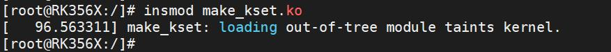
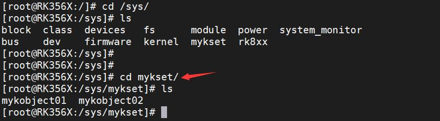
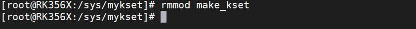

# 第093章 进一步探究设备模型

### 92.2.2 运行测试
将本章节编译好的make_kset.ko 驱动文件拷贝到开发板上。开发板启动之后，使用insmodmake_kset.ko 命令进行驱动模块的加载，如下图92.4 所示：

图92.4驱动加载之后，进入/sys/目录下，可以看到创建生成的mykset 目录，如下图92.5 所示，进到mykset 目录下，可以看到创建的mykobject01 和mykobject02。至此，kset 是kobject 集合验证成功。

图92.5实验成功后可以使用rmmod make_kset 命令进行驱动的卸载，如下图92.6 所示：

图92.6至此，创建kset 实验就完成了。

本章节将从代码层面深入分析：为何当创建kobject，父kobject 为NULL 时，kobject 会被创建在系统根目录/sys 下。创建并注册kobject 使用kobject_create_and_add()函数，函数实现如代码清单93.1 所示代码清单93.1
```c
struct kobject *kobject_create_and_add(const char *name, struct kobject *parent)
{
    struct kobject *kobj;
    int retval;
    kobj = kobject_create(); //分配并初始化kobject
    if (!kobj)
        return NULL;
    //调用kobject_add()函数注册
    //参数parent 是传入的父kobject(可以是NULL)，参数name 是当前kobject 的名称
    retval = kobject_add(kobj, parent, "%s", name);
    if (retval) {
        pr_warn("%s: kobject_add error: %d\n", __func__, retval);
        kobject_put(kobj);
        kobj = NULL;
    }
    return kobj;
}
EXPORT_SYMBOL_GPL(kobject_create_and_add);
```
通过代码清单93.1 可知，kobject_create_and_add()函数本质是kobject_create()函数和kobject_add()函数的组合。kobject_create()函数分配并初始化kobject 结构体。kobject_add()函数将kobject 关联到sysfs 文件系统中，生成对应的目录。kobject_add()函数实现如代码清单93.2所示。代码清单93.2
```c
int kobject_add(struct kobject *kobj, struct kobject *parent,const char *fmt, ...)
{
    va_list args;
    int retval;
    if (!kobj)
        return -EINVAL;
```

```c
if (!kobj->state_initialized) {
    pr_err("kobject '%s' (%p): tried to add an uninitialized object, something is seriously wrong.\n",
           kobject_name(kobj), kobj);
    dump_stack();
    return -EINVAL;
}
va_start(args, fmt);
retval = kobject_add_varg(kobj, parent, fmt, args);
va_end(args);
return retval;
}
```
通过代码清单93.2 可知，kobject_add()函数其内部调用了kobject_add_varg()函数处理可变参数。kobject_add_varg()函数的实现如代码清单93.3 所示。代码清单93.3
```c
static __printf(3, 0) int kobject_add_varg(struct kobject *kobj,
                         struct kobject *parent,
                         const char *fmt, va_list vargs)
{
    int retval;
    retval = kobject_set_name_vargs(kobj, fmt, vargs);
    if (retval) {
        pr_err("kobject: can not set name properly!\n");
        return retval;
    }
    kobj->parent = parent;
    return kobject_add_internal(kobj);
}
```
通过代码清单93.3 可知，kobject_add_varg()函数通过调用kobject_set_name_vargs()函数设置kobject 的名称，并将父节点赋值给kobject 的parent 字段。然后，它调用kobject_add_internal()函数执行实际的添加操作。kobject_add_internal()函数实现如代码清单93.4 所示。代码清单93.4
```c
static int kobject_add_internal(struct kobject *kobj)
{
    int error = 0;
    struct kobject *parent;
    ...
    parent = kobject_get(kobj->parent); //增加父kobject 的引用计数，防止父节点在后续操作被释放
    /*处理kset 相关逻辑
    */
```

```c
if (kobj->kset) {
    if (!parent)
        parent = kobject_get(&kobj->kset->kobj);
    kobj_kset_join(kobj);
    kobj->parent = parent;
}
...
error = create_dir(kobj); //生成sysfs 目录路径
...
return error;
}
```
通过代码清单93.4 可知，代码第5 行获取kobj 指定的父节点，代码第8-12 行的逻辑是首先判断kobj->kset 不为空再继续执行，随后判断parent 如果为空，那么将parent 替换为kset自身。最终通过kobj_kset_join(kobj)将kobj 加入kset 的集合。完成上述操作之后，紧跟调用create_dir()函数生成sysfs 目录路径。create_dir()函数的实现，如代码清单93.5 所示。代码清单93.5
```c
static int create_dir(struct kobject *kobj)
{
    const struct kobj_ns_type_operations *ops;
    int error;
    error = sysfs_create_dir_ns(kobj, kobject_namespace(kobj));
    ...
    return 0;
}
```
通过代码清单93.5 可知create_dir()函数实际调用sysfs_create_dir_ns()函数实际创建目录。sysfs_create_dir_ns()函数实现如代码清单93.6 所示：代码清单93.6
```c
int sysfs_create_dir_ns(struct kobject *kobj, const void *ns)
{
    struct kernfs_node *parent, *kn;
    kuid_t uid;
    kgid_t gid;
    BUG_ON(!kobj);
    if (kobj->parent)
        parent = kobj->parent->sd;
    else
```

```c
parent = sysfs_root_kn;
if (!parent)
return -ENOENT;
kobject_get_ownership(kobj, &uid, &gid);
kn = kernfs_create_dir_ns(parent, kobject_name(kobj),S_IRWXU | S_IRUGO | S_IXUGO, uid, gid,kobj, ns);
if (IS_ERR(kn)) {
if (PTR_ERR(kn) == -EEXIST)
    sysfs_warn_dup(parent, kobject_name(kobj));
return PTR_ERR(kn);
}
kobj->sd = kn;
return 0;
}
```
通过代码清单93.6 可知，代码第8-11 行表示父节点存在，则父节点为kobj->parent->sd，若父节点不存在，父节点被赋值成了sysfs_root_kn，即/sys 目录根目录的节点。最后调用kernfs_create_dir_ns 创建目录。而/sysfs 目录早在sysfs 文件系统初始化时就已经被创建，代码位于kernel/fs/sysfs/mount.c文件的sysfs_init 方法中，如代码清单93.7 所示所示。代码清单93.7
```c
int __init sysfs_init(void)
{
    int err;
    sysfs_root = kernfs_create_root(NULL, KERNFS_ROOT_EXTRA_OPEN_PERM_CHECK,
                     NULL);
    if (IS_ERR(sysfs_root))
        return PTR_ERR(sysfs_root);
    sysfs_root_kn = sysfs_root->kn;
    err = register_filesystem(&sysfs_fs_type);
    if (err) {
        kernfs_destroy_root(sysfs_root);
        return err;
    }
    return 0;
}
```

