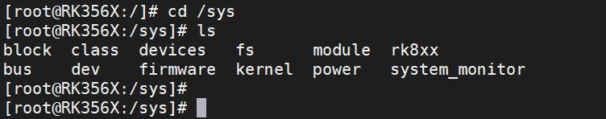
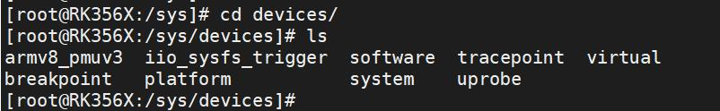
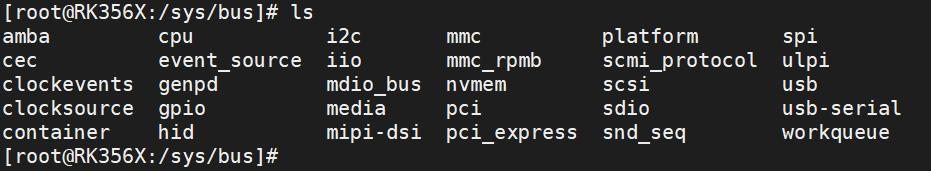
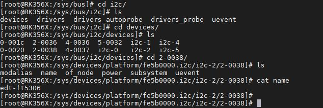
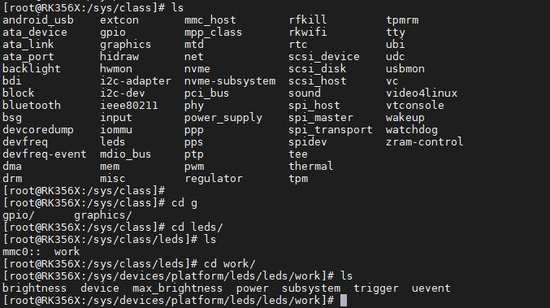

# 第094章 虚拟文件系统sysfs目录层次分析实验

通过上述对API 函数的分析，我们可以总结出创建目录的规律，如下所示：1、无父目录、无kset，则将在sysfs 的根目录（即/sys/）下创建目录。2、无父目录、有kset，则将在kset 下创建目录，并将kobj 加入kset.list。3、有父目录、无kset，则将在parent 下创建目录。4、有父目录、有kset，则将在parent 下创建目录，并将kobj 加入kset.list。至此，关于kobject 在系统根目录/sys 下的创建机制的代码分析工作已完成。

在Linux 系统中，/sys 目录是sysfs 文件系统的挂载点，通过文件系统接口将内核中的对象（如设备、总线、驱动、类等）及其属性以目录和文件的形式暴露给用户，方便用户查询。我们进入到Linux 系统的/sys 目录下，可以看到如图94.1 所示的文件夹。

图94.1和设备模型有关的文件夹有/sys/bus、/sys/class、/sys/devices。（1）/sys/devices 目录包含了系统中所有设备的子目录。每个设备子目录代表一个具体的设备，每个设备子目录中包含了设备的属性、状态和其他相关信息。如下图94.2 所示：

图94.2（2）/sys/bus 目录包含了总线类型的子目录。每个子目录代表一个特定类型的总线，例如PCI、USB、I2C 等。每个总线子目录中包含与该总线相关的设备和驱动程序的信息。如下图94.3所示。

图94.3比如查看I2C 总线下连接的设备—Ft5x06 触摸芯片，我们进入到/sys/bus/i2c/devices/2-0038/目录下，如下图94.4 所示，可以看到此设备的属性等信息。

图94.4（3）/sys/class 目录包含了按照功能类型抽象的设备类别的子目录。每个子目录代表一个设备类别，例如磁盘、网络接口等。每个设备类别子目录中包含了属于该类别的设备的信息。如下图94.5 所示：

图94.5
例如，应用程序需要设置gpio 引脚的输出电平，可通过sysfs 文件系统提供的两种典型路径实现。第一种是通过/sys/class/gpio 类路径，这是内核为GPIO 设备提供的逻辑抽象接口。若设置gpio157 的电平为1，使用命令echo 1 > /sys/class/gpio/gpio157/value 直接向value 文件写入1 即可。第二种是通过/sys/devices/...设备路径，这是直接基于硬件物理拓扑的底层路径。设置gpio157 的电平为1，使用命令echo 1 >/sys/devices/platform/fe770000.gpio/gpiochip4/gpio/gpio157/value 向value 值写入1。显然，方法一抽象了底层硬件差异，应用程序操作GPIO 更加简单方便。

