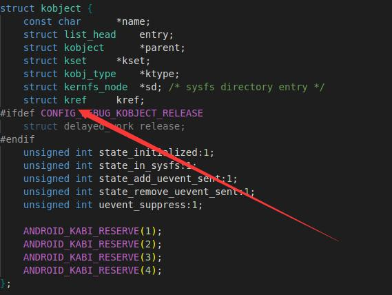
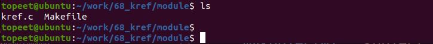
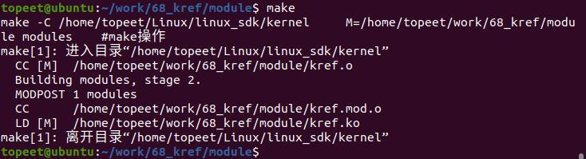
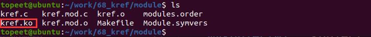
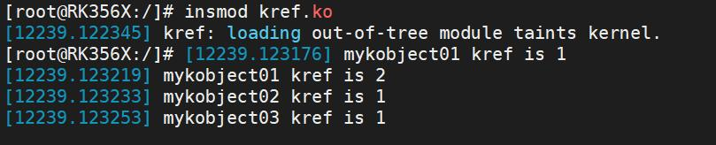
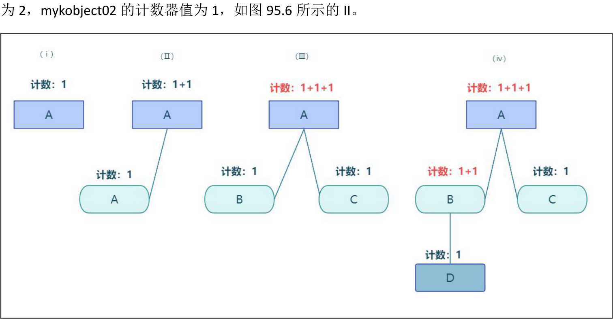
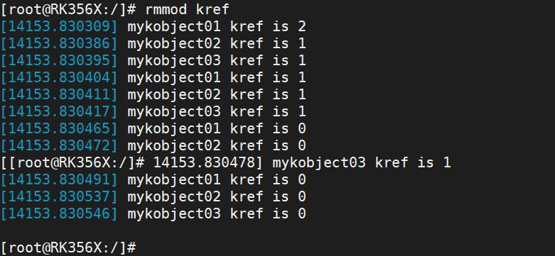

# 第095章引用计数器实验

## 95.1 什么是引用计数器
引用计数器（reference counting）是一种内存管理技术。它的基本原理是：当对象被引用时计数器加一，当引用被释放时计数器减一，当计数器变为0 表示没有任何引用指向该对象，此时可以安全释放资源并清理操作。引用计数器的基本原理如下：对象或资源被创建时，引用计数器初始化为1。每有一个新的引用指向该对象或资源时，引用计数器加一。当引用不再指向该对象或资源时（引用被删除、超出作用域等），引用计数器减少。当引用计数器的值为0 时，释放该对象或资源。
## 95.2 引用计数器kref 介绍
在Linux 系统中，引用计数器用kref 结构体来表示，定义在include/linux/kref.h 头文件当中，其本质是一个int 型变量，如代码清单95.1 所示：代码清单95.1
```c
struct kref {
    refcount_t refcount;
};
typedef struct {
    atomic_t refs;
} refcount_t;
typedef struct {
    int counter;
} atomic_t;
```
在使用引用计数器时，通常会将结构体kref 嵌入到其他结构体中，例如struct kobject 结构体，以实现引用计数的管理，如下图95.1 所示：


图95.1
## 95.3 常用api 函数
引用计数器提供了一些API 函数来进行引用计数的增加和减少操作。（1）kref_init(struct kref *kref)函数原型如代码清单95.2 所示。代码清单95.2
```c
static inline void kref_init(struct kref *kref)
{
   refcount_set(&kref->refcount, 1);
}
```
该函数详细介绍如下：函数作用：初始化一个struct kref 对象，并将引用计数的值初始化为1。在使用引用计数之前，必须先调用此函数进行初始化。函数参数：
```c
kref 指向struct kref 类型对象的指针。
```

（2）kref_get(struct kref *kref)函数原型如代码清单95.3 所示。代码清单95.3
```c
static inline void kref_get(struct kref *kref)
{
   refcount_inc(&kref->refcount);
 }
```
该函数详细介绍如下：函数作用：
```c
增加引用计数，每次调用此函数，引用计数值都会增加1。
函数参数：
kref 是指向已初始化的struct kref 对象的指针。
```
（3）kref_put(struct kref *kref, void (*release)(struct kref *))函数原型如代码清单95.4 所示。代码清单95.4
```c
static inline void kref_put(struct kref *kref)
{
    if (refcount_dec_and_test(&kref->refcount)) {
        release(kref);
        return 1;
    }
    return 0;
 }
```
该函数详细介绍如下：函数作用：减少引用计数，并在引用计数减少到零时调用release 函数进行资源的释放。函数参数：kref 指向已初始化的struct kref 对象的指针。
（4）void refcount_set(refcount_t *r, int n)函数原型如代码清单95.5 所示。代码清单95.5
```c
static inline void refcount_set(refcount_t *r,int n)
{
   atomic_set(&r->refs,n);
}
```
该函数详细介绍如下：函数作用：设置引用计数的计数值。函数参数：r 指向refcount_t 类型对象的指针

n 是要设置的引用计数初始值。
## 95.4 实验程序的编写
### 95.4.1 驱动程序编写
本实验代码存放在网盘iTOP-RK3568 开发板\07_学习教程配套资料\03_Linux 驱动配套资料\04_Linux 驱动例程\68_kref\module 路径下。本实验定义并初始化两个自定义内核对象mykobject01 和mykobject02 和mykobject03，并打印它们的计数值。实验代码kref.c 如代码清单95.6 所示：代码清单95.6
```c
#include <linux/module.h>
#include <linux/init.h>
#include <linux/slab.h>
#include <linux/configfs.h>
#include <linux/kernel.h>
#include <linux/kobject.h>
// 定义了三个kobject 指针变量：mykobject01、mykobject02、mykobject03
struct kobject *mykobject01;
struct kobject *mykobject02;
struct kobject *mykobject03;
// 定义了一个kobj_type 结构体变量mytype，用于描述kobject 的类型。
struct kobj_type mytype;
// 模块的初始化函数
static int mykobj_init(void)
{
        int ret;
        // 创建kobject 的第一种方法
        // 创建并添加了名为"mykobject01"的kobject 对象，父kobject 为NULL
        mykobject01 = kobject_create_and_add("mykobject01", NULL);
        printk("mykobject01 kref is %d\n", mykobject01->kref.refcount.refs.counter);
        // 创建并添加了名为"mykobject02"的kobject 对象，父kobject 为mykobject01。
        mykobject02 = kobject_create_and_add("mykobject02", mykobject01);
        printk("mykobject01 kref is %d\n", mykobject01->kref.refcount.refs.counter);
        printk("mykobject02 kref is %d\n", mykobject02->kref.refcount.refs.counter);
        // 创建kobject 的第二种方法
```

```c
// 1 使用kzalloc 函数分配了一个kobject 对象的内存
mykobject03 = kzalloc(sizeof(struct kobject), GFP_KERNEL);
// 2 初始化并添加到内核中，名为"mykobject03"。
ret = kobject_init_and_add(mykobject03, &mytype, NULL, "%s", "mykobject03");
printk("mykobject03 kref is %d\n", mykobject03->kref.refcount.refs.counter);
return 0;
}
// 模块退出函数
static void mykobj_exit(void)
{
printk("mykobject01 kref is %d\n", mykobject01->kref.refcount.refs.counter);
printk("mykobject02 kref is %d\n", mykobject02->kref.refcount.refs.counter);
printk("mykobject03 kref is %d\n", mykobject03->kref.refcount.refs.counter);
// 释放了之前创建的kobject 对象
kobject_put(mykobject01);
printk("mykobject01 kref is %d\n", mykobject01->kref.refcount.refs.counter);
printk("mykobject02 kref is %d\n", mykobject02->kref.refcount.refs.counter);
printk("mykobject03 kref is %d\n", mykobject03->kref.refcount.refs.counter);
kobject_put(mykobject02);
printk("mykobject01 kref is %d\n", mykobject01->kref.refcount.refs.counter);
printk("mykobject02 kref is %d\n", mykobject02->kref.refcount.refs.counter);
printk("mykobject03 kref is %d\n", mykobject03->kref.refcount.refs.counter);
kobject_put(mykobject03);
printk("mykobject01 kref is %d\n", mykobject01->kref.refcount.refs.counter);
printk("mykobject02 kref is %d\n", mykobject02->kref.refcount.refs.counter);
printk("mykobject03 kref is %d\n", mykobject03->kref.refcount.refs.counter);
}
module_init(mykobj_init); // 指定模块的初始化函数
module_exit(mykobj_exit); // 指定模块的退出函数
MODULE_LICENSE("GPL");// 模块使用的许可证
MODULE_AUTHOR("topeet"); // 模块的作者
```
## 95.5 运行测试
### 95.5.1 编译驱动程序
在上一小节中的kref.c 代码同一目录下创建Makefile 文件，如图95.2 所示：


图95.2Makefile 文件内容如代码清单95.7 所示：代码清单95.7
```c
export ARCH=arm64#设置平台架构
export CROSS_COMPILE=aarch64-linux-gnu-#交叉编译器前缀
obj-m += kref.o#此处要和你的驱动源文件同名
KDIR :=/home/topeet/Linux/linux_sdk/kernel#这里是你的内核目录
PWD ?= $(shell pwd)
all:
    make -C $(KDIR) M=$(PWD) modules#make 操作
clean:
    make -C $(KDIR) M=$(PWD) clean#make clean 操作
```
回到存放kref.c 和Makefile 文件目录下，使用命令make 编译驱动程序，编译完成如图95.3所示。

图95.3编译完生成kref.ko 目标文件，如图95.4 所示：

图95.4至此驱动模块就编译成功了，接下来进行测试。
### 95.5.2 运行测试
将本章节编译好的kref.ko 驱动文件拷贝到开发板上。开发板启动之后，使用insmod kref.ko 命令进行驱动模块的加载，如下图95.5 所示：


图95.5通过图95.5 可以看到驱动加载后，第一条打印为“mykobject01 kref is 1”，因为创建了mykobject01，所以打印引用计数器的值为1，如下图95.6 所示的I。第二条打印为：“mykobject01kref is 2”，因为在mykobject01 目录下创建了子目录mykobject02,所以mykobject01 的计数器值

图95.6
以此类推，如果在objectA 下面创建两个object，objectA 的计数器值为3。在objectB 下创建object,那么objectB 的计数器值为2，objectC 的计数器值为1。如图95.6 中III 和IV 所示。最后可以使用rmmod kref 命令进行驱动的卸载，如下图95.7 所示：


图95.7通过图95.7 可以看到卸载驱动之后打印计数器的值。当引用计数器的值为0 时，表示没有任何引用指向对象或资源，可以安全地释放对象或资源。至此，引用计数器实验就完成了。

