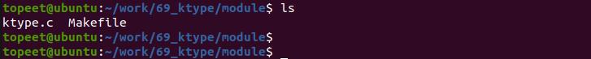
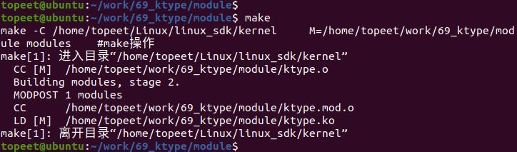

# 第097章 引入并完善kobject_type结构体

代码清单96.4 中核心成员是release 函数指针，在Linux 内核中，dynamic_kobj_ktype 是kobj_type 类型结构体，它指定了释放函数和sysfs 操作，如代码清单96.5 所示。代码清单96.5
```c
static struct kobj_type dynamic_kobj_ktype =
{
  .release = dynamic_kobj_release,
  .sysfs_ops = &kobj_sysfs_ops,
 };
```
代码清单96.5 第3 行代码dynamic_kobj_release 函数实现如代码清单96.6 所示。代码清单96.6
```c
static void dynamic_kobj_release(struct kobject *kobj)
 {
   pr_debug("kobject: (%p): %s\n", kobj, __func__);
  kfree(kobj);
}
```
代码清单96.6 第4 行代码使用kfree()函数对创建的kobj 进行了释放。在代码清单96.3 中，第18-21 行代码调用了release 函数。至此，kobj 被释放的代码分析完毕。
本章实现自定义ktype 结构体，通过自定义release 函数实现kobject 的正确释放。
## 97.1 实验程序的编写
### 97.1.1 驱动程序编写
本实验代码存储在网盘iTOP-RK3568 开发板\07_学习教程配套资料\03_Linux 驱动配套资料\04_Linux 驱动例程\69_ktype\module 路径下。本实验代码创建了一个自定义的kobject 对象，并定义了相应的初始化和释放函数。实验代码ktype.c 代码如代码清单97.1 所示：

代码清单97.1
```c
#include <linux/module.h>
#include <linux/init.h>
#include <linux/slab.h>
#include <linux/configfs.h>
#include <linux/kernel.h>
#include <linux/kobject.h>
// 定义了kobject 指针变量：mykobject03
struct kobject *mykobject03;
// 定义kobject 的释放函数
static void dynamic_kobj_release(struct kobject *kobj)
{
        printk("kobject: (%p): %s\n", kobj, __func__);
        kfree(kobj);
}
// 定义了一个kobj_type 结构体变量mytype，用于描述kobject 的类型。
struct kobj_type mytype = {
       .release = dynamic_kobj_release,
};
// 模块的初始化函数
static int mykobj_init(void)
{
       int ret;
       // 创建kobject 的第二种方法
       // 1 使用kzalloc 函数分配了一个kobject 对象的内存
       mykobject03 = kzalloc(sizeof(struct kobject), GFP_KERNEL);
       // 2 初始化并添加到内核中，名为"mykobject03"。
       ret = kobject_init_and_add(mykobject03, &mytype, NULL, "%s", "mykobject03");
       return 0;
}
// 模块退出函数
static void mykobj_exit(void)
{
       kobject_put(mykobject03);
}
module_init(mykobj_init); // 指定模块的初始化函数
```

```c
module_exit(mykobj_exit); // 指定模块的退出函数
MODULE_LICENSE("GPL");// 模块使用的许可证
MODULE_AUTHOR("topeet"); // 模块的作者
```
## 97.2 运行测试
### 97.2.1 编译驱动程序
在ktype.c 代码同一目录下创建Makefile 文件，如图97.1 所示。

图97.1Makefile 文件内容如代码清单97.2 所示：代码清单97.2
```c
export ARCH=arm64#设置平台架构
export CROSS_COMPILE=aarch64-linux-gnu-#交叉编译器前缀
obj-m += ktype.o#此处要和你的驱动源文件同名
KDIR :=/home/topeet/Linux/linux_sdk/kernel#这里是你的内核目录
PWD ?= $(shell pwd)
all:
    make -C $(KDIR) M=$(PWD) modules#make 操作
clean:
    make -C $(KDIR) M=$(PWD) clean#make clean 操作
```
在存放ktype.c 和Makefile 文件目录下使用make 命令编译驱动程序，编译完成如图97.2所示。

图97.2编译完生成ktype.ko 目标文件，如图97.3 所示：

