# 第098章 创建属性文件并实现读写功能实验

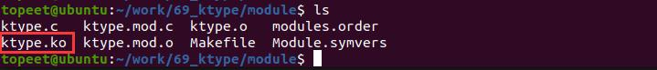
图97.3至此驱动模块就编译成功了，接下来进行测试。
### 97.2.2 运行测试
将本章节编译好的ktype.ko 驱动文件拷贝到开发板上。开发板启动之后，使用insmod ktype.ko 命令进行驱动模块的加载，驱动加载成功之后，可以使用rmmod ktype 命令进行驱动卸载，如图97.4 所示。
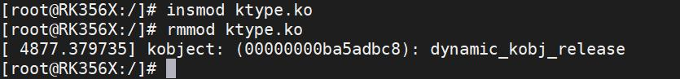
图97.4通过图97.4 可以看出，当卸载驱动时，打印dynamic_kobj_release 信息，说明dynamic_kobj_release 函数被成功执行。至此，引入并完善kobject_type 结构体实验就完成了。
本章学习如何创建带有自定义属性的kobject，以实现对其属性值的读取和写入操作。
## 98.1 创建属性文件并实现读写功能方法一
### 98.1.1 驱动程序编写
本实验代码存储在网盘iTOP-RK3568 开发板\07_学习教程配套资料\03_Linux 驱动配套资料\04_Linux 驱动例程\70_attr\module 路径下。本实验创建一个自定义的kobject，并在sysfs 中创建了两个属性——value1 和value2，允许读取和写入这些属性的值。实验代码attr.c 代码如代码清单98.1 所示。代码清单98.1

```c
#include <linux/module.h>
#include <linux/init.h>
#include <linux/slab.h>
#include <linux/configfs.h>
#include <linux/kernel.h>
#include <linux/kobject.h>
#include <linux/sysfs.h>
// 自定义的kobject 结构体，包含一个kobject 对象和两个整型值
struct mykobj
{
       struct kobject kobj;
       int value1;
       int value2;
};
// 定义了mykobj 结构体指针变量mykobject01
struct mykobj *mykobject01;
// 自定义的kobject 释放函数
static void dynamic_kobj_release(struct kobject *kobj)
{
       struct mykobj *mykobject01 = container_of(kobj, struct mykobj, kobj);
       printk("kobject: (%p): %s\n", kobj, __func__);
       kfree(mykobject01);
}
// 自定义的attribute 对象value1 和value2
struct attribute value1 = {
        .name = "value1",
        .mode = 0666,
};
struct attribute value2 = {
        .name = "value2",
        .mode = 0666,
};
// 将attribute 对象放入数组中
struct attribute *myattr[] = {
        &value1,
        &value2,
        NULL,
};
```

```c
// 自定义的show 函数，用于读取属性值
ssize_t myshow(struct kobject *kobj, struct attribute *attr, char *buf)
{
        ssize_t count;
        struct mykobj *mykobject01 = container_of(kobj, struct mykobj, kobj);
        if (strcmp(attr->name, "value1") == 0)
        {
            count = sprintf(buf, "%d\n", mykobject01->value1);
        }
        else if (strcmp(attr->name, "value2") == 0)
        {
            count = sprintf(buf, "%d\n", mykobject01->value2);
        }
        else
        {
            count = 0;
        }
        return count;
}
// 自定义的store 函数，用于写入属性值
ssize_t mystore(struct kobject *kobj, struct attribute *attr, const char *buf, size_t size)
{
        struct mykobj *mykobject01 = container_of(kobj, struct mykobj, kobj);
        if (strcmp(attr->name, "value1") == 0)
        {
            sscanf(buf, "%d\n", &mykobject01->value1);
        }
        else if (strcmp(attr->name, "value2") == 0)
        {
            sscanf(buf, "%d\n", &mykobject01->value2);
        }
        return size;
}
// 自定义的sysfs_ops 结构体，包含show 和store 函数指针
struct sysfs_ops myops = {
        .show = myshow,
        .store = mystore,
};
// 自定义的kobj_type 结构体，包含释放函数、默认属性和sysfs_ops
static struct kobj_type mytype = {
        .release = dynamic_kobj_release,
```

```c
.default_attrs = myattr,
.sysfs_ops = &myops,
};
// 模块的初始化函数
static int mykobj_init(void)
{
int ret;
// 分配并初始化mykobject01
mykobject01 = kzalloc(sizeof(struct mykobj), GFP_KERNEL);
mykobject01->value1 = 1;
mykobject01->value2 = 1;
// 初始化并添加mykobject01 到内核中，名为"mykobject01"
ret = kobject_init_and_add(&mykobject01->kobj, &mytype, NULL, "%s", "mykobject01");
return 0;
}
// 模块的退出函数
static void mykobj_exit(void)
{
// 释放mykobject01
kobject_put(&mykobject01->kobj);
}
module_init(mykobj_init); // 指定模块的初始化函数
module_exit(mykobj_exit); // 指定模块的退出函数
MODULE_LICENSE("GPL");// 模块使用的许可证
MODULE_AUTHOR("topeet"); // 模块的作者
```
### 98.1.2 编译驱动程序
在attr.c 代码同一目录下创建Makefile 文件，如图98.1 所示。
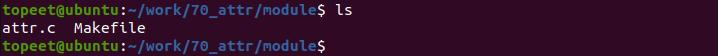

图98.1Makefile 文件内容如代码清单98.2 所示。代码清单98.2
```c
export ARCH=arm64#设置平台架构
export CROSS_COMPILE=aarch64-linux-gnu-#交叉编译器前缀
obj-m += attr.o#此处要和你的驱动源文件同名
KDIR :=/home/topeet/Linux/linux_sdk/kernel#这里是你的内核目录
PWD ?= $(shell pwd)
all:
    make -C $(KDIR) M=$(PWD) modules#make 操作
clean:
    make -C $(KDIR) M=$(PWD) clean#make clean 操作
```
在存放attr.c 和Makefile 文件目录下使用make 命令编译驱动程序，编译完成如图98.2 所示。
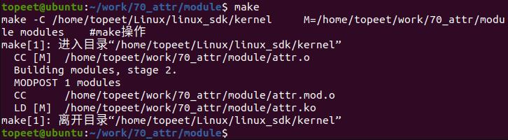
图98.2编译完生成attr.ko 目标文件，如图98.3 所示。
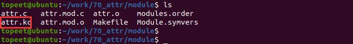
图98.3
### 98.1.3 运行测试
将本章节编译好的attr.ko 驱动文件拷贝到开发板上。开发板启动之后，使用命令insmod attr.ko 进行驱动模块的加载，如图98.4 所示。
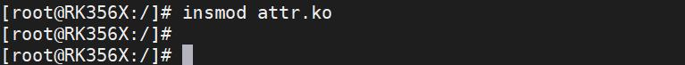
图98.4然后进入/sys/目录下，可以看到创建生成的myobject01，如图98.5 所示

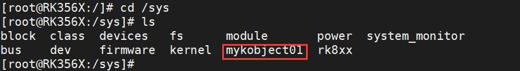
图98.5接着进入到myobject01 目录下，可以看到创建的属性文件value1 和value2，如下图98.6所示。
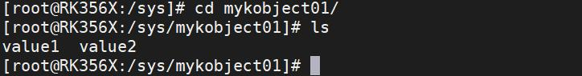
图98.6使用echo 和cat 命令对属性值进行写入和读取，如果写入和读取均成功，说明实验成功。如下图98.7 所示：
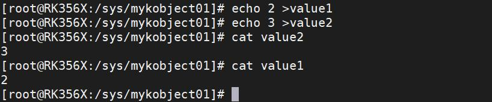
图98.7实验成功后使用rmmod attr 命令进行驱动的卸载，如下图98.8 所示：
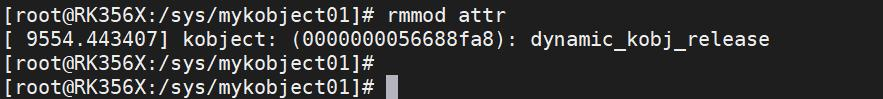
图98.8
## 98.2 优化属性文件读写函数
上节已实现带属性的自定义kobject 及属性值的读写。读写属性文件的作用是实现用户与内核空间的信息交换，用户可自定义属性及操作。本章将基于上节实验优化属性文件读写函数。
### 98.2.1 驱动程序编写
本实验代码存储在网盘iTOP-RK3568 开发板\07_学习教程配套资料\03_Linux 驱动配套资

料\04_Linux 驱动例程\71_attr02\module 路径下。本实验创建了一个自定义的kobject，并在sysfs 中创建了两个属性文件，并实现了读取和写入这些属性的功能。属性对象value1 和value2 被定义为kobj_attribute 结构体，并使用__ATTR 宏进行初始化。实验代码attr.c 如代码清单98.3 所示：代码清单98.3
```c
#include <linux/module.h>
#include <linux/init.h>
#include <linux/slab.h>
#include <linux/configfs.h>
#include <linux/kernel.h>
#include <linux/kobject.h>
#include <linux/sysfs.h>
// 自定义的kobject 结构体，包含一个kobject 对象和两个整型值
struct mykobj
{
      struct kobject kobj;
      int value1;
      int value2;
};
// 定义了mykobj 结构体指针变量mykobject01
struct mykobj *mykobject01;
// 自定义的show 函数，用于读取属性值
ssize_t show_myvalue1(struct kobject *kobj, struct kobj_attribute *attr, char *buf)
{
      ssize_t count;
      count = sprintf(buf, "show_myvalue1\n");
      return count;
};
// 自定义的store 函数，用于写入属性值
ssize_t store_myvalue1(struct kobject *kobj, struct kobj_attribute *attr, const char *buf, size_t count)
{
      printk("buf is %s\n", buf);
      return count;
};
// 自定义的show 函数，用于读取属性值
ssize_t show_myvalue2(struct kobject *kobj, struct kobj_attribute *attr, char *buf)
{
```

```c
ssize_t count;
count = sprintf(buf, "show_myvalue2\n");
return count;
};
// 自定义的store 函数，用于写入属性值
ssize_t store_myvalue2(struct kobject *kobj, struct kobj_attribute *attr, const char *buf, size_t count)
{
printk("buf is %s\n", buf);
return count;
};
// 定义attribute 对象value1 和value2
struct kobj_attribute value1 = __ATTR(value1, 0664, show_myvalue1, store_myvalue1);
struct kobj_attribute value2 = __ATTR(value2, 0664, show_myvalue2, store_myvalue2);
// 自定义的kobject 释放函数
static void dynamic_kobj_release(struct kobject *kobj)
{
  struct mykobj *mykobject01 = container_of(kobj, struct mykobj, kobj);
  printk("kobject: (%p): %s\n", kobj, __func__);
  kfree(mykobject01);
}
// 将attribute 对象放入数组中
struct attribute *myattr[] = {
  &value1.attr,
  &value2.attr,
  NULL,
};
// 自定义的show 函数，用于读取属性值
ssize_t myshow(struct kobject *kobj, struct attribute *attr, char *buf)
{
  ssize_t count;
  struct kobj_attribute *kobj_attr = container_of(attr, struct kobj_attribute, attr);
  count = kobj_attr->show(kobj, kobj_attr, buf);
  return count;
}
// 自定义的store 函数，用于写入属性值
ssize_t mystore(struct kobject *kobj, struct attribute *attr, const char *buf, size_t size)
{
  struct kobj_attribute *kobj_attr = container_of(attr, struct kobj_attribute, attr);
```

```c
return kobj_attr->store(kobj, kobj_attr, buf, size);
}
// 自定义的sysfs_ops 结构体，包含show 和store 函数指针
struct sysfs_ops myops = {
.show = myshow,
.store = mystore,
};
// 自定义的kobj_type 结构体，包含释放函数、默认属性和sysfs_ops
static struct kobj_type mytype = {
.release = dynamic_kobj_release,
.default_attrs = myattr,
.sysfs_ops = &myops,
};
// 模块的初始化函数
static int mykobj_init(void)
{
int ret;
// 分配并初始化mykobject01
mykobject01 = kzalloc(sizeof(struct mykobj), GFP_KERNEL);
mykobject01->value1 = 1;
mykobject01->value2 = 1;
// 初始化并添加mykobject01 到内核中，名为"mykobject01"
ret = kobject_init_and_add(&mykobject01->kobj, &mytype, NULL, "%s", "mykobject01");
return 0;
}
// 模块的退出函数
static void mykobj_exit(void)
{
// 释放mykobject01
kobject_put(&mykobject01->kobj);
}
module_init(mykobj_init); // 指定模块的初始化函数
module_exit(mykobj_exit); // 指定模块的退出/
MODULE_LICENSE("GPL");// 模块使用的许可证
MODULE_AUTHOR("topeet");// 模块的作者
```

### 98.2.2 编译驱动程序
在attr.c 代码同一目录下创建Makefile 文件，如图98.9 所示。
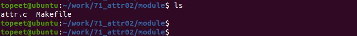
图98.9Makefile 文件内容如代码清单98.4 所示。代码清单98.4
```c
export ARCH=arm64#设置平台架构
export CROSS_COMPILE=aarch64-linux-gnu-#交叉编译器前缀
obj-m += attr.o#此处要和你的驱动源文件同名
KDIR :=/home/topeet/Linux/linux_sdk/kernel#这里是你的内核目录
PWD ?= $(shell pwd)
all:
    make -C $(KDIR) M=$(PWD) modules#make 操作
clean:
    make -C $(KDIR) M=$(PWD) clean#make clean 操作
```
在存放attr.c 和Makefile 文件目录下使用make 命令编译驱动程序，编译完成如图98.10 所示：
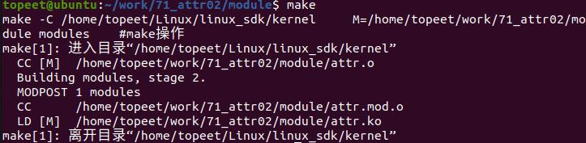
图98.10编译完生成attr.ko 目标文件，如图98.11 所示。
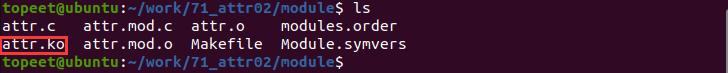
图98.11

### 98.2.3 运行测试
将本章节编译好的attr.ko 驱动文件拷贝到开发板上。开发板启动之后，使用insmod attr.ko 命令进行驱动模块的加载，如下图98.12 所示：

图98.12然后进入/sys/目录下，可以看到创建生成的myobject01，如图98.13 所示。

图98.13接着进到myobject01 目录下，可以看到创建的属性文件value1 和value2，如图98.14 所示。

图98.14使用echo 和cat 命令对属性值进行写入和读取，如果写入和读取成功说明使用宏定义创建属性成功。如图98.15 所示：

图98.15实验成功后使用rmmod attr 命令进行驱动卸载，如下图98.16 所示：

图98.16

## 98.3 创建属性文件并实现读写功能方法二
### 98.3.1 驱动程序编写
在98.1 小节的实验中，使用kobject_init_and_add()函数创建kobject,并创建了属性文件，实现了读写功能。本章节使用另一种方法—— kobject_create_and_add()函数创建kobject，并创建属性文件，实现读写功能。
本实验代码存储在网盘iTOP-RK3568 开发板\07_学习教程配套资料\03_Linux 驱动配套资料\04_Linux 驱动例程\72_attr03\module 路径下。本实验使用kobject_create_and_add()函数创建了一个名为"mykobject01" 的自定义kobject，并在其中创建了两个属性文件"value1" 和"value2"。实验代码attr.c 如代码清单98.5 所示。代码清单98.5
```c
#include <linux/module.h>
#include <linux/init.h>
#include <linux/slab.h>
#include <linux/configfs.h>
#include <linux/kernel.h>
#include <linux/kobject.h>
#include <linux/sysfs.h>
// 定义了mykobj 结构体指针变量mykobject01
struct kobject *mykobject01;
// 自定义的show 函数，用于读取属性值
ssize_t show_myvalue1(struct kobject *kobj, struct kobj_attribute *attr, char *buf)
{
        ssize_t count;
        count = sprintf(buf, "show_myvalue1\n");
        return count;
};
// 自定义的store 函数，用于写入属性值
ssize_t store_myvalue1(struct kobject *kobj, struct kobj_attribute *attr, const char *buf, size_t count)
{
        printk("buf is %s\n", buf);
        return count;
};
// 自定义的show 函数，用于读取属性值
```

```c
ssize_t show_myvalue2(struct kobject *kobj, struct kobj_attribute *attr, char *buf)
{
        ssize_t count;
        count = sprintf(buf, "show_myvalue2\n");
        return count;
};
// 自定义的store 函数，用于写入属性值
ssize_t store_myvalue2(struct kobject *kobj, struct kobj_attribute *attr, const char *buf, size_t count)
{
        printk("buf is %s\n", buf);
        return count;
};
// 定义attribute 对象value1 和value2
struct kobj_attribute value1 = __ATTR(value1, 0664, show_myvalue1, store_myvalue1);
struct kobj_attribute value2 = __ATTR(value2, 0664, show_myvalue2, store_myvalue2);
// 模块的初始化函数
static int mykobj_init(void)
{
        int ret;
        // // 分配并初始化mykobject01
        // mykobject01 = kzalloc(sizeof(struct mykobj), GFP_KERNEL);
        // mykobject01->value1 = 1;
        // mykobject01->value2 = 1;
        // // 初始化并添加mykobject01 到内核中，名为"mykobject01"
        // ret = kobject_init_and_add(&mykobject01->kobj, &mytype, NULL, "%s", "mykobject01");
        mykobject01 = kobject_create_and_add("mykobject01", NULL);
        ret = sysfs_create_file(mykobject01, &value1.attr);
        ret = sysfs_create_file(mykobject01, &value2.attr);
        return ret;
}
// 模块的退出函数
static void mykobj_exit(void)
{
        // 释放mykobject01
        kobject_put(mykobject01);
}
module_init(mykobj_init); // 指定模块的初始化函数
```

```c
module_exit(mykobj_exit); // 指定模块的退出/
MODULE_LICENSE("GPL");// 模块使用的许可证
MODULE_AUTHOR("topeet");// 模块的作者
```
驱动编写好之后，修改Linux 源码中的kernel/lib/kobject.c 文件，添加如下图98.17 框选的打印语句。
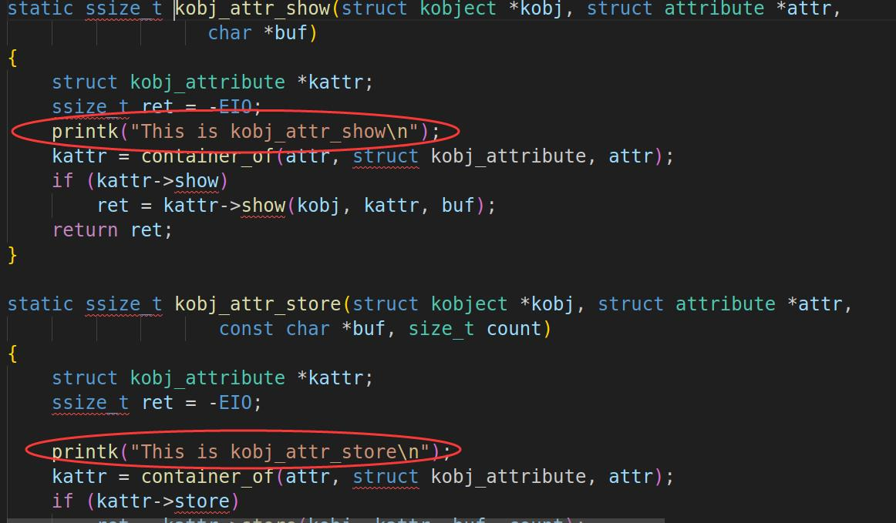
图98.17添加完成后重新编译内核源码并将编译好的内核镜像烧写到开发板。
### 98.3.2 编译驱动程序
在和attr.c 的同一目录下创建Makefile 文件，如图98.18 所示。
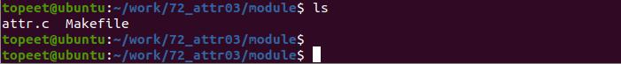
图98.18Makefile 文件内容如代码清单98.6 所示。代码清单98.6
```c
export ARCH=arm64#设置平台架构
export CROSS_COMPILE=aarch64-linux-gnu-#交叉编译器前缀
obj-m += attr.o#此处要和你的驱动源文件同名
```

```c
KDIR :=/home/topeet/Linux/linux_sdk/kernel#这里是你的内核目录
PWD ?= $(shell pwd)
all:
    make -C $(KDIR) M=$(PWD) modules#make 操作
clean:
    make -C $(KDIR) M=$(PWD) clean#make clean 操作
```
使用make 命令编译驱动程序，编译成功后如图98.19 所示。
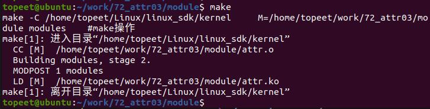
编译完后会生成attr.ko 目标文件，如下图98.20 所示：
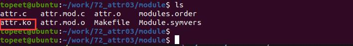
图98.20
### 98.3.3 运行测试
将本章节编译好的attr.ko 驱动文件拷贝到开发板上。开发板启动之后，使用insmod attr.ko 命令进行驱动模块的加载，如图98.21 所示：

图98.21然后进入/sys/目录下，可以看到创建生成的myobject01，如下图98.22 所示。

图98.22接着进到myobject01 目录下，可以看到创建的属性文件value1 和value2，如图98.23 所示。

