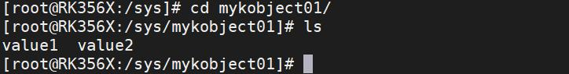
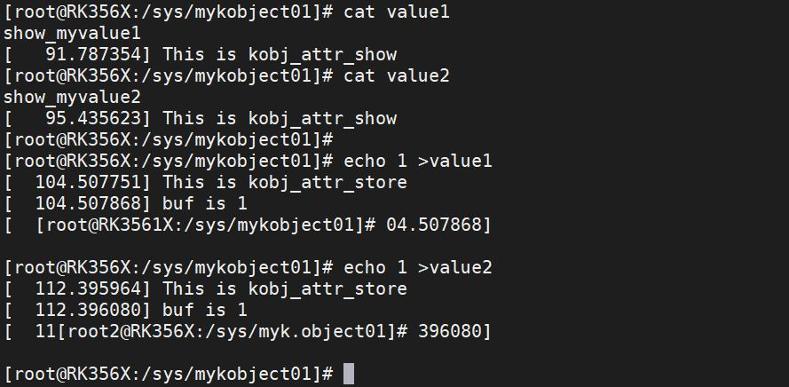
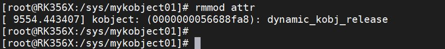
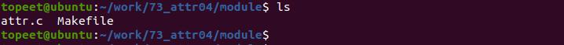
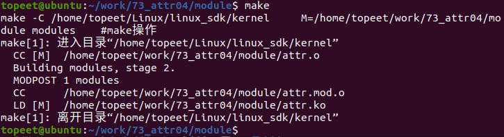
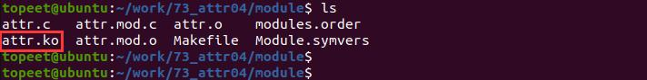
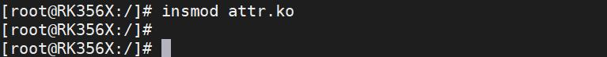
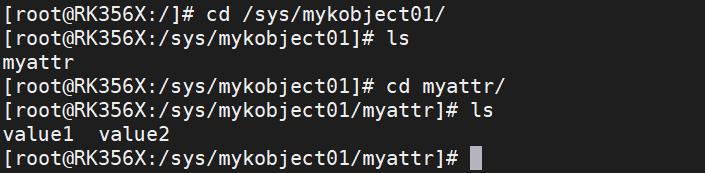
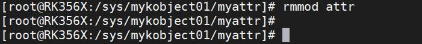

# 第099章 创建多个属性文件实验


图98.23使用echo 和cat 命令对属性进行写入和读取的操作，如下图98.24 所示，如果可以看到在写入和读取的过程中在内核中添加的打印，说明实验成功。

图98.24实验成功后使用命令rmmod attr 进行驱动的卸载，如下图98.25 所示。

图98.25

本章节学习创建多个属性文件
## 99.1 sysfs_create_group 函数
sysfs_create_group()函数，用于在sysfs 中创建一个组(group)。组是一组相关的属性文件的集合。函数原型如代码清单99.1 所示：代码清单99.1
```c
int sysfs_create_group(struct kobject *kobj, const struct attribute_group *grp);
```
该函数详细介绍如下：函数参数：kobj: 指向包含目标组的kobject 的指针。grp: 指向attribute_group 结构体的指针，该结构体定义了组中的属性文件。
代码清单99.1 中，函数参数grp 是指向attribute_group 结构体的指针，attribute_group 结构体定义如代码清单99.2 所示：代码清单99.2
```c
struct attribute_group {
    const char *name;//组的名称，将用做sysfs 目录的名称
    const struct attribute **attrs;//指向属性文件数组的指针
    //可选的回调函数，用于决定每个属性文件是否可见。如果为NULL，则所有属性文件都可见。
mode_t (*is_visible)(struct kobject *kobj, struct attribute *attr, int index);
};
```
代码清单99.2 中第3 行，属性文件数组是一个以struct attribute *类型为元素的数组，以NULL 结束。每个struct attribute 结构体表示一个属性文件，可以使用&运算符将属性对象（如struct kobject_attribute）的.attr 字段传递给属性文件数组。接下来使用sysfs_create_group 创建一个组并添加属性文件，如代码清单99.3代码清单99.3
```c
struct attribute *attrs[] = {
        &attr1.attr,
        &attr2.attr,
        NULL,
};
const struct attribute_group attr_group = {
        .name = "my_group",
```

```c
.attrs = attrs,
};
sysfs_create_group(kobj, &attr_group);
```
通过代码清单99.3 可知，创建了一个名叫“my_group”的组，并将属性文件attr1 和attr2添加到该组中，然后使用sys_create_group()函数将该组添加到指定的kobject kobj 中。
## 99.2 实验程序的编写
### 99.2.1 驱动程序编写
本实验代码存储在网盘iTOP-RK3568 开发板\07_学习教程配套资料\03_Linux 驱动配套资料\04_Linux 驱动例程\73_attr04\module 路径下。本实验创建了一个名为"mykobject01" 的自定义kobject，并使用上小节介绍的方式创建了两个属性文件"value1" 和"value2"。实验代码attr.c 代码如代码清单99.4 所示：代码清单99.4
```c
#include <linux/module.h>
#include <linux/init.h>
#include <linux/slab.h>
#include <linux/configfs.h>
#include <linux/kernel.h>
#include <linux/kobject.h>
#include <linux/sysfs.h>
// 定义了mykobj 结构体指针变量mykobject01
struct kobject *mykobject01;
// 自定义的show 函数，用于读取属性值
ssize_t show_myvalue1(struct kobject *kobj, struct kobj_attribute *attr, char *buf)
{
        ssize_t count;
        count = sprintf(buf, "show_myvalue1\n");
        return count;
};
// 自定义的store 函数，用于写入属性值
ssize_t store_myvalue1(struct kobject *kobj, struct kobj_attribute *attr, const char *buf, size_t count)
{
        printk("buf is %s\n", buf);
```

```c
return count;
};
// 自定义的show 函数，用于读取属性值
ssize_t show_myvalue2(struct kobject *kobj, struct kobj_attribute *attr, char *buf)
{
ssize_t count;
count = sprintf(buf, "show_myvalue2\n");
return count;
};
// 自定义的store 函数，用于写入属性值
ssize_t store_myvalue2(struct kobject *kobj, struct kobj_attribute *attr, const char *buf, size_t count)
{
printk("buf is %s\n", buf);
return count;
};
// 定义attribute 对象value1 和value2
struct kobj_attribute value1 = __ATTR(value1, 0664, show_myvalue1, store_myvalue1);
struct kobj_attribute value2 = __ATTR(value2, 0664, show_myvalue2, store_myvalue2);
struct attribute *attr[] = {
&value1.attr,
&value2.attr,
NULL,
};
const struct attribute_group my_attr_group = {
.name = "myattr",
.attrs = attr,
};
// 模块的初始化函数
static int mykobj_init(void)
{
int ret;
// 创建并添加kobject "mykobject01"
mykobject01 = kobject_create_and_add("mykobject01", NULL);
// 在kobject "mykobject01" 中创建属性组
ret = sysfs_create_group(mykobject01, &my_attr_group);
```

```c
return ret;
}
// 模块的退出函数
static void mykobj_exit(void)
{
// 释放kobject "mykobject01"
kobject_put(mykobject01);
}
module_init(mykobj_init); // 指定模块的初始化函数
module_exit(mykobj_exit); // 指定模块的退出函数
MODULE_LICENSE("GPL");// 模块使用的许可证
MODULE_AUTHOR("topeet");// 模块的作者
```
## 99.3 运行测试
### 99.3.1 编译驱动程序
在和attr.c 的代码同一目录下创建Makefile 文件，如图99.1 所示。

图99.1Makefile 文件内容如代码清单99.5 所示。代码清单99.5
```c
export ARCH=arm64#设置平台架构
export CROSS_COMPILE=aarch64-linux-gnu-#交叉编译器前缀
obj-m += attr.o#此处要和你的驱动源文件同名
KDIR :=/home/topeet/Linux/linux_sdk/kernel#这里是你的内核目录
PWD ?= $(shell pwd)
all:
    make -C $(KDIR) M=$(PWD) modules#make 操作
clean:
    make -C $(KDIR) M=$(PWD) clean#make clean 操作
```
使用make 命令编译驱动程序，编译成功后如图99.2 所示。


图99.2编译完后会生成attr.ko 目标文件，如图99.3 所示：

图99.3
### 99.3.2 运行测试
将本章编译好的attr.ko 驱动文件拷贝到开发板上。开发板启动之后，使用insmod attr.ko 命令进行驱动模块的加载，如下图99.4 所示：

图99.4驱动加载成功之后，进入/sys/目录下，如果实验成功可以看到创建生成的myobject01 以及属性组myattr 和属性组中的属性value1，value2，如图99.5 所示。

图99.5实验成功之后，使用rmmod attr 命令进行驱动的卸载，如下图99.6 所示。


图99.6至此，创建多个属性文件实验就完成了。

