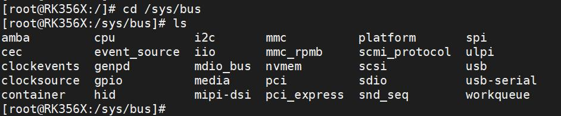
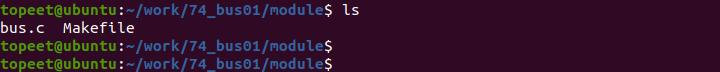
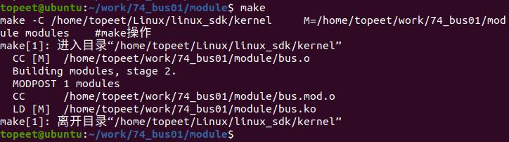
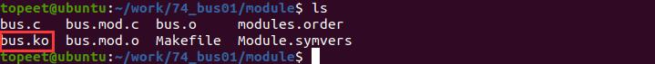
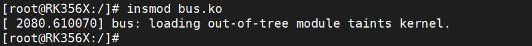
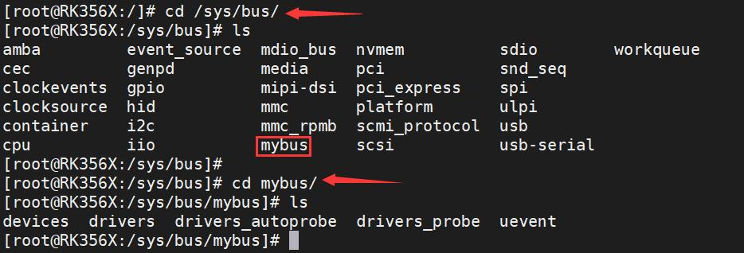
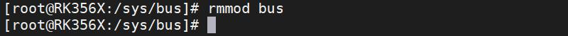

# 第100章 注册自定义总线实验

在设备模型中，包含总线、设备、驱动和类四个概念。本章学习如何注册一个自定义的总线。
## 100.1 总线注册API 函数
进入开发板的/sys/bus 目录下，/sys/bus 是Linux 系统中的一个目录，用于表示总线（bus）子系统的根目录。如果我们自己注册一个总线，会在此目录下显示，如图100.1

图100.1bus_register()函数用于将一个自定义总线注册到Linux 内核中。函数原型如代码清单100.1所示。代码清单100.1int bus_register(struct bus_type *bus);该函数详细介绍如下：函数参数：bus: 指向struct bus_type 结构体的指针，表示要注册的自定义总线。函数返回值：函数返回一个整数值，表示注册操作的结果。返回0 表示注册成功，负值表示注册失败。
bus_unregister()用于取消注册一个已经注册的自定义总线。函数原型如代码清单100.2 所示。代码清单100.2
```c
void bus_unregister(struct bus_type *bus);
```
该函数详细介绍如下：函数参数：bus: 指向struct bus_type 结构体的指针，表示要注册的自定义总线。函数返回值：没有返回值

接下来，使用上述的API 函数编写驱动代码进行实验。
## 100.2 实验程序的编写
### 100.2.1 驱动程序编写
本实验代码存储在网盘iTOP-RK3568 开发板\07_学习教程配套资料\03_Linux 驱动配套资料\04_Linux 驱动例程\74_bus01\module 路径下。本实验定义了一个名为"mybus" 的自定义总线。实验代码bus.c 代码如代码清单100.3 所示：代码清单100.3
```c
#include <linux/module.h>
#include <linux/init.h>
#include <linux/slab.h>
#include <linux/configfs.h>
#include <linux/kernel.h>
#include <linux/kobject.h>
#include <linux/device.h>
int mybus_match(struct device *dev, struct device_driver *drv)
{
        // 检查设备名称和驱动程序名称是否匹配
        return (strcmp(dev_name(dev), drv->name) == 0);
}
int mybus_probe(struct device *dev)
{
        struct device_driver *drv = dev->driver;
        if (drv->probe)
            drv->probe(dev);
        return 0;
}
struct bus_type mybus = {
        .name = "mybus",// 总线的名称
        .match = mybus_match,// 设备和驱动程序匹配的回调函数
        .probe = mybus_probe,// 设备探测的回调函数
};
```

```c
// 模块的初始化函数
static int bus_init(void)
{
        int ret;
        ret = bus_register(&mybus);// 注册总线
        return 0;
}
// 模块退出函数
static void bus_exit(void)
{
        bus_unregister(&mybus);// 取消注册总线
}
module_init(bus_init);// 指定模块的初始化函数
module_exit(bus_exit);// 指定模块的退出函数
MODULE_LICENSE("GPL");// 模块使用的许可证
MODULE_AUTHOR("topeet");// 模块的作者
```
## 100.3 运行测试
### 100.3.1 编译驱动程序
在和bus.c 代码同一目录下创建Makefile 文件，如图100.2 所示。

图100.2Makefile 文件内容如代码清单100.4 所示。代码清单100.4
```c
export ARCH=arm64#设置平台架构
export CROSS_COMPILE=aarch64-linux-gnu-#交叉编译器前缀
obj-m += bus.o#此处要和你的驱动源文件同名
KDIR :=/home/topeet/Linux/linux_sdk/kernel#这里是你的内核目录
PWD ?= $(shell pwd)
all:
    make -C $(KDIR) M=$(PWD) modules#make 操作
clean:
```

```c
make -C $(KDIR) M=$(PWD) clean#make clean 操作
```
使用make 命令编译驱动程序，编译成功后如图100.3 所示。

图100.3编译完后会生成bus.ko 目标文件，如图100.4 所示：

图100.4
### 100.3.2 运行测试
将本章节编译好的bus.ko 驱动文件拷贝到开发板上。开发板启动之后，使用insmod bus.ko 命令进行驱动模块的加载，如图100.5 所示：

图100.5驱动加载成功后，进入/sys/bus 目录下，如果可以看到创建生成的总线mybus，说明实验成功，如下图100.6 所示，进到mybus 目录下，可以看到创建属性文件。

图100.6实验成功后使用rmmod bus 命令进行驱动的卸载，如下图100.7 所示：


图100.7至此，注册一个自定义总线实验就完成了。

