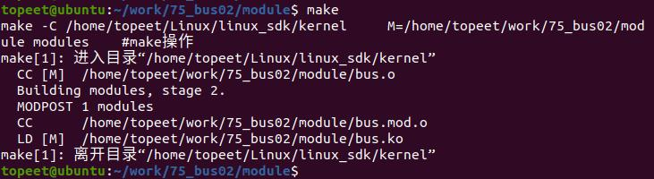
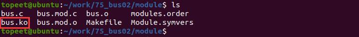

# 第101章 在总线目录下创建属性文件实验

在上个章节中，我们成功注册了一个自定义总线，本章节在上个实验的基础上，实现总线目录下创建属性文件。
## 101.1 总线下创建属性API 函数
bus_create_file()函数用于在总线的sysfs 目录下创建一个属性文件。函数原型如代码清单101.1 所示。代码清单101.1
```c
int bus_create_file(struct bus_type *bus, struct kobject *kobj, const struct attribute *attr);
```
函数详细介绍如下：函数参数bus：指向struct bus_type 的指针，表示要创建属性文件的总线。kobj：指向struct kobject 的指针，表示要在其下创建属性文件的内核对象。attr：指向struct attribute 的指针，表示要创建的属性文件的属性。返回值成功时返回0，否则返回负数错误代码。在调用bus_create_file()函数之前，需要先定义好属性结构体struct attribute，并将其相关字段填充好。通常，属性结构体会包含以下字段：.name：属性的名称。.mode：属性的访问权限。示例用法如代码清单101.2 所示。代码清单101.2
```c
struct bus_attribute mybus_attr = {
        .attr = {
            .name = "value",
            .mode = 0664,
        },
        .show = mybus_show,
};
ret = bus_create_file(&mybus, &mydevice.kobj, &mybus_attr.attr);
```
代码清单101.2 中创建了一个名为"value" 的属性文件，并指定了访问权限为0664。在创建属性文件时，还可以指定其他属性的回调函数，如.show、.store 等，以实现对属性值的读取和写入操作。

## 101.2 实验程序的编写
### 101.2.1 驱动程序编写
本实验代码存储在网盘iTOP-RK3568 开发板\07_学习教程配套资料\03_Linux 驱动配套资料\04_Linux 驱动例程\75_bus02\module 路径下。本实验定义了一个名为"mybus" 的总线，还定义了一个名为"value" 的属性文件。实验代码bus.c 如代码清单101.3 所示。代码清单101.3
```c
#include <linux/module.h>
#include <linux/init.h>
#include <linux/slab.h>
#include <linux/configfs.h>
#include <linux/kernel.h>
#include <linux/kobject.h>
#include <linux/device.h>
#include <linux/sysfs.h>
int mybus_match(struct device *dev, struct device_driver *drv)
{
        // 检查设备名称和驱动程序名称是否匹配
        return (strcmp(dev_name(dev), drv->name) == 0);
};
int mybus_probe(struct device *dev)
{
        struct device_driver *drv = dev->driver;
        if (drv->probe)
            drv->probe(dev);
        return 0;
};
struct bus_type mybus = {
        .name = "mybus",// 总线的名称
        .match = mybus_match,// 设备和驱动程序匹配的回调函数
        .probe = mybus_probe,// 设备探测的回调函数
};
ssize_t mybus_show(struct bus_type *bus, char *buf)
{
```

```c
return sprintf(buf, "%s\n", "mybus_show");
};
struct bus_attribute mybus_attr = {
.attr = {
    .name = "value",// 属性的名称
    .mode = 0664,// 属性的访问权限
},
.show = mybus_show,// 属性的show 回调函数
};
// 模块的初始化函数
static int bus_init(void)
{
int ret;
ret = bus_register(&mybus);// 注册总线
ret = bus_create_file(&mybus, &mybus_attr);// 在sysfs 中创建属性文件
return 0;
}
// 模块退出函数
static void bus_exit(void)
{
bus_remove_file(&mybus, &mybus_attr);// 从sysfs 中移除属性文件
bus_unregister(&mybus);// 取消注册总线
}
module_init(bus_init);// 指定模块的初始化函数
module_exit(bus_exit);// 指定模块的退出函数
MODULE_LICENSE("GPL");// 模块使用的许可证
MODULE_AUTHOR("topeet");// 模块的作者
```
## 101.3 运行测试
### 101.3.1 编译驱动程序
在和bus.c 的同一目录下创建Makefile 文件，如图101.1 所示。


图101.1Makefile 文件内容如代码清单101.4 所示。代码清单101.4
```c
export ARCH=arm64#设置平台架构
export CROSS_COMPILE=aarch64-linux-gnu-#交叉编译器前缀
obj-m += bus.o#此处要和你的驱动源文件同名
KDIR :=/home/topeet/Linux/linux_sdk/kernel#这里是你的内核目录
PWD ?= $(shell pwd)
all:
    make -C $(KDIR) M=$(PWD) modules#make 操作
clean:
    make -C $(KDIR) M=$(PWD) clean#make clean 操作
```
使用命令make 编译驱动程序，编译成功后如图101.2 所示：

图101.2编译完后会生成bus.ko 目标文件，如图101.3 所示：

图101.3
### 101.3.2 运行测试
将本章节编译好的bus.ko 驱动文件拷贝到开发板上。开发板启动之后，使用insmod bus.ko 命令进行驱动模块的加载，如下图101.4 所示：

图101.4驱动加载成功之后，进入/sys/bus 目录下，可以看到创建生成的总线mybus，如下图101.5所示，进到mybus 目录下，如果实验成功，可以看到创建属性文件value。

