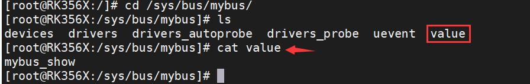

# 第102章 总线注册流程理论分析实验


图101.5实验成功后使用rmmod bus 命令进行驱动的卸载，如下图101.6 所示：

图101.6至此，在总线目录下创建属性文件实验就完成了。
在本章节中，我们将深入分析总线注册的流程，从代码的层面来理解总线的实现过程。在Linux 内核中，总线是连接设备和驱动的核心枢纽，负责管理设备的发现、驱动的匹配以及通信。总线的注册流程由bus_register()函数实现。bus_register()函数实现可分为5 个关键步骤。下面结合代码逐行分析。步骤一初始化准备，如代码清单102.1 所示。代码清单102.1
```c
int bus_register(struct bus_type *bus)
{
    int retval;
    struct subsys_private *priv;
    struct lock_class_key *key = &bus->lock_key;
    // 分配并初始化一个subsys_private 结构体，用于保存子系统的相关信息
    priv = kzalloc(sizeof(struct subsys_private), GFP_KERNEL);
    if (!priv)
    return -ENOMEM;
    priv->bus = bus;
    bus->p = priv;
    ...
}
```
代码清单102.1 中，subsys_private 是总线的内核私有数据结构，包含sysfs 属性，设备/驱动集合的kset 等关键成员。subsys_private 结构体如代码清单102.2 所示。代码清单102.2

```c
struct subsys_private {
    struct kset subsys;//总线子系统集合（管理sysfs 根目录）
    struct kset *devices_kset;//设备集合kset(对应/sys/bus/xxx/devices 目录)
    struct list_head interfaces;//接口链表
    struct mutex mutex;//互斥锁
    struct kset *drivers_kset; //驱动集合kset（对应/sys/bus/xxx/drivers 目录）
    struct klist klist_devices;//设备链表
    struct klist klist_drivers;//驱动链表
    struct blocking_notifier_head bus_notifier;//总线通知头
    unsigned int drivers_autoprobe:1;
    struct bus_type *bus;//关联的上层总线类型结构体
    struct kset glue_dirs;
    struct class *class;//设备类指针
};
```
代码清单102.1 第7 行到13 行通过kzalloc 分配内存并初始化后，将其与bus_type 双向绑定。步骤二初始化总线的子系统，如代码清单102.3 所示。代码清单102.3
```c
int bus_register(struct bus_type *bus)
{
     ...
    // 设置子系统的kset 和ktype
    priv->subsys.kobj.kset = bus_kset;//bus_kset
    priv->subsys.kobj.ktype = &bus_ktype;
    priv->drivers_autoprobe = 1;
    // 注册子系统到内核
    retval = kset_register(&priv->subsys);
    if (retval)
    goto out;
    ...
}
```
步骤三创建驱动和设备的kset 集合，如代码清单102.4 所示。代码清单102.4
```c
int bus_register(struct bus_type *bus)
{
     ...
    // 创建并添加"devices" 子目录的kset（对应/sys/bus/<bus>/drivers）
    priv->devices_kset = kset_create_and_add("devices", NULL, &priv->subsys.kobj);
    if (!priv->devices_kset) {
      retval = -ENOMEM;
```

```c
goto bus_devices_fail;
}
// 创建并添加"drivers" 子目录的kset（对应/sys/bus/<bus>/devices）
priv->drivers_kset = kset_create_and_add("drivers", NULL, &priv->subsys.kobj);
if (!priv->drivers_kset) {
retval = -ENOMEM;
goto bus_drivers_fail;
}
...
}
```
步骤四初始化设备与驱动的链表，如代码清单102.5 所示。代码清单102.5
```c
int bus_register(struct bus_type *bus)
{
    ...
    klist_init(&priv->klist_devices, klist_devices_get, klist_devices_put);
    klist_init(&priv->klist_drivers, NULL, NULL);
    ...
}
```
步骤五注册总线到全局列表，并创建属性文件，如代码清单102.6 所示。代码清单102.6
```c
int bus_register(struct bus_type *bus)
{
    ...
    // 添加总线的属性组
    retval = bus_add_groups(bus, bus->bus_groups);
    if (retval)
    goto bus_groups_fail;
    // 打印调试信息，表示总线注册成功
    pr_debug("bus: '%s': registered\n", bus->name);
    return 0;
```
}至此，总线注册流程分析完毕。

