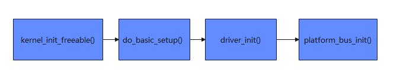

# 第103章  platform总线注册流程实例分析实验

本章节分析platform 总线注册流程。内核在初始化的过程中调用platform_bus_init()函数来初始化平台总线，调用流程如下图103.1 所示：

图103.1我们直接分析platform_bus_init()函数。platform_bus_init 函数实现如代码清单103.1 所示。代码清单103.1
```c
int __init platform_bus_init(void)
{
    int error;
    early_platform_cleanup();// 提前清理平台总线相关资源
    error = device_register(&platform_bus);// 注册平台总线设备
    if (error) {
        put_device(&platform_bus);// 注册失败，释放平台总线设备
        return error;
    }
    error = bus_register(&platform_bus_type);// 注册平台总线类型
    if (error) {
        device_unregister(&platform_bus);// 注册失败，注销平台总线设备
        return error;
    }
    of_platform_register_reconfig_notifier();// 注册平台重新配置的通知器
    return error;
}
```
代码清单103.1 中第7 行代码device_register(platform_bus_type) 注册平台总线设备，将platform_bus 结构体注册到设备子系统中。第13 行使用bus_register(&platform_bus_type)函数

注册平台总线类型，将platform_bus_type 结构体注册到总线子系统中。platform_bus_type 结构体如代码清单103.2 所示：代码清单103.2
```c
struct bus_type platform_bus_type = {
    .name= "platform",//指定平台总线类型的名称是platform
    .dev_groups= platform_dev_groups,
    .match= platform_match,
    .uevent= platform_uevent,
    .dma_configure= platform_dma_configure,
    .pm= &platform_dev_pm_ops,
};
```
在代码清单103.2 第4 行代码中，platform_match 是Linux 内核中平台总线的设备与驱动匹配函数，用于判断一个平台设备(platform_device)与平台驱动(platform_driver)是否兼容。platform_match()函数实现，如代码清单103.3 所示，代码清单103.3
```c
static int platform_match(struct device *dev, struct device_driver *drv)
{
    struct platform_device *pdev = to_platform_device(dev);
    struct platform_driver *pdrv = to_platform_driver(drv);
    /* When driver_override is set, only bind to the matching driver */
    if (pdev->driver_override)
        return !strcmp(pdev->driver_override, drv->name);
    /* Attempt an OF style match first */
    if (of_driver_match_device(dev, drv))
        return 1;
    /* Then try ACPI style match */
    if (acpi_driver_match_device(dev, drv))
        return 1;
    /* Then try to match against the id table */
    if (pdrv->id_table)
        return platform_match_id(pdrv->id_table, pdev) != NULL;
    /* fall-back to driver name match */
    return (strcmp(pdev->name, drv->name) == 0);
}
```
在代码清单103.3 第3-4 行代码通过to_platform_device 和to_platform_driver 宏，将通用的device 和driver 结构体转换为平台总线特有的platform_device 和platform_driver，以便访问平

台设备/驱动的私有字段（如driver_override、id_table）。第7-8 行表示如果设备的driver_override字段非空，则直接比较driver_override 与驱动名(drv->name) 。第11-12 行表示调用of_driver_match_device(dev, drv)函数，检查设备树中设备的compatible 属性是否和驱动支持的兼容列表(drv->of_match_table)匹配，这种匹配方式是系统中最常用的匹配方式。第15 行代码调用acpi_driver_match_device(dev, drv)函数，检查设备的硬件ID 是否和驱动支持的ID 列表(drv->acpi_match_table) 匹配。第19-20 行代码表示如果驱动定义了id_table ，则调用platform_match_id()函数检查设备是否在该列表中。第23 行代码表示如果上面的匹配均失败的话，最终比较设备名(pdev->name)与驱动名(drv->name),名称完全一致则匹配成功。通过上述分析，我们认识到platform_match() 函数通过多种优先级匹配方式（of_match_table>id_table>name），确保平台设备能在不同场景下正确找到对应的驱动。至此，platform 总线注册流程分析完毕。

